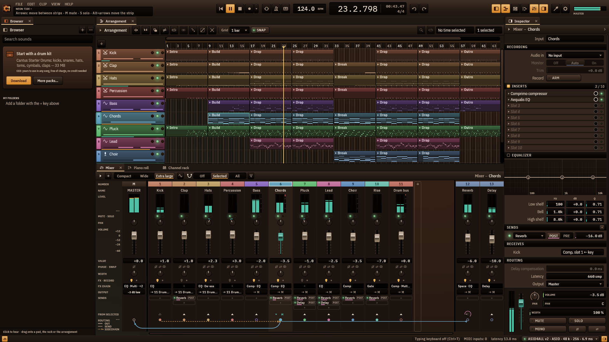
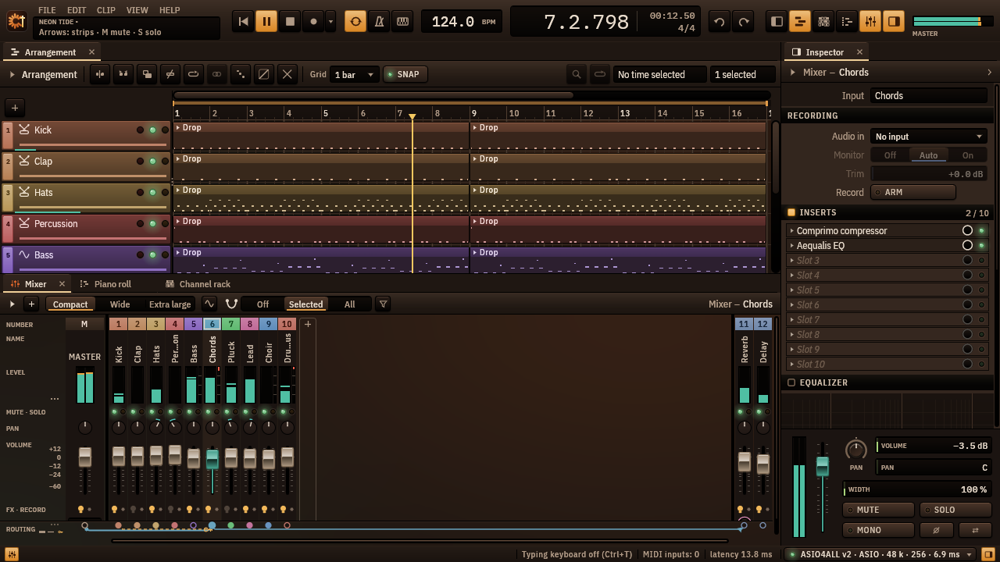
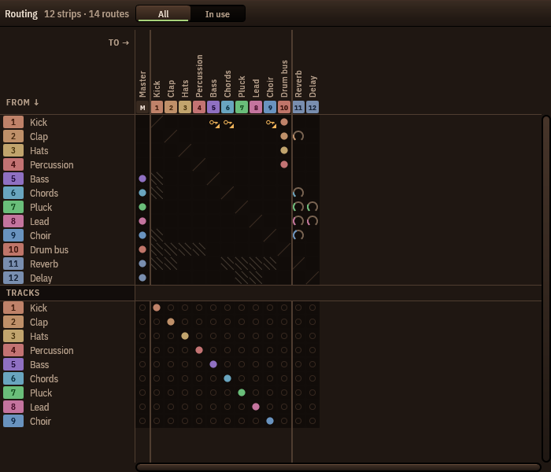
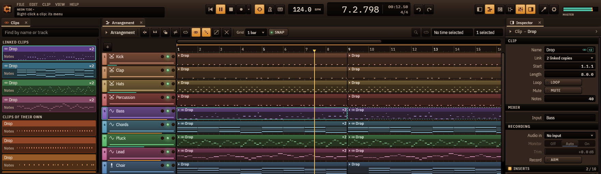
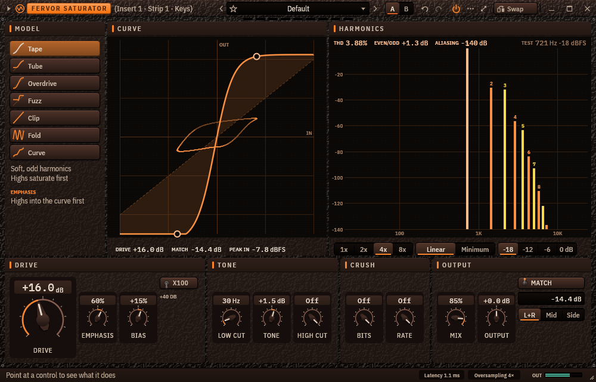
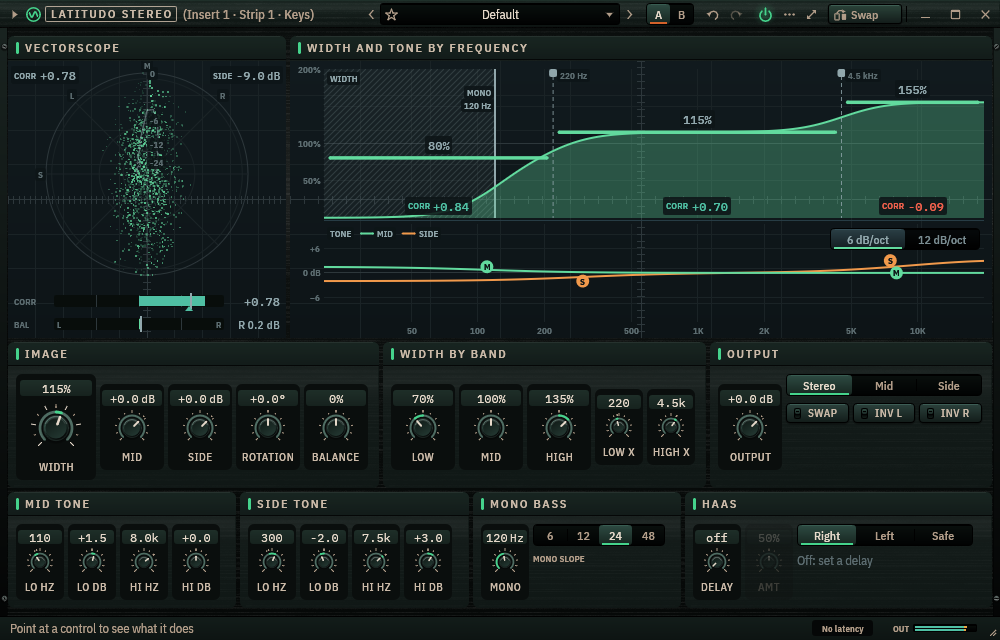
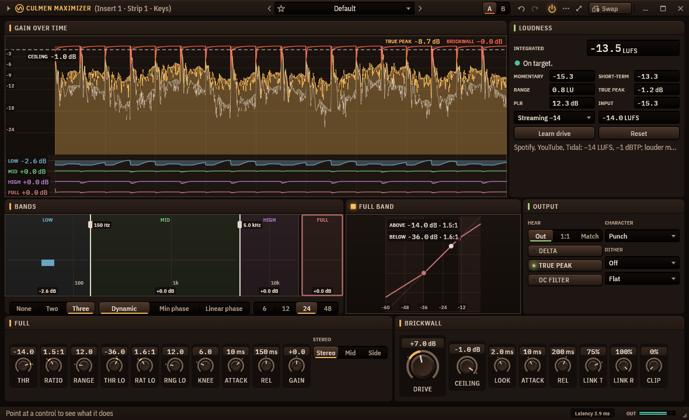
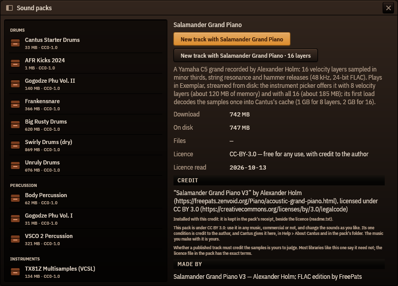
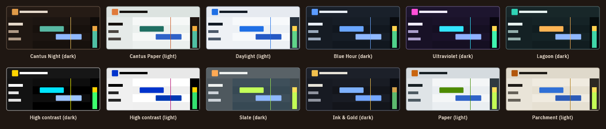
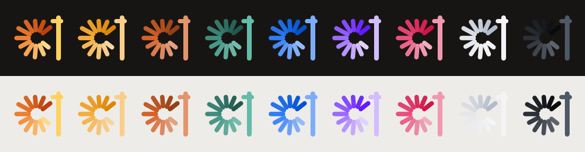

<p align="center">
  
</p>

<h1 align="center">Cantus™</h1>

<p align="center">
  A free, open-source digital audio workstation, written in Rust and drawn by hand.<br>
  Created by <b>Luis Ángel Almazán</b> · <a href="https://lalmazan.com">lalmazan.com</a>
</p>

<p align="center">
  
</p>

> *"Whatever you do, work at it with all your heart."* — Colossians 3:23

Cantus takes its name from the *cantus firmus*: the fixed melody on which polyphony is built.
The engine is that fixed line — deterministic, sample-accurate, allocation-free — and
everything else is built on top of it. The full vision lives in [idea.md](idea.md); the
decisions that shape the code live in [docs/adr/](docs/adr/); where the project stands right
now is in [docs/STATUS.md](docs/STATUS.md).

## Highlights

- **A look drawn by hand, FL Studio first** (ADR 0024). Every knob, fader, meter, slot and
  window frame is painted by Cantus's own vector kit, crisp at any zoom from 75 % to 200 %
  and on 4K. Twelve themes, **Cantus Night** by default; the taskbar icon is the Cantus
  mark, in the colour you choose.
- **An FL-style mixer with cables.** Drag from a strip's port to another strip (a send, the
  only output with Ctrl, a sidechain key with Alt), pre- or post-fader sends, a routing
  matrix (Alt+F9), submixes, groups and a per-channel sheet in the inspector.
- **Linked clips and a clip browser.** A copied pattern stays the same clip until you make
  it unique; the clip browser (Alt+F5) shows every clip as a tile to drag in or paint with
  (B), as in FL's playlist.
- **Twelve effects and nine instruments of its own**, researched against the best on the
  market and measured — plus free sound packs, among them the **Salamander Grand Piano**,
  streamed from disk.
- **Works with the market's DAWs.** Hosts **CLAP and VST3** plug-ins; ships its own effects as
  **CLAP/VST3** for any other DAW, bit-identical to the native ones; **MIDI files**, **stems**
  and **DAWproject** in and out.
- **Fast, and tested to stay fast.** An audio thread that never allocates, nothing redrawn
  when nothing moves, and 2 000+ tests — null tests that hold offline renders bit-identical
  to playback, golden images that hold the look, and a frame budget that fails the build
  when the UI gets slow.

## A tour

Every picture here is the program itself, drawn headless on its demo song by
`cargo run --release -p cantus-ui --example shoot_readme` ([how](docs/DEVELOPING.md#3-build-and-run)).

### The workspace

Panels dock, split, float and remember their size. F5 / F6 / F7 / F9 bring up the
arrangement, channel rack, piano roll and mixer, Alt+F8 the sample browser, I the
inspector; the hint bar names whatever is under the pointer. English and Spanish, and
names in any script.

| Cantus Night (dark, the default) | Cantus Paper (light) |
|---|---|
|  |  |

### Mixer, cables and routing

<p>
  
  
</p>

The desk follows FL's strip: a colour number, the name, meter, mute and solo, pan, fader,
phase and swap, the effect chain, the output and the sends — rows that line up across the
desk, named once in a legend column. Under it, **cables**: drag from a strip's port to
another, or click one and then the other; each send taps before or after the fader. The
inspector shows the selected channel as a signal-flow sheet: inserts, the channel EQ you
drag, sends, receives and routing, with the channel's own fader at the bottom.

<p>
  
</p>

The **routing matrix** (Alt+F9) shows every source against every destination: click a cell
to route, drag for the level.

### Arrangement, linked clips, piano roll, channel rack



Duplicate a clip, paste it or Alt-drag it and the copy is **the same clip**: edit one and
every copy follows, until *Make unique* (Alt+U). *Link to…* (Alt+N) makes a clip become
another; the inspector's *Link* row counts the copies. The **clip browser** (Alt+F5) lists
every clip as a tile — drag one onto the arrangement, or click it and paint copies along a
track with the **paint tool** (B).

| | |
|---|---|
|  |  |

The piano roll has FL's seven tools and a velocity lane, and holds 20 000 notes on screen
within its frame budget; in the channel rack a step *is* a note.

### Effects

| | | |
|---|---|---|
|  **Aequalis** — 24-band EQ, zero-latency, natural and linear phase, dynamic bands, EQ match |  **Comprimo** — compressor with nine visible detectors, key EQ, auto gain |  **Terminus** — true-peak limiter, BS.1770 loudness, delivery profiles |
|  **Spatium** — reverb with decay fitted per frequency and shown in seconds |  **Multiplex** — eight two-sided bands, three crossover modes |  **Sibilus** — a de-esser that tells an *s* from a bright sound |
|  **Porta** — gate and expander with hysteresis, MIDI trigger and hits to MIDI |  **Fervor** — saturation with a curve you draw |  **Latitudo** — stereo width by frequency, mono bass, mid/side tone |
|  **Culmen** — mastering maximizer with loudness targets and *learn drive* |  **Any CLAP or VST3** — with a generic editor or its own window | Plus **Delay** and **Reverb**, simple and light. |

Every effect is a bit-exact wire at settings that do nothing, and any strip can key any of
them. Fervor, Latitudo and Culmen make the master chain a mastering chain. Design notes
and feature matrices: [docs/plugins/](docs/plugins/).

### Instruments

| | | | |
|---|---|---|---|
|  **Unda** — wavetable |  **Calor** — analog modelling |  **Modulus** — 8-operator FM |  **Exemplar** — multisampler, here playing the Salamander Grand Piano |
|  **Gravis** — 808, synth and string bass |  **Organum** — tonewheel organ |  **Lamina** — electric piano |  **Pulsus II** — drums |

They share one modulation model — eight macros and a matrix you connect by dragging a
source onto a knob — one frame (Play · Edit · Matrix), and the project's undo. Firmus, the
simple synth every new track starts with, makes nine.

### Sounds

<p>
  
</p>

Free sound packs download on demand from *Sound packs…* — kits, percussion, a TX81Z and the
**Salamander Grand Piano** (a Yamaha C5 in 16 velocity layers), which plays in Exemplar,
streamed from disk through a sample cache. Packs are CC0, or CC BY with the credit shown on
the pack's page and in *Help ▸ Credits*; the music you make with them is yours.

### Make it yours

<p>
  
  
</p>

Dark, light or follow the system; hue, saturation, brightness, contrast, depth, roundness,
density and text size; every colour role named, searchable and resettable — or click any
element of the interface and recolour it on the spot. The taskbar icon is the Cantus mark,
in its own colours or one of eight others, changed live:

<p>
  
</p>

## Everything it does

<details>
<summary>The full list, area by area</summary>

**Engine.** Real-time audio on WASAPI / CoreAudio / ALSA through `cpal`, with an audio thread
that never allocates, locks or panics (ADR 0005). Offline WAV export bit-identical to
playback. Plug-in delay compensation per routing edge (ADR 0018); the playhead and recording
follow what is heard; a bypassed latent effect keeps its latency (ADR 0022). A recorder on
every strip and the master.

**Instruments** (ADR 0023). Unda (wavetable, additive and granular; imports Serum and Surge
tables), Calor (five self-oscillating zero-delay filters, seeded voice cards), Modulus
(8-operator FM that reads and writes DX7 SysEx), Exemplar (SFZ, Decent Sampler, SF2/SF3,
WAV/AIFF/FLAC/Ogg), Gravis (808, 303-style and string bass), Organum (tonewheels and rotary
speaker), Lamina (tine and reed electric piano), Pulsus II (layers, round robin, 808/909 and
modal voices, 16 choke groups), plus Firmus, the built-in polysynth.

**Editing.** Arrangement with per-track heights, icons, time selection and clip editing
(split, glue, trim, slip, repeat, per-clip mute, colour and name); linked clips, the clip
browser and its paint tool (ADR 0037); copy and paste between projects (ADR 0036). Piano
roll with FL-style tools, clipboard, quantize, slicing and a velocity lane. A channel rack
where a step *is* a note. MIDI recording with one undo step per take; the computer keyboard as a MIDI
controller; hardware MIDI in.

**Mixer** (ADRs 0014–0016, 0041–0045). Strips, buses, sends before or after the fader,
cables drawn under the desk, the routing matrix, solo with connected routes, a three-band
channel EQ, a dry/wet per insert slot, ten slots per strip, multi-selection with ganged
faders, submixes, docks, groups with colours, a pan law per project, width and polarity.

**Effects** (ADRs 0017–0018, 0026). The twelve above, each with presets, A/B, a display that
is the control, and design notes in `docs/plugins/`.

**Sounds** (ADRs 0030, 0042, 0050). Sound packs downloaded on demand and checked by SHA-256,
CC0 or CC BY with credit; long samples streamed from disk through a sample cache.

**Standards** (ADRs 0019–0021). CLAP and VST3 hosting with a crash-proof scanner; our effects
as CLAP/VST3 (`crates/cantus-plugins`); MIDI files, stems and DAWproject.

**Project.** One command bus for every change, with unlimited undo/redo and an audit log
(ADR 0004). Versioned JSON projects with SHA-256 integrity, schema migrations, atomic saves
and autosave (ADR 0006).

**Interface** (ADRs 0007, 0009, 0010, 0024, 0046). English and Spanish, names in any script;
every shortcut rebindable in `keymap.toml`, with presets modelled on FL Studio, Ableton Live
and Bitwig; named layouts; twelve themes and the appearance settings above; one text field
everywhere (Enter or a click elsewhere keeps what you typed, Esc puts it back).

</details>

## Build and run

```
cargo run --release -p cantus                     # build and open Cantus
cargo run --release -p cantus -- --locale es      # in Spanish
cargo run --release -p cantus -- song.cantus      # open a project
cargo run --release -p cantus -- --stress         # 160 000-note stress project
```

**A standalone `.exe`:**

```
cargo build --release -p cantus
```

It is written to `target\release\cantus.exe`, with the Cantus icon; fonts, logos and themes
are inside it, so the file can be copied anywhere and run.

**Our effects as plug-ins for other DAWs:**

```
cargo run -p xtask -- bundle          # target/bundled/Cantus <Name>.clap and .vst3
cargo run -p xtask -- bundle --v3     # a build for modern CPUs (AVX2), 15–25 % faster
```

Copy the `.clap` files to `%LOCALAPPDATA%\Programs\Common\CLAP` and the `.vst3` bundles to
`%LOCALAPPDATA%\Programs\Common\VST3`, then rescan in your DAW.

Requires stable Rust 1.95 or newer. No system libraries are needed on Windows or macOS; on
Linux install `libasound2-dev` (and `libxkbcommon-dev`, `libwayland-dev` for the window).

## Tests

```
cargo test --workspace                          # unit, property, null, golden-image and budget tests
cargo test -p cantus-engine -- --ignored        # real-device smoke test
cargo clippy --workspace --all-targets
```

The null tests in `crates/cantus-engine/tests/null_tests.rs` are the project's most important
guardrail: they fail if the engine ever produces different output for different block sizes,
or if a render stops matching playback, and they hold the line that a control at its default
must not touch a sample. The kit's golden images (`crates/cantus-ui/tests/golden/`) hold the
look, and `tests/frame_budget.rs` holds the speed.

## Layout

| Crate | License | Purpose |
|---|---|---|
| `cantus-core` | MPL-2.0 | musical time, project model, commands, undo/redo, snapshots |
| `cantus-dsp` | MPL-2.0 | every instrument's and effect's DSP, null-test harness |
| `cantus-engine` | MPL-2.0 | audio thread, transport, mixer graph, delay compensation, offline render |
| `cantus-project` | MPL-2.0 | project file format, migrations, MIDI files, DAWproject |
| `cantus-host` | GPL-3.0-or-later | hosting CLAP and VST3 plug-ins |
| `cantus-plugins` | GPL-3.0-or-later | Cantus's effects as CLAP and VST3 |
| `cantus-ai` | GPL-3.0-or-later | `AiProvider` trait, tool specs, command bridge |
| `cantus-ui` | GPL-3.0-or-later | the interface, its design system and the hand-drawn kit |
| `cantus` | GPL-3.0-or-later | the binary |

The engine crates (and `cantus-rt`) are MPL-2.0: whoever distributes a modified file
must publish it, while the engine can still be used unchanged inside other programs. The
application is GPL-3.0-or-later, and the program as distributed is one combined work under
it. See [ADR 0001](docs/adr/0001-license.md) and [ADR 0047](docs/adr/0047-licensing-revised.md);
contributing: [CONTRIBUTING.md](CONTRIBUTING.md) and the [CLA](CLA.md); the name and
logos: [TRADEMARKS.md](TRADEMARKS.md). The bundled fonts
(IBM Plex Sans, Sans Condensed and Mono, in `crates/cantus-ui/assets/fonts/`) are licensed
under the [SIL Open Font License 1.1](crates/cantus-ui/assets/fonts/LICENSE-OFL.txt) and
shipped unmodified — "IBM Plex" is a Reserved Font Name.

## Support

Cantus is free and stays free; everyone gets the same program, whatever they give, or
nothing at all. If it helps you make music, you can help keep it growing:
[Ko-fi](https://ko-fi.com/luisalmazan314159) ·
[Buy Me a Coffee](https://buymeacoffee.com/angel314159) ·
[Liberapay](https://liberapay.com/lalmazan). Donations unlock nothing; the best help is
still to make a song and [tell us](https://github.com/luis314159/cantus-daw/issues) what
got in your way.

## Author

Cantus is designed and built by **Luis Ángel Almazán** — [lalmazan.com](https://lalmazan.com).
The logos are his own designs.
