<p align="center">
  
</p>

<h1 align="center">Cantus™</h1>

<p align="center">
  A free, open-source digital audio workstation, written in Rust and drawn by hand.<br>
  Created by <b>Luis Ángel Almazán</b> · <a href="https://lalmazan.com">lalmazan.com</a>
</p>

<p align="center">
  
</p>

> *"Whatever you do, work at it with all your heart."* — Colossians 3:23

Cantus takes its name from the *cantus firmus*: the fixed melody on which polyphony is built.
The engine is that fixed line — deterministic, sample-accurate, allocation-free — and
everything else is built on top of it. The full vision lives in [idea.md](idea.md); the
decisions that shape the code live in [docs/adr/](docs/adr/); where the project stands right
now is in [docs/STATUS.md](docs/STATUS.md).

## Highlights

- **A look drawn by hand, FL Studio first** (ADR 0024). Every knob, fader, meter, slot and
  window frame is painted by Cantus's own vector kit, crisp at any zoom from 75 % to 200 %
  and on 4K. Twelve themes, **Cantus Night** by default; the taskbar icon is the Cantus
  mark, in the colour you choose.
- **An FL-style mixer with cables.** Drag from a strip's port to another strip (a send, the
  only output with Ctrl, a sidechain key with Alt), pre- or post-fader sends, a routing
  matrix (Alt+F9), submixes, groups and a per-channel sheet in the inspector.
- **Linked clips and a clip browser.** A copied pattern stays the same clip until you make
  it unique; the clip browser (Alt+F5) shows every clip as a tile to drag in or paint with
  (B), as in FL's playlist.
- **Twenty-five effects and ten instruments of its own**, researched against the best on
  the market and measured — plus free sound packs, among them the **Salamander Grand
  Piano**, streamed from disk.
- **Each unit wears its own face** (ADR 0074): its colour, material, controls and the
  display that tells its story, drawn in vectors in light and dark themes. The CLAP and
  VST3 versions wear the same face in any DAW; *Units wear their own faces* switches back
  to the plain look.
- **The score from the piano roll** (ADR 0075). A clip or a track as an engraved staff —
  spelled in the song's key, beamed and tied as an engraver would — beside the piano roll
  or in a pane of its own; edit on the staff, export **MusicXML** and vector **PDF**, print.
- **A session view, in sync, with per-note expression** (ADRs 0076–0080). Live's clip
  grid beside the arrangement (Tab), played from the keyboard, the mouse, MIDI learn or a
  Launchpad or APC; **Ableton Link**, **MIDI clock** and **MTC** in and out; **MPE** from the
  controller to the piano roll's per-note lanes and the instruments.
- **AI that works with you, on your computer** (ADRs 0081–0086). Claude and the other
  assistants drive Cantus through **MCP**, every change one undo step and edits asked
  first; **stem separation** and **audio to MIDI** by models downloaded from their makers
  when you ask; a **mastering assistant** that proposes a chain of our own effects per
  platform.
- **Works with the market's DAWs.** Hosts **CLAP and VST3** plug-ins; ships its own effects as
  **CLAP/VST3** for any other DAW, bit-identical to the native ones; **MIDI files**, **stems**
  and **DAWproject** in and out.
- **Fast, and tested to stay fast.** An audio thread that never allocates, nothing redrawn
  when nothing moves, and 2 000+ tests — null tests that hold offline renders bit-identical
  to playback, golden images that hold the look, and a frame budget that fails the build
  when the UI gets slow.

## A tour

Every picture here is the program itself, drawn headless on its demo song by
`cargo run --release -p cantus-ui --example shoot_readme` ([how](docs/DEVELOPING.md#3-build-and-run));
the session view's, sync's and MPE's by `shoot_session`, `shoot_sync` and `shoot_mpe`;
the AI pictures by `shoot_ai`, `shoot_mastering`, `shoot_stems` and `shoot_transcribe`.

### The workspace

Panels dock, split, float and remember their size. F5 / F6 / F7 / F9 bring up the
arrangement, channel rack, piano roll and mixer, Alt+F8 the sample browser, I the
inspector; the hint bar names whatever is under the pointer. English and Spanish, and
names in any script.

| Cantus Night (dark, the default) | Cantus Paper (light) |
|---|---|
|  |  |

### Mixer, cables and routing

<p>
  
  
</p>

The desk follows FL's strip: a colour number, the name, meter, mute and solo, pan, fader,
phase and swap, the effect chain, the output and the sends — rows that line up across the
desk, named once in a legend column. Under it, **cables**: drag from a strip's port to
another, or click one and then the other; each send taps before or after the fader. The
inspector shows the selected channel as a signal-flow sheet: inserts, the channel EQ you
drag, sends, receives and routing, with the channel's own fader at the bottom.

<p>
  
</p>

The **routing matrix** (Alt+F9) shows every source against every destination: click a cell
to route, drag for the level.

### Arrangement, linked clips, piano roll, channel rack


Duplicate a clip, paste it or Alt-drag it and the copy is **the same clip**: edit one and
every copy follows, until *Make unique* (Alt+U). *Link to…* (Alt+N) makes a clip become
another; the inspector's *Link* row counts the copies. The **clip browser** (Alt+F5) lists
every clip as a tile — drag one onto the arrangement, or click it and paint copies along a
track with the **paint tool** (B).

| | |
|---|---|
|  |  |

The piano roll has FL's seven tools and a velocity lane, and holds 20 000 notes on screen
within its frame budget; in the channel rack a step *is* a note.

### The score

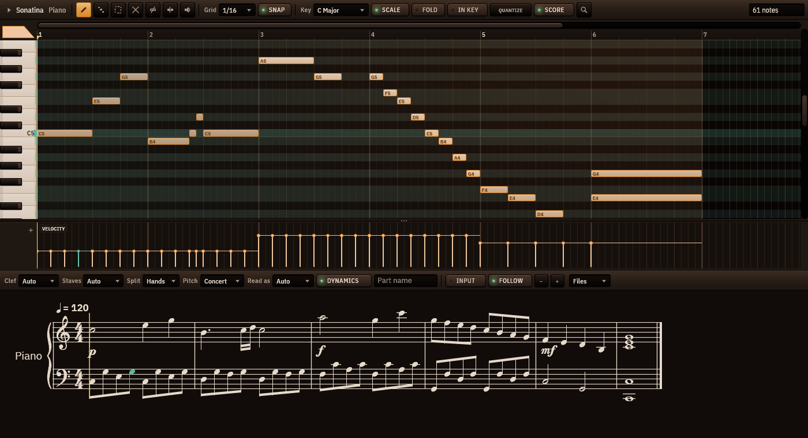

**Score** in the piano roll's toolbar (Alt+S) puts the clip's part under the roll as an
engraved staff that follows the playhead and shares the selection; the **Score** pane
(Alt+Shift+S) shows a whole track in systems. The notes are read for the score only — each
beat picks straight values or triplets — and written as Dorico or MuseScore would: ties
that show the beat, beams by the metre, a grand staff whose split follows the hands,
accidentals and courtesy accidentals in the song's key, tempo and metre changes, dynamics
from velocity, 8va lines, in the SMuFL font Bravura.

| The Score pane (Cantus Paper) | A printed page (A4) |
|---|---|
| 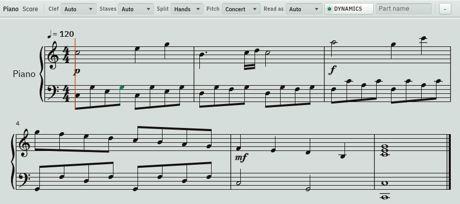 | 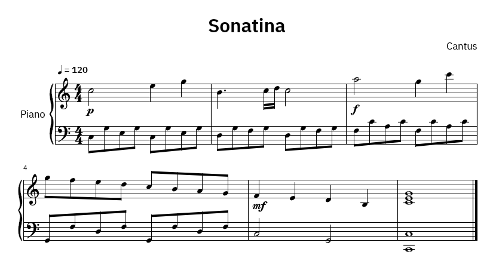 |

Click a note to select it; ↑ ↓ move it a step of the key; **N** enters notes by letter and
value, as in MuseScore — each edit one undo step. Per track: clef, one staff or two,
transposition (B♭, E♭, F…), the reading grid, the part's name. **MusicXML 4.0** out (a part
or the whole song) and in, vector **PDF** (A4 or Letter, fonts embedded), **Print**.

### The session view, Link and MPE

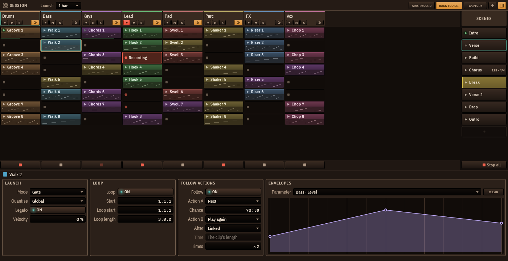

**Tab** puts the **Session** pane in front of the arrangement and back. Each track has a
column of slots, each scene a row; launch a clip or a scene on the next bar (or the clip's
own quantise), hold it as a gate, record into an armed track's empty slot. A clip's panel
sets its launch, loop, **follow actions** (two, with a chance and a count, as in Live 12)
and **envelopes**; a scene can set the tempo and the metre. *Capture* copies what plays into
a new scene; *Arr. record* writes the launches into the arrangement as you play them; *Back
to arr.* hands every track back to it. Enter, the arrows and the clipboard work on the grid;
a pad, a key or a note learnt on a slot or a scene launches it.

| Cantus Paper | A Launchpad's ring |
|---|---|
| 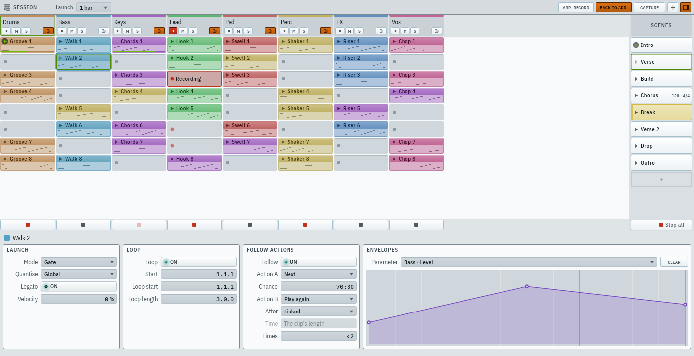 | 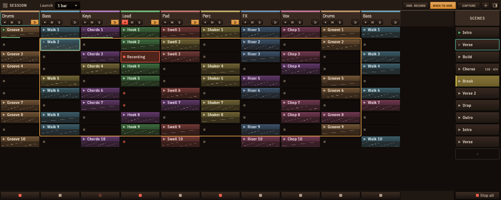 |

A **Launchpad** (Mini MK3, X, Pro MK3) or an **APC** (mini mk2, APC40 mkII) is found when
it is plugged in: the pads launch and light in the clips' colours — green while playing,
flashing while queued, red while recording — and the arrows move the ring the grid shows.

<p>
  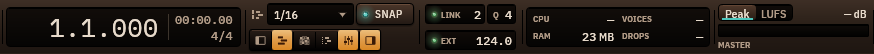
</p>

**Ableton Link** is built in (a Rust implementation, wire-compatible with the SDK): turn on
LINK and the tempo, the beat and start/stop are shared with Live and every Link app on the
network, the peers counted in the top bar. Cantus follows **MIDI clock** or **MIDI time
code** from a port, or sends them, each output with its own offset.

<p>
  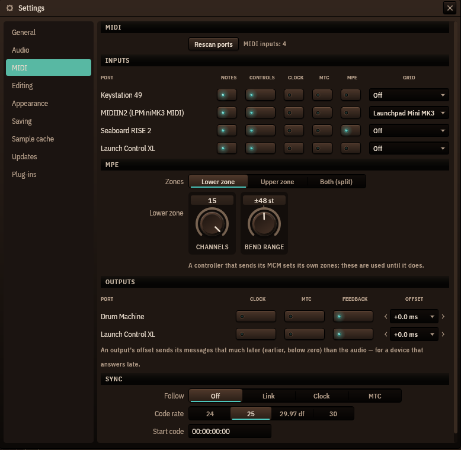
  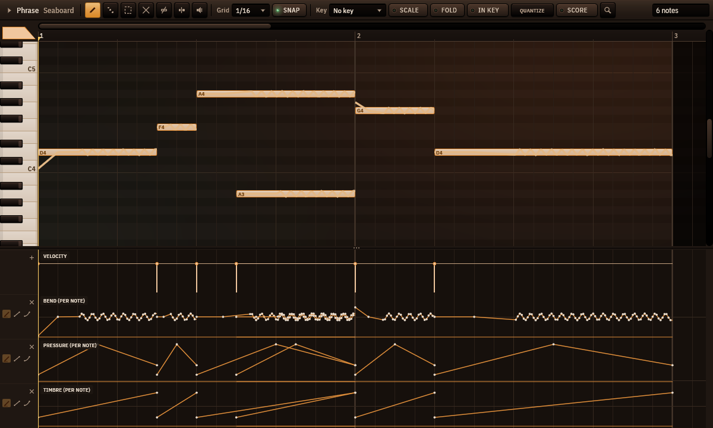
</p>

Settings ▸ MIDI sets each port in one row: notes, controls, clock, time code, **MPE** and
the grid. A port marked MPE plays and records **per-note expression** — bend, pressure and
timbre — kept on each note and edited in the piano roll's lanes; Unda, Calor, Modulus and
Gravis play it, and an MPE plug-in gets it as note expressions or as MPE MIDI.

### AI that works with you — agents, stems, audio to MIDI, mastering

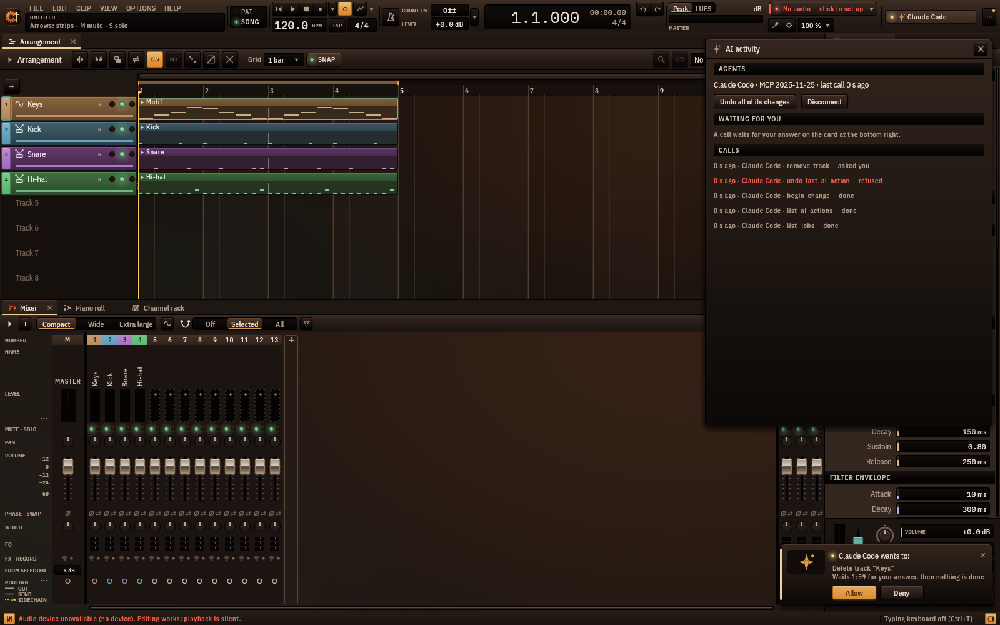

The assistant you already use — **Claude Code, Claude Desktop, Cursor, VS Code, Gemini CLI,
LM Studio** — can work in Cantus through the **Model Context Protocol**. It brings its model;
Cantus brings about sixty tools made for music: tracks, notes and chords, the mixer, effects
and instruments in their own units, automation, the session, export — and a catalogue of
every unit, a **music linter** that finds a note ringing across a chord change, and writers
that turn a chord chart into a part (`write_part`, `voice_chords`, `pedal_from_chart`).
**Every change is one step of the undo history**, named *AI: …*; edits ask first on a card,
and removing your material, undoing and files always ask. The agent chip in the top bar
opens the **AI activity**: every call, *Undo all of its changes*, *Disconnect*.

<p>
  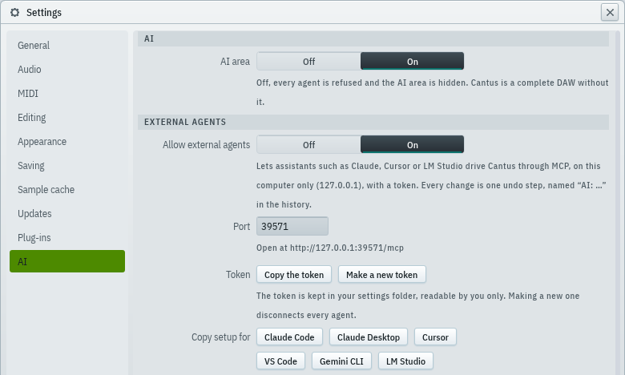
  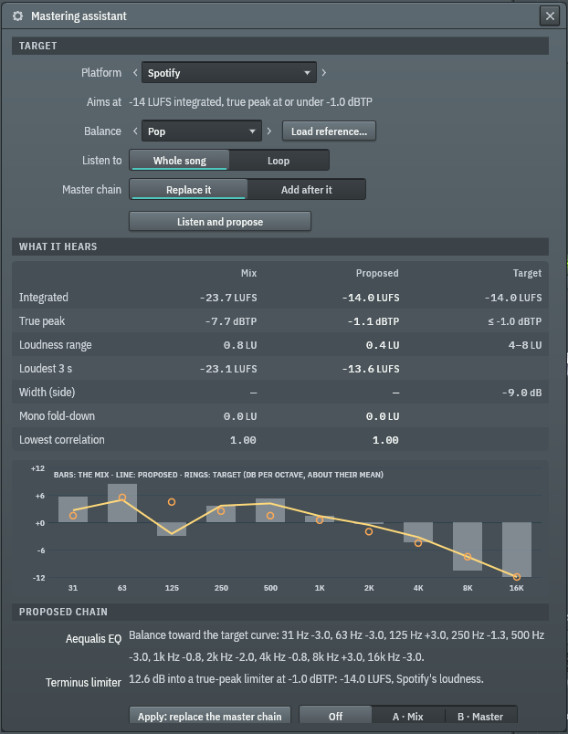
</p>

**Settings ▸ AI** holds one switch for the whole area; external agents are **off** until you
allow them, and then reach a door on `127.0.0.1` only, with a token per client — *Copy
setup for…* gives each client its lines. An agent can **listen**: `audition` answers with
loudness per section, true peak, the spectrum against a genre's curve and a WAV, and after
an edit near the end renders only the end — from a checkpoint, identical to the whole song
to the sample. The **mastering assistant** on the master proposes a chain of Cantus's own
effects for Spotify, Apple Music, YouTube, TIDAL, Amazon Music, SoundCloud, CD, Club or
EBU R 128, says why each setting is there, compares by A/B at the same loudness and applies
in one undo step (on the demo songs: within 0.07 LU of the target, never over the ceiling).

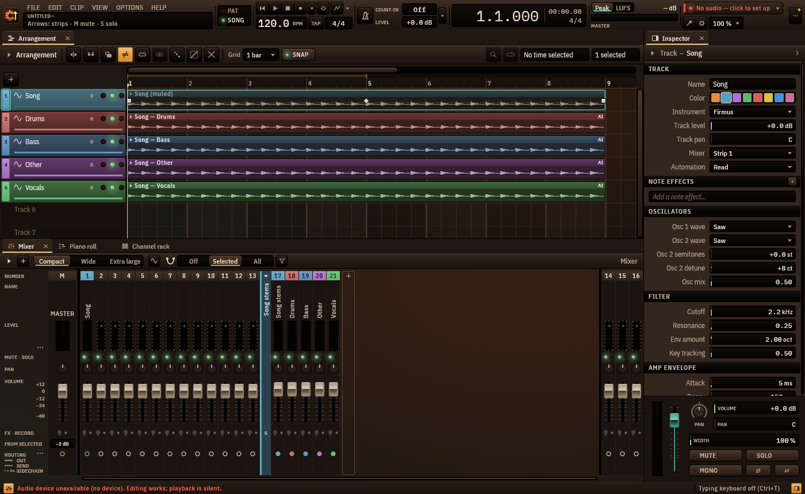

**Separate stems…** splits a clip into drums, bass, vocals and the rest (or six parts) with
Meta's **HT-Demucs**, in a helper process on your computer through ONNX Runtime — the parts
on their own tracks under a bus, level-true to the original, in one undo step. Measured on
MUSDB18-HQ: **8.80 dB SDR**, the paper's own numbers. **Convert to MIDI…** writes what a
clip plays as notes: a melody by Cantus's pitch tracker, chords by Spotify's **Basic Pitch**
(note for note what Spotify's program gives), drums by Cantus's own detector and Magenta's
drum model.

<p>
  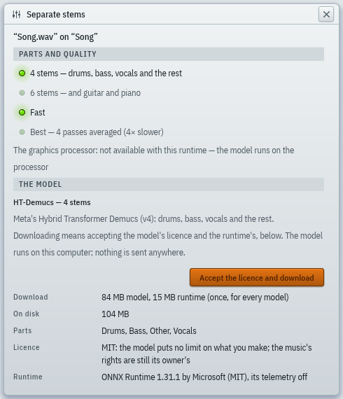
  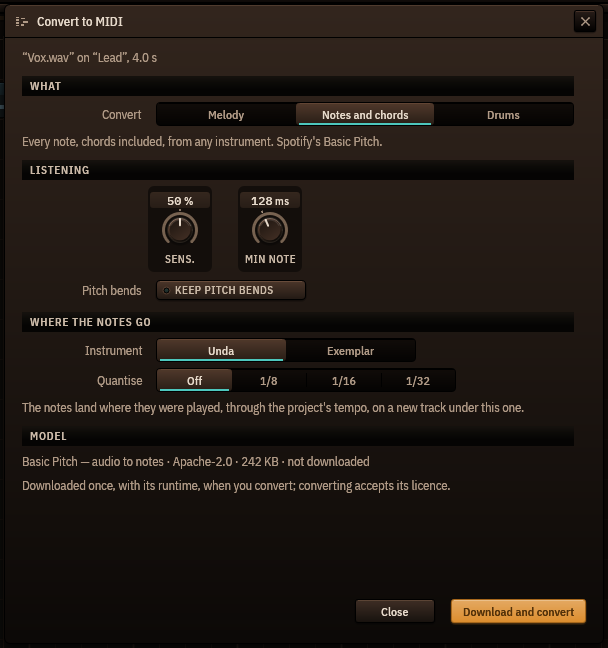
</p>

Models are never in the installer: each is downloaded from its maker the first time, after
you see its licence, size and origin, checked by SHA-256 and removable in Settings ▸ Models.

### Effects

Each one in its own face — colour, material, controls and the display that tells what it
does. *Settings ▸ Appearance ▸ Units wear their own faces* switches to the plain look;
the exported CLAP and VST3 versions wear the same faces in any DAW.

| | | |
|---|---|---|
|  **Aequalis** — 24-band EQ, zero-latency, natural and linear phase, dynamic bands, EQ match |  **Comprimo** — compressor with nine visible detectors, key EQ, auto gain |  **Terminus** — true-peak limiter, BS.1770 loudness, delivery profiles |
|  **Spatium** — reverb with decay fitted per frequency and shown in seconds |  **Multiplex** — eight two-sided bands, three crossover modes |  **Sibilus** — a de-esser that tells an *s* from a bright sound |
|  **Porta** — gate and expander with hysteresis, MIDI trigger and hits to MIDI |  **Fervor** — saturation with a curve you draw |  **Latitudo** — stereo width by frequency, mono bass, mid/side tone |
|  **Culmen** — mastering maximizer with loudness targets and *learn drive* | 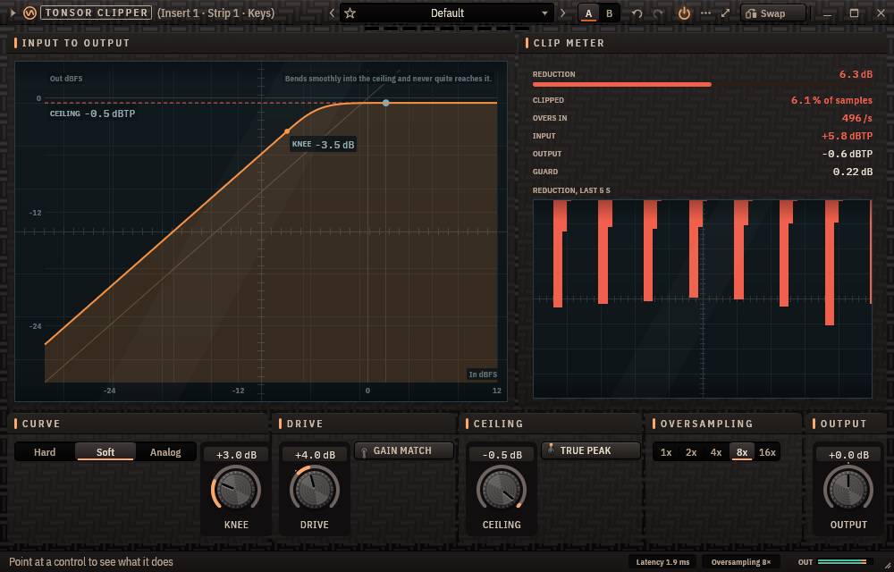 **Tonsor** — clipper with true-peak ceiling, oversampling and gain match | 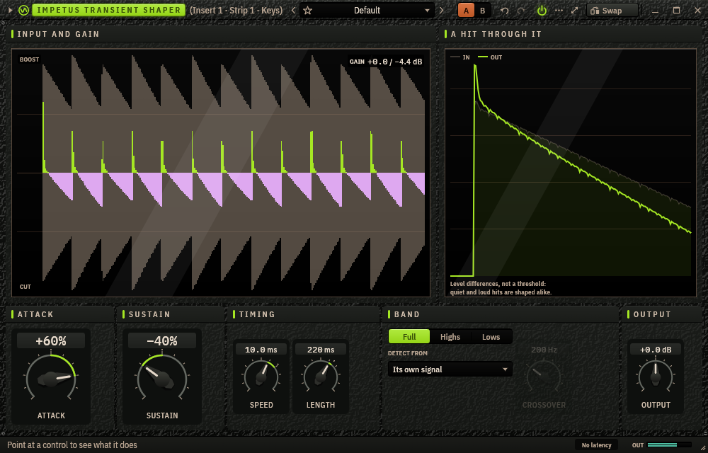 **Impetus** — attack and sustain by level difference, not threshold |
| 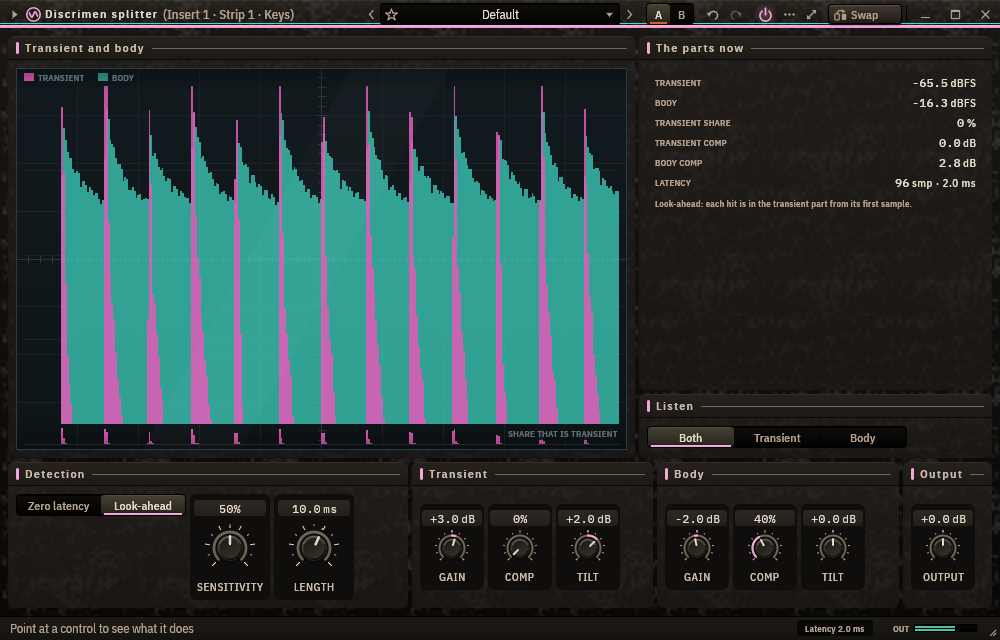 **Discrimen** — splits each hit into transient and body | 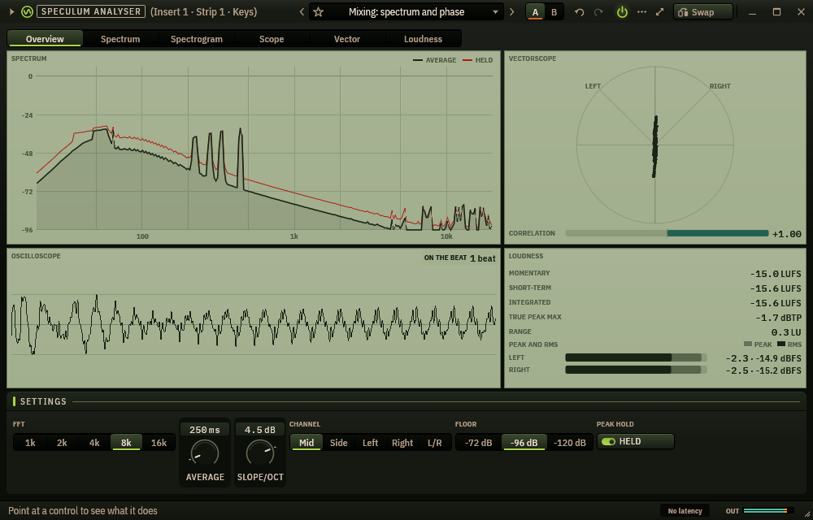 **Speculum** — spectrum, spectrogram, scope, vector and loudness | 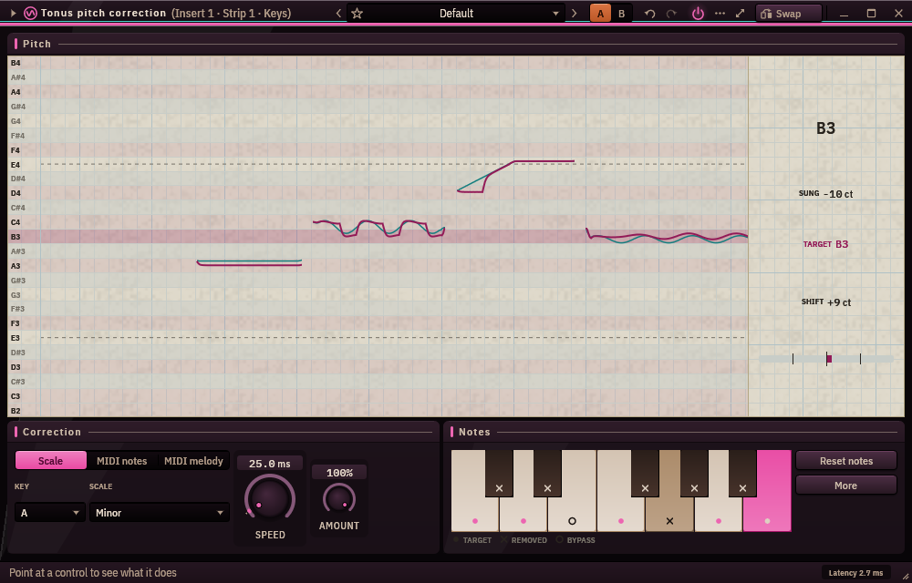 **Tonus** — pitch correction for a voice, by key or by MIDI |
| 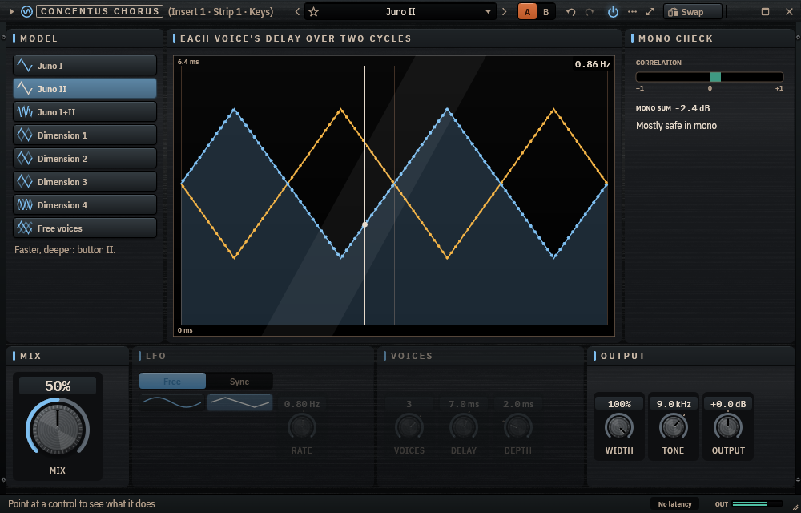 **Concentus** — chorus: the classic bucket-brigade models and free voices | 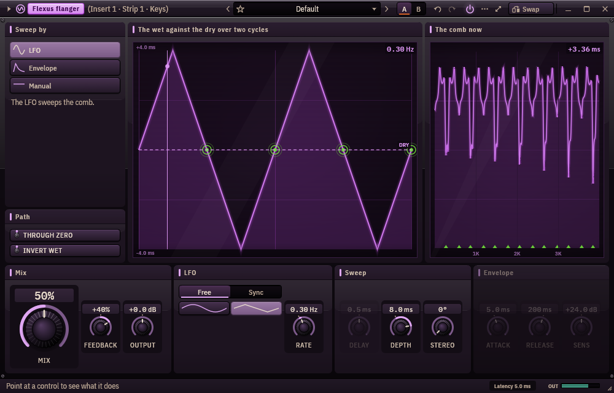 **Flexus** — flanger, through zero, the comb drawn as you hear it | 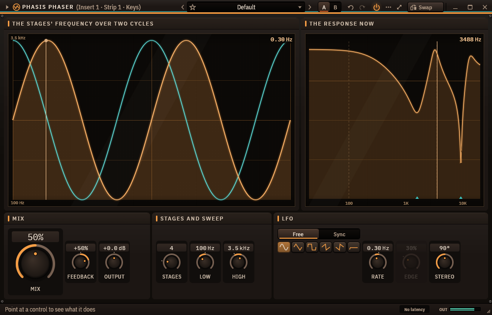 **Phasis** — phaser, 2 to 12 stages |
| 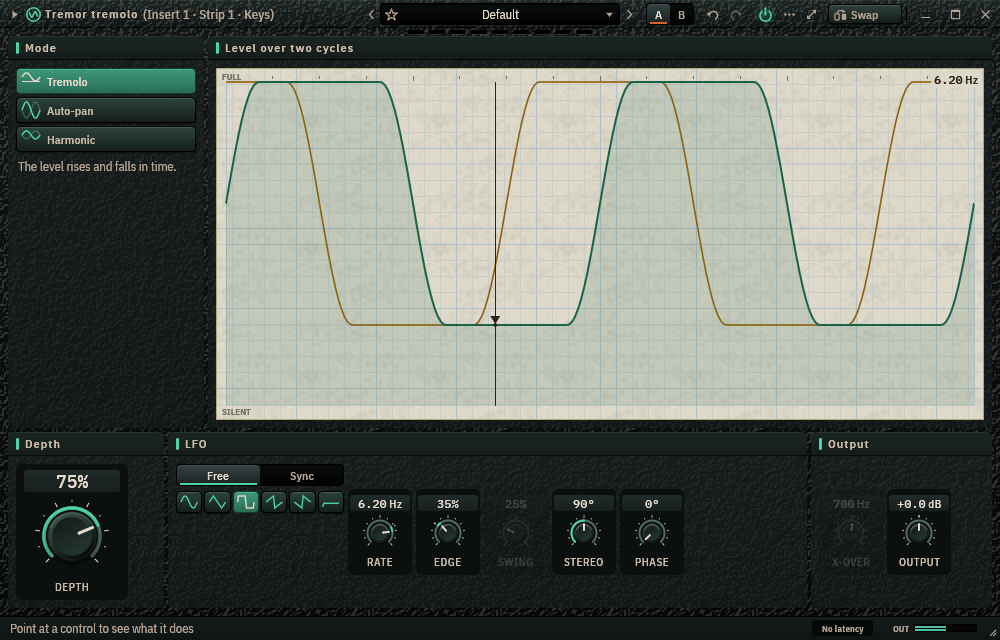 **Tremor** — tremolo, auto-pan and harmonic tremolo | 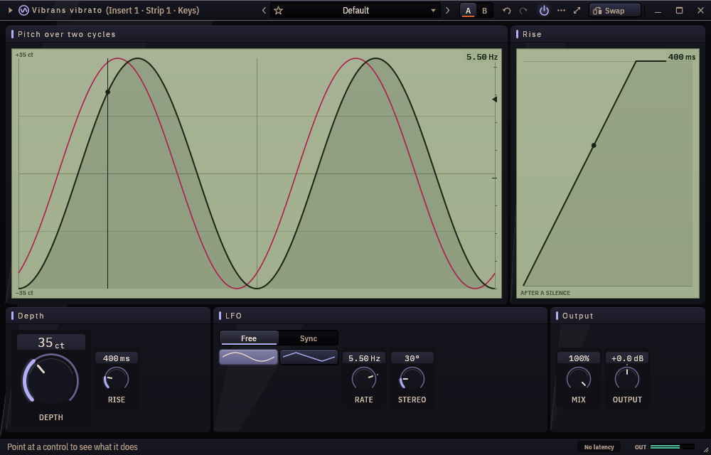 **Vibrans** — vibrato in cents, with a singer's rise | 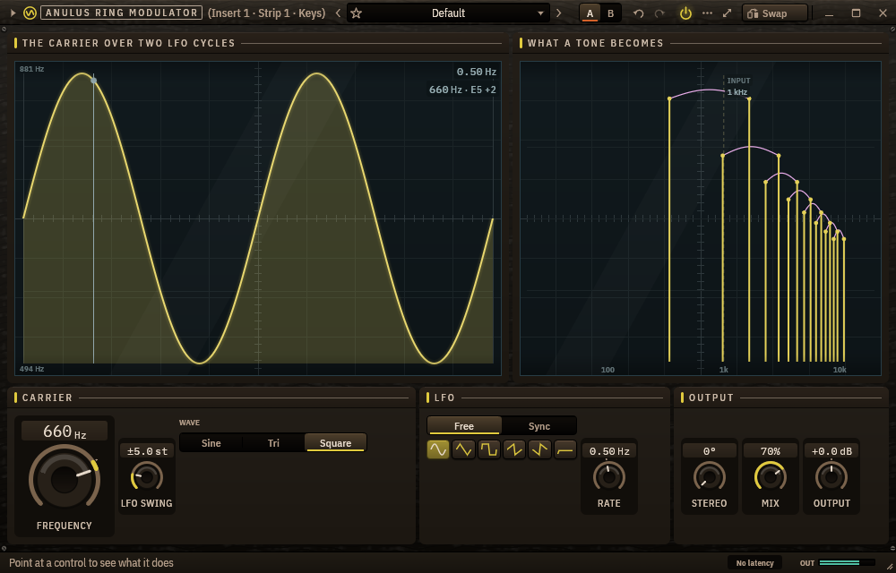 **Anulus** — ring modulator, the carrier as a note |
| 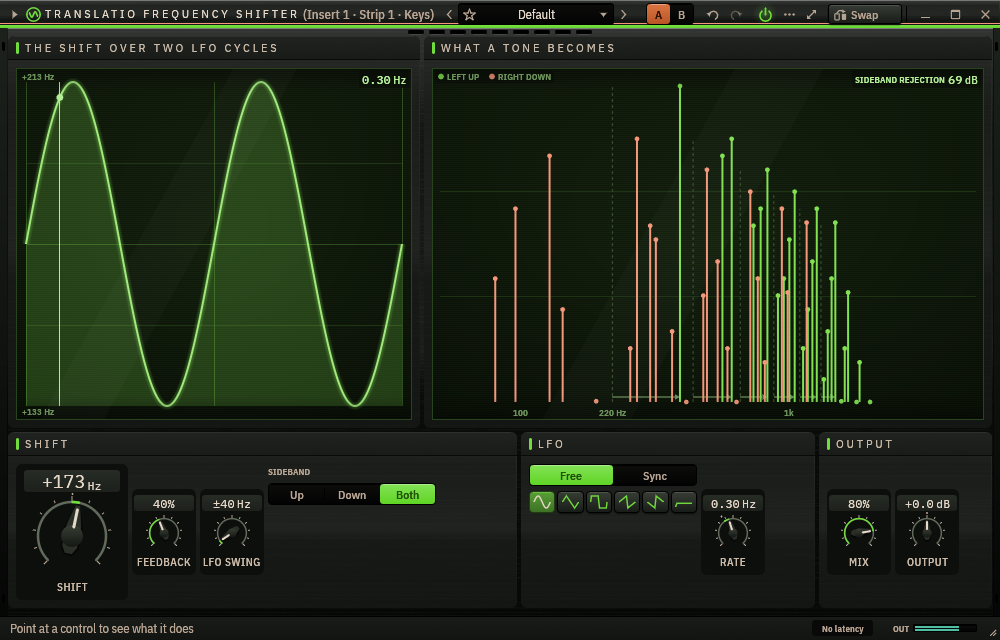 **Translatio** — frequency shifter, barber-pole feedback | 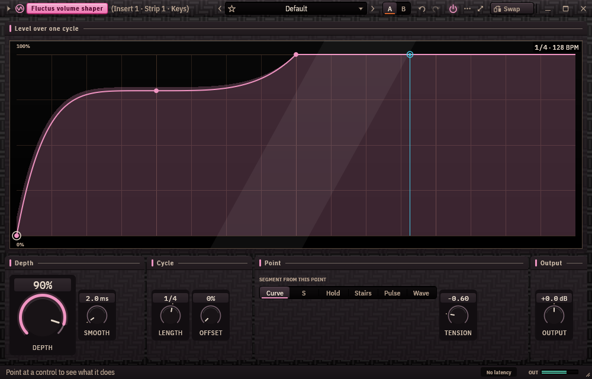 **Fluctus** — volume shaper: draw the pump |  **Any CLAP or VST3** — with a generic editor or its own window |

Plus **Delay** and **Reverb**, simple and light.

Every effect is a bit-exact wire at settings that do nothing, and any strip can key any of
them. Fervor, Latitudo and Culmen make the master chain a mastering chain. Design notes
and feature matrices: [docs/plugins/](docs/plugins/).

### Instruments

| | | | |
|---|---|---|---|
|  **Unda** — wavetable |  **Calor** — analog modelling |  **Modulus** — 8-operator FM |  **Exemplar** — multisampler, here playing the Salamander Grand Piano |
|  **Gravis** — 808, synth and string bass |  **Organum** — tonewheel organ |  **Lamina** — electric piano |  **Pulsus II** — drums |
| 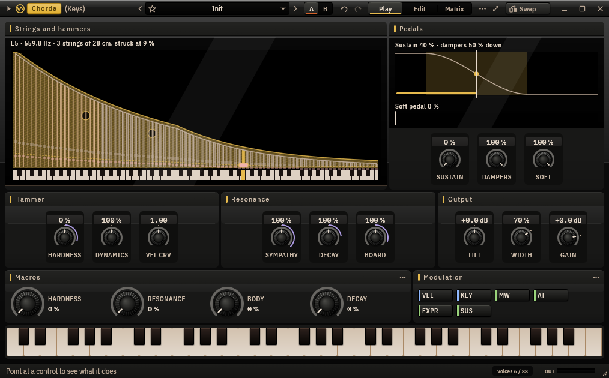 **Chorda** — a modelled grand piano: strings, hammers, soundboard, half pedalling | | | |

They share one modulation model — eight macros and a matrix you connect by dragging a
source onto a knob — one frame (Play · Edit · Matrix), and the project's undo, and each
wears its own face. Firmus, the simple synth every new track starts with, makes ten.

### Sounds

<p>
  
</p>

Free sound packs download on demand from *Sound packs…* — kits, percussion, a TX81Z and the
**Salamander Grand Piano** (a Yamaha C5 in 16 velocity layers), which plays in Exemplar,
streamed from disk through a sample cache. Packs are CC0, or CC BY with the credit shown on
the pack's page and in *Help ▸ Credits*; the music you make with them is yours.

### Make it yours

<p>
  
  
</p>

Dark, light or follow the system; hue, saturation, brightness, contrast, depth, roundness,
density and text size; every colour role named, searchable and resettable — or click any
element of the interface and recolour it on the spot. The taskbar icon is the Cantus mark,
in its own colours or one of eight others, changed live:

<p>
  
</p>

## Everything it does

<details>
<summary>The full list, area by area</summary>

**Engine.** Real-time audio on WASAPI / CoreAudio / ALSA through `cpal`, with an audio thread
that never allocates, locks or panics (ADR 0005). Offline WAV export bit-identical to
playback. Plug-in delay compensation per routing edge (ADR 0018); the playhead and recording
follow what is heard; a bypassed latent effect keeps its latency (ADR 0022). A recorder on
every strip and the master.

**Instruments** (ADR 0023). Unda (wavetable, additive and granular; imports Serum and Surge
tables), Calor (five self-oscillating zero-delay filters, seeded voice cards), Modulus
(8-operator FM that reads and writes DX7 SysEx), Exemplar (SFZ, Decent Sampler, SF2/SF3,
WAV/AIFF/FLAC/Ogg), Gravis (808, 303-style and string bass), Organum (tonewheels and rotary
speaker), Lamina (tine and reed electric piano), Pulsus II (layers, round robin, 808/909 and
modal voices, 16 choke groups), Chorda (a modelled grand piano), plus Firmus, the built-in
polysynth.

**Editing.** Arrangement with per-track heights, icons, time selection and clip editing
(split, glue, trim, slip, repeat, per-clip mute, colour and name); linked clips, the clip
browser and its paint tool (ADR 0037); copy and paste between projects (ADR 0036). Piano
roll with FL-style tools, clipboard, quantize, slicing and a velocity lane. A channel rack
where a step *is* a note. MIDI recording with one undo step per take; the computer keyboard as a MIDI
controller; hardware MIDI in.

**Mixer** (ADRs 0014–0016, 0041–0045). Strips, buses, sends before or after the fader,
cables drawn under the desk, the routing matrix, solo with connected routes, a three-band
channel EQ, a dry/wet per insert slot, ten slots per strip, multi-selection with ganged
faders, submixes, docks, groups with colours, a pan law per project, width and polarity.

**Effects** (ADRs 0017–0018, 0026). The twenty-three above plus Delay and Reverb, each with presets, A/B, a display
that is the control, and design notes in `docs/plugins/`; the twenty-three each in its own face (ADR 0074).

**Session** (ADRs 0076–0077). Clip slots and scenes beside the arrangement, launched on the
song's grid; gate, legato, follow actions, per-clip envelopes, scene tempo and metre;
capture, arrangement record; the keyboard, MIDI learn, Launchpad Mini MK3 / X / Pro MK3,
APC mini mk2 and APC40 mkII.

**Sync** (ADRs 0078–0079). Ableton Link (tempo, beat, start/stop), MIDI clock and MTC in
and out, a per-port offset.

**MPE** (ADR 0080). Per-note bend, pressure and timbre from the controller, recorded on each
note, edited in the piano roll, played by the native instruments and sent to MPE plug-ins.

**AI** (ADRs 0081–0086). An MCP server (both protocol generations, a door on `127.0.0.1`
off by default, the `cantus-mcp` bridge) with about sixty tools, each change one undo step:
the unit catalogue, the music linter, part and chord writers, listening with numbers and
masking, mix targets; the mastering assistant (nine platforms, A/B at matched loudness);
stem separation by HT-Demucs and audio to MIDI by Basic Pitch, our pitch tracker and our
drum detector, in the `cantus-ml` helper process on ONNX Runtime.

**Score** (ADR 0075). A clip's or a track's part engraved beside the piano roll or in its own
pane, edited on the staff; MusicXML 4.0 in and out, vector PDF and printing.

**Sounds** (ADRs 0030, 0042, 0050). Sound packs downloaded on demand and checked by SHA-256,
CC0 or CC BY with credit; long samples streamed from disk through a sample cache.

**Standards** (ADRs 0019–0021). CLAP and VST3 hosting with a crash-proof scanner; our effects
as CLAP/VST3 (`crates/cantus-plugins`); MIDI files, stems and DAWproject.

**Project.** One command bus for every change, with unlimited undo/redo and an audit log
(ADR 0004). Versioned JSON projects with SHA-256 integrity, schema migrations, atomic saves
and autosave (ADR 0006).

**Interface** (ADRs 0007, 0009, 0010, 0024, 0046). English and Spanish, names in any script;
every shortcut rebindable in `keymap.toml`, with presets modelled on FL Studio, Ableton Live
and Bitwig; named layouts; twelve themes and the appearance settings above; one text field
everywhere (Enter or a click elsewhere keeps what you typed, Esc puts it back).

</details>

## Build and run

```
cargo run --release -p cantus                     # build and open Cantus
cargo run --release -p cantus -- --locale es      # in Spanish
cargo run --release -p cantus -- song.cantus      # open a project
cargo run --release -p cantus -- --stress         # 160 000-note stress project
```

**A standalone `.exe`:**

```
cargo build --release -p cantus
```

It is written to `target\release\cantus.exe`, with the Cantus icon; fonts, logos and themes
are inside it, so the file can be copied anywhere and run.

**Our effects as plug-ins for other DAWs:**

```
cargo run -p xtask -- bundle          # target/bundled/Cantus <Name>.clap and .vst3
cargo run -p xtask -- bundle --v3     # a build for modern CPUs (AVX2), 15–25 % faster
```

Copy the `.clap` files to `%LOCALAPPDATA%\Programs\Common\CLAP` and the `.vst3` bundles to
`%LOCALAPPDATA%\Programs\Common\VST3`, then rescan in your DAW.

Requires stable Rust 1.95 or newer. No system libraries are needed on Windows or macOS; on
Linux install `libasound2-dev` (and `libxkbcommon-dev`, `libwayland-dev` for the window).

## Tests

```
cargo test --workspace                          # unit, property, null, golden-image and budget tests
cargo test -p cantus-engine -- --ignored        # real-device smoke test
cargo clippy --workspace --all-targets
```

The null tests in `crates/cantus-engine/tests/null_tests.rs` are the project's most important
guardrail: they fail if the engine ever produces different output for different block sizes,
or if a render stops matching playback, and they hold the line that a control at its default
must not touch a sample. The kit's golden images (`crates/cantus-ui/tests/golden/`) hold the
look, and `tests/frame_budget.rs` holds the speed.

## Layout

| Crate | License | Purpose |
|---|---|---|
| `cantus-core` | MPL-2.0 | musical time, project model, commands, undo/redo, snapshots |
| `cantus-dsp` | MPL-2.0 | every instrument's and effect's DSP, null-test harness |
| `cantus-engine` | MPL-2.0 | audio thread, transport, mixer graph, delay compensation, offline render |
| `cantus-project` | MPL-2.0 | project file format, migrations, MIDI files, DAWproject |
| `cantus-host` | GPL-3.0-or-later | hosting CLAP and VST3 plug-ins |
| `cantus-plugins` | GPL-3.0-or-later | Cantus's effects as CLAP and VST3 |
| `cantus-link` | GPL-3.0-or-later | Ableton Link in Rust, wire-compatible with the SDK |
| `cantus-ai` | GPL-3.0-or-later | `AiProvider` trait, the tool table, command bridge |
| `cantus-mcp` | GPL-3.0-or-later | the MCP server, written by hand: both protocol generations, permissions, jobs |
| `cantus-ml` | GPL-3.0-or-later | the machine-learning helper process: stem separation and transcription on ONNX Runtime |
| `cantus-ui` | GPL-3.0-or-later | the interface, its design system and the hand-drawn kit |
| `cantus` | GPL-3.0-or-later | the binary |

The engine crates (and `cantus-rt`) are MPL-2.0: whoever distributes a modified file
must publish it, while the engine can still be used unchanged inside other programs. The
application is GPL-3.0-or-later, and the program as distributed is one combined work under
it. See [ADR 0001](docs/adr/0001-license.md) and [ADR 0047](docs/adr/0047-licensing-revised.md);
contributing: [CONTRIBUTING.md](CONTRIBUTING.md) and the [CLA](CLA.md); the name and
logos: [TRADEMARKS.md](TRADEMARKS.md). The bundled fonts
(IBM Plex Sans, Sans Condensed and Mono, in `crates/cantus-ui/assets/fonts/`) are licensed
under the [SIL Open Font License 1.1](crates/cantus-ui/assets/fonts/LICENSE-OFL.txt) and
shipped unmodified — "IBM Plex" is a Reserved Font Name.

## Support

Cantus is free and stays free; everyone gets the same program, whatever they give, or
nothing at all. If it helps you make music, you can help keep it growing:
[Ko-fi](https://ko-fi.com/luisalmazan314159) ·
[Buy Me a Coffee](https://buymeacoffee.com/angel314159) ·
[Patreon](https://www.patreon.com/c/angel314159/membership) ·
[Liberapay](https://liberapay.com/lalmazan). Donations unlock nothing; the best help is
still to make a song and [tell us](https://github.com/luis314159/cantus-daw/issues) what
got in your way.

## Author

Cantus is designed and built by **Luis Ángel Almazán** — [lalmazan.com](https://lalmazan.com).
The logos are his own designs.
