<p align="center">
  
</p>

<h1 align="center">Cantus™</h1>

<p align="center">
  A free, open-source digital audio workstation, written in Rust and drawn by hand.<br>
  <b>Windows · Linux · macOS (preview)</b><br>
  Created by <b>Luis Ángel Almazán</b> · <a href="https://lalmazan.com">lalmazan.com</a>
</p>

<p align="center">
  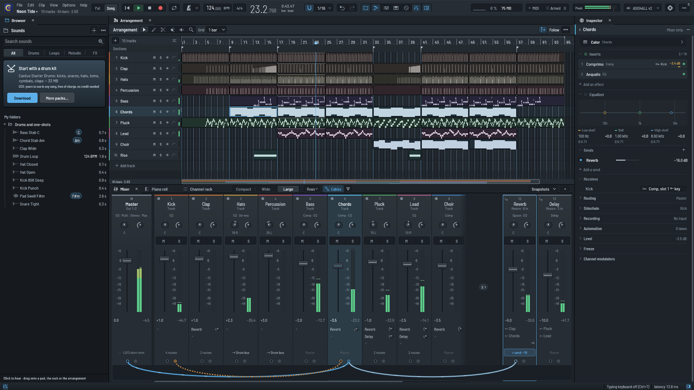
</p>

> *"Whatever you do, work at it with all your heart."* — Colossians 3:23

Cantus takes its name from the *cantus firmus*: the fixed melody on which polyphony is built.
The engine is that fixed line — deterministic, sample-accurate, allocation-free — and
everything else is built on top of it. The full vision lives in [idea.md](idea.md); the
decisions that shape the code live in [docs/adr/](docs/adr/); where the project stands right
now is in [docs/STATUS.md](docs/STATUS.md).

## Download

Cantus runs on **Windows** and **Linux** — every release ships for both, and the whole test
suite runs on both each round — with **macOS as a preview**. Everything is on the
[releases page](https://github.com/luis314159/cantus-daw/releases/latest), with SHA-256 sums.

| System | File | |
|---|---|---|
| **Windows 11** (x64) | [`Cantus-windows-x64-setup.exe`](https://github.com/luis314159/cantus-daw/releases/latest/download/Cantus-windows-x64-setup.exe) | installer, no administrator; a portable zip is on the releases page. WASAPI and ASIO |
| **Linux** (x86-64, Ubuntu 22.04 or newer, or alike) | [`Cantus-linux-x86_64.AppImage`](https://github.com/luis314159/cantus-daw/releases/latest/download/Cantus-linux-x86_64.AppImage) | one file for every distribution: `chmod +x` and open it; it updates itself. PipeWire, JACK and ALSA |
| **macOS** (Apple silicon and Intel) — **preview** | [`Cantus-macos-universal.dmg`](https://github.com/luis314159/cantus-daw/releases/latest/download/Cantus-macos-universal.dmg) | see below. Core Audio |

**The macOS preview** is one universal disk image, built and tested on GitHub's macOS
machines but **not yet opened on a real Mac, and not signed yet**. The first time, macOS
blocks it: open *System Settings → Privacy & Security* and choose **Open Anyway**. Please
[report what goes wrong](https://github.com/luis314159/cantus-daw/issues) — that is how it
leaves preview.

## Highlights

- **Sounds for every style, heard before you choose** (ADRs 0098–0101, 0104). **511 factory
  presets** tagged by style and role, each one levelled and checked by a test, auditioned on
  a phrase or on your own clip before it touches the song — and **heard on the
  [website](https://cantusdaw.com/#units)** before you download anything.
  - **Chorda, model 2**: mics, lid and room, shown as a piano in its room rendered in 3-D.
  - **Sectio** slices a loop across Exemplar's keys.
  - **Pulsus** gives every pad its own output and effect chain.
  - **Two sound packs of our own**, public domain (CC0), downloaded when you ask.
- **Measured against FL Studio and REAPER, wins and losses alike** (ADRs 0102, 0106). On
  the same quiet laptop, like against like: on an empty song Cantus's window is ready in
  **0.74 s** against REAPER 7.85's 1.76 s, on a beat starter in **0.76 s** against FL Studio
  24.1.2's 2.49 s, and it is done working sooner. **At rest it uses less CPU than both**
  (1.6 % of a core against REAPER's 2.3–3.7 %, 2 % against FL Studio's 6.6 %): a channel
  whose effects hear silence stops running them, to the same bits. It still holds **more
  memory** than both (237 MB against 62 and 133), and the
  [scorecard](docs/scorecard/README.md) says so, with the method to repeat every number.
- **The recording mode** (ADR 0092). *Prepare to record* bakes every strip that feeds the
  master and leaves only what you record live, so a heavy song plays at a low buffer: on the
  development machine, 64 tracks with effects went from 224–590 % of each block's time
  live to 2–4 % in the mode, with no disk underrun in a minute at any buffer from 32 to 1024
  frames. Mix controls stay live; leaving gives the song back bit for bit.
  [More below](#the-recording-mode--the-whole-song-baked-only-your-take-live).
- **A professional studio** (ADRs 0093–0097). VCA faders, mixer snapshots and scene cues; an
  audio editor with a spectrogram, noise reduction by profile and declick; outboard synths
  and effects on time after an automatic latency ping; Mackie Control and HUI surfaces;
  ARA 2 plug-ins on audio clips.

- **A look drawn by hand, FL Studio first** (ADR 0024). Every knob, fader, meter, slot and
  window frame is painted by Cantus's own vector kit, crisp at any zoom from 75 % to 200 %
  and on 4K. Twelve themes, **Cantus Night** by default; the taskbar icon is the Cantus
  mark, in the colour you choose.
- **An FL-style mixer with cables.** Drag from a strip's port to another strip (a send, the
  only output with Ctrl, a sidechain key with Alt), pre- or post-fader sends, a routing
  matrix (Alt+F9), submixes, groups and a per-channel sheet in the inspector.
- **Linked clips and a clip browser.** A copied pattern stays the same clip until you make
  it unique; the clip browser (Alt+F5) shows every clip as a tile to drag in or paint with
  (B), as in FL's playlist.
- **Twenty-five effects and ten instruments of its own**, researched against the best on
  the market and measured — [each one shown below](#instruments), with what it does — plus
  free sound packs, among them the **Salamander Grand Piano**, streamed from disk.
- **Each unit wears its own face** (ADR 0074): its colour, material, controls and the
  display that tells its story, drawn in vectors in light and dark themes. The CLAP and
  VST3 versions wear the same face in any DAW; *Units wear their own faces* switches back
  to the plain look.
- **The score from the piano roll** (ADR 0075). A clip or a track as an engraved staff —
  spelled in the song's key, beamed and tied as an engraver would — beside the piano roll
  or in a pane of its own; edit on the staff, export **MusicXML** and vector **PDF**, print.
- **A session view, in sync, with per-note expression** (ADRs 0076–0080). Live's clip
  grid beside the arrangement (Tab), played from the keyboard, the mouse, MIDI learn or a
  Launchpad or APC; **Ableton Link**, **MIDI clock** and **MTC** in and out; **MPE** from the
  controller to the piano roll's per-note lanes and the instruments.
- **AI that works with you, on your computer** (ADRs 0081–0086). Claude and the other
  assistants drive Cantus through **MCP**, every change one undo step and edits asked
  first; **stem separation** and **audio to MIDI** by models downloaded from their makers
  when you ask; a **mastering assistant** that proposes a chain of our own effects per
  platform.
- **A character that dances to your song** (ADRs 0087–0091, 0105). Eight characters of our own —
  or your own Lottie, sprite sheet or DragonBones file — dance over the workspace to the
  beat, driven by automation, modulators and notes; a companion window for streams; the
  clip exported as an MP4, a WebM or a transparent MOV with the song's audio.
- **Works with the market's DAWs.** Hosts **CLAP and VST3** plug-ins; ships its own effects as
  **CLAP/VST3** for any other DAW, bit-identical to the native ones; **MIDI files**, **stems**
  and **DAWproject** in and out.
- **Fast, and tested to stay fast.** An audio thread that never allocates, nothing redrawn
  when nothing moves, and 6 000+ tests — null tests that hold offline renders bit-identical
  to playback, golden images that hold the look, and a frame budget that fails the build
  when the UI gets slow.

## A tour

Every picture here is the program itself, drawn headless on its demo song by
`cargo run --release -p cantus-ui --example shoot_readme` ([how](docs/DEVELOPING.md#3-build-and-run));
the session view's, sync's and MPE's by `shoot_session`, `shoot_sync` and `shoot_mpe`;
the AI pictures by `shoot_ai`, `shoot_mastering`, `shoot_stems` and `shoot_transcribe`;
the instruments and effects by `shoot_skins`; the recording mode and the desk's VCAs by
`shoot_showcase`; the editor's, external gear's and ARA's by `shoot_editor`,
`shoot_external` and `shoot -- <dir> 1 ara`.

### The recording mode — the whole song baked, only your take live

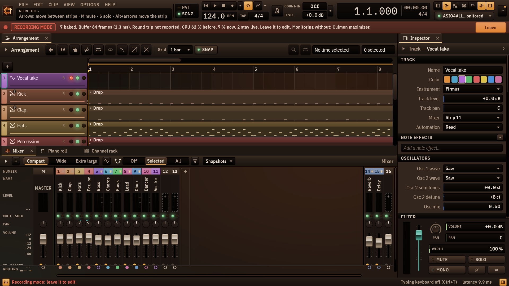

A heavy song and a low buffer do not mix: every plug-in has to finish before the next
block. **Prepare to record** (in the record menu, or `prepare_to_record` for an agent)
renders every strip that feeds the master — its effects, sends and automation, before its
fader — and plays the renders back as streams read ahead from disk. Armed tracks stay live
with their own effects; the master chain stays live or is baked too. While you play, the
computer only reads and sums, so the buffer can go down without dropouts.

- **Mix while you record.** Fader, pan, mute and solo keep working on every baked strip that
  goes straight to the master (fader and pan on one that feeds others only before its
  fader) — or lock them. Anything else waits behind *Recording mode — leave it to edit*.
- **A bar you cannot miss**: the buffer, the round trip, the CPU before and now, the strips
  baked, what low-latency monitoring leaves out, and **Leave**.
- **Bit-exact when you leave.** The baked mix equals the live mix to the bit, at every block
  size (the tests hold it); the mode is never an undo step and never written into the
  project, and going back in renders only what changed.
- **Optional, never automatic.** The question first says what will be rendered, how much
  disk it may take and what stays live; a plug-in that cannot render offline is named and
  stays live, or stops the preparation.

<p>
  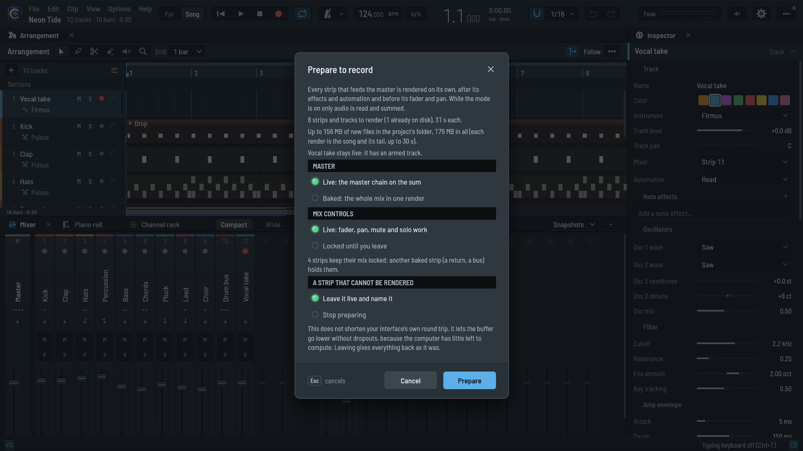
</p>

**Measured** on the development machine (Windows, 16 logical cores): 64 tracks, each a synth
into EQ, compressor, delay and reverb; processor time per audio block against the block's
length, one thread ([every figure and the method](docs/round36/record.md)).

| | buffers 32–512 frames |
|---|---|
| Live (the machine shared with other builds) | **224–590 %** — it could not play at any buffer |
| In the mode, 64 strips streamed from disk | **2–4 %** mean |
| In the mode, the master baked too | **0.4–0.9 %** mean |
| Disk underruns, one-minute real-time runs at 32–1024 frames, 64 and 128 streams | **0** |
| Lowest buffer with no block over budget in a minute, this machine | **64 frames** for 64 streams, 128 for 128 |

What it does **not** do: it does not shorten your interface's own round trip — the
converters and the driver set that, and the bar shows it as the driver reports it. It lowers
the work per block so a lower buffer holds; the lowest stable buffer is your machine's to
find, and Cantus gives you the numbers.

### The professional studio — VCAs, snapshots, an audio editor, outboard gear, surfaces, ARA

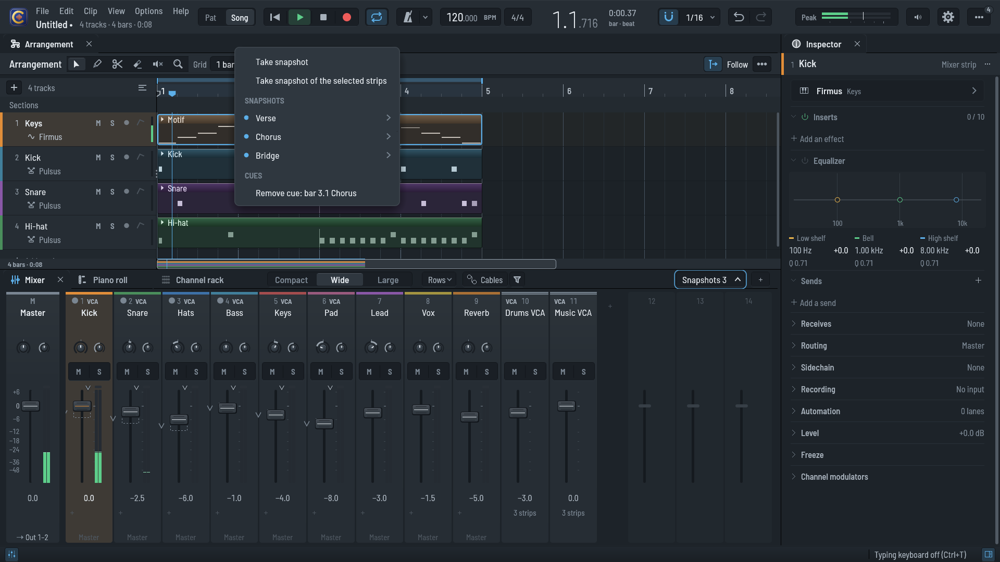

**VCA faders** move their members' gain at the gain stage: the members' own faders and
automation stay where you left them; a member can follow two VCAs, a VCA another, a group a
VCA. A VCA at 0 dB touches no sample (a null test holds it). **Mixer snapshots** capture the
whole desk or chosen channels — faders, pans, mutes, sends, inserts' bypass and parameters,
EQ — and recall them in one undo step, with recall-safe and solo-safe strips and an A/B
compare; a snapshot placed on the timeline is a **scene cue** that changes the mix on that bar.

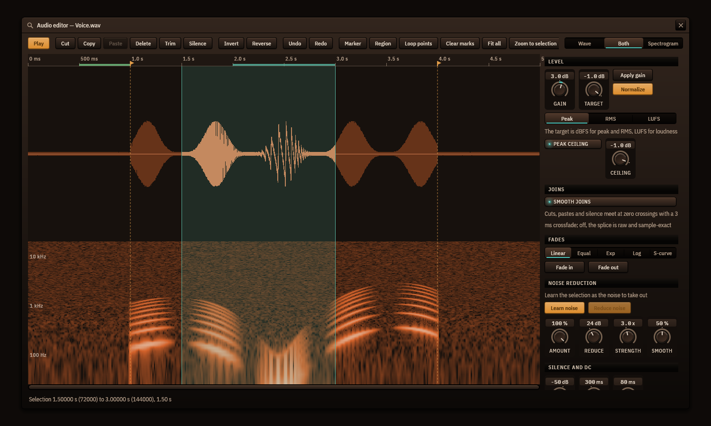

**The audio editor** opens from any clip (*Edit in audio editor…*) and returns to it: cut,
paste, silence, fades with five curves, normalise to peak, RMS or LUFS, invert, reverse, DC,
remove silence — each edit a new file and one undo step, the original kept, joins smoothed at
zero crossings. A **spectrogram** where you select a region in time and frequency and turn it
down; **noise reduction by a learned profile**; **declick** and **repair**; markers, regions
and loop points saved with the file. In its tests: hiss 12 dB down or more with a voice
within 1 dB, clicks found and repaired.

<p>
  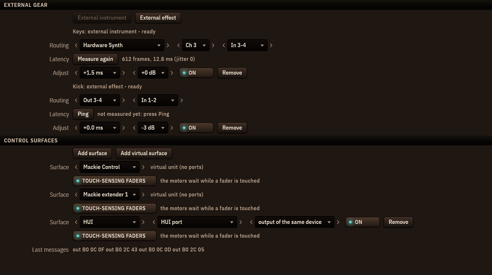
  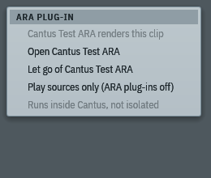
</p>

**Outboard gear on time.** *External instrument* and *External effect* units send MIDI and
audio out of your interface and bring the result back; **Ping** sends a burst out and listens
for it, the trip measured to the sample, stored with the unit and used by delay
compensation. An unplugged interface is said, never loaded blindly; export and freeze
refuse a track with outboard gear and say why (hardware cannot render offline).

**Mackie Control and HUI.** A Mackie Control with its extenders, or a HUI, drives the mixer —
motor faders that never fight your hand, V-Pots, transport and jog, banks and flip, scribble
strips, meters and the timecode display — set up in two clicks, beside generic MIDI mapping.
Tested byte for byte against a built-in emulation of both protocols, written from their
published notes; trying it on real surfaces is still to come.

**ARA 2 hosting.** Cantus hosts ARA 2 plug-ins on audio clips: bind a clip, open the
plug-in's editor from it, and each edit gesture is one undo step; the plug-in renders the
region and Cantus plays the render, so fades, clip gain and offline export keep working.
ARA plug-ins run **inside Cantus's own process**, not isolated like other plug-ins, and the
clip menu says so. ARA hosting is new: tell us which plug-ins you tried.

### Instruments

Nine instruments with a face of their own — click a picture for it full size, or a name below for what it does.

<table>
<tr>
<td align="center" valign="top" width="33%"><a href="docs/images/units/unda-dark.png">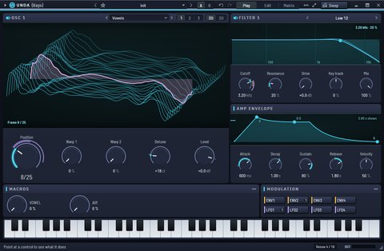</a><br><b>Unda</b><br><sub>Wavetable synth</sub></td>
<td align="center" valign="top" width="33%"><a href="docs/images/units/calor-dark.png">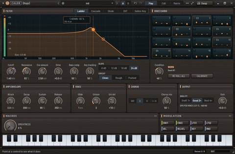</a><br><b>Calor</b><br><sub>Analog-modelling polysynth</sub></td>
<td align="center" valign="top" width="33%"><a href="docs/images/units/modulus-dark.png">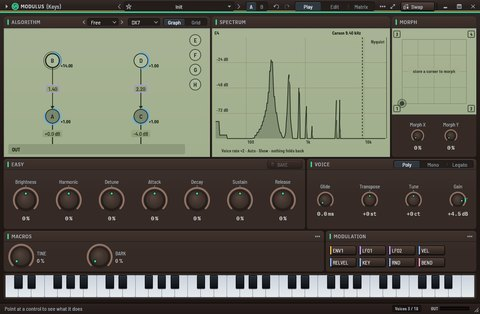</a><br><b>Modulus</b><br><sub>FM synth</sub></td>
</tr>
<tr>
<td align="center" valign="top" width="33%"><a href="docs/images/units/exemplar-dark.png">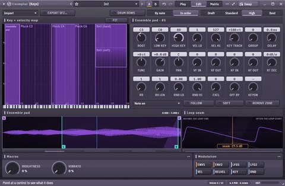</a><br><b>Exemplar</b><br><sub>Multisampler</sub></td>
<td align="center" valign="top" width="33%"><a href="docs/images/units/gravis-dark.png">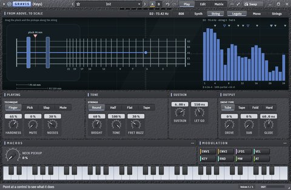</a><br><b>Gravis</b><br><sub>Bass instrument</sub></td>
<td align="center" valign="top" width="33%"><a href="docs/images/units/organum-dark.png">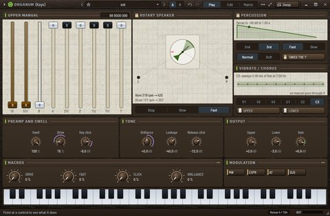</a><br><b>Organum</b><br><sub>Tonewheel organ</sub></td>
</tr>
<tr>
<td align="center" valign="top" width="33%"><a href="docs/images/units/lamina-dark.png">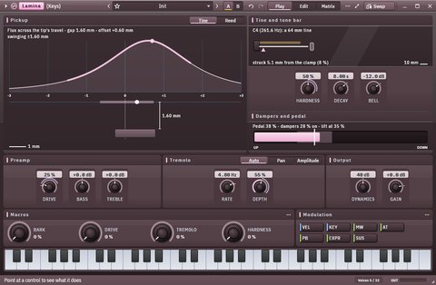</a><br><b>Lamina</b><br><sub>Electric piano</sub></td>
<td align="center" valign="top" width="33%"><a href="docs/images/units/chorda-dark.png"></a><br><b>Chorda</b><br><sub>Modelled grand piano</sub></td>
<td align="center" valign="top" width="33%"><a href="docs/images/units/pulsus-dark.png">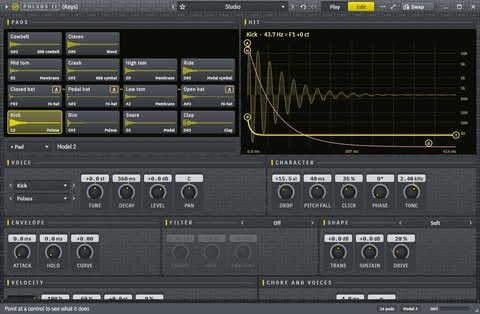</a><br><b>Pulsus II</b><br><sub>Drum instrument</sub></td>
</tr>
</table>

<details>
<summary><b>Unda</b> — Wavetable synth. Three wavetable oscillators with additive and granular engines, and Serum and Surge table import.</summary>

<a href="docs/images/units/unda-dark.png">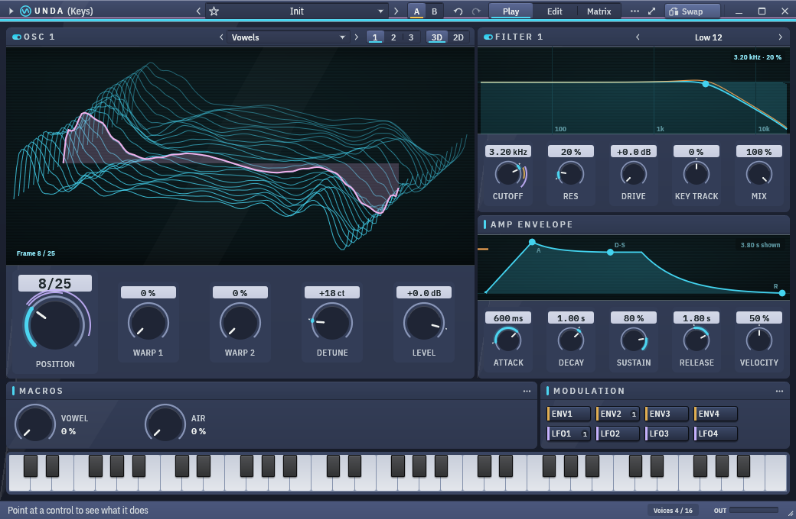</a>

Unda has three oscillators, each with up to sixteen unison lanes and two warp slots, plus a sub and noise, two filters in series, in parallel or anywhere between, four envelopes and eight LFOs. Each oscillator can also run as an additive or a granular engine, and the same notes give the same samples live or bounced.

- 3 oscillators, up to 16 unison lanes each, two warps from 14 types
- Partes additive engine (up to 256 partials, stretch) and Grana granular engine
- Imports WAV wavetables (Serum, u-he and Surge markers) and Surge .wt files
- A zero-delay-feedback ladder that self-oscillates, plus state-variable modes
- Four DAHDSR envelopes, eight LFOs with drawable shapes, 85 modulation targets
- Aliasing of a full saw below −96 dB at the default 2× quality

<sub>26 factory presets — [hear them](https://cantusdaw.com/#unit-unda) · [light theme](docs/images/units/unda-light.png)</sub>

</details>
<details>
<summary><b>Calor</b> — Analog-modelling polysynth. Five self-oscillating filters and sixteen voice cards whose analog drift is reproducible.</summary>

<a href="docs/images/units/calor-dark.png">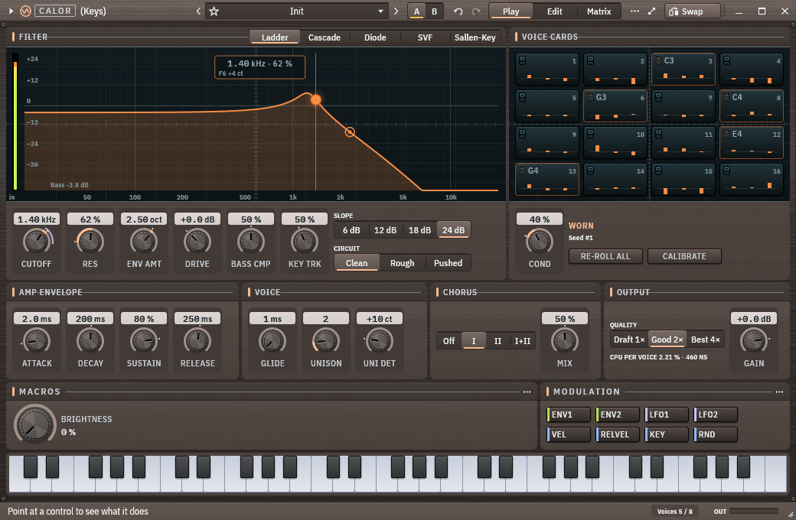</a>

Calor is an analog-modelling polysynth with a fixed, readable signal path: three oscillators, a sub and noise into a mixer that drives the filter, a high-pass, five filter models in one slot, and the amplifier. Drift and voice-card variations come from the note and a seed, so the same notes give the same result live and rendered.

- Five zero-delay filters: ladder, cascade, diode, state-variable and Sallen-Key
- Every filter self-oscillates on its cutoff at 100 % resonance
- Sixteen voice cards with visible calibration errors, re-rolled one at a time
- Draft 1×, Good 2× or Best 4×: the same quality live and rendered
- Condition from Calibrated to Unruly; drift and variances in cents and dB
- Poly-mod, cross-mod, hard sync and a three-mode chorus

<sub>26 factory presets — [hear them](https://cantusdaw.com/#unit-calor) · [light theme](docs/images/units/calor-light.png)</sub>

</details>
<details>
<summary><b>Modulus</b> — FM synth. Eight-operator FM with a free matrix that reads and writes DX7 SysEx.</summary>

<a href="docs/images/units/modulus-dark.png"></a>

Modulus has eight operators connected any to any through a matrix where every cell is an automatable, modulatable number. The 32 classic algorithms are templates, envelopes run in DX-style or time-breakpoint mode, and oversampling is chosen per voice so the quality setting changes the aliasing, never the timbre.

- 8 operators, any-to-any matrix; every cell automatable and modulatable
- Reads and writes DX7 SysEx, single voices and 32-voice cartridges
- 32 classic algorithm templates that leave every cell editable
- Auto oversampling per voice from Carson's rule; Tame keeps sidebands from folding
- Easy macros with Bake, and a four-corner morph pad
- An operator graph you drag to connect, and a spectrum of the patch's own sound

<sub>25 factory presets — [hear them](https://cantusdaw.com/#unit-modulus) · [light theme](docs/images/units/modulus-light.png)</sub>

</details>
<details>
<summary><b>Exemplar</b> — Multisampler. A multisampler that reads SFZ, Decent Sampler and SF2/SF3, with alias-free resampling by default.</summary>

<a href="docs/images/units/exemplar-dark.png"></a>

Exemplar plays groups of zones mapped by key and velocity, with round robin, crossfades, release samples, loops and exclusive classes. Its resampler costs the same at any transposition, long samples stream from disk, and every edit, a thousand-zone import included, is one undo step.

- Imports WAV, AIFF, FLAC, Ogg, SFZ, Decent Sampler and SoundFont 2/3; exports SFZ
- High quality (default): spurious lines near −120 dBFS two octaves up
- Round robin in order, never the same sample twice in a row
- Loops forward, ping-pong or backward with crossfades; seam error shown in dB
- Long samples stream from disk, bit-identical to playback from memory
- Map editor: drag zones; dropped files are mapped by metadata or note names

<sub>32 factory presets — [hear them](https://cantusdaw.com/#unit-exemplar) · [light theme](docs/images/units/exemplar-light.png)</sub>

</details>
<details>
<summary><b>Gravis</b> — Bass instrument. One bass, three engines (808, synth and modelled string), with a drive that keeps the fundamental.</summary>

<a href="docs/images/units/gravis-dark.png">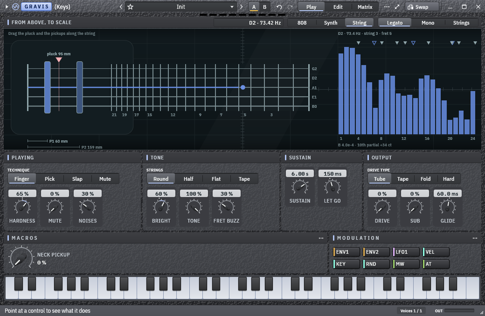</a>

Gravis is a bass instrument with three engines behind one mono/legato voice: an 808 with knock, click and exact harmonics; a synth with unison, ladder, diode and state-variable filters and an accent that climbs; and a physically modelled electric bass string with movable pickups and fret buzz.

- Drive adds harmonics while the fundamental moves less than 0.1 dB (measured)
- A sub one or two octaves down, locked to the main oscillator's phase
- String engine: 4–6 strings; finger, pick, slap, palm mute, hammer-ons, slides
- Two movable pickups set in millimetres, a piezo, fret buzz and a fretless option
- Synth accent with a sweep that climbs on runs of accented notes
- Glide by time or rate, a legato window and declick; pitch within 0.05 cent

<sub>25 factory presets — [hear them](https://cantusdaw.com/#unit-gravis) · [light theme](docs/images/units/gravis-light.png)</sub>

</details>
<details>
<summary><b>Organum</b> — Tonewheel organ. A 91-wheel tonewheel organ with modelled key click and a rotary speaker, flat in CPU.</summary>

<a href="docs/images/units/organum-dark.png">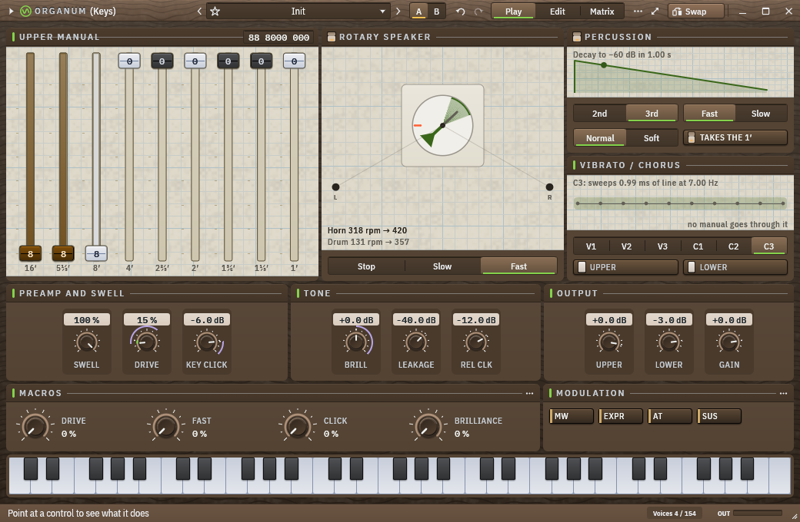</a>

Organum is built the way the instrument is: 91 wheels that never stop, keys that close nine contacts each, drawbars, single-trigger percussion, a scanner vibrato and chorus, a preamp and a rotary speaker with a horn and a drum. Its cost does not depend on how many keys are held.

- Upper, lower and pedal drawbars; split points, or MIDI channels 2 and 3
- Key click modelled from contact bounce, seeded per note
- Single-trigger percussion: 2nd or 3rd harmonic, fast or slow decay
- Scanner vibrato and chorus, V1–V3 and C1–C3
- Rotary speaker: horn and drum with real spin-up, a brake and movable microphones
- Gear tuning within 0.71 cent of equal temperament below C8, or exact equal

<sub>24 factory presets — [hear them](https://cantusdaw.com/#unit-organum) · [light theme](docs/images/units/organum-light.png)</sub>

</details>
<details>
<summary><b>Lamina</b> — Electric piano. Tine and reed electric pianos modelled from hammer, tine or reed, and pickup, drawn to scale.</summary>

<a href="docs/images/units/lamina-dark.png">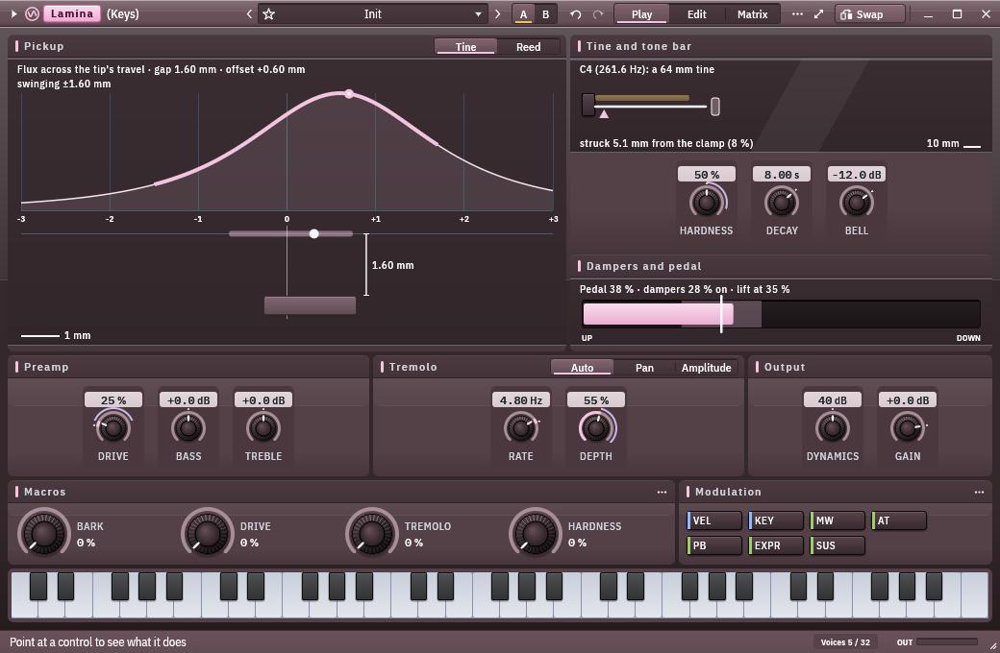</a>

Lamina models two classic electric pianos from their parts: a hammer, a vibrating tine with its tone bar or a reed, and the pickup that hears the tip, whose nonlinearity makes the bark. Every geometric value is in millimetres and drawn at true scale in the editor.

- Tine and Reed engines; 73, 64 or 88 keys
- Pickup gap and offset dragged in millimetres; the bark grows with velocity
- Continuous sustain pedal with half-pedalling
- A key struck again while it rings is struck on the moving tine
- Tremolo as stereo pan or amplitude; preamp drive, bass and treble
- Hardness, decay and level curves across the keyboard

<sub>24 factory presets — [hear them](https://cantusdaw.com/#unit-lamina) · [light theme](docs/images/units/lamina-light.png)</sub>

</details>
<details>
<summary><b>Chorda</b> — Modelled grand piano. A grand piano played from its physics: strings, felt hammers, a soundboard and half pedalling.</summary>

<a href="docs/images/units/chorda-dark.png">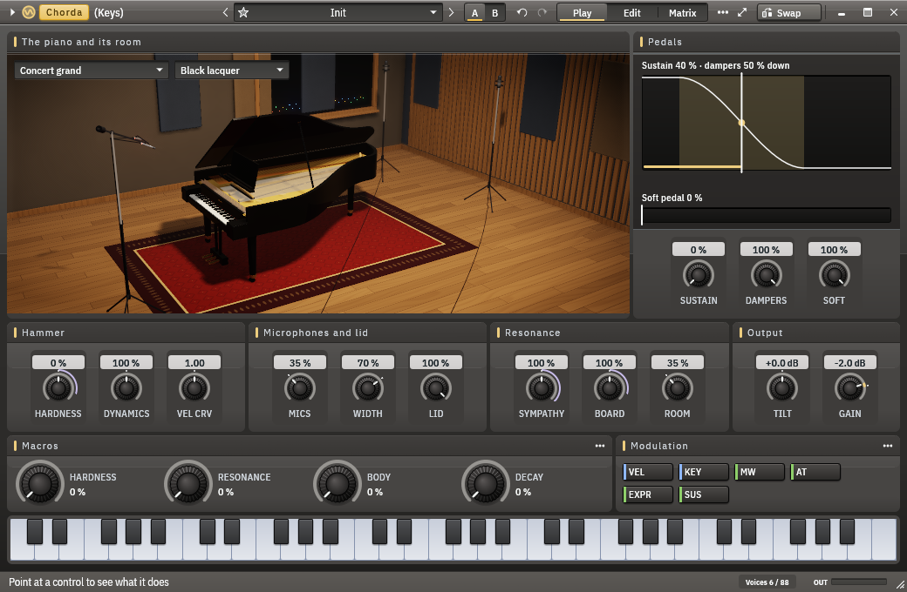</a>

Chorda plays a grand piano from a physical model: each key's one to three strings struck by a felt hammer, meeting at a yielding bridge and ringing into a soundboard, with the other strings ringing in sympathy as their dampers allow. No sample excites anything; its numbers come from published measurements.

- Worst partial within 0.5 cent on the rendered sound, across all 88 keys
- Continuous sustain pedal with half-pedalling; the soft pedal shifts the hammers
- Sympathetic resonance of the other strings and a 40-mode soundboard
- Stretched tuning 0–200 %, string stiffness and A4 from 415 to 466 Hz
- Felt hardness and hysteresis, two-stage decay and phantom partials, adjustable
- The piano drawn from above: strings, bridge, dampers and the last key played

<sub>24 factory presets — [hear them](https://cantusdaw.com/#unit-chorda) · [light theme](docs/images/units/chorda-light.png)</sub>

</details>
<details>
<summary><b>Pulsus II</b> — Drum instrument. A drum instrument of synthesized and sampled pads: 808, 909 and modal voices, 16 layers per pad.</summary>

<a href="docs/images/units/pulsus-dark.png">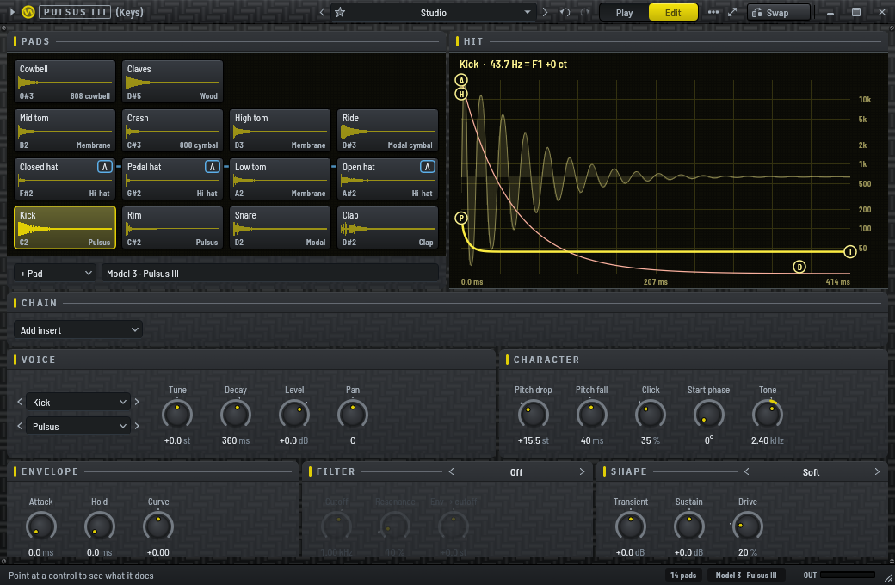</a>

Pulsus II is the drum instrument behind the channel rack: each pad is a kick, snare, metal, clap, tom/percussion or sample voice with its own envelope, pitch, filter, transient, drive and velocity section. Every choice a hit makes is seeded from the note, so a render from any bar equals the full render there.

- Kick models Pulsus, 808 and 909, tuned to F1 at Tune 0
- Modal snare, toms and percussion in five materials, and a modal cymbal
- Up to 16 sample layers per pad; round robin Stack, Cycle, Random or No repeat
- 16 choke groups with a fade time per pad; polyphony per pad
- Hi-hat pedal by MIDI controller opens the hat continuously and plays the chick
- Sixteen factory kits on the General MIDI map

<sub>16 factory kits — [hear them](https://cantusdaw.com/#unit-pulsus) · [light theme](docs/images/units/pulsus-light.png)</sub>

</details>

They share one modulation model — eight macros and a matrix you connect by dragging a
source onto a knob — one frame (Play · Edit · Matrix), and the project's undo. Firmus, the
simple synth every new track starts with, makes ten.

### Effects

Twenty-three effects with a face of their own, each also a CLAP and VST3 plug-in for other DAWs,
and Delay, edited in the inspector.
Seven of them can be heard with and without, on the same excerpt of a demo song, at
[cantusdaw.com](https://cantusdaw.com/#effects).

<table>
<tr>
<td align="center" valign="top" width="25%"><a href="docs/images/units/aequalis-dark.png">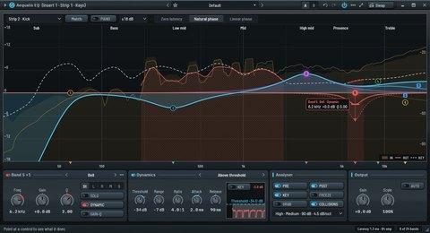</a><br><b>Aequalis</b><br><sub>Equalizer</sub></td>
<td align="center" valign="top" width="25%"><a href="docs/images/units/comprimo-dark.png"></a><br><b>Comprimo</b><br><sub>Compressor</sub></td>
<td align="center" valign="top" width="25%"><a href="docs/images/units/terminus-dark.png">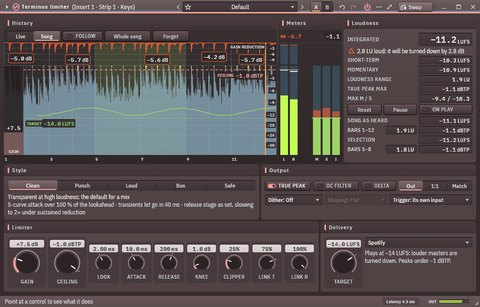</a><br><b>Terminus</b><br><sub>Limiter</sub></td>
<td align="center" valign="top" width="25%"><a href="docs/images/units/culmen-dark.png">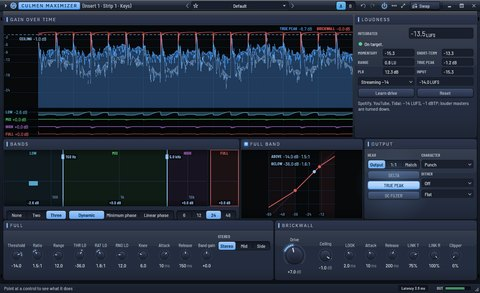</a><br><b>Culmen</b><br><sub>Mastering maximizer</sub></td>
</tr>
<tr>
<td align="center" valign="top" width="25%"><a href="docs/images/units/multiplex-dark.png">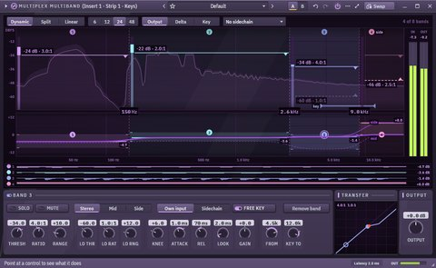</a><br><b>Multiplex</b><br><sub>Multiband dynamics</sub></td>
<td align="center" valign="top" width="25%"><a href="docs/images/units/sibilus-dark.png">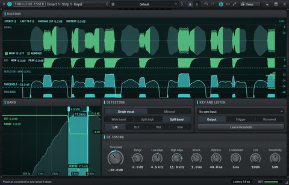</a><br><b>Sibilus</b><br><sub>De-esser</sub></td>
<td align="center" valign="top" width="25%"><a href="docs/images/units/porta-dark.png">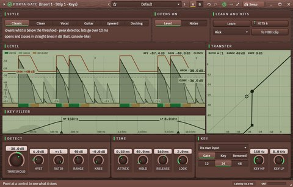</a><br><b>Porta</b><br><sub>Gate and expander</sub></td>
<td align="center" valign="top" width="25%"><a href="docs/images/units/tonsor-dark.png">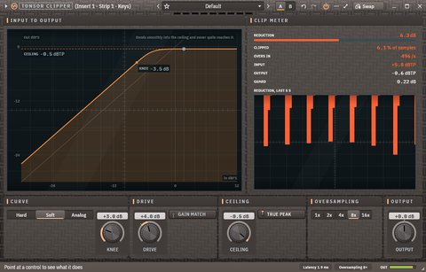</a><br><b>Tonsor</b><br><sub>Clipper</sub></td>
</tr>
<tr>
<td align="center" valign="top" width="25%"><a href="docs/images/units/impetus-dark.png">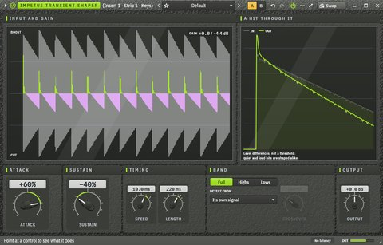</a><br><b>Impetus</b><br><sub>Transient processor</sub></td>
<td align="center" valign="top" width="25%"><a href="docs/images/units/discrimen-dark.png">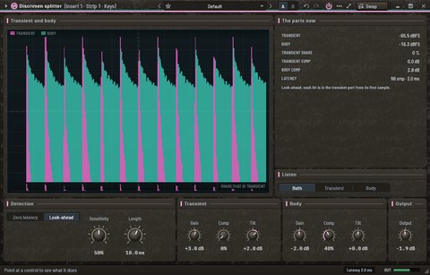</a><br><b>Discrimen</b><br><sub>Transient splitter</sub></td>
<td align="center" valign="top" width="25%"><a href="docs/images/units/spatium-dark.png">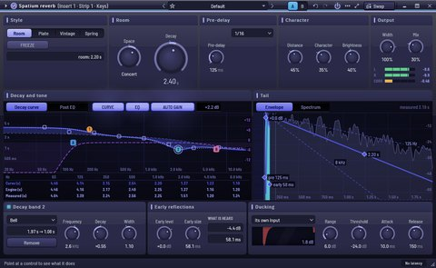</a><br><b>Spatium</b><br><sub>Reverb</sub></td>
<td align="center" valign="top" width="25%"><a href="docs/images/units/fervor-dark.png">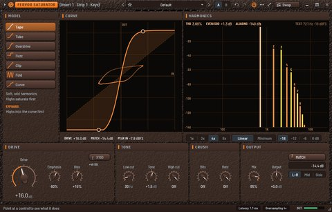</a><br><b>Fervor</b><br><sub>Saturator</sub></td>
</tr>
<tr>
<td align="center" valign="top" width="25%"><a href="docs/images/units/latitudo-dark.png">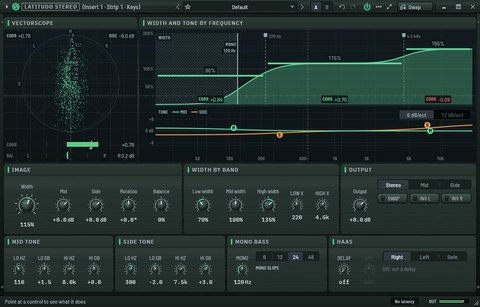</a><br><b>Latitudo</b><br><sub>Stereo imager</sub></td>
<td align="center" valign="top" width="25%"><a href="docs/images/units/speculum-dark.png">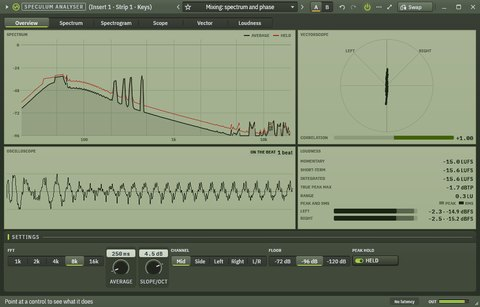</a><br><b>Speculum</b><br><sub>Analyzer</sub></td>
<td align="center" valign="top" width="25%"><a href="docs/images/units/tonus-dark.png">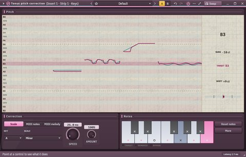</a><br><b>Tonus</b><br><sub>Pitch correction</sub></td>
<td align="center" valign="top" width="25%"><a href="docs/images/units/concentus-dark.png">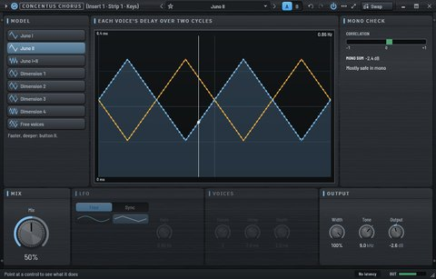</a><br><b>Concentus</b><br><sub>Chorus</sub></td>
</tr>
<tr>
<td align="center" valign="top" width="25%"><a href="docs/images/units/flexus-dark.png">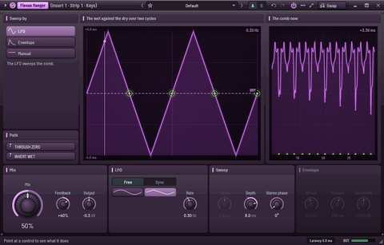</a><br><b>Flexus</b><br><sub>Flanger</sub></td>
<td align="center" valign="top" width="25%"><a href="docs/images/units/phasis-dark.png">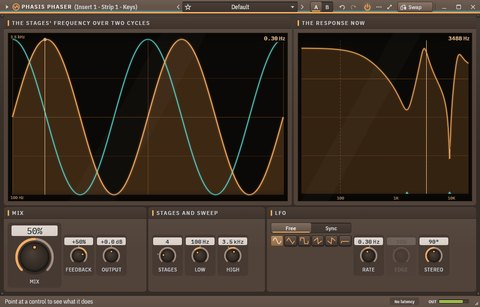</a><br><b>Phasis</b><br><sub>Phaser</sub></td>
<td align="center" valign="top" width="25%"><a href="docs/images/units/tremor-dark.png">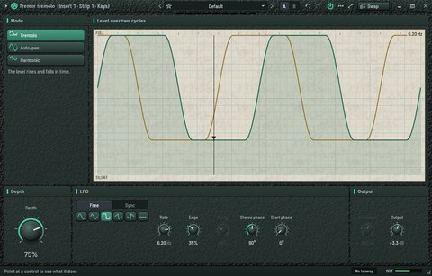</a><br><b>Tremor</b><br><sub>Tremolo and auto-pan</sub></td>
<td align="center" valign="top" width="25%"><a href="docs/images/units/vibrans-dark.png">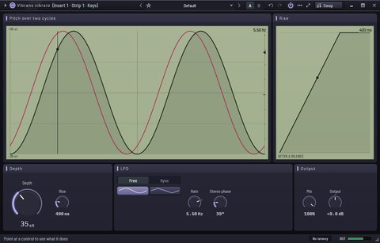</a><br><b>Vibrans</b><br><sub>Vibrato</sub></td>
</tr>
<tr>
<td align="center" valign="top" width="25%"><a href="docs/images/units/anulus-dark.png">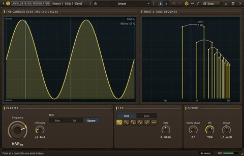</a><br><b>Anulus</b><br><sub>Ring modulator</sub></td>
<td align="center" valign="top" width="25%"><a href="docs/images/units/translatio-dark.png">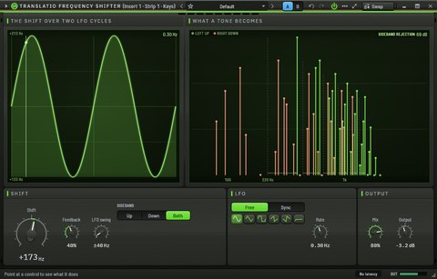</a><br><b>Translatio</b><br><sub>Frequency shifter</sub></td>
<td align="center" valign="top" width="25%"><a href="docs/images/units/fluctus-dark.png">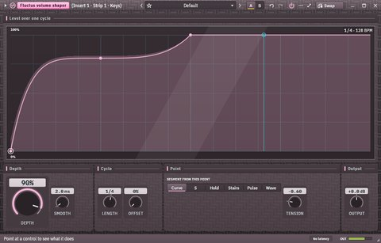</a><br><b>Fluctus</b><br><sub>Volume shaper</sub></td>
<td align="center" valign="top" width="25%"><a href="docs/images/units/delay-dark.png">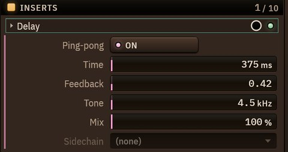</a><br><b>Delay</b><br><sub>Stereo delay</sub></td>
</tr>
</table>

<details>
<summary><b>Aequalis</b> — Equalizer. A 24-band EQ where the display is the control, in zero-latency, natural or linear phase.</summary>

<a href="docs/images/units/aequalis-dark.png">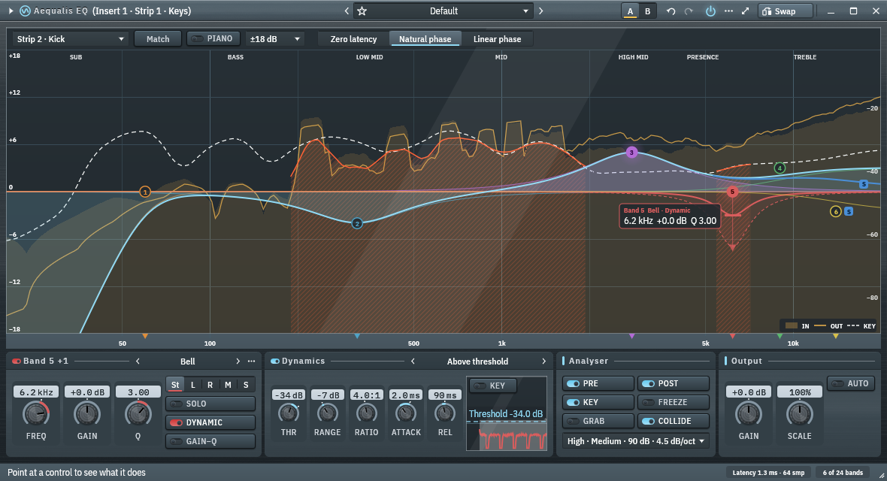</a>

Aequalis is a 24-band equalizer with nine filter shapes, dynamic bands and per-band placement on stereo, left, right, mid or side. You create and shape bands directly on the analyser, key any band from another strip without routing, and match the tone of a reference with EQ match.

- 24 bands, 9 shapes, cuts from 6 to 96 dB/oct, each on stereo, L, R, mid or side
- Zero latency, natural phase (64 samples) or linear phase; latency always on screen
- Dynamic bands in dB and ms, acting above or below the threshold, keyed from any strip
- EQ match fits a reference into ordinary bands and states the remaining error
- Auto gain measured on K-weighted loudness, not estimated from the curve
- Spectrum Grab labels peaks in Hz or note and dB; pull one to make a bell there

<sub>14 factory presets — [hear them](https://cantusdaw.com/#unit-aequalis) · also a CLAP and VST3 plug-in for other DAWs, with the same face · [light theme](docs/images/units/aequalis-light.png)</sub>

</details>
<details>
<summary><b>Comprimo</b> — Compressor. A compressor whose detector you can read: nine styles shown as numbers and a measured auto gain.</summary>

<a href="docs/images/units/comprimo-dark.png">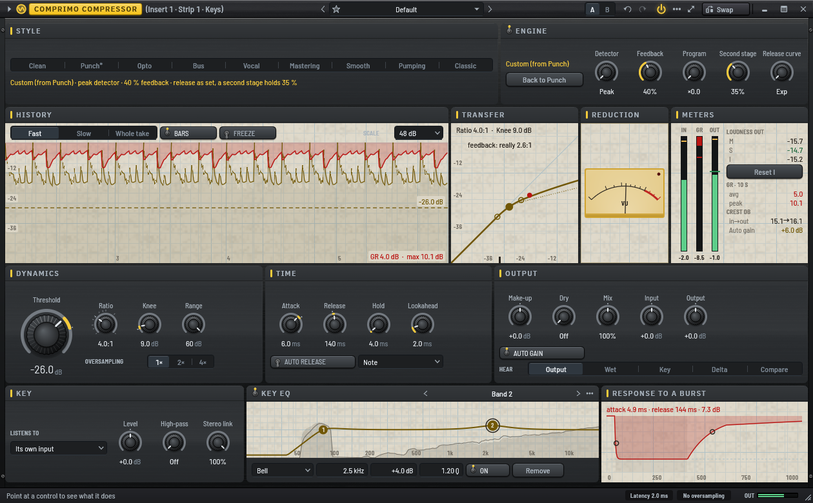</a>

Comprimo is a feed-forward compressor with peak or RMS detection, a feedback blend, program-dependent and two-stage release, lookahead and 2× or 4× oversampling. The key can come from any strip through its own six-band EQ, and the transfer curve and level history are controls you drag.

- Nine styles, each a visible set of detector numbers, editable in an engine drawer
- Auto gain measured on gated short-term loudness; Compare at matched loudness
- Listen to Output, Wet, Key, Delta (what is taken away) or Compare
- Six-band key EQ and a sidechain from any strip, chosen in the editor, no routing
- Mix 0–200 %, dry gain for parallel compression, lookahead up to 20 ms
- Level history with bars and beats; drag the threshold on it

<sub>12 factory presets — [hear them](https://cantusdaw.com/#unit-comprimo) · also a CLAP and VST3 plug-in for other DAWs, with the same face · [light theme](docs/images/units/comprimo-light.png)</sub>

</details>
<details>
<summary><b>Terminus</b> — Limiter. A true-peak limiter with conformance-tested loudness and a history kept in song time.</summary>

<a href="docs/images/units/terminus-dark.png"></a>

Terminus is a two-stage mastering limiter, a look-ahead transient stage and a release stage, with true-peak detection checked against a 32× reference. It measures loudness to BS.1770-4 and EBU R128, judges it against delivery profiles in words, and keeps its gain reduction at each bar and beat of the song.

- Five styles (Clean, Punch, Loud, Bus, Safe), each printed as the numbers it sets
- True peak held at least 0.1 dB under the ceiling, verified by a 32× reference
- Song view stores reduction by bar; loudness of the whole song or a time selection
- Delivery profiles (streaming, EBU R128, ATSC A/85) with a written pass/fail verdict
- Monitor Out, 1:1, loudness-matched Match, or Δ (what the limiter takes away)
- 4× soft clipper, 0–12 dB knee, TPDF dither 16–24 bit, silent on digital silence

<sub>12 factory presets — [hear them](https://cantusdaw.com/#unit-terminus) · also a CLAP and VST3 plug-in for other DAWs, with the same face · [light theme](docs/images/units/terminus-light.png)</sub>

</details>
<details>
<summary><b>Culmen</b> — Mastering maximizer. Up to three bands plus a full band, each with a two-sided curve, into a true-peak brickwall.</summary>

<a href="docs/images/units/culmen-dark.png">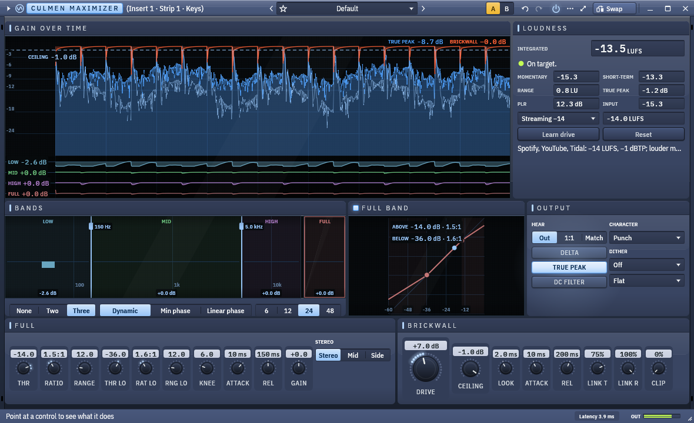</a>

Culmen is a mastering maximizer: a band stage of up to three bands and a full band, each able to compress, expand or lift quiet parts, then a drive into a true-peak brickwall limiter. It meters loudness to EBU R128, and Learn drive sets the drive by measuring the output until it reaches your target.

- Learn drive: a closed loop that stops within 0.3 LU of the target, one undo step
- Two-sided curve per band: hold peaks and lift quiet parts at once, with numbers
- Crossovers: Dynamic (no latency), minimum phase or linear phase, 6–48 dB/oct
- Five delivery targets set target and ceiling in one step; verdict in words and shape
- Integrated, momentary, short-term, LRA, true peak, PLR and input loudness at once
- One time axis shows input, output, brickwall reduction and a lane per band

<sub>12 factory presets — [hear them](https://cantusdaw.com/#unit-culmen) · also a CLAP and VST3 plug-in for other DAWs, with the same face · [light theme](docs/images/units/culmen-light.png)</sub>

</details>
<details>
<summary><b>Multiplex</b> — Multiband dynamics. Up to eight bands that compress and expand on both sides, with thresholds dragged on the spectrum.</summary>

<a href="docs/images/units/multiplex-dark.png">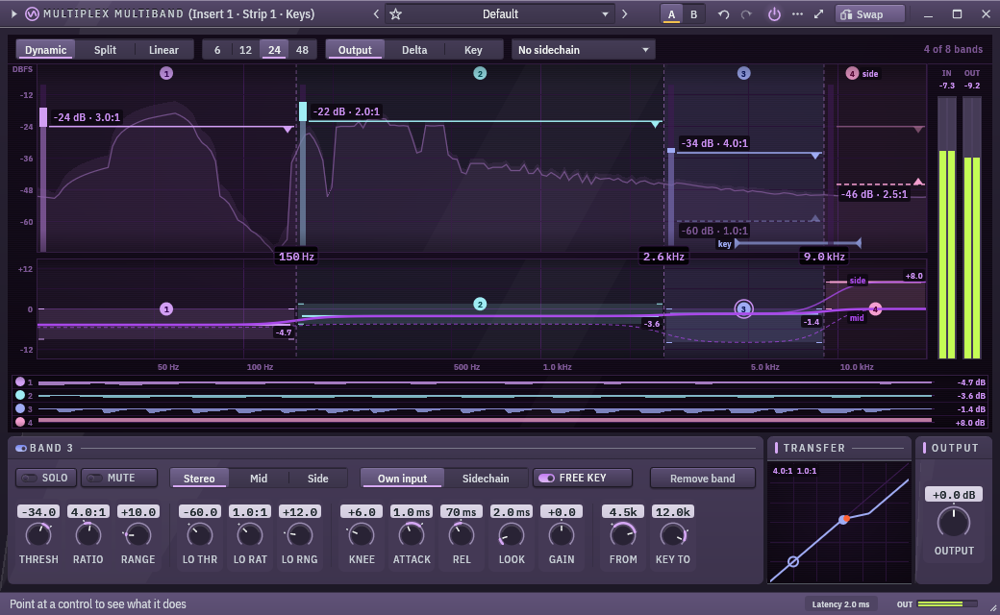</a>

Multiplex splits the spectrum into up to eight bands, each with an upper and a lower threshold, so one band can hold its peaks down and lift its quiet parts at once. Bands work on stereo, mid or side, listen to their own signal or a sidechain from any strip, and are edited directly on the display.

- Up to 8 bands; upper and lower sections, each with its own ratio and range
- Three modes: Dynamic (zero latency), Split (Linkwitz–Riley) and Linear phase
- Upper and lower thresholds drawn and dragged against each band's live level
- Attack and release in ms, ratios shown as 4.0:1 or 1:2.0, knee 0–24 dB
- Per-band lookahead 0–20 ms; latency is the largest in use, always shown
- Listen to output, delta or key; a history lane per band

<sub>12 factory presets — [hear them](https://cantusdaw.com/#unit-multiplex) · also a CLAP and VST3 plug-in for other DAWs, with the same face · [light theme](docs/images/units/multiplex-light.png)</sub>

</details>
<details>
<summary><b>Sibilus</b> — De-esser. A de-esser that tells an 's' from a bright sound, with a detector you can see and check.</summary>

<a href="docs/images/units/sibilus-dark.png">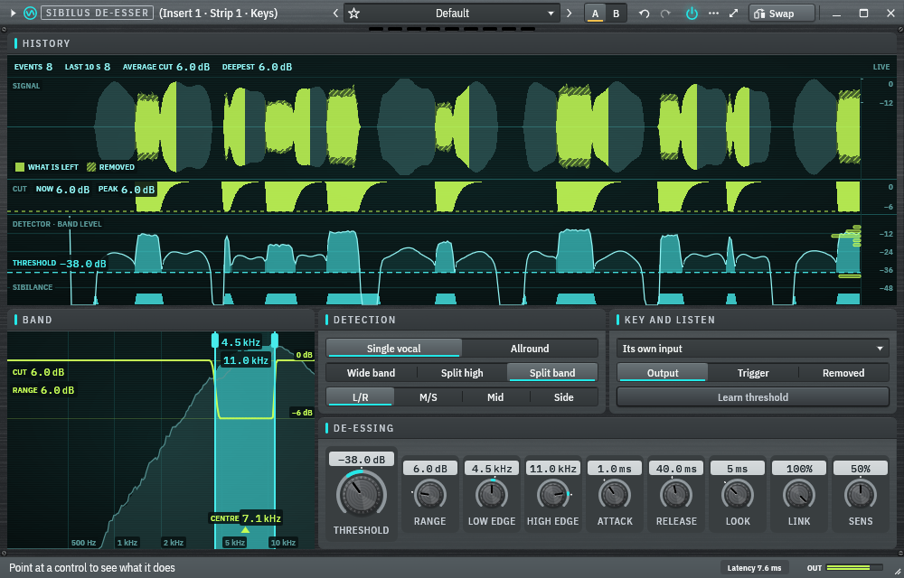</a>

Sibilus turns sibilance down across the whole signal or only in its band. In Single vocal mode a classifier combines two measured features, the band's share of the energy and its spectral flatness, so bright vowels and tones are left alone. A key from any strip, lookahead and mid/side are built in.

- Single vocal and Allround detection; the classifier's confidence drawn per column
- Wide band, Split high or Split band (linear phase, leaves the air above alone)
- Band 1–20 kHz dragged on a spectrum; threshold dragged on the detector lane
- Learn threshold from a passage, in one undo step
- Lookahead 0–15 ms reported for compensation; L/R, M/S, mid only or side only
- Listen to Trigger or Removed; events, average and deepest cut per event

<sub>12 factory presets — [hear them](https://cantusdaw.com/#unit-sibilus) · also a CLAP and VST3 plug-in for other DAWs, with the same face · [light theme](docs/images/units/sibilus-light.png)</sub>

</details>
<details>
<summary><b>Porta</b> — Gate and expander. A gate and expander with real hysteresis, a MIDI trigger, and hits you can turn into MIDI.</summary>

<a href="docs/images/units/porta-dark.png"></a>

Porta is a gate, a downward and upward expander and a ducker around one detector. The key can be its own input or any strip, filtered before the detector; the open and close thresholds are lines you drag on the level history, and it can also be opened by a track's MIDI notes.

- Hysteresis as a parameter: open and close thresholds dragged as lines
- Six styles (Classic, Clean, Vocal, Guitar, Upward, Ducking), each spelled out
- Key high- and low-pass at 12, 24 or 48 dB/oct, dragged on a spectrum
- Hear the gate, the key, or exactly what the gate removes
- Learn thresholds from a passage; hits become a MIDI clip on a new drum track
- Opens from a track's MIDI notes; lookahead 0–10 ms at a fixed 10 ms latency

<sub>12 factory presets — [hear them](https://cantusdaw.com/#unit-porta) · also a CLAP and VST3 plug-in for other DAWs, with the same face · [light theme](docs/images/units/porta-light.png)</sub>

</details>
<details>
<summary><b>Tonsor</b> — Clipper. A clipper with a true-peak ceiling and up to 16× oversampling that leaves the rest untouched.</summary>

<a href="docs/images/units/tonsor-dark.png"></a>

Tonsor cuts the peaks off a sound with a hard, soft or analog-style shoulder. Oversampling up to 16× keeps the harmonics it makes from folding back, and the true-peak ceiling also holds between the samples. The editor shows the curve, the reduction, the share of samples clipped and the overs between samples.

- Hard, Soft and Analog curves, with a 0–12 dB knee under the ceiling
- Oversampling 1× to 16×; samples the curve leaves alone pass to the bit
- True-peak guard: −0.045 dB re the ceiling where a plain clip went +1.88 dB over
- Gain match takes the drive back out after the curve
- Latency 0 at 1× without the guard, at most 1.9 ms at 48 kHz
- Aliasing of a hard-clipped 7 kHz sine: −15.9 dB at 1×, −84.7 dB at 16×

<sub>12 factory presets — [hear them](https://cantusdaw.com/#unit-tonsor) · also a CLAP and VST3 plug-in for other DAWs, with the same face · [light theme](docs/images/units/tonsor-light.png)</sub>

</details>
<details>
<summary><b>Impetus</b> — Transient processor. Shapes attack and sustain from level differences, so there is no threshold to set.</summary>

<a href="docs/images/units/impetus-dark.png"></a>

Impetus makes the onsets of a sound louder or softer and its tails longer or shorter by comparing a fast envelope with a slow one, so a quiet hit and a loud one are shaped alike. A split band shapes only the highs or only the lows, and another strip's hits can drive it as a sidechain.

- Attack and sustain from −100 to +100 %, with no threshold
- Split band: Full, Highs or Lows, with a crossover from 40 Hz to 8 kHz
- Sidechain from any strip, chosen in the editor's Detect from field
- No latency; at 0 % the sound passes untouched
- Shows a test hit through the real DSP and the last three seconds
- Measured: attack at +100 % lifts the first 5 ms of each hit by 14.0 dB

<sub>12 factory presets — [hear them](https://cantusdaw.com/#unit-impetus) · also a CLAP and VST3 plug-in for other DAWs, with the same face · [light theme](docs/images/units/impetus-light.png)</sub>

</details>
<details>
<summary><b>Discrimen</b> — Transient splitter. Splits each hit into transient and body, each with its own gain, compressor and tilt.</summary>

<a href="docs/images/units/discrimen-dark.png"></a>

Discrimen cuts a sound into its transient, the attack of every hit, and its body, everything else. Each part gets its own gain, one-knob compressor and tilt before they are summed back; left alone, the two parts add up to the input to the bit, so it can sit on any track.

- Transient and body sum back to the input to the bit
- Per part: gain ±24 dB, a one-knob compressor and a tilt around 1 kHz
- Zero-latency detection, or a 2 ms look-ahead that catches every onset
- Listen to both, the transient alone or the body alone
- Sensitivity and speed set what counts as a transient and how long it lasts

<sub>12 factory presets — [hear them](https://cantusdaw.com/#unit-discrimen) · also a CLAP and VST3 plug-in for other DAWs, with the same face · [light theme](docs/images/units/discrimen-light.png)</sub>

</details>
<details>
<summary><b>Spatium</b> — Reverb. A reverb whose decay you draw in seconds per frequency, with the measured decay shown beside it.</summary>

<a href="docs/images/units/spatium-dark.png"></a>

Spatium is a 16-line feedback delay network whose decay time is a curve you draw in seconds, with filters fitted so the tail follows it. The editor shows the curve you asked for, what the engine achieves and what was measured on the real tail, plus a time view with handles on the pre-delay, reflections and decay.

- Twelve named rooms morphed by one Space control; the decay follows, in seconds
- Four styles: Room, Plate, Vintage and Spring
- Decay EQ on a seconds axis; per-octave table of curve, engine and measured
- Measured spectrogram of the real tail with the curve's −30 and −60 dB lines
- Shapeable early reflections, six-band post EQ and freeze; no latency
- Ducking with threshold, range, attack and release, keyed from any strip

<sub>12 factory presets — [hear them](https://cantusdaw.com/#unit-spatium) · also a CLAP and VST3 plug-in for other DAWs, with the same face · [light theme](docs/images/units/spatium-light.png)</sub>

</details>
<details>
<summary><b>Fervor</b> — Saturator. Seven saturation models, including a curve you draw, level-matched so louder never wins.</summary>

<a href="docs/images/units/fervor-dark.png"></a>

Fervor bends a signal through tape, tube, overdrive, fuzz, clip, fold or a curve you draw, oversampled up to 8× with linear- or minimum-phase filters. A bias adds even harmonics, filters before and after shape the tone, and the editor measures the harmonics of a test tone, with aliasing shown in red.

- Tape, Tube, Overdrive, Fuzz, Clip, Fold and a drawn Curve of up to 16 points
- Oversampling 1× to 8×, linear phase (47–57 samples) or minimum phase (5–8)
- Static level match at −18 dBFS RMS: it never pumps, and the gain is shown
- Harmonics display: even and odd in two hues, aliasing in red, THD readout
- Bias, low cut before and high cut after the curve, tilt, bit and rate reduction
- Stereo, mid only or side only; dry/wet with the dry path delayed to match

<sub>13 factory presets — [hear them](https://cantusdaw.com/#unit-fervor) · also a CLAP and VST3 plug-in for other DAWs, with the same face · [light theme](docs/images/units/fervor-light.png)</sub>

</details>
<details>
<summary><b>Latitudo</b> — Stereo imager. Width, mono bass and mid/side tone in one device that never delays the signal.</summary>

<a href="docs/images/units/latitudo-dark.png"></a>

Latitudo is the stereo tool for a strip or the master: width, mid and side gain, balance, rotation, swap and polarity; mono below a frequency through a phase-coherent crossover; width in three bands; mid/side shelving; and Haas widening. At its defaults it returns its input to the bit.

- Mono below 20–1000 Hz, phase-coherent: a hard-left source above stays hard left
- Width in three bands, crossovers dragged on a map of width over frequency
- Mid/side tone: low and high shelves on the mid and on the side
- Haas widening, classic or mono-safe (the mono sum stays the input's)
- Vectorscope with level rings; correlation overall, per band and input vs output
- Rotation ±45°, balance, swap and per-channel polarity; no latency

<sub>13 factory presets — [hear them](https://cantusdaw.com/#unit-latitudo) · also a CLAP and VST3 plug-in for other DAWs, with the same face · [light theme](docs/images/units/latitudo-light.png)</sub>

</details>
<details>
<summary><b>Speculum</b> — Analyzer. Spectrum, spectrogram, scope, vectorscope and R128 loudness in one pass-through analyser.</summary>

<a href="docs/images/units/speculum-dark.png"></a>

Speculum shows what is in a sound and never touches it: spectrum, spectrogram, an oscilloscope triggered or synced to the beat, a vectorscope with phase correlation, and loudness to EBU R128 with peak and RMS per channel. It floats or docks in the workspace, and several can be watched at once.

- Momentary, short-term and integrated LUFS, loudness range and true peak
- Spectrum: FFT 1k–16k, averaging, 0–6 dB/oct slope, peak hold, mid, side or L/R
- Oscilloscope free, triggered, or locked to 1/4 to 8 beats of the song
- A pure pass-through: renders bit-identically to no Speculum
- Docks as a resizable tab; three at once measured with no frame lost at 60 Hz
- Readings checked against the EBU Tech 3341 and 3342 test signals

<sub>8 factory presets — [hear them](https://cantusdaw.com/#unit-speculum) · also a CLAP and VST3 plug-in for other DAWs, with the same face · [light theme](docs/images/units/speculum-light.png)</sub>

</details>
<details>
<summary><b>Tonus</b> — Pitch correction. Real-time pitch correction at a constant 2.7 ms latency, low enough to monitor while recording.</summary>

<a href="docs/images/units/tonus-dark.png"></a>

Tonus hears a monophonic voice and moves it to a target note chosen from a key and scale, any set of notes, or the notes played on MIDI. The retune speed runs from the hard, stepped effect at 0 ms to a slow, natural pull, and the voice keeps its formants whatever the shift.

- Targets from 13 scales, a one-octave keyboard, MIDI notes or a MIDI melody
- Retune speed 0–400 ms, humanise, flex tolerance and amount
- Formants kept, or moved on purpose with throat ±12 semitones
- Latency 128 samples at 48 kHz (2.7 ms), the same at every setting
- Removes, keeps or doubles the singer's vibrato, or adds a created one
- Pitch display of the last three seconds over note lanes, with a cents meter

<sub>12 factory presets — [hear them](https://cantusdaw.com/#unit-tonus) · also a CLAP and VST3 plug-in for other DAWs, with the same face · [light theme](docs/images/units/tonus-light.png)</sub>

</details>
<details>
<summary><b>Concentus</b> — Chorus. Classic bucket-brigade chorus models and free voices, with a mono check as it plays.</summary>

<a href="docs/images/units/concentus-dark.png"></a>

Concentus thickens and widens: three classic polysynth chorus modes (I, II and I+II, from the circuit's published measurements), four crossed-pair widening modes, and a Free mode of one to four voices, free or synced. The editor draws every voice's delay and checks the mono sum as it plays.

- Seven models plus Free: 1–4 voices, sine or triangle, free or synced to the song
- Mono check: correlation, the mono sum's loss and a verdict in words
- Every voice's delay drawn over two cycles, exactly as the unit plays it
- Bucket-brigade style lines darkened by a 2–20 kHz tone filter
- Model changes glide over 40 ms, so switching while playing does not click

<sub>14 factory presets — [hear them](https://cantusdaw.com/#unit-concentus) · also a CLAP and VST3 plug-in for other DAWs, with the same face · [light theme](docs/images/units/concentus-light.png)</sub>

</details>
<details>
<summary><b>Flexus</b> — Flanger. A through-zero flanger that draws the comb you hear and reports its latency to compensation.</summary>

<a href="docs/images/units/flexus-dark.png"></a>

Flexus mixes the signal with a copy read from a swept delay. The sweep follows an LFO (free or synced), the input's envelope, or a manual position for automation. Through zero, the dry path is delayed 5 ms so the moving copy passes through it, reaching the deep cancellation at the crossing.

- Through zero: dry delayed 5 ms, latency compensated even when automated
- Sweep by LFO (free or synced), by the input's envelope, or by a manual position
- Feedback ±95 % in either polarity; the wet can be inverted
- The comb drawn with the unit's own arithmetic, within 0.6 dB of what plays
- Stereo spread of 0–180° between the channels' LFOs

<sub>12 factory presets — [hear them](https://cantusdaw.com/#unit-flexus) · also a CLAP and VST3 plug-in for other DAWs, with the same face · [light theme](docs/images/units/flexus-light.png)</sub>

</details>
<details>
<summary><b>Phasis</b> — Phaser. A phaser of 2 to 12 stages with bounded feedback and the response drawn as it moves.</summary>

<a href="docs/images/units/phasis-dark.png"></a>

Phasis runs the signal through a cascade of allpass stages and mixes it with the dry, so every two stages make a notch that the LFO sweeps between a low and a high bound. It syncs to the song and draws both the sweep and the response now.

- 2 to 12 allpass stages, a notch for every two
- Feedback of either polarity, bounded at ±95 %
- Six LFO shapes including a stepped random sweep, free or synced to the song
- Sweep bounds from 20 Hz to 16 kHz, moved on a log scale
- Response drawn with the unit's own arithmetic, within 0.3 dB of what plays

<sub>12 factory presets — [hear them](https://cantusdaw.com/#unit-phasis) · also a CLAP and VST3 plug-in for other DAWs, with the same face · [light theme](docs/images/units/phasis-light.png)</sub>

</details>
<details>
<summary><b>Tremor</b> — Tremolo and auto-pan. Tremolo, auto-pan and harmonic tremolo locked to the song position, with no clicks on a square.</summary>

<a href="docs/images/units/tremor-dark.png"></a>

Tremor moves a sound's level, its place between the speakers or, in harmonic mode, its lows against its highs, in time with the song. The LFO follows the song position, so a render from any bar hears what the full render hears there.

- Modes: Tremolo, Auto-pan (a balance that never raises a channel) and Harmonic
- Synced from 8/1 to 1/32 with dotted and triplet values, or free from 0.05 to 20 Hz
- Six shapes, with a soft edge on the square, the saws and the random steps
- Swing on synced cycles; stereo phase spread of 0–180°
- Draws the next two cycles with a playhead where the unit is now
- In another DAW, the plug-in follows that host's tempo and position

<sub>12 factory presets — [hear them](https://cantusdaw.com/#unit-tremor) · also a CLAP and VST3 plug-in for other DAWs, with the same face · [light theme](docs/images/units/tremor-light.png)</sub>

</details>
<details>
<summary><b>Vibrans</b> — Vibrato. A vibrato set in cents, so the pitch swings exactly as far as the knob says at any rate.</summary>

<a href="docs/images/units/vibrans-dark.png"></a>

Vibrans makes the pitch waver by reading the sound from a delay line whose length moves. The depth is set in cents, a rise lets the vibrato arrive after each note as a performer's does, and lowering the mix turns it into a one-voice chorus.

- Depth from 0 to 100 cents, the same at any rate
- Rise 0–2000 ms: the vibrato fades in after each silence detected in the audio
- Free rates from 0.2 to 15 Hz, or synced from 8/1 to 1/32
- Sine or triangle; stereo phase spread of 0–180°
- The display draws the pitch, not the delay, over two cycles

<sub>12 factory presets — [hear them](https://cantusdaw.com/#unit-vibrans) · also a CLAP and VST3 plug-in for other DAWs, with the same face · [light theme](docs/images/units/vibrans-light.png)</sub>

</details>
<details>
<summary><b>Anulus</b> — Ring modulator. A clean ring modulator with band-limited carriers and a display of what a tone becomes.</summary>

<a href="docs/images/units/anulus-dark.png"></a>

Anulus multiplies the sound by a carrier, turning every partial into a pair of sum and difference frequencies: bell-like and metallic sounds or, at a few hertz, a tremolo through zero. The carrier is a band-limited sine, triangle or square, and an LFO can swing its frequency.

- Sine, triangle or square carrier from 1 Hz to 5 kHz, band-limited
- The carrier shown as a note with its cents
- No carrier or input bleed: the input's frequency stays below −80 dB
- An LFO swings the carrier up to two octaves either way, free or synced
- Draws every partial a 1 kHz tone becomes, within 1 dB of the DSP
- DC removed after the product; stereo carrier phase spread of 0–180°

<sub>12 factory presets — [hear them](https://cantusdaw.com/#unit-anulus) · also a CLAP and VST3 plug-in for other DAWs, with the same face · [light theme](docs/images/units/anulus-light.png)</sub>

</details>
<details>
<summary><b>Translatio</b> — Frequency shifter. A frequency shifter with 60 dB or more of sideband rejection from 20 Hz, and barber-pole feedback.</summary>

<a href="docs/images/units/translatio-dark.png"></a>

Translatio moves every partial by the same number of hertz, so a harmonic tone stops being harmonic: slow phasing, a detuned shimmer, bells or robots. It is a single-sideband shifter with up, down or both sidebands, feedback for barber-pole spirals and an LFO on the shift.

- Shift from −2000 to +2000 Hz; Up, Down, or Both (left up, right down)
- Other sideband ≥ 60 dB down from 20 Hz to 19.9 kHz (69.2 dB worst measured)
- Feedback up to 95 % stays bounded at any shift
- An LFO on the shift of up to ±1000 Hz, free or synced
- Draws what a harmonic 220 Hz tone becomes; no latency

<sub>12 factory presets — [hear them](https://cantusdaw.com/#unit-translatio) · also a CLAP and VST3 plug-in for other DAWs, with the same face · [light theme](docs/images/units/translatio-light.png)</sub>

</details>
<details>
<summary><b>Fluctus</b> — Volume shaper. Draw the pump: a level curve of up to 16 points that repeats in time with the song.</summary>

<a href="docs/images/units/fluctus-dark.png"></a>

Fluctus makes the level follow a drawn curve that repeats with the song: the sidechain pump without a key, gates, swells and chops. Each segment bends with the same six shapes and tension as the automation editor, and the cycle follows the song position.

- Up to 16 points per cycle; a cycle from 4/1 to 1/16 of the song
- Six segment shapes (curve, S, hold, stairs, pulse, wave) with tension
- Follows the song position: a render from any bar matches the full render
- Smoothing of 0–50 ms (2 ms by default) so a step never clicks
- Offset nudges the curve onto the kick

<sub>12 factory presets — [hear them](https://cantusdaw.com/#unit-fluctus) · also a CLAP and VST3 plug-in for other DAWs, with the same face · [light theme](docs/images/units/fluctus-light.png)</sub>

</details>
<details>
<summary><b>Delay</b> — Stereo delay. A stereo echo with ping-pong and repeats that darken, edited right in the inspector.</summary>

<a href="docs/images/units/delay-dark.png"></a>

Delay is Cantus's plain stereo echo: a time of up to two seconds, feedback, a tone filter inside the feedback path so each repeat is darker than the one before, and ping-pong between the sides. It has no window of its own: it opens under its insert in the inspector, where every parameter is automated and modulated like any other. A change of time glides through a fractional read head, so a sweep bends the pitch as tape does instead of clicking.

- Time from 1 ms to 2 s; a sweep glides and bends the pitch like tape, never clicks
- Feedback up to 95 %, with a tone filter from 200 Hz to 20 kHz in the loop
- Ping-pong between left and right, or straight stereo repeats
- Dry/wet on the insert; every parameter automated and modulated from the inspector
- Slapback, dotted eighth, dub spiral, tape echo, doubler and more, by style and role
- Its two-second line is allocated once: nothing allocated or locked while it plays

<sub>13 factory presets — [hear them](https://cantusdaw.com/#unit-delay) · [light theme](docs/images/units/delay-light.png)</sub>

</details>

Plus the older **Reverb** (kept for the projects that use it), and any **CLAP or VST3** plug-in with a
generic editor or its own window. Every effect is a bit-exact wire at settings that do
nothing, and any strip can key any of them. Fervor, Latitudo and Culmen make the master
chain a mastering chain. Design notes and feature matrices: [docs/plugins/](docs/plugins/)
and [docs/instruments/](docs/instruments/).

### The workspace

Panels dock, split, float and remember their size. F5 / F6 / F7 / F9 bring up the
arrangement, channel rack, piano roll and mixer, Alt+F8 the sample browser, I the
inspector; the hint bar names whatever is under the pointer. English and Spanish, and
names in any script.

| Cantus Night (dark, the default) | Cantus Paper (light) |
|---|---|
|  |  |

### Mixer, cables and routing

<p>
  
  
</p>

The desk follows FL's strip: a colour number, the name, meter, mute and solo, pan, fader,
phase and swap, the effect chain, the output and the sends — rows that line up across the
desk, named once in a legend column. Under it, **cables**: drag from a strip's port to
another, or click one and then the other; each send taps before or after the fader. The
inspector shows the selected channel as a signal-flow sheet: inserts, the channel EQ you
drag, sends, receives and routing, with the channel's own fader at the bottom.

<p>
  
</p>

The **routing matrix** (Alt+F9) shows every source against every destination: click a cell
to route, drag for the level.

### Arrangement, linked clips, piano roll, channel rack


Duplicate a clip, paste it or Alt-drag it and the copy is **the same clip**: edit one and
every copy follows, until *Make unique* (Alt+U). *Link to…* (Alt+N) makes a clip become
another; the inspector's *Link* row counts the copies. The **clip browser** (Alt+F5) lists
every clip as a tile — drag one onto the arrangement, or click it and paint copies along a
track with the **paint tool** (B).

| | |
|---|---|
|  |  |

The piano roll has FL's seven tools and a velocity lane, and holds 20 000 notes on screen
within its frame budget; in the channel rack a step *is* a note.

### The score


**Score** in the piano roll's toolbar (Alt+S) puts the clip's part under the roll as an
engraved staff that follows the playhead and shares the selection; the **Score** pane
(Alt+Shift+S) shows a whole track in systems. The notes are read for the score only — each
beat picks straight values or triplets — and written as Dorico or MuseScore would: ties
that show the beat, beams by the metre, a grand staff whose split follows the hands,
accidentals and courtesy accidentals in the song's key, tempo and metre changes, dynamics
from velocity, 8va lines, in the SMuFL font Bravura.

| The Score pane (Cantus Paper) | A printed page (A4) |
|---|---|
|  |  |

Click a note to select it; ↑ ↓ move it a step of the key; **N** enters notes by letter and
value, as in MuseScore — each edit one undo step. Per track: clef, one staff or two,
transposition (B♭, E♭, F…), the reading grid, the part's name. **MusicXML 4.0** out (a part
or the whole song) and in, vector **PDF** (A4 or Letter, fonts embedded), **Print**.

### The session view, Link and MPE


**Tab** puts the **Session** pane in front of the arrangement and back. Each track has a
column of slots, each scene a row; launch a clip or a scene on the next bar (or the clip's
own quantise), hold it as a gate, record into an armed track's empty slot. A clip's panel
sets its launch, loop, **follow actions** (two, with a chance and a count, as in Live 12)
and **envelopes**; a scene can set the tempo and the metre. *Capture* copies what plays into
a new scene; *Arr. record* writes the launches into the arrangement as you play them; *Back
to arr.* hands every track back to it. Enter, the arrows and the clipboard work on the grid;
a pad, a key or a note learnt on a slot or a scene launches it.

| Cantus Paper | A Launchpad's ring |
|---|---|
|  |  |

A **Launchpad** (Mini MK3, X, Pro MK3) or an **APC** (mini mk2, APC40 mkII) is found when
it is plugged in: the pads launch and light in the clips' colours — green while playing,
flashing while queued, red while recording — and the arrows move the ring the grid shows.

<p>
  
</p>

**Ableton Link** is built in (a Rust implementation, wire-compatible with the SDK): turn on
LINK and the tempo, the beat and start/stop are shared with Live and every Link app on the
network, the peers counted in the top bar. Cantus follows **MIDI clock** or **MIDI time
code** from a port, or sends them, each output with its own offset.

<p>
  
  
</p>

Settings ▸ MIDI sets each port in one row: notes, controls, clock, time code, **MPE** and
the grid. A port marked MPE plays and records **per-note expression** — bend, pressure and
timbre — kept on each note and edited in the piano roll's lanes; Unda, Calor, Modulus and
Gravis play it, and an MPE plug-in gets it as note expressions or as MPE MIDI.

### AI that works with you — agents, stems, audio to MIDI, mastering


The assistant you already use — **Claude Code, Claude Desktop, Cursor, VS Code, Gemini CLI,
LM Studio** — can work in Cantus through the **Model Context Protocol**. It brings its model;
Cantus brings about sixty tools made for music: tracks, notes and chords, the mixer, effects
and instruments in their own units, automation, the session, export — and a catalogue of
every unit, a **music linter** that finds a note ringing across a chord change, and writers
that turn a chord chart into a part (`write_part`, `voice_chords`, `pedal_from_chart`).
**Every change is one step of the undo history**, named *AI: …*; edits ask first on a card,
and removing your material, undoing and files always ask. The agent chip in the top bar
opens the **AI activity**: every call, *Undo all of its changes*, *Disconnect*.

<p>
  
  
</p>

**Settings ▸ AI** holds one switch for the whole area; external agents are **off** until you
allow them, and then reach a door on `127.0.0.1` only, with a token per client — *Copy
setup for…* gives each client its lines. An agent can **listen**: `audition` answers with
loudness per section, true peak, the spectrum against a genre's curve and a WAV, and after
an edit near the end renders only the end — from a checkpoint, identical to the whole song
to the sample. The **mastering assistant** on the master proposes a chain of Cantus's own
effects for Spotify, Apple Music, YouTube, TIDAL, Amazon Music, SoundCloud, CD, Club or
EBU R 128, says why each setting is there, compares by A/B at the same loudness and applies
in one undo step (on the demo songs: within 0.07 LU of the target, never over the ceiling).


**Separate stems…** splits a clip into drums, bass, vocals and the rest (or six parts) with
Meta's **HT-Demucs**, in a helper process on your computer through ONNX Runtime — the parts
on their own tracks under a bus, level-true to the original, in one undo step. Measured on
MUSDB18-HQ: **8.80 dB SDR**, the paper's own numbers. **Convert to MIDI…** writes what a
clip plays as notes: a melody by Cantus's pitch tracker, chords by Spotify's **Basic Pitch**
(note for note what Spotify's program gives), drums by Cantus's own detector and Magenta's
drum model.

<p>
  
  
</p>

Models are never in the installer: each is downloaded from its maker the first time, after
you see its licence, size and origin, checked by SHA-256 and removable in Settings ▸ Models.

### A dancer for your songs — characters, video, the stage


Add a **Saltator** track and a character dances over your workspace **to the beat** — no
automation needed. Its moves, travel, speed, energy, lift, spin, size, mood and colour are
ordinary automation and modulator targets, MIDI learn reaches them, and notes from C3
choose its sixteen moves like a drum map, so an automation clip changes the dance exactly
on the bars where you drew it. *React to* makes it move with a channel's level or the whole
song's. The dancer makes no sound: the tests hold every sample of a song with dancers
equal, bit for bit, to the same song without them.


<p>
  
  
</p>

Eight characters of our own come with Cantus — led by **Fuga** the ninja (masked, a torn
crimson scarf in the wind: flips, high kicks, a crouched landing) and **Volta** the mecha
(a V visor of light, a core that pulses on the beat, jets for its rocket jump), then
**Trino** the songbird, **Miso** the cat, **Lana** the lamb, **Tic** the metronome robot,
**Corchea** the eighth note and **Sol** — each with every move and mood, in its own style,
crisp at any size. Bring your own as **Lottie**
(`.json`, `.lottie`), **Aseprite** or **TexturePacker** sprite sheets or **DragonBones**
skeletons: Cantus reads them with its own players, runs no script in them, bounds every
size, shows their licence first and copies them into the project.

**The companion** (Alt+Shift+D; Alt+D shows or hides the dancers) keeps dancing in a small window above everything while you work —
on Windows with true transparency, soft shadows and all; **streaming mode** (Ctrl+Shift+D)
gives OBS or Streamlabs a window titled *Cantus Stage* with a transparent or chroma
background, a fixed size and place, and a light visualiser of the song. Measured for an
hour under OBS: about 3.4 % of one processor core.

<p>
  
  
</p>

**File ▸ Export video…** turns the song into a clip with the dancers and the song's audio:
**MP4** (H.264 and AAC from your system's encoders), **WebM**, or a **transparent MOV** or
PNG frames for an editor — square, vertical or wide, 30 or 60 frames a second, on the stage,
transparent, on a chroma key or black, with a title. Audio and picture are in sync to the
sample: decoded back, 0.000 ms on every path.

### Sounds

<p>
  
</p>

Free sound packs download on demand from *Sound packs…* — kits, percussion, a TX81Z and the
**Salamander Grand Piano** (a Yamaha C5 in 16 velocity layers), which plays in Exemplar,
streamed from disk through a sample cache. Packs are CC0, or CC BY with the credit shown on
the pack's page and in *Help ▸ Credits*; the music you make with them is yours.

### Make it yours

<p>
  
  
</p>

Dark, light or follow the system; hue, saturation, brightness, contrast, depth, roundness,
density and text size; every colour role named, searchable and resettable — or click any
element of the interface and recolour it on the spot. The taskbar icon is the Cantus mark,
in its own colours or one of eight others, changed live:

<p>
  
</p>

## Everything it does

<details>
<summary>The full list, area by area</summary>

**Engine.** Real-time audio on WASAPI / CoreAudio / ALSA through `cpal`, with an audio thread
that never allocates, locks or panics (ADR 0005). Offline WAV export bit-identical to
playback. Plug-in delay compensation per routing edge (ADR 0018); the playhead and recording
follow what is heard; a bypassed latent effect keeps its latency (ADR 0022). A recorder on
every strip and the master.

**Instruments** (ADR 0023). Unda (wavetable, additive and granular; imports Serum and Surge
tables), Calor (five self-oscillating zero-delay filters, seeded voice cards), Modulus
(8-operator FM that reads and writes DX7 SysEx), Exemplar (SFZ, Decent Sampler, SF2/SF3,
WAV/AIFF/FLAC/Ogg), Gravis (808, 303-style and string bass), Organum (tonewheels and rotary
speaker), Lamina (tine and reed electric piano), Pulsus II (layers, round robin, 808/909 and
modal voices, 16 choke groups), Chorda (a modelled grand piano), plus Firmus, the built-in
polysynth.

**Editing.** Arrangement with per-track heights, icons, time selection and clip editing
(split, glue, trim, slip, repeat, per-clip mute, colour and name); linked clips, the clip
browser and its paint tool (ADR 0037); copy and paste between projects (ADR 0036). Piano
roll with FL-style tools, clipboard, quantize, slicing and a velocity lane. A channel rack
where a step *is* a note. MIDI recording with one undo step per take; the computer keyboard as a MIDI
controller; hardware MIDI in.

**Mixer** (ADRs 0014–0016, 0041–0045). Strips, buses, sends before or after the fader,
cables drawn under the desk, the routing matrix, solo with connected routes, a three-band
channel EQ, a dry/wet per insert slot, ten slots per strip, multi-selection with ganged
faders, submixes, docks, groups with colours, a pan law per project, width and polarity.

**Effects** (ADRs 0017–0018, 0026). The twenty-three above plus Delay and Reverb, each with presets, A/B, a display
that is the control, and design notes in `docs/plugins/`; the twenty-three each in its own face (ADR 0074).

**Recording mode** (ADR 0092). *Prepare to record*: every strip that feeds the master (a bus
with what it sums, a return with its sends) rendered after its inserts, sends and effect
automation and before its fader, streamed from disk by a reader thread with no I/O on the
audio thread; armed tracks, monitored tracks and outboard gear stay live; master live or
baked; mix controls live or locked; low-latency monitoring forced on; an edit lock that
names what it refuses; never an undo step, never saved; agents `prepare_to_record`,
`get_recording_mode`, `leave_recording_mode`.

**Studio mixing** (ADR 0093). VCA strips (nested, two per member, a group's VCA; mute and solo
follow), mixer snapshots (all or chosen channels, recall-safe and solo-safe strips, A/B,
update), scene cues on the timeline compiled into ordinary automation.

**Audio editor** (ADR 0096). Destructive edits as new content-addressed files, one undo step
each: cut/copy/paste/delete, trim, silence, fades (five curves), gain, normalise (peak, RMS,
LUFS), invert, reverse, DC, remove silence, noise reduction by profile, spectral region
attenuation, declick, repair; zero-crossing joins with a 3 ms crossfade; markers, regions and
loop points saved with the file; selection to a new clip; *Remove unused audio…*.

**External gear and surfaces** (ADRs 0094–0095). External instrument and effect units with an
automatic latency ping measured to the sample and fed to delay compensation; Mackie Control
(with extenders) and HUI, byte-exact codecs, motor faders, V-Pots, banks, scribble strips,
meters and the timecode display, a virtual unit of each for testing.

**ARA 2** (ADR 0097). ARA 2 plug-ins bound to audio clips (VST3), each rendering its region on
a render thread, the plug-in's editor opened from the clip, each edit gesture one undo step,
archives saved with the project; in Cantus's own process.

**Session** (ADRs 0076–0077). Clip slots and scenes beside the arrangement, launched on the
song's grid; gate, legato, follow actions, per-clip envelopes, scene tempo and metre;
capture, arrangement record; the keyboard, MIDI learn, Launchpad Mini MK3 / X / Pro MK3,
APC mini mk2 and APC40 mkII.

**Sync** (ADRs 0078–0079). Ableton Link (tempo, beat, start/stop), MIDI clock and MTC in
and out, a per-port offset.

**MPE** (ADR 0080). Per-note bend, pressure and timbre from the controller, recorded on each
note, edited in the piano roll, played by the native instruments and sent to MPE plug-ins.

**AI** (ADRs 0081–0086). An MCP server (both protocol generations, a door on `127.0.0.1`
off by default, the `cantus-mcp` bridge) with about sixty tools, each change one undo step:
the unit catalogue, the music linter, part and chord writers, listening with numbers and
masking, mix targets; the mastering assistant (nine platforms, A/B at matched loudness);
stem separation by HT-Demucs and audio to MIDI by Basic Pitch, our pitch tracker and our
drum detector, in the `cantus-ml` helper process on ONNX Runtime.

**Score** (ADR 0075). A clip's or a track's part engraved beside the piano roll or in its own
pane, edited on the staff; MusicXML 4.0 in and out, vector PDF and printing.

**Sounds** (ADRs 0030, 0042, 0050). Sound packs downloaded on demand and checked by SHA-256,
CC0 or CC BY with credit; long samples streamed from disk through a sample cache.

**Standards** (ADRs 0019–0021). CLAP and VST3 hosting with a crash-proof scanner, the
plug-ins out of process by default (ADR 0063); our effects
as CLAP/VST3 (`crates/cantus-plugins`); MIDI files, stems and DAWproject.

**Project.** One command bus for every change, with unlimited undo/redo and an audit log
(ADR 0004). Versioned JSON projects with SHA-256 integrity, schema migrations, atomic saves
and autosave (ADR 0006).

**Interface** (ADRs 0007, 0009, 0010, 0024, 0046). English and Spanish, names in any script;
every shortcut rebindable in `keymap.toml`, with presets modelled on FL Studio, Ableton Live
and Bitwig; named layouts; twelve themes and the appearance settings above; one text field
everywhere (Enter or a click elsewhere keeps what you typed, Esc puts it back).

</details>

## Build and run

```
cargo run --release -p cantus                     # build and open Cantus
cargo run --release -p cantus -- --locale es      # in Spanish
cargo run --release -p cantus -- song.cantus      # open a project
cargo run --release -p cantus -- --stress         # 160 000-note stress project
```

**A standalone `.exe`:**

```
cargo build --release -p cantus
```

It is written to `target\release\cantus.exe`, with the Cantus icon; fonts, logos and themes
are inside it, so the file can be copied anywhere and run.

**Our effects as plug-ins for other DAWs:**

```
cargo run -p xtask -- bundle          # target/bundled/Cantus <Name>.clap and .vst3
cargo run -p xtask -- bundle --v3     # a build for modern CPUs (AVX2), 15–25 % faster
```

Copy the `.clap` files to `%LOCALAPPDATA%\Programs\Common\CLAP` and the `.vst3` bundles to
`%LOCALAPPDATA%\Programs\Common\VST3`, then rescan in your DAW.

Requires stable Rust 1.95 or newer. No system libraries are needed on Windows or macOS; on
Linux install `libasound2-dev` (and `libxkbcommon-dev`, `libwayland-dev` for the window).

## Tests

```
cargo test --workspace                          # unit, property, null, golden-image and budget tests
cargo test -p cantus-engine -- --ignored        # real-device smoke test
cargo clippy --workspace --all-targets
```

The null tests in `crates/cantus-engine/tests/null_tests.rs` are the project's most important
guardrail: they fail if the engine ever produces different output for different block sizes,
or if a render stops matching playback, and they hold the line that a control at its default
must not touch a sample. The kit's golden images (`crates/cantus-ui/tests/golden/`) hold the
look, and `tests/frame_budget.rs` holds the speed.

## Layout

| Crate | License | Purpose |
|---|---|---|
| `cantus-core` | MPL-2.0 | musical time, project model, commands, undo/redo, snapshots |
| `cantus-dsp` | MPL-2.0 | every instrument's and effect's DSP, null-test harness |
| `cantus-engine` | MPL-2.0 | audio thread, transport, mixer graph, delay compensation, offline render |
| `cantus-project` | MPL-2.0 | project file format, migrations, MIDI files, DAWproject |
| `cantus-host` | GPL-3.0-or-later | hosting CLAP and VST3 plug-ins |
| `cantus-plugins` | GPL-3.0-or-later | Cantus's effects as CLAP and VST3 |
| `cantus-link` | GPL-3.0-or-later | Ableton Link in Rust, wire-compatible with the SDK |
| `cantus-ai` | GPL-3.0-or-later | `AiProvider` trait, the tool table, command bridge |
| `cantus-mcp` | GPL-3.0-or-later | the MCP server, written by hand: both protocol generations, permissions, jobs |
| `cantus-ml` | GPL-3.0-or-later | the machine-learning helper process: stem separation and transcription on ONNX Runtime |
| `cantus-dance` | GPL-3.0-or-later | the dancing character: its characters, moves, imports and drawing |
| `cantus-video` | GPL-3.0-or-later | video export: MP4 from the system's H.264 and AAC, WebM (AV1 + Vorbis), a PNG MOV and frames for editors |
| `cantus-ui` | GPL-3.0-or-later | the interface, its design system and the hand-drawn kit |
| `cantus` | GPL-3.0-or-later | the binary |

The engine crates (and `cantus-rt`) are MPL-2.0: whoever distributes a modified file
must publish it, while the engine can still be used unchanged inside other programs. The
application is GPL-3.0-or-later, and the program as distributed is one combined work under
it. See [ADR 0001](docs/adr/0001-license.md) and [ADR 0047](docs/adr/0047-licensing-revised.md);
contributing: [CONTRIBUTING.md](CONTRIBUTING.md) and the [CLA](CLA.md); the name and
logos: [TRADEMARKS.md](TRADEMARKS.md). The bundled fonts
(IBM Plex Sans, Sans Condensed and Mono, in `crates/cantus-ui/assets/fonts/`) are licensed
under the [SIL Open Font License 1.1](crates/cantus-ui/assets/fonts/LICENSE-OFL.txt) and
shipped unmodified — "IBM Plex" is a Reserved Font Name.

## Support

Cantus is free and stays free; everyone gets the same program, whatever they give, or
nothing at all. If it helps you make music, you can help keep it growing:
[Ko-fi](https://ko-fi.com/luisalmazan314159) ·
[Buy Me a Coffee](https://buymeacoffee.com/angel314159) ·
[Patreon](https://www.patreon.com/c/angel314159/membership) ·
[Liberapay](https://liberapay.com/lalmazan). Donations unlock nothing; the best help is
still to make a song and [tell us](https://github.com/luis314159/cantus-daw/issues) what
got in your way.

## Author

Cantus is designed and built by **Luis Ángel Almazán** — [lalmazan.com](https://lalmazan.com).
The logos are his own designs.
