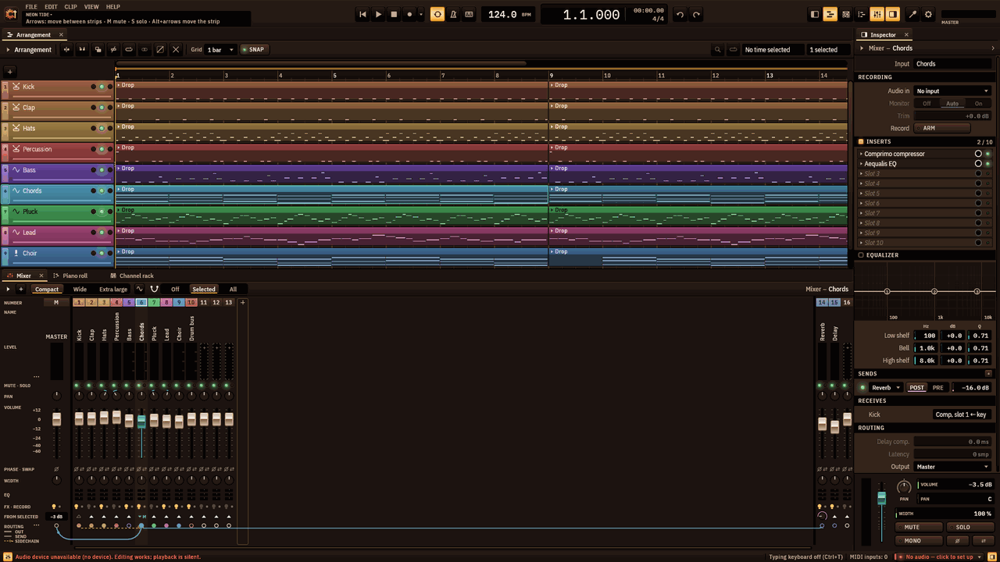
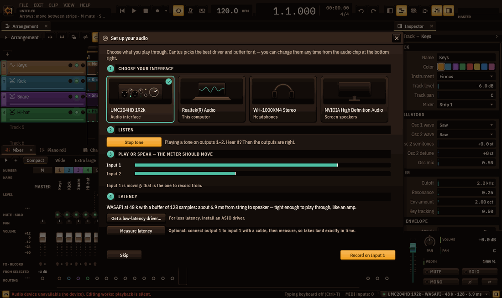
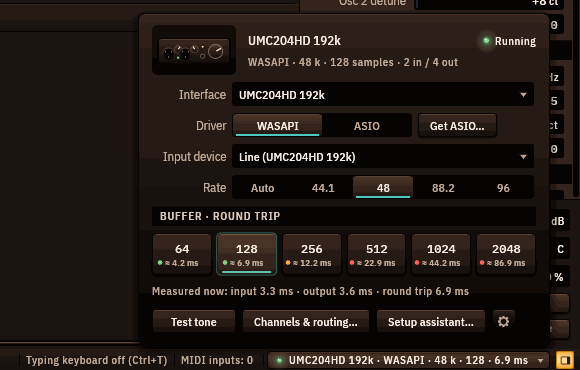
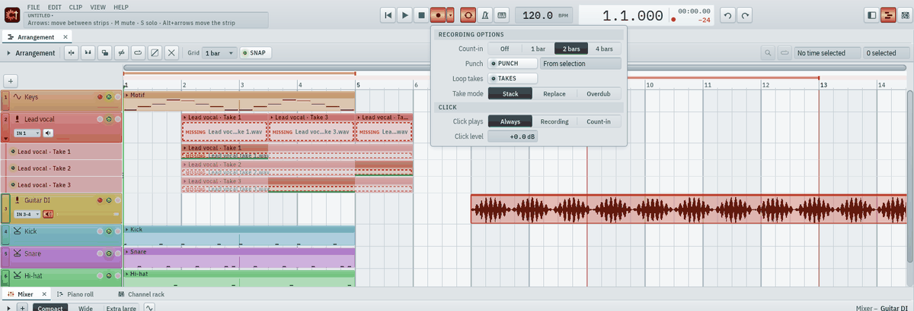
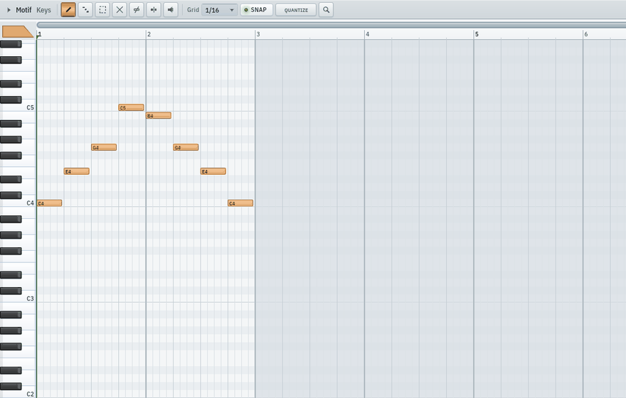
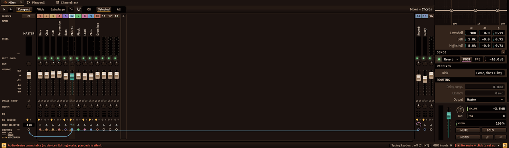
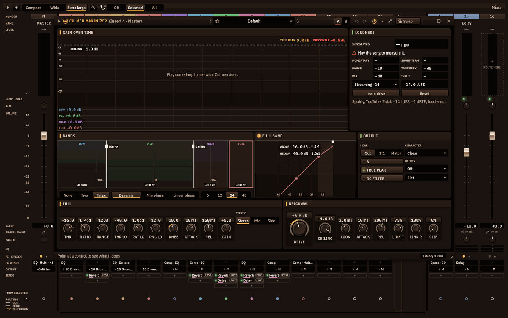
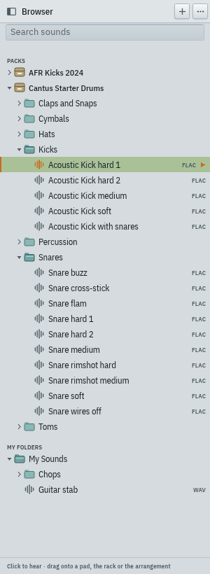
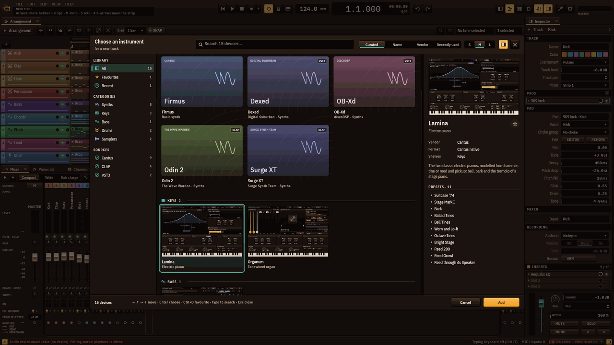

# Cantus — quick-start manual

*For Cantus 0.1.0-beta.1 on Windows · [Leer en español](../es/README.md)*

Cantus is a free, open-source digital audio workstation: record, compose, mix and master a
song, from the first note to a finished file. This manual gets you there in an evening.
Everything it names is in the program as it is today; where the beta still has gaps,
[chapter 14](#14-known-issues-and-limitations) says so.

**Contents**

1. [Install](#1-install)
2. [First run: set up your audio](#2-first-run-set-up-your-audio)
3. [The workspace](#3-the-workspace)
4. [Record audio and MIDI](#4-record-audio-and-midi)
5. [Edit: clips, piano roll, automation](#5-edit-clips-piano-roll-automation)
6. [Mix: the mixer, inserts and sends](#6-mix-the-mixer-inserts-and-sends)
7. [Master: the master chain, Fervor, Latitudo, Culmen](#7-master-the-master-chain-fervor-latitudo-culmen)
8. [Export](#8-export)
9. [Sounds: the browser and sound packs](#9-sounds-the-browser-and-sound-packs)
10. [Instruments and effects: the device picker](#10-instruments-and-effects-the-device-picker)
11. [Projects, autosave and settings](#11-projects-autosave-and-settings)
12. [Keyboard shortcuts](#12-keyboard-shortcuts)
13. [Privacy and updates](#13-privacy-and-updates)
14. [Known issues and limitations](#14-known-issues-and-limitations)
15. [Report a bug](#15-report-a-bug)

## 1. Install

You need Windows 11, 64-bit (Windows 10 untested), and about
200 MB of disk.

1. Download `Cantus-0.1.0-beta.1-windows-x64-setup.exe` from the
   [releases page](https://github.com/luis314159/cantus/releases).
2. Run it. It installs for you alone, in `%LOCALAPPDATA%\Programs\Cantus`, and asks for no
   administrator rights. This beta is not code-signed yet, so Windows may show *"Windows
   protected your PC"*: choose *More info ▸ Run anyway*.
3. Choose the components: the program (required), *Open .cantus projects with Cantus*
   (on), a desktop shortcut (off), the CLAP and VST3 plug-ins for other DAWs (on), and
   *FlexASIO driver (downloaded now)* (off — tick it if your sound card has no ASIO driver
   of its own; see [chapter 2](#2-first-run-set-up-your-audio)).
4. The *Privacy* page says what Cantus sends over the network (only a daily question about
   new versions, and the downloads you ask for). *Check for updates once a day
   (recommended)* is ticked; untick it to turn the check off (also later in *Settings ▸
   Updates*).

**Portable copy.** Unzip `Cantus-0.1.0-beta.1-windows-x64-portable.zip` anywhere (a USB
stick works). Because of the `portable.txt` beside `cantus.exe`, that copy keeps its
settings in the `data` folder next to it and writes nothing to your profile.

**Uninstall** from Windows' *Apps*. Your settings, presets and autosaves — and the sample
cache (up to 16 GB, see [chapter 11](#11-projects-autosave-and-settings)) — are removed
only if you tick that box; your projects are never touched.

## 2. First run: set up your audio

The first time Cantus starts, the window **Set up your audio** opens over the music.

1. **Choose your interface.** Each audio device has a card: an *Audio interface*, *This
   computer*, *Headphones*… Click the one you play and listen through. Cantus picks a
   driver and a buffer for it: **ASIO** at 128 samples for an interface with its own ASIO
   driver, otherwise **WASAPI** (Windows' own audio) at 256.
2. **Listen.** Click *Test tone*: you should hear a soft tone on outputs 1–2.
3. **Play or speak — the meter should move.** Strum, sing or speak into what is plugged
   in; the input that moves is the one you will record from.
4. **Latency.** Cantus says how long the sound takes from string to speaker, and whether
   that is tight enough to play through. For the most accurate takes, cable output 1 to
   input 1 and click *Measure latency*; Cantus then places every take to the sample.

Click **Record on …** and Cantus adds an audio track on that input, armed and ready:
press `R` to record. *Skip* closes the window; it does not open by itself again (the
*Setup assistant…* button in the audio chip brings it back).

### The audio chip

The chip in the top bar (or in its ⋯ menu when the window is narrow) shows the device,
driver, rate, buffer and latency —
for example `UMC204HD · ASIO · 48 k · 128 · 6.1 ms`. Its lamp is green when the audio
runs, amber after a dropout, red when the device is lost or the driver stopped. **Click
it** to change anything; every change applies at once and is remembered for that
interface:

- **Interface**, **Driver** (WASAPI or ASIO, with the *ASIO driver* list), **Input
  device**, **Rate**;
- **Buffer · round trip**: 64 to 2048 samples, each with its latency. Smaller is tighter
  for playing; larger is safer for big mixes. If the top bar counts dropouts, take the
  next size up;
- problems appear on top with a button that fixes them (*Restart audio*, *Use this
  computer's audio*, *Run at 48 kHz*…);
- *Test tone*, *Channels & routing…* (name your inputs and outputs, choose a headphone
  cue pair), *Setup assistant…*, and the gear for every setting.

**Which driver?** Use your interface's own ASIO driver if it has one (Behringer, Focusrite,
PreSonus, Steinberg, MOTU, RME…). For a laptop's built-in sound, use WASAPI, or install
**FlexASIO** for lower latency. *Get ASIO…* in the popover opens a window with FlexASIO's
download page, ASIO4ALL's page and the makers' driver pages; after installing a driver,
click *Rescan drivers*. Cantus never installs drivers by itself.

Plugging an interface in offers to switch to it; unplugging one offers your computer's
audio, and Cantus goes back to it when it returns. If a driver stops responding, Cantus
restarts the audio once by itself. You cannot change the device while recording.

## 3. The workspace

Cantus opens on a song — the second drop of the demo *Neon Tide*, looping — so the first
thing you hear is music. Press `Space` to play it.

- **The top bar** (see [below](#the-top-bar)): the menus over the project's name and the
  hint panel, then the transport, the tempo, the metronome, the position, the meters and
  more — one group per function.
- **The arrangement** (centre): tracks and their clips on a timeline.
- **The clip browser** (`Alt+F5`, *View ▸ Clip browser*): every clip of the song as a
  tile, beside the arrangement (see [chapter 5](#clips-in-the-arrangement)).
- **The lower zone**: the Mixer, the Piano roll and the Channel rack as tabs.
- **The inspector** (right, `I`): everything about the selected track, strip or clip.
- **The status bar** (bottom): what is under the pointer, plug-in latency, samples loading,
  the typing keyboard's octave and minimised devices.

Every area can be shown or hidden with its window key or its function key (`F5`
arrangement, `Alt+F5` clip browser, `F6` channel rack, `F7` piano roll, `F9` mixer,
`Alt+F8` browser, `I` inspector). Drag the splitters to resize; right-click a tab to float it in its own
window; save the arrangement of the window under *View ▸ Layout ▸ Save layout…*. The
interface zooms from 75 % to 200 % (`Ctrl+Plus`, `Ctrl+Minus`, `Ctrl+0`). Twelve themes —
Cantus Night (the default), Cantus Paper, Daylight, Blue Hour, high-contrast dark and light
and more, each with a preview — the colours, the logo and the taskbar icon's colour are
under *View ▸ Appearance*.

**Typing a name or a value** works the same everywhere — renaming a track, a clip, a pad
or a strip, a search, a level: the field opens with its words selected, so typing
replaces them; `Enter` or a click elsewhere keeps what you typed; `Esc` puts back what was
there. While you type, no shortcut fires. Names can be in any script — Japanese, Chinese,
Korean, Hindi, Thai, Arabic, Hebrew…: Cantus uses your system's own fonts for them (see
the [known issues](#14-known-issues-and-limitations) about right-to-left scripts).

**Demo songs.** *File ▸ Demo songs…* (`Ctrl+Shift+N`) opens seven songs made entirely with
Cantus's own instruments and effects: With All Your Heart (cinematic pop — the modelled
grand Chorda pedalled from its automation lane, every modulation and dynamics effect of
round 28, Tonus hard-tuning the topline, modulators and automation, mastered to −11 LUFS),
Neon Tide (house), Morning Light (pop ballad), Sunday Strut (funk and soul), Paper
Lanterns (lo-fi hip-hop), Aurora (cinematic) and Midnight Static (trap). Open one, play
it, take it apart.

### The top bar

The top bar is FL Studio's strip in two rows: one group per function, a thin divider
between the columns. The groups with two lines of their own — PAT / SONG, the metronome,
the clock, CPU/RAM and the meter — take the bar's height; the others are one row high and
stack two to a column (the transport over the tempo, the snap over undo, the windows over
the inputs, the audio chip over the tools). At 1920 pixels and 100 % every group is on the
bar, in English and in Spanish, with your interface's chip on it: on a full bar the chip
shortens a long device line in the middle (point at it for the whole line), and widens
when there is room.

- **The menus and the hint panel**: *File, Edit, Clip, View, Help* over the project's name
  and the hint for whatever is under the pointer. **Click the name** to rename the
  project in place (`Enter` keeps it, `Esc` leaves); the window's title follows it, with
  `•` while there are unsaved changes.
- **PAT / SONG** (`L`): *song mode* plays the arrangement; *pattern mode* plays the clip
  you are editing in the piano roll or the channel rack — with whatever the rack shows
  on the other tracks in that stretch — alone and looped, and the clock counts from the
  pattern's start; the playhead stays in the pattern (Home or a click outside it goes to
  its top). Choosing another note clip changes what plays; selecting a track, an audio
  clip or nothing keeps the pattern. Leaving pattern mode puts
  the playhead back where the song was. Pattern mode does not record, and cannot be
  switched on in the middle of a take (a take belongs to
  the song: switch to song mode first) and export always renders the song. It is saved
  with the project.
- **Transport**: go to start, play, stop, record and its ▾ options, loop.
- **Tempo**: the BPM (drag, wheel, double-click for 120); **TAP** (`Shift+T`): tap at least
  twice — the tempo is the average of your last taps, a pause starts again, and each run
  of taps is one undo step; the **time signature**: click it for the beats (‹ ›), the
  note value and the usual metres.
- **Metronome** (`Ctrl+M`): its switch, the **count-in** (off, 1, 2, 4 bars) and the
  click's **level** (drag, wheel, double-click for 0 dB). Its ▾ holds the **sound**
  (*Classic*, *Woodblock*, *Beep*), the **accent** on the first beat of each bar, and
  **when** it plays (always, while recording, during the count-in). The sound and the
  accent are saved with the song.
- **Position**: bars.beats.ticks and the time, the metre beside them; while recording, the
  take's time.
- **Grid and snap**: the grid and the SNAP lamp of the editor you are working in — the
  arrangement, the piano roll or the channel rack (always on its grid); with an audio clip
  in the piano roll's place, the pitch editor's grid (what *Quantise timing* moves notes
  to), and with an automation clip, the arrangement's grid the automation editor snaps
  to. The same values as the editor's own toolbar.
- **Undo** and **redo**, and the **window keys** (browser, arrangement, rack, piano roll,
  mixer, inspector).
- **CPU, RAM, voices, drops**: the audio callback's load (its histogram in the tooltip),
  the memory Cantus uses, the voices sounding and the dropouts counted (the latest one's
  cause in the tooltip, and said on the status line when it happens).
- **Master meter**: *Peak* shows the left and right peaks and holds the highest of the
  last two seconds (click the number to reset it); *LUFS* shows the master's loudness —
  momentary in the top lane, short-term below, with a mark at −14 LUFS (the streaming
  services' level), and underneath the short-term, the integrated loudness of the pass
  (from Play; it holds after Stop) and the highest true peak since you
  pressed play (click the number to reset it).
- **Inputs**: the typing keyboard (`Ctrl+T`), the **MIDI** lamp (it lights as notes come
  in; the number is the inputs open) and **Armed** (how many tracks will record; click to
  arm the selected one).
- **The audio chip** (see [the audio chip](#the-audio-chip)) and the **tools**: the
  element picker, the appearance page, and the interface's zoom.

**A narrow window** folds the least important groups — whole — into the **⋯** menu at the
right end, where they work as on the bar — their own menus and popovers included; a
group folded earlier comes back as soon as it fits. The menus never fold: they sit above
the hint panel, in its width. A dot on ⋯ says something is folded there (red when it is
the audio chip and the audio needs a look). **Customise top bar…** (in ⋯, in *View*, or
right-click the bar): tick a group to show or hide it, drag it by its grip to move it,
*Reset* for the default. Your arrangement is kept.

## 4. Record audio and MIDI

### An audio track

1. Add an audio track: `Ctrl+Shift+A`, or right-click the **+** above the track headers
   ▸ *Add audio track*. (The first-run setup's *Record on …* makes one for you.)
2. **Arm it**: click the round red lamp on its header (or `Alt+R`). Shift+click arms that
   track alone. An armed track shows its input meter.
3. **Choose its input**: the input chip on the header (*In 1*, *In 1-2*…; shown when the
   track row is tall enough), the inspector's *Recording* section, or the track's menu.
4. **Monitoring**: the speaker key on the header cycles *Off*, *Auto* (you hear the input
   while the track is armed — the default) and *On*. The inspector also has *Trim*
   (−24 to +24 dB before recording).
5. Press **`R`** (or the record key). Every armed track records; press `R` or `Space` to
   stop. The whole pass is one undo step.

Takes are written as 32-bit float WAV files: into the project's `Audio` folder once it is
saved, until then into `%LOCALAPPDATA%\Cantus\recordings\`; saving moves them into the
project. Each take is placed earlier by the measured latency, so it lines up with what you
heard.

### Recording options

The ▾ beside the record key (or right-click it) opens **Recording options**:

- **Count-in**: off, 1, 2 or 4 bars before the take (`Alt+C`). The count-in clicks
  whether or not the **Metronome** (`Ctrl+M`) is on.
- **Punch**: record only inside a range. *From selection* takes the time selection; `Alt+P`
  uses the selection, else the loop, else two bars from the playhead. The range shows as a
  red brace under the ruler: drag its ends. Everything played is kept in the file; punch
  only sets the clip's window.
- **Loop takes**: with the loop on, each pass becomes a take.
- **Take mode**: *Stack* (old clips move to take lanes — the default), *Replace* (cut what
  the take covers) or *Overdub* (MIDI: add notes to the clip).
- The click — its level, sound, accent and when it plays — is the metronome's, in the
  [top bar](#the-top-bar).

### Monitoring with low latency

Delay compensation keeps every track in time with the slowest one: with a linear-phase EQ
somewhere in the song, everything — **the input you monitor included** — waits for it, and
a singer can hear themself 96 ms late. **Low-latency monitoring** (`Alt+Shift+R`, or its
switch in the record options, in the audio chip's popover and in the inspector's
recording rows) changes that while it is on:

- What you monitor (an armed track's input in *Auto*, any input set to *On*, or an armed
  instrument track you play) reaches your ears **without waiting for the other tracks**: a
  voice through Tonus is heard 2.7 ms late instead of 96 ms. The backing stays in time with
  itself.
- An insert on the monitored path whose latency is above the **limit** (3 ms by default;
  5, 10 or 20 ms in the same rows) is **bypassed** — the list says which: *Monitoring
  without: Aequalis, Culmen* (and how many more, past eight). They come back the moment
  you switch it off, with nothing left over from before.
- The audio chip shows the round trip of what you monitor — the driver's, the input's
  wait and the monitored chain's — while it is on.
- Your take is placed exactly where it would be with it off: what is recorded is the raw
  input, placed by the latency in force when the take started.

For the lowest delay, monitor through a strip of your own: a bus that mixes your voice
with other recorded tracks keeps those in time, and your voice waits there with them.

### Takes and comping

Every take is kept on a **take lane** under the track: open them with the small disclosure
at the bottom of the track's colour cell, `Alt+T`, or the track menu's *Show takes*.
**Drag across a take** to comp that stretch into the track; click a take to use all of it.
Right-click a lane for *Use this take*, *Delete unused takes* (which also drops recordings
nothing plays any more), *Explode takes to new tracks* and *Hide takes*.

**Seams.** Where two takes meet in the comp they **crossfade**: equal-power, 10 ms by
default, centred on the seam, each take reading on into its own recording. A seam has a
small diamond at the foot of the track; **drag it** (or the edge of either take there) and
both sides move together. Right-click it for its crossfade — *Off*, 5, 10, 20 or 50 ms —
or to use that one for every seam of the track. Each piece of the comp shows the number of
its take, and the take lanes light what is in the comp.

**Alternate comps.** The first take lane's header has the comp's chip, *Comp A*. Click it
for the comps: switch between them (each comes back exactly as you left it, pitch edits
included), *New comp* (a copy of this one, to try another idea), *Rename*, *Delete*,
**Flatten** (keep the comp, drop the takes) and **Flatten and merge** (the comp bounced
into one recording beside the takes — their files stay on disk). The same menu turns
**Quick swipe** off (then dragging on a lane selects time and a click selects a take) and
**grouped comping** on or off: tracks whose strips are in one mixer group — a drum kit's
microphones recorded together — comp together, the same stretch of the same take on each;
their seams move together, take the same crossfades, and their comps switch and are made
together. Every change is one undo step.

**What belongs to the comp.** The pieces a swipe or a promote makes are the comp's, and so
is the take that plays over the others after a recording (the last pass of a loop, or a
take recorded over older ones; a recording where no take lies is a plain clip that plays
under every comp): they switch with the comp, and stay its own when split,
nudged or slipped. A copy is never the comp's, wherever it is pasted — right over its take
too: it stays on the playing lane through every switch, under every comp. A piece dragged
to another track leaves the comp; after a flatten the pieces are plain clips. The take
lanes light the stretch of each take the comp plays.

### MIDI

Arm an **instrument track** (one with no audio input) and press `R`: notes from every MIDI
keyboard Cantus found (the top bar's MIDI lamp lights as notes come in; its tooltip names
the inputs) are recorded into a clip.
With nothing armed, `R` records into the selected track. No keyboard? `Ctrl+T` turns the
**typing keyboard** on: `A`–`L` play notes, `Z`/`X` change octave. While it is on, letter
shortcuts (including `R`) are off — use `Space` or the record key.

### MIDI controllers

Any knob, fader, button or pad of a MIDI controller can drive anything Cantus can set: a
parameter of any device (Cantus's own or a hosted plug-in's), a fader, a pan, a width, a
send, a modulator's amount, a mute, a solo, a record arm, an insert's bypass or mix, the
tempo, and the transport (play, stop, record, loop, the metronome, tap tempo, the markers,
PAT / SONG — anything a key can do).

**Learn in two clicks.** Right-click a control ▸ **Learn MIDI controller**, then move a
control on your hardware: done. Or click the top bar's **MIDI** cell (or press
`Ctrl+Shift+M`; a right-click on it opens the MIDI settings) for the **learn mode**: every control that can be learnt is outlined; click
one, move a hardware control, click the next. A mapped control wears a small dot at its
lower right; in the learn mode it is outlined in the highlight's colour, and the one
waiting for your hardware is lit. `Esc` lets go of a learn. **Change MIDI controller** and
**Forget MIDI controller** are in the same menu. The mixer's strip and insert menus and the
track header's menu have *Learn* rows for the volume, pan, width, mute, solo, arm, bypass
and mix. Inside a plug-in's own window, move the parameter there, then press `Alt+Shift+A`
(**Link the last tweaked parameter to a controller**, FL Studio's way) and move the
hardware.

Cantus tells what you moved: a plain knob, a **14-bit fader** (its fine controller came
too), an **endless encoder** (and which of the three encodings it speaks), a button, a pad
(on a switch it toggles; on a knob its velocity sets the value) or a program change.

**How a mapping reads its control** — in the **Controllers** pane (View menu, or
`Ctrl+Shift+K`), one row per mapping:

- **Mode**: *Absolute* (where the control is, the target is), *Relative* (an encoder: each
  step moves the target), *Toggle* (each press flips it), *Momentary* (held: on; let go:
  off), *Trigger* (each press fires an action).
- **From / To**: the part of the target's travel the control covers, in the target's own
  units (−∞ dB to +6 dB, 200 Hz to 4 kHz, 60 to 180 BPM…); *To* below *From* turns it
  round. Drag a cell, or double-click it and type; right-click resets it.
- **Curve**: a bend, so the first half of the turn does less (or more).
- **Takeover**, for a control that does not move itself when the value changes elsewhere:
  *Pick up* (the default: nothing moves until the knob passes the value — no jumps),
  *Scale* (the value moves with the knob, so both reach the end together), *Jump*. The
  header sets the takeover new mappings get.
- **Feedback** (*Send*): the value goes back to the controller whenever it changes — for
  motor faders and LED rings. Off by default.

A lit dot at the left of a row shows a message just came. **Shared** marks one control
on several targets (allowed: one knob can open two filters at once). A row whose target is
gone (a deleted track) is kept, marked **Missing**, and works again if undo brings the
target back.

**Two maps.** *This project*'s mappings are saved with the project, and every change is
one undo step. **Everywhere** — your global mappings, kept beside your keyboard shortcuts
— holds what means the same in every song: the transport, the tempo, the master, **the
selected track** and **the selected channel** (volume, pan, mute, solo, arm) and **the
focused device**'s first eight knobs (the device window you clicked last). Learning a
transport key or the master puts it there; **Add a mapping** in the pane offers all of them.
When one control is in both, the project's mapping wins.

**While you play and record.** A mapped knob no longer reaches the instrument (it does
not also bend its filter), and a mapped pad plays no note. A move made with the mouse or a
controller is one undo step per gesture. With a parameter under an automation clip, the
clip plays it — until a recording pass moves it: from that moment the parameter follows
your hand (the clip is set aside for the rest of the pass), and the pass writes what you
did as an automation clip, each move at the moment its message arrived (Record options ▸
*Record automation*).

Channel pressure and key pressure now reach the instrument (Cantus's and hosted ones), and
a program change reaches a hosted instrument.

## 5. Edit: clips, piano roll, automation

### Quick gestures

As in FL Studio, the arrangement opens things with no hunting through menus:

- **Double-click a track header** (anywhere but its name): its **instrument** opens — the
  instrument's window (Unda, Pulsus II…) or a CLAP/VST3 plug-in's own window. Firmus and
  audio tracks, which have no window, show the inspector instead.
- **Click a track's name** — on the letters themselves (the pointer becomes a text cursor)
  — to **rename** it in place: the name is selected, type the new one, `Enter` keeps it
  (one undo step), `Esc` puts back the old one. A click elsewhere on the header only
  selects the track, and typing with a track selected never renames it. (Mixer strips and
  rack pads rename on a double-click.)
- **Double-click a clip**: the **piano roll** opens on it, the whole clip in view. A step
  pattern the rack shows with nothing lost — every note a short hit on a step, one pitch
  per channel (a drum kit may use all its pads; a melody on a synth opens the piano roll,
  as in FL) — opens in the **channel rack** instead, at the pattern's own grid and
  scrolled to its track. An automation clip opens in its large editor; an audio clip opens
  in the **pitch editor** (its gain, fades and file stay in the inspector).
- **Open editor** — in the inspector, the mixer's menus or an instrument's frame — brings a
  window that is already open back from the tray (or the taskbar, for a plug-in instrument
  or effect) and to the front; while a plug-in's window is open its key reads *Show*. `F8`
  and the channel rack's channel button do the same when the window is minimised, behind
  another tab or under another window, and close it only when it is already in front.
  (Cantus cannot bring forward a plug-in that floats a window of its own: its key reads
  *Close*.)

### Clips in the arrangement

- **Create**: double-click an empty place on a track (a 4-bar clip), or record.
- **Select**: click; `Ctrl+click` adds; drag on empty space for a marquee; `Esc` clears.
- **Move**: drag (also to another track). `Alt+drag` copies; `Ctrl` while dragging ignores
  the grid. `Left`/`Right` nudge by the grid, `Shift` by a bar.
- **Trim**: drag a clip's edge — its content stays where it is. **Slip**: `Shift+drag`
  slides the content inside the clip.
- **Split** at the playhead: `Ctrl+E`. **Glue**: `Ctrl+J`. **Duplicate**: `Ctrl+D` (press
  again to keep tiling). **Mute**: `0`. **Rename**: `F2`. **Colour**: `Ctrl+Shift+C`.
- **Time selection**: drag in the ruler's lower lane; the top strip is the loop. `Shift+L`
  loops the selection, `Z` zooms to it.
- **Audio clips** have handles for fade in, fade out and gain (double-click one to reset
  it; right-click a fade for its curve) and a menu with *Normalize*, *Reverse*, *Reset clip
  gain* and *Remove fades*.
- **Import audio**: drag WAV, AIFF, FLAC or Ogg files onto the arrangement (they land at
  the pointer), or *File ▸ Import audio…*. A MIDI file adds its tracks.
- **Linked copies**: a paste, `Ctrl+D` or `Alt+drag` makes *the same clip* again — edit one
  and every copy follows (notes, or an audio clip's gain, fades and reverse). A link mark and
  a ×N count show it. *Make unique* (`Alt+U`) takes the selection out of its group;
  *Select linked copies* (`Shift+Alt+L`); *Link selection to this clip* (`Alt+L`); *Link
  to…* (`Alt+N`) picks, by name or track, a linked group or a clip of its own to become.
  In the inspector, a linked clip's *Link* row shows how many copies it has and offers
  *Link to…*; renaming it in the *Name* row renames every copy. Right-click an empty place
  in the arrangement ▸ *Copies are linked* to make independent copies instead.
- **The clip browser** (`Alt+F5`, or *View ▸ Clip browser*) shows every linked group and
  every clip of its own once, as tiles in the clip's colour with a miniature of what it
  holds; type to filter by name or track. **Drag a tile** onto the arrangement to place a
  linked copy there. **Click a tile** to choose it for the **paint tool**: with the
  arrangement focused, `B` (or `2`) takes the tool out — a click places a linked copy, a
  drag paints copies end to end along the track, a right-drag (or `Alt`+drag) erases the
  copies of that clip only; each stroke is one undo step; `Esc` puts the tool away.
  Double-click a tile to select all its copies.

The **grid** (the arrangement's toolbar) starts at one bar; choose finer values for
detail. Scroll with the wheel, `Shift+wheel` for time, `Ctrl+wheel` to zoom.

### The tempo track and markers

A song can change tempo and metre as it goes, and carry named markers (round 29).

- **The tempo track** is a lane under the ruler (*View ▸ Tempo track*, or the ruler's
  menu): each point is a tempo, held flat to the next point or **ramping** straight to
  it. Double-click the lane to add a point (on the grid, at the tempo where you clicked);
  drag a point to move it (`Shift` for fine tempo steps, `Ctrl` off the grid); `Alt+click`
  turns a point's ramp on or off; double-click a point to type its tempo; right-click for
  *Ramp to the next point*, *Remove the point* and *Remove the tempo track*. The header
  beside the lane shows the tempo at the playhead.
- **The top bar's tempo** shows the tempo at the playhead (inside a ramp, its value
  there). Dragging it and the wheel (a notch, one BPM) move the point the playhead is
  under by that much — inside a ramp, the ramp's start; a double-click (120) or **TAP**
  set it — the song's tempo when there is no tempo track.
- **Metre changes** are chips on the ruler before a bar's number ("7/8"). Right-click the
  marker lane or the ruler ▸ *Add a metre change here* (at bar 1 it opens the song's own
  metre); click a chip to edit its signature, drag it along the bar lines between its
  neighbours, right-click to remove it. The bars after a change
  keep their numbers; notes never move. The top bar's metre edits the metre in force at the
  playhead.
- **Markers** appear in a lane under the loop lane. `Alt+M` adds one at the playhead (or
  double-click the lane, or right-click the ruler ▸ *Add a marker here*); click a marker
  to put the playhead there; **double-click** it to rename it; drag it along the grid;
  markers on one tick sit side by side; right-click for *Rename…*, *Colour…*, *Loop to the next
  marker*, *Select to the next marker*, *Export to the next marker…* and *Remove*.
  `Alt+,` and `Alt+.` go to the previous and next marker; `Alt+Shift+,` loops between the
  markers around the playhead. The lane's menu lists every marker under *Go to*.
- **Export between markers**: *File ▸ Export audio…* ▸ *What* ▸ *Markers*, then pick the
  two markers by name (two at different places: the dialog says so otherwise, and never
  exports the whole song instead).
- Everything follows the tempo: notes, audio clips (an unwarped audio clip plays at its
  natural speed, laid on the timeline from where its file begins — split it, trim it,
  comp it anywhere and every piece plays on where it was; move or copy it elsewhere and it
  plays the same part of its file), automation, modulators, synced effects, the click
  (the first beat of every bar accented; a bar of 7/8 counted in eighths) and plug-ins
  made by others.
- **MIDI files** carry the whole tempo map out (a ramp as a tempo change every sixteenth
  note, and every marker, those at the end too) and in — importing with *Set the project
  to … BPM in …* keeps the file's tempo changes, metre changes and markers: at the song's
  start they are the song's; dropped at a later bar they start there (the bar line nearest
  the drop), the song keeping its own tempo and metre before it. **DAWproject** files carry the tempo
  track, the metre changes and the markers both ways.

### The piano roll

Select a MIDI clip and show the piano roll (`F7`, or its tab under the arrangement): it
edits that clip's notes.

| Tool | Key | What it does |
|---|---|---|
| Draw | `P` or `1` | Click adds a note, drag moves, drag the right edge resizes, right-click deletes |
| Paint | `B` or `2` | Drag across the grid to paint notes |
| Select | `E` or `3` | Drag to select; drag notes to move them |
| Delete | `D` or `4` | Click or drag over notes to delete |
| Mute | `T` or `5` | Click a note to mute it (it stays, silent) |
| Slice | `C` or `6` | Drag a line to split notes |
| Play | `Y` or `7` | Click notes or rows to hear them |

`Up`/`Down` transpose the selection (`Shift`: an octave), `Left`/`Right` nudge it, `Q`
quantizes, `Ctrl+C`/`Ctrl+V` copy and paste. Velocities are stems in the lane under the
grid: drag them, or `Alt+wheel` over a note. A drum kit shows one named row per pad.

The **channel rack** (`F6`) shows every track as a row of steps over the selected clip's
bars: click a step on, right-click it off, drag to paint. A step is an ordinary note.

### The pitch editor

Double-click an audio clip — or its menu ▸ *Edit pitch*, or *Edit pitch* in the inspector
— and its take opens in the piano roll's place, Melodyne's way: each **note** is a blob on
the row it sounds, as thick as the voice is loud, with the **pitch curve** running through
it (what was sung, dim, under what will sound). Sibilants and breaths are marked along the
bottom. The take is analysed beside the window the first time (a second or so per minute
of audio; a recorded take is analysed as soon as it lands) and the result is kept in
Cantus's cache, so it opens at once next time. The file is never changed: the clip plays a
render of your edits, made beside the window, and while a render is on its way you hear
the take as it was (never silence). Export waits for every render.

- **Edit tool**: click a note to select it (`Shift` adds; drag on empty ground for
  several). Drag it **up or down** to move its pitch — on the notes of the key (*Snap:
  Scale*), on semitones, or anywhere (*Free*; hold `Alt` for cents). Drag it **sideways**
  to move it in time, or drag one of its **ends** to stretch it: only the gaps beside it
  give way, its neighbours stay exactly as sung. **Double-click** a note to pull its centre
  onto its note (again to let it go). `Up`/`Down` move the selection a step (`Shift`: an
  octave, `Alt`: 10 cents), `Ctrl+A` selects every note, `Ctrl+J` joins, `Q` quantises,
  `Esc` clears.
- **Split tool**: click inside a note to cut it in two; **Join** puts neighbours together.
- **The note** (the panel below): what the selection *sounds* and was *sung*, and its
  **centre** (how far its centre is pulled onto its note, keeping its natural drift and
  vibrato), **drift** (the slow wander: 100 % as sung, 0 % flat), **vibrato** (0–200 %),
  **formant** (the voice's colour, up or down, the pitch kept) and **gain**.
- **The macros** act on the selection, or on every note when none is selected:
  **Correct pitch** by an amount (each note that far toward its note — a note off the key
  toward its nearest note; 0 % leaves it alone), **Correct drift** by an amount, and
  **Quantise** each note's start to what *Quantise to* on the bar says: a grid, or
  **another track's notes** (each note onto the nearest one within an eighth note).
- **Key**: found from the notes; change it on the bar (Tonus's scales). **Original**
  compares with the take as sung (A/B) — the inspector has the same switch. **Reset** undoes
  every edit on the selection. **▶** plays from the first selected note. Every edit is one
  undo step.
- **MIDI**: drag it onto an instrument track in the arrangement and the melody lands
  there, at the voice's place; click it for a new track. **Double**: a second voice a third
  or a fifth above in the key, from the same take, on a track of its own. MIDI out and
  Double are also in the audio clip's right-click menu.
- When the editor is narrow, what the bar has no room for is in its **…** menu, and the
  panel under the notes scrolls sideways.

**The pitch lane**: right-click an audio track's header ▸ **Pitch lane** shows its notes in
a lane under it, in the arrangement — drag one up or down to move it, double-click it to
pull it onto its note — for small fixes without opening the editor.

Formants are kept when a note moves (measured within 3 dB at ±3 semitones). It works on
one voice or one instrument line at a time; chords are not split into notes.

### Warping and stretching audio

**Warping** makes an audio clip play in the project's time: faster or slower than it was
recorded, without changing its pitch, and following every tempo change of the tempo track.
The file is never changed: the clip plays a render made beside the window.

- **Loops warp themselves.** Import a loop (from *File ▸ Import audio…*, a drop from Windows or
  from the browser) and Cantus finds its tempo, its beats and its first downbeat; a file
  of a whole number of bars (or one whose WAV carries its tempo) is warped at once to the
  project's tempo, in the same undo step as the import. Longer files, and every take you
  record, play at their natural speed until you warp them; a recording plays as it was
  played.
- **Warp a clip yourself**: right-click it ▸ *Warp* ▸ **Detect tempo** (markers on every
  bar it found), or **Warp from here** (its tempo counted from where you clicked), or
  **Follow tempo** in the inspector. *Set the project tempo from this clip* goes the other
  way: the project takes the clip's tempo.
- **Warp markers** pin a moment of the audio to a beat. A warped clip shows its
  **transients** (the hits found in it) as ticks along a band at its top, and its markers
  as gold flags. **Double-click the band** to add a marker (on a transient, it lands on
  it); drag in the band to add one and move it at once. **Drag a marker** to move that
  moment of the audio to another beat — it snaps to the grid (hold `Ctrl` for free) and
  the audio between its neighbours stretches to fit. Hold **`Alt`** while dragging to
  slide the audio *under* the marker instead. Double-click a marker, or right-click it ▸
  *Remove warp marker*, or click it and press `Del`, to remove it.
- **Stretch a whole clip**: hold `Alt` and drag its **right edge** (`Shift` still slips).
- **The clip editor's Warp tab**: double-click the clip (or *Edit warp*) — the editor has
  two tabs, **Pitch** and **Warp**, and opens in the one you used last. The Warp tab shows
  the clip large on a bar ruler, with the same gestures, and a bar with the mode, the
  transposition, *Formants*, *Follow*, the clip's tempo (**½**, **×2** when it was counted
  at half or double), *Detect tempo*, *Quantise…* and *Reset warp*.
- **Modes** (the inspector's *Warp* section, or the bar):
  - **Complex** — anything: full mixes, pads, chords. Keeps the attacks sharp and the
    stereo image steady.
  - **Rhythm** — drums and percussive loops: each hit is played exactly as recorded, only
    moved; **Slice ends** chooses what fills the gap after a hit when it is slowed down
    (*Fade*, *Loop*, *Ping-pong*).
  - **Melodic** — one voice or one instrument line: the cleanest for a solo, with the
    voice's colour kept when transposed.
  - **Re-pitch** — like a turntable: the speed and the pitch change together (no
    processing artefacts; *Transpose* is then off).
- **Transpose** shifts the clip by semitones and cents without changing its time;
  **Formants ▸ Keep** keeps a voice's colour when it is transposed (no "chipmunk").
- **Quantise audio…** (the clip menu, with one or several clips selected): pulls the
  transients toward a grid with a *Strength*, only the stronger ones if you choose
  (*Transients over*) — one undo step for every clip.
- **Bounce warped audio** writes the clip as it sounds now to a new file beside the
  project's audio, and the clip then plays that file, unwarped (one undo step). **Reset
  warp** puts the clip back to its natural speed.

While a render is on its way (a fraction of a second for a loop, a few seconds for a long
file) you hear a quick preview of the same timing; export, stems and freezing always wait
for the full render. Warped clips travel in DAWproject files with their markers and mode.

### Automation

Right-click any knob, fader or effect control ▸ **Create automation clip**, or move a
control and press **`Alt+A`** (automate the last thing you touched). The clip covers the
time selection (else the loop, else four bars) on a lane under its track. On the lane:
drag points, drag the ring between two points to bend the curve, click the line to add a
point, double-click a point to delete it, right-click it for its shape (single or double
curve, hold, stairs, pulse, wave). Double-click the clip for the large editor, with a
drawing tool and articulators (flip, smooth, random, scale, LFO). An automated control
shows a dot.

**Hosted plug-ins** are automated like Cantus's own: right-click a parameter in a plug-in's
generic editor (or in a hosted instrument's *Parameters* list in the inspector), or move it
in the plug-in's own window and press `Alt+A`. Their changes reach the plug-in at their
exact sample inside the audio block.

**Recording automation.** While you record, every control you move — in Cantus or in a
plug-in's own window — is written into an automation clip over the stretch you moved it
in (one undo step when the pass ends). Switch it off in the record options (*Automation*).

### Modulators

A **modulator** moves parameters for you: an **LFO** (five shapes, synced to the song or
free in Hz, restarted by notes if you like), an **envelope** (attack, decay, sustain,
release — opened by the track's notes or by an audio level), a **follower** (the level of
any strip: duck a pad under a kick), **steps** (up to 32, synced, with glide) and a
**random** source (held or smooth, repeatable from its seed). Each modulator drives **any
number of parameters**, each with its own depth, plus or minus; a parameter may take
several, and they add up on top of its automation.

- **Where they live**: the inspector's *Modulators* section for the selected track, its
  channel, or the master (click the band's **+**). Each modulator shows its movement as a
  picture, its settings, its amount, and one row per parameter it drives: drag the depth,
  *bake* it, or disconnect it.
- **Connect**: right-click any knob, fader or plug-in parameter ▸ **Modulate…** and pick a
  modulator or make a new one already connected; or **drag a modulator's handle** (the grip
  at the left of its title) onto any knob; or press its **map** key and drag any knob — the
  drag sets that modulator's depth there.
- **Depth on the knob**: hold `Alt` and drag a modulated knob to change the depth of its
  modulation (only the drag: a double-click still resets the value). Modulated knobs wear coloured rings (the depth, in the modulator's colour), a
  moving dot where the parameter is now, and a violet mark.
- **Everywhere**: every knob of Cantus's instruments and effects, the mixer's faders, pans
  and widths (the master's too), every **send's level** (its knob and row on the desk, its
  cable's level, the inspector's send and receive rows; a send's right-click menu has
  *Automate* and *Modulate…* for it), the inspector's pinned strip and a hosted plug-in's
  parameters take a modulator the same way. So does a modulator's own **amount**: let a
  random source move how deep an LFO goes (one level of nesting). Chorda's tuning (A4,
  stretch, stiffness) is set, never automated or modulated.
- **Bake to automation**: a route's bake key (or *Modulate… ▸ Bake to automation*) turns
  that modulator's effect into an automation clip over the time selection (else the loop,
  else the song) and removes the route, in one undo step.

Synced modulators follow the song position, so playing from bar 5 hears what a full play
hears there; free ones start with playback. Exports sound exactly as playback.

## 6. Mix: the mixer, inserts and sends

Each track feeds a **strip** of the mixer (`F9`); strips feed the **master** at the left,
or another strip (a bus). A strip has its level meter, mute and solo, pan, fader, phase
and swap, width, a three-band EQ, its inserts and its sends. Click to select, `Ctrl+click`
to add, `Shift+click` for a run; dragging one fader of a selection moves them all. With
the mixer focused, `M` mutes, `S` solos, `Alt+Left`/`Alt+Right` move the strip.
`Ctrl+wheel` changes the strips' width; at *Extra large* each strip shows a one-line summary
of its chain (click it to open the inspector).

- **Inserts** (up to ten per strip): click an empty slot to choose an effect in the device
  picker, or right-click it for the quick list. On a filled slot, click the lamp to bypass
  it and the name to open its window; right-click to swap, move or remove it. In the
  inspector, each insert has a **Mix** ring (dry/wet).
- **Sends**: select a strip, then look at the *Sends* row of the others — click the ▲ of
  the strip you want to send to (a reverb return, a parallel compressor); a knob then sets
  the send's level. Each send taps **after the fader (POST, the default) or before it
  (PRE)** — click its PRE/POST chip; a PRE send keeps sounding when you pull the fader down.
- **Cables**: each strip has a port. Drag from it to another strip, or click it and then
  the destination (`Esc` cancels): plain makes a send at 0 dB, `Ctrl` makes it the strip's
  only output, `Alt` makes it a sidechain key. The selected strip's cables (or all, or
  none — the switch above the desk, with a filter for which kinds) are drawn in a band
  under the desk; click a cable to select it, drag its end to move it, `Delete` removes it.
  A doubled path is allowed and marked. Every change is one undo step.
- **Routing**: right-click a strip ▸ *Routing* ▸ *Output* or *Send to*, `Shift+F10` for the
  selected strip's route menu, or select several strips and *Create submix from selected*.
  In a cable's or a send's route menu, *Level ▸ Type a level…* takes a level in dB (−∞ to
  0; `Enter` or a click elsewhere sets it, in one undo step; `Esc` cancels).
  **The routing matrix** (`Alt+F9`) shows every source against every destination: click a
  cell to route, drag for the level (`Shift` for fine), `Ctrl+drag` copies down a column.
  Strips and groups move by dragging or with `Alt+Left`/`Alt+Right`; a track header dropped
  on a strip plays into it.
- **Device windows** have *Swap*, minimise (to the tray in the status bar), maximise and
  close. `F8` opens the selected track's instrument (or brings it to the front, or closes
  it when it is already in front), `Esc` closes the device you used last,
  `F12` closes every floating one.

**Solo** follows the routing: a soloed strip is heard with what feeds it and what it feeds.

### Freeze and bounce in place

**Freeze** turns a heavy track into a recording of itself, so its instrument and effects
stop using the processor — and gives it back, exactly, when you unfreeze it.

- **Freeze a track**: right-click its header ▸ *Freeze track*, `Alt+Shift+F`, or the
  inspector's *Freeze* row. A track on a strip of its own freezes with the strip: its
  instrument, clips and the strip's inserts and EQ. A track that shares its strip freezes
  its own instrument and clips. **Freeze a strip** (a bus, a return) from the strip's menu:
  it freezes with everything it gathers.
- It renders first (a card at the corner shows how far, with **Stop**); the song keeps
  playing and nothing changes until it is done. Then the track is frozen in one undo step:
  a **snowflake** on its header and its strip, its clips frosted.
- A frozen track or strip is still **mixed**: its fader, pan, width, mute, solo and send
  levels — and their automation — stay live, and so do the mute and solo on the header of
  a track frozen with its own strip (its level and balance are inside the render: mix it
  with the strip's fader). Anything that would change its sound (its notes, its
  instrument, its inserts, the tempo, a strip moved among the ones it gathers) is refused,
  and the card says how to give it back: **Unfreeze** (the same menu entries, the same key).
  Unfrozen, it plays live again, to the bit.
- What also plays somewhere else keeps playing: freezing a bus does not silence a strip
  that keys its compressor and plays to the master, nor a return the strip that sends to
  it. Solo stays a listening aid — a freeze is made as if nothing were soloed; with
  something soloed **inside** what you freeze, unsolo it first. Saving a project moves a
  frozen take into its *Audio* folder and keeps it frozen.
- Its plug-ins are unloaded while it is frozen and come back with their settings. A
  freeze needs the plug-ins it renders: one that is not loaded is named, and nothing is
  frozen.
- Renders are kept in a *Freeze* folder beside the project (or in Cantus's own cache for a
  project not saved yet), named by what they hold: freezing again what did not change is
  instant, and a project opened without them (on another computer, at another sample
  rate) plays live while they are made again in the background.

**Bounce in place** renders to an audio clip, on a **new track right under the original**,
at the same place:

- *Bounce in place* (track menu, `Alt+Shift+B`): this track through its strip's inserts;
  the new track gets a strip of its own with the old one's fader, pan, width and sends.
- *Bounce in place (source only)*: the instrument and clips before the track's level; the
  new track plays into the same strip, through the same inserts.
- *Bounce clips in place* (the clip menu): only the selected clips (on several tracks, one
  bounce each); with a time selection — chosen after the clips, or with none selected —
  the keys bounce what plays inside it, its edges moved out to the notes held across them.
- *Bounce strip in place* (the strip menu): everything the strip gathers; what was keyed
  from it, or followed it, follows the new strip.
- The original is **muted** — or removed, if you tick *Remove the original after a
  bounce* in the track menu (Cantus remembers your choice; a track whose notes something
  still hears is muted instead). Its level, fader and send rides go with the bounce, and so
  does its solo. The tail (a reverb's) is kept until it rings out. One undo step. If you
  edit the song while it renders, it is bounced again from your edit.

## 7. Master: the master chain, Fervor, Latitudo, Culmen

The **master** has its own chain of up to ten inserts, run on the whole mix before the
master fader. Click the master's head to see its chain in the inspector (*The whole mix*
→ the inserts → *Audio output*), or right-click its name ▸ *Effects* ▸ *+ Add effect*.

The demos master in this order, and it is a good start:

1. **Aequalis** (EQ): a high-pass under the sub, a little air.
2. **Multiplex** or **Comprimo**: gentle glue.
3. **Latitudo** (stereo): the preset *Master: tighten the low end* or *Master: wider top,
   mono bass* keeps the bass in mono and the top wide. Watch its correlation meter: it
   should stay above zero.
4. **Culmen** (maximizer): choose a **target** — *Streaming −14* (−14 LUFS, −1 dBTP),
   *Apple −16*, *CD −9*, *Club −7*, *Broadcast −23* — then play the loudest part of the song
   and click **Learn drive**: Culmen listens, sets the drive, listens again and stops on
   the target, in one undo step. The *Loudness* card shows momentary, short-term and
   integrated loudness and the true peak; the verdict says *On target* or how many LU you
   are over or under. Culmen works in three bands plus the full band, into a true-peak
   brickwall at the ceiling; its *Character* (Clean, Punch, Loud, Bus, Safe) and its ten
   presets cover most masters.

**Fervor** (saturation) adds colour: *Tape*, *Tube*, *Overdrive*, *Fuzz*, *Clip*, *Fold* or a
drawn *Curve*, with oversampling, tone, mix and *Level match*, so that louder never fools
you. On the master, the presets *Master clipper* and *Tube glue on the mid* are the gentle
ones.

## 8. Export

*File ▸ Export audio…* (`Ctrl+Shift+E` in the default keys) opens the export window:
presets on the left, the choices on the right, and a line that says exactly what will be
written.

- **Presets**: *Streaming* (MP3 320 kbps, 44.1 kHz, −14 LUFS, −1 dBTP), *CD* (WAV 16-bit,
  44.1 kHz, shaped dither), *Stems for mastering* (every strip, WAV 24-bit at the session's
  rate, not normalised) and *Podcast* (mono MP3 128 kbps, −16 LUFS, −1 dBTP). Change any
  choice and the *Custom* card lights.
- **What**: the song (from the start to the end of the last clip, plus a tail you choose),
  the time selection, or **stems** — one file per mixer strip (after its fader) or per track
  (before its strip), all starting on the song's first beat, delay compensation included,
  optionally *through the master chain*.
- **Formats**: **WAV** 16-bit, 24-bit or 32-bit float; **FLAC** 16 or 24-bit; **MP3** CBR
  128–320 kbps or VBR V0/V2/V4/V6 (LAME), gapless; **Ogg Vorbis** quality 3–10. Sample rate:
  the session's or 44.1, 48, 88.2, 96, 192 kHz (MP3 uses 44.1 or 48). Mono or stereo.
- **Dither** (off, TPDF, shaped) when writing 16 or 24 bits.
- **Loudness**: off, or a target (−9, −11, −14, −16, −19, −23 LUFS) with a true-peak ceiling
  (−0.1, −0.3, −1, −2 dBTP); Culmen's own limiter holds the ceiling when the gain needs it.
  Stems are never normalised.
- **Tags**: title, artist, album, year, comment, and a *Cantus* encoder credit.

Exports run in the background with a progress bar; *Stop* leaves no partial file. Your last
choices are remembered.

- **MIDI**: *File ▸ Export MIDI…* — the whole song, the selected track or the selected clip,
  as a type 1 file with the tempo, metre and track names.
- **DAWproject**: *File ▸ Export DAWproject…* to move a project to Bitwig, Studio One and
  other DAWs that read it (a report lists anything that could not travel).

## 9. Sounds: the browser and sound packs

The **browser** (`Alt+F8`, the first window key) docks at the left. It lists the sound
packs you installed and *My folders* (click **+** to add any folder of samples).

- **Click** a sound to hear it; click again to stop. Type in the search field to find
  sounds across every pack and folder.
- **Drag** a sound onto a **Pulsus pad** (the pad plays it), onto **Exemplar**'s key map (a
  zone on that key), onto the **channel rack** (a new sample channel with its own strip),
  or onto the **arrangement** (an audio clip where you drop it). Each drop is one undo step.
- With nothing installed, the browser offers **Start with a drum kit**: *Download* fetches
  *Cantus Starter Drums* (81 one-shots, 33 MB). *Sound packs…* (or *More packs…*) lists
  the others — Karoryfer's kits, VCSL and VSCO 2 percussion, a TX81Z for Exemplar, the
  **Salamander Grand Piano** (a Yamaha C5, 16 velocity layers) and **DRSKit**, an acoustic
  drum kit recorded by the DrumGizmo team — with their size, licence
  and credits; *Install*, *Update*, *Remove*, *Show the folder*, and *Install from a
  file…* for computers without internet.

Every pack is free. Most are **CC0** (no credit needed); the Salamander Grand Piano is
**CC BY 3.0** and DRSKit **CC BY 4.0**: their credit is shown on their page in *Sound
packs…* and in *Help ▸ Credits*, and kept in the pack's folder (DrumGizmo also asks, in
its own words quoted on the pack's page, for a credit wherever a song's other credits are
given). Either way, the music you make with them is yours. Packs
are saved in `%LOCALAPPDATA%\Cantus\Content\`; every file is checked against its SHA-256.

**Pack instruments.** An installed pack that brings instruments (the Salamander: with 8
velocity layers, about 120 MB of memory, or all 16, about 185 MB) shows them in the
device picker's *Keys* shelf and on its *Sound packs…* page (*New track with …*); each
plays in Exemplar. Long samples are **streamed from disk**: only their first moments stay
in memory. The first time, Cantus decodes the samples once into its **sample cache** (1 GB
for the Salamander's 8 layers, 2 GB for 16), beside the window, with *Loading samples… n
of m* on the status bar; later loads take a fraction of a second. If the disk cannot keep
up, the status bar counts *Disk late: n*.

**The acoustic drum kit.** *DRSKit* (DrumGizmo team and Jes Eiler of DRSDrums) was
recorded with 13 microphones; when you install it (a 2.8 GB download), Cantus mixes them
into a stereo kit — every drum at its place in the stereo field, the snare's bottom
microphone in polarity, the toms' and cymbals' close microphones turned down on the other
drums as a mixing engineer's gates would — so each hit plays as one stereo sample. It
takes about two minutes after the download and leaves about 470 MB; **while it installs it
needs about 7.6 GB free** (the download, the unpacked kit and the mix side by side — the
pack's page says so, and an install without the room is refused before anything is
downloaded). If the mixing is cancelled or fails, the download is kept: the next try
starts from it. *DRSKit acoustic drums* is then on the device picker's *Drums* shelf,
playing in Exemplar on the General MIDI drum keys with its own drums only: kick 36 (35 a
more open kick), side stick 37, snare 38 (40 a damped snare), toms 41 · 43–45 · 47–50,
hi-hat closed 42, pedal 44 and open 46, crashes 49 and 57, ride 51 and 59, bell 53. The
General MIDI keys the kit has no sound for (tambourine, cowbell, the Latin percussion)
stay silent, so a General MIDI part never plays a cymbal in their place; DrumGizmo's other
articulations sit above General MIDI 2's percussion and clear of the XG and GS kits' extra
keys below it (13–26): the chained ride on 88–90, the brushes on 91–100, and the half-open
hi-hat and the tips on 101–106. Each drum has its strengths as velocity layers
down to 24 dB under its loudest, and the hits of a layer take their turns **in order** —
counted per drum and per layer, so a roll, a tom fill across the drum's keys or an accent
on every fourth hat never plays the same sample twice in a row; a closed or pedal hi-hat
silences an open one. In the piano roll and the channel rack the kit shows **a row per
drum**, by name, in the interface's language (Exemplar's *Drum rows* switch, in its *Edit*
view). The microphones' balance is fixed by the mix:
faders for each microphone need an instrument with several outputs, a later step.

**Round robin in order.** Exemplar's *Edit* view has the round robin's order: *In order*
(each note takes the next turn of the samples it reaches — whatever key or velocity
reaches the same ones shares the turns — by its place in the song, so a render from any
point chooses what the whole song does there) or *By note* (drawn from each note — how
Exemplars in projects and user presets saved before this version keep playing). An
imported instrument plays its round robins in order.

**A missing pack.** A project that plays a pack this computer does not have opens a card
that names the pack and its silent tracks: *Install in Sound packs…*, *Use the installed
pack* (when the project points at another copy, say from another computer), or *Find the
folder…* (when files of an installed pack were moved). The rest of the project plays as
usual.

## 10. Instruments and effects: the device picker

The **device picker** shows every instrument and effect — Cantus's own and the CLAP and
VST3 plug-ins installed on your computer — as tiles.

Open it with the **+** above the track headers (a new instrument track), by clicking a
track's instrument chip (swap the instrument), *Swap* on any device window, an empty
insert slot, or *View ▸ Device picker…*. Search by name, maker or kind; filter by shelf
(*Favourites*, *Recent*, a category, or *Cantus / CLAP / VST3*); arrows move, `Enter`
chooses, `Ctrl+D` marks a favourite, `Esc` closes. Installed pack instruments (the
Salamander Grand Piano) are under *Keys*, DRSKit under *Drums*. Swapping an instrument keeps its notes,
clips, mixer strip and effects; swapping an effect keeps its slot, mix and bypass.

| Instrument | What it is |
|---|---|
| Firmus | The simple synth every new track starts with |
| Pulsus II | Drum machine: synthesized drums and sample pads, choke groups |
| Unda | Wavetable synth: three oscillators, unison, two filters, drawn LFOs |
| Calor | Analog polysynth |
| Modulus | FM synth with eight operators; reads DX7 banks |
| Exemplar | Sampler: SFZ, Decent Sampler and SoundFont |
| Gravis | Bass: 808, synth and modelled electric bass |
| Lamina | Electric piano |
| Organum | Tonewheel organ with drawbars and a rotary speaker |
| Chorda | Grand piano played from a physical model: strings, hammers, soundboard, pedals |

The effects are Aequalis (EQ), Comprimo (compressor), Porta (gate and expander), Sibilus
(de-esser), Multiplex (multiband dynamics), Terminus (limiter), Culmen (maximizer),
Spatium (reverb), Fervor (saturation), Latitudo (stereo), Delay and Reverb.

### Chorda: the modelled grand piano

Chorda is a grand piano computed as you play — no samples. Every key has its own one, two
or three strings, struck by a felt hammer and ringing into a soundboard; the strings of the
other keys ring along when the dampers let them. So it answers the way a piano does: the
harder you play, the brighter; a held chord rings on, the strings beating gently; with the
**sustain pedal** (controller 64) the whole instrument resonates, and **half pedalling**
works — a pedal partly down damps partly. The **soft pedal** (una corda, controller 67)
shifts the hammers for the next notes: softer and darker.

The sustain pedal is also a knob — **Sustain**, on the PEDALS card in Play and Edit — so a
song can pedal without a pedal: draw it as an **automation lane** (right-click the knob ▸ *Create
automation clip*; points held, up on each chord change and down just after it, is how a pianist
pedals), or let a **modulator** move it; half pedalling works there too. The pedal the
strings hear is the higher of the knob and controller 64, so a real pedal still works on
top of a lane. The demo *With All Your Heart* is pedalled this way.

- **Play** shows the piano from above — every key's strings at their length, the bridge,
  where the hammers strike, the dampers — with the key you last played lit, and the pedals:
  the sustain pedal's travel drawn over the law of how far the dampers are down at each
  position, with the **Sustain**, **Dampers** and **Soft** knobs under it. Below: the hammer (hardness, dynamics, velocity curve), the resonance
  (sympathy, decay, soundboard) and the output (tilt, width, gain).
- **Edit** adds the tuning (A4, the stretch an aural tuner gives a piano's octaves, the
  strings' stiffness) with its curve in cents across the keyboard, the felt's stiffness,
  the strings' ring key by key, the unisons' spread, the bridge coupling and the phantom
  partials.
- Ten presets (*Concert Grand*, *Warm Ballad*, *Felt Piano*, *Honky-Tonk*, *Baroque Pitch*
  at A = 415 Hz…) each come with four macros: hardness, resonance, body and decay.

Changing **A4, the stretch or the stiffness** designs the strings again, beside the window,
once the knob has settled (a second or two; the editor says *designing the strings* with
how far it has come): the piano keeps its previous tuning until the new one is ready. An
export always waits for it. These three are set, not automated.

### The modulation effects

Eight effects move the sound in time: **Concentus** (chorus), **Flexus** (flanger),
**Phasis** (phaser), **Tremor** (tremolo and auto-pan), **Vibrans** (vibrato), **Anulus**
(ring modulator), **Translatio** (frequency shifter) and **Fluctus** (volume shaper). Each
one is inserted **doing nothing** — its *Mix* or *Depth* starts at 0 and the sound passes
untouched — so turn that one control up, or pick a factory preset from the frame's list.

| Effect | What it does | Worth knowing |
|---|---|---|
| Concentus | Thickens and widens | *Juno I, II, I+II* are the Juno-60's chorus as its circuit sweeps; *Dimension 1–4* widen without the wobble; *Free voices* are 1–4 voices on your own LFO. The **mono check** tells you whether the width survives a mono speaker. |
| Flexus | The jet-plane comb | Through zero, the dry sound waits 5 ms so the moving copy passes through it, as two tape machines did; those 5 ms are the footer's latency, and Cantus compensates them, even when the switch is automated. Off, Flexus adds no delay. The sweep follows the LFO, how loud you play (*Envelope*), or a knob (*Manual*). *The comb now* draws the notches you hear. |
| Phasis | Sweeping notches | 2 to 12 stages (a notch for every two), feedback either way; the Phase 90 and Small Stone are presets. |
| Tremor | Level or pan in time | *Tremolo*, *Auto-pan* (a balance: the far side fades, the near side never gets louder) and *Harmonic* (lows against highs, like the brown amps). Square and saw shapes have a soft **edge**, so they never click. |
| Vibrans | Pitch that wavers | The depth is in **cents**, whatever the rate; **Rise** lets the vibrato arrive after each note, as a singer's does. |
| Anulus | Bells, metal, robots | The carrier is shown as a note with its cents; *What a tone becomes* draws the partials it makes of a test tone, its frequency (1 kHz) written on the display. |
| Translatio | Moves every partial by the same hertz | Not a pitch shifter: harmonics stop being harmonic. *Up*, *Down*, or *Both* (one per side); feedback makes the barber-pole spirals. Its other sideband is more than 60 dB down from 20 Hz to 20 kHz. |
| Fluctus | Sidechain pumping without a key | Draw the level over one cycle (a note value from 4/1 to 1/16): drag points (Shift: off the grid), double-click to add or remove one, drag a segment to bend it; segment shapes are the automation editor's. |

**In time with the song.** Every LFO can follow the song (*Sync*, a note value with dotted
and triplet values, swing where it makes sense) or run free in Hz. A synced LFO is tied to
the song's position, not to when you pressed Play: start from bar 5 and it is where it
would have been; a loop that wraps puts it back; offline export sounds exactly like
playback. The display of each effect draws what the LFO will do over the next two cycles,
with a playhead where it is now.

**In another DAW.** The exported CLAP and VST3 versions read the host's tempo and position,
so a synced Tremor or Fluctus follows that DAW's song too.

**Your plug-ins.** Cantus scans the standard folders — `%LOCALAPPDATA%\Programs\Common\CLAP`
and `…\VST3`, `C:\Program Files\Common Files\CLAP` and `…\VST3` — and any folder you add
in *Settings ▸ Plug-ins* (*Scan for plug-ins*, *Rescan everything*). Each file is scanned
in a separate process, so a plug-in that crashes while being scanned is blocked, not
fatal. Cantus's own effects are installed in your CLAP and VST3 folders too, for other
DAWs.

### Tonus: pitch correction for a voice

**Tonus** (in the picker's *Pitch · vocal* shelf) tunes a sung voice as it comes in — for the
hard, stepped effect, for a natural correction, or for monitoring while you record (it
adds 2.7 ms, reported to delay compensation).

1. Put Tonus on the voice's track. Choose the **key** and the **scale**; on the keyboard,
   click a note to remove it (×) or bring it back (●), right-click to leave it alone (○).
2. **Speed**: 0 ms (*Hard*) jumps from note to note; 50–100 ms corrects and keeps the
   voice's life. **Amount** sets how much is applied.
3. To tune to what you play instead: **MIDI notes** (the notes held on a track, in any
   octave) or **MIDI melody** (the voice sings exactly the newest note) — choose the
   track under the switch; its clips and what you play on it live both count.
4. **More** holds humanise (long notes keep their movement), flex (small deviations left
   alone), vibrato (the singer's, removed or doubled; or a created one), the formants and
   the **throat** (brighter or darker without changing the pitch), transposition and the
   reference A4.

The display shows what you sang (dim) and what comes out (bright), and the note you are
singing with its distance in cents. Presets: *Natural*, *Tight*, *Hard tune*, *Throat up*,
*Throat down*, *MIDI lead* and more. Details: `docs/plugins/tonus.md`.

### Dynamics and analysis: Tonsor, Impetus, Discrimen, Speculum

Four effects shape a sound's peaks and attacks and show what is in it. Like the others they
are inserted **doing nothing**, so a fresh one changes no sample until you turn it.

| Effect | What it does | Worth knowing |
|---|---|---|
| Tonsor | A clipper: cuts the peaks off | **Ceiling**, **Drive**, a **Knee** and three shoulders (*Hard*, *Soft*, *Analog*). **Oversampling** up to 16× keeps the harmonics it makes from folding back; **True peak** holds the ceiling between the samples too (about 1 ms of look-ahead), so a streaming service's −1 dBTP is really −1. **Gain match** takes the drive back out, so louder never wins. The meter shows how much (the deepest reduction), how often (the share of samples clipped in the last second), the overs between the samples in the input, and the output's true peak. |
| Impetus | More or less attack and sustain | Works on **level differences, not a threshold**: a quiet hit and a loud one are shaped alike. **Speed** is how long an attack lasts, **Length** how long a tail counts as one. *Highs* or *Lows* shape only one side of a crossover (snap without the low end pumping, or a kick's thump); a **sidechain** lets another track's hits drive it. *A hit through it* draws what it does before you play. |
| Discrimen | Splits each hit into its **transient** and its **body** | Each part has its own **gain**, a one-knob **compressor** and a **tilt**; *Listen* plays one part alone. Left alone the two add up to the input exactly. *Zero latency* costs nothing; *Look-ahead* (2 ms, compensated) catches every attack from its first sample. |
| Speculum | An analyser that never touches the sound | Tabs: *Overview*, *Spectrum* (averaging, slope, peak hold, mid/side/left/right), *Spectrogram*, *Scope* (free, triggered, or **on the beat**), *Vector* (and the **correlation**: under 0 means trouble in mono), *Loudness* (momentary, short-term and integrated LUFS, range, true peak, against a target — the EBU R128 readings). ⋯ ▸ **Dock in the workspace** makes it a tab you can resize, split or tear out; dock several and watch them at once. |

Pages: `docs/plugins/tonsor.md`, `impetus.md`, `discrimen.md`, `speculum.md`.

### When a plug-in crashes

A plug-in made by someone else — a CLAP or VST3 effect or instrument — can crash or hang.
Cantus runs those plug-ins **in a helper process of their own** (`cantus-sandbox`), so when
one fails, the helper stops and **Cantus keeps playing**:

- an effect that stopped passes the sound through untouched, in time with the rest of the
  mix (as if it were bypassed); an instrument that stopped falls silent;
- a card in the bottom-right corner says so — *"Glacier stopped working. Cantus kept
  playing without it."* — with **Reload** and **Keep it off**, and what happened in a line
  of its own. Point anywhere on the card to read the whole account;
- **Reload** loads the plug-in again with what you had set: its last good state and every
  value of the project. Several plug-ins that stopped together share one card and
  **Reload all**;
- *Keep it off* leaves it stopped: its slot shows *stopped* in red (an instrument's track
  shows the sign on its icon and an outlined channel button; point at them for why), and
  its menu — in the inspector and on the mixer strip's insert line — offers **Reload
  plug-in** whenever you want it back. Asking for its window brings its card back;
- a plug-in that crashes while it loads is told the same way: Reload it, or choose where it
  runs, and Cantus tries again;
- **the project loses nothing**: saving keeps the plug-in's last good state and values, and
  the project opens with them next time;
- a plug-in that hangs is given two seconds, then its helper is ended; while it hangs, the
  audio never waits for it longer than a few milliseconds, and the window never waits at
  all. A plug-in showing a dialog of its own (a file to open, a licence) is not hung:
  Cantus waits for you, and keeps saving and answering meanwhile;
- notes and knob moves sent while a plug-in was late are not lost: it gets them as soon as
  it answers.

**Where a plug-in runs.** Settings ▸ Plug-ins ▸ *Where third-party plug-ins run* sets the
default for this computer: **Together** (one helper for all of them; the default), **By
maker** (one per maker), **Individually** (a helper each: a crash stops only that plug-in)
or **Within Cantus** (no helper: the fastest, and a crash closes Cantus). Each plug-in can
differ: right-click its slot (or open *Runs* on a hosted instrument's row in the inspector)
and choose. The choice is saved with the project; changing it moves the plug-in at once,
with its sound. A plug-in that crashes three times in a session is offered **Run
individually** on its card — by name, when the card lists the plug-ins it took down with it,
which are reloaded where they were. Only the plug-in that crashed is counted. The plug-in
manager lists the plug-ins that ever stopped on
this computer (*Forget* clears one). Cantus's own effects and instruments always run
within.

**What it costs.** A plug-in in a helper adds a round trip per audio block: a few
microseconds while plug-ins follow one another, a few tens of microseconds after a pause
(ADR 0063 has the measurements). Point at a hosted slot to see where it runs and its
**CPU**; the status bar counts *Plug-ins late* each time a helper did not answer in time
(the sound went on without the plug-in for a moment; a larger buffer gives it more time).
Exports, stems, freezes and bounces wait for every block, so they are always exactly what
the plug-in makes; if a plug-in stops working during one, Cantus says so instead of
calling it done, and *Stop* ends it even while a plug-in hangs.

## 11. Projects, autosave and settings

- *File ▸ New project* (`Ctrl+N`), *Open…* (`Ctrl+O`), *Save* (`Ctrl+S`), *Save as…*
  (`Ctrl+Shift+S`). A project is a `.cantus` file; saving keeps the previous one as
  `.cantus.bak`.
- **Audio files** are collected when you save: recordings move into the project's `Audio`
  folder and imported files are copied there, so the folder travels whole. *Collect audio
  and save* does it on demand. A missing file shows **MISSING** on its clip; right-click it
  ▸ *Locate file…*.
- **Autosave** writes a recovery copy every minute when something changed (*Settings ▸
  Saving*, 10 s to 10 min): `<project>.cantus.autosave` beside a saved project, or in
  `%LOCALAPPDATA%\Cantus\autosave\` for an unsaved one. It never overwrites your file.
  Writing it never freezes the window (it runs in the background).
- **Recover your work**: if Cantus closes unexpectedly — or you close it without saving —
  the next start offers what was left: the autosaved changes and any recorded takes that
  are in no saved file. *Restore* brings them back as one undo step (`Ctrl+Z` shows the last
  save); *Discard* deletes nothing. *New* and *Open* ask before replacing unsaved work.

**Settings** (*View ▸ Settings…*): *General* (the verse at start, on or off, and the
Spanish Bible), *Audio* (driver, devices, rate, buffer, latency and the record offset),
*MIDI*, *Appearance* (language — English or Español —, interface size, colours, keyboard
shortcuts), *Saving*, *Sample cache* (its size limit — 16 GB by default; when full, the
least recently used samples go first — and *Clear cache*; it lives in
`%LOCALAPPDATA%\Cantus\cache\samples`, or in a portable copy's `data` folder), *Updates*
and *Plug-ins*.

## 12. Keyboard shortcuts

*Help ▸ Keyboard shortcuts* lists every shortcut and lets you change them, or load the
FL Studio, Ableton Live or Bitwig Studio presets. The defaults:

| Keys | Action |
|---|---|
| `Space` | Play / pause (also stops a recording) |
| `R` | Record |
| `Home` | Go to start |
| `Ctrl+L` · `Ctrl+M` | Loop on/off · metronome on/off |
| `L` · `Shift+T` | Pattern / song mode · tap the tempo |
| `Alt+R` · `Alt+C` · `Alt+P` · `Alt+T` | Arm the selected track · count-in · punch · show takes |
| `Ctrl+Shift+A` | Add an audio track |
| `Ctrl+N` · `Ctrl+O` · `Ctrl+S` · `Ctrl+Shift+S` | New · open · save · save as |
| `Ctrl+Shift+N` | Demo songs |
| `Ctrl+Shift+E` | Export audio |
| `Ctrl+Z` · `Ctrl+Y` | Undo · redo |
| `Ctrl+X` · `Ctrl+C` · `Ctrl+V` · `Ctrl+D` | Cut · copy · paste · duplicate |
| `Ctrl+A` · `Delete` · `Esc` | Select all · delete · clear the selection |
| `Ctrl+E` · `Ctrl+J` · `0` · `F2` | Split clip · glue · mute clip · rename |
| `Left` `Right` (`Shift`: a bar) | Nudge |
| `Up` `Down` (`Shift`: an octave) | Transpose notes |
| `Q` | Quantize |
| `P` `B` `E` `D` `T` `C` `Y` or `1`–`7` | Piano roll tools; in the arrangement, `B` or `2` is the paint tool |
| `Shift+L` · `Z` | Loop the time selection · zoom to it |
| `Alt+A` | Automate the last parameter you moved |
| `F5` `F6` `F7` `F9` · `Alt+F8` · `I` | Arrangement, channel rack, piano roll, mixer · browser · inspector |
| `Alt+F5` | Clip browser |
| `F8` · `F12` | The selected track's instrument · close floating devices |
| `M` · `S` · `Alt+Left`/`Alt+Right` | Mixer: mute · solo · move the strip |
| `Alt+F9` · `Shift+F10` | The routing matrix · the selected strip's route menu |
| `Alt+U` · `Alt+L` · `Shift+Alt+L` · `Alt+N` | Make unique · link the selection to this clip · select linked copies · link to… |
| `Ctrl+T` | Typing keyboard plays notes |
| `Ctrl+Plus` · `Ctrl+Minus` · `Ctrl+0` | Interface zoom |

## 13. Privacy and updates

Cantus has **no telemetry**. An installed or portable copy asks GitHub once a day whether
a newer version is out — an anonymous request that carries no version, machine or user
information — and asks you before downloading anything; *Settings ▸ Updates ▸ Check daily*
turns it off. Sound packs are downloaded only when you click *Install*. Everything else
stays on your computer. The details are in [PRIVACY.md](../../../PRIVACY.md); the licences
of everything Cantus is built from are in
[THIRD-PARTY-NOTICES.md](../../../THIRD-PARTY-NOTICES.md) (also in *Help ▸ About Cantus*).

## 14. Known issues and limitations

This is a beta. What we know about:

- **A plug-in made by someone else that crashes closes Cantus** (plug-ins run inside the
  program; isolating them comes later). Save often.
- **MP3 files cannot be imported** (WAV, AIFF, FLAC and Ogg can).
- **No time-stretch**: audio clips keep their speed when the tempo changes; one tempo and
  one time signature per project. No crossfades between separate clips (comp seams do
  crossfade, §4) and no clip gain envelopes.
- Recorded automation writes every move made while a pass records (no latch or touch
  modes yet). In stems exported *through the master chain*, a hosted effect on the master
  is left out of the stems (the full mix has it).
- Splitting a **looping** clip silences its right half: select the time range you need,
  copy it and paste it instead (the pasted part keeps the loop).
- Automation clips are pasted only within the project they came from, while Cantus stays
  open; a first save or a *Save As* that copies imported audio into the project folder can
  pause the window while the files are copied; Ctrl+V with nothing
  copied does nothing and says nothing.
- **Chorda** designs its strings for the audio device's sample rate when Cantus starts (a
  second or two, beside the window — the window never waits). Played before that, or at
  a sample rate it has not met (after changing the device), it is silent until the design
  is ready, and its editor says *designing the strings* with how far it has come. Its
  tuning parameters (A4, stretch, stiffness) are set, not automated or modulated: they
  offer no automation clip.
- **Lamina** plays a little quieter than the other instruments (about 4 dB) at the same
  fader, and the **Salamander Grand Piano** about 5 dB quieter. **DRSKit** is a raw,
  uncompressed kit: a groove sits around −26 LUFS with peaks near −8 dBFS (at full
  strength it reaches −0.8 dBFS, near the most the headroom rule allows) — raise its fader or put
  a compressor on its strip, as with a recorded kit.
- The **Salamander's first load** decodes its samples into the sample cache (1–2 GB on
  disk; about 10 s), beside the window; a note played before its samples
  arrive is silent. Later loads are quick.
- Names in other scripts use your system's fonts (read when first needed, never shipped
  with Cantus). **Arabic and Hebrew show left to right with unjoined letters**, and scripts
  that join or reorder letters (Devanagari, Thai…) show them without that: the toolkit
  does not shape text yet.
- **Audio**: the built-in Realtek ASIO driver delivers no sound on some laptops (use
  WASAPI or FlexASIO); ASIO4ALL can take several seconds to start; many ASIO drivers set
  the buffer in their own control panel; plug an interface in *before* starting Cantus.
  Exclusive-mode WASAPI is not offered.
- **Performance**: dense projects at small buffers can drop out on modest computers; raise
  the buffer if the top bar counts dropouts.
- The audio device cannot be changed while recording; the sample browser has no keyboard navigation yet; projects refer to
  sound-pack samples by their full path.
- **Not in this beta**: macOS and Linux, warping, MIDI learn and control surfaces, AI
  features, several arrangements per project.

## 15. Report a bug

*Help ▸ Report a bug…* opens the bug form on GitHub (you need a free GitHub account). Say
what you did, what you expected and what happened; give your Cantus version (*Help ▸
About Cantus*), Windows version, audio interface, driver, rate and buffer (all in the
audio chip); attach a small project that shows the problem if you can. Tell us about your
audio interface even when it works, with the
[hardware report](https://github.com/luis314159/cantus/issues/new?template=hardware_report.yml),
and send ideas with *Help ▸ Suggest a feature…*. English or Spanish, both are welcome.

*Cantus is made by Luis Ángel Almazán — [lalmazan.com](https://lalmazan.com) — and is free
software under the GNU GPL, version 3 or later.*
