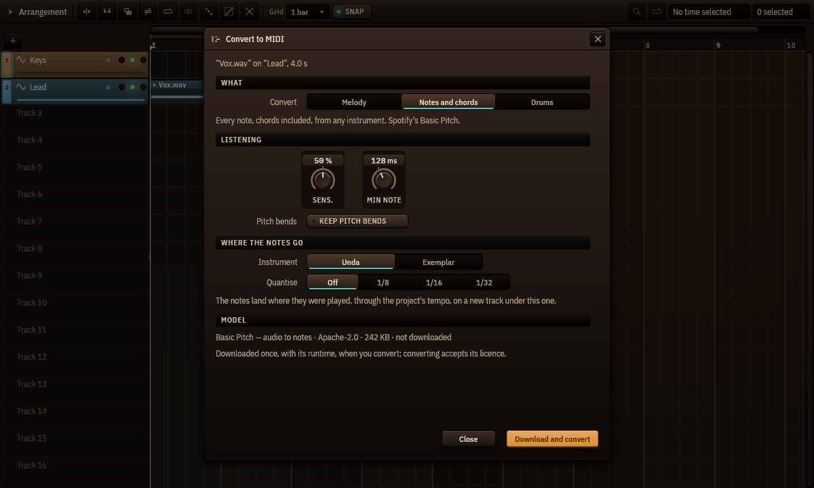

# Convert audio to MIDI

*Cantus 0.1.0-beta.9 and later · [Leer en español](../es/audio-to-midi.md)*

Cantus turns an audio clip into notes you can edit, play with any instrument, quantise or
print: a sung or hummed melody, a piano part with its chords, a drum loop.

## Convert a clip

1. Right-click an audio clip in the arrangement ▸ **Convert to MIDI…**
2. Choose **what** to convert:
   - **Melody** — one note at a time: a voice, a solo, a bass line. Cantus's own pitch
     tracker (the pitch editor's): nothing to download.
   - **Notes and chords** — every note, chords included, from any instrument. Spotify's
     *Basic Pitch* model.
   - **Drums** — kick, snare, toms, hi-hat and cymbals, written on the General MIDI drum
     map for Pulsus.
3. Adjust how it listens:
   - **Sensitivity** (notes and chords, drums) — higher finds fainter notes (and more
     wrong ones); 50 % is each model's own default. Melody has none: its tracker decides
     by itself what is sung.
   - **Shortest note** — shorter notes are dropped (128 ms by default).
   - **Keep pitch bends** — each note keeps its bends and vibrato as its own bend curve
     (the piano roll's per-note expression), even notes that overlap.
   - For drums, **Write** chooses the classes. Kick, snare and hi-hat are on; toms and
     cymbals are on only when the drum model is installed, because without it they are
     often wrong.
4. Choose where the notes go: **Unda**, or **Exemplar** with its first factory sound
   (Pulsus's studio kit for drums), and
   **Quantise** — off by default, so the notes stay where they were played.
5. **Convert**. The notes arrive on a new track under the clip's, in a MIDI clip that
   starts and ends with the audio clip. It is **one step of Undo**.

The notes follow the clip as it plays: through the project's tempo and its tempo changes,
a warped clip's warp markers, a reversed clip backwards, and a looped clip on every loop
— each loop where it really sounds, after a tempo change too, the last one cut where the
clip ends.

## The models

*Notes and chords* needs **Basic Pitch** (230 KB, Apache-2.0, by Spotify) and the ONNX
Runtime (about 15 MB, MIT, by Microsoft), downloaded once the first time you convert —
the dialog shows the model, its licence and its size before it downloads, and converting
accepts its licence. *Melody* and *Drums* work with nothing downloaded.

For better drums, **Download the drum model** in the dialog: Magenta's *Onsets and Frames
Drums* (6 MB, Apache-2.0), trained on 444 hours of real drumming. It writes every class;
Cantus's own detector still says which hi-hats were open.

Everything runs on your computer, in a helper process: if a model fails, Cantus goes on.

## How well it works

Measured with the field's usual rule (a note counts when it starts within 50 ms of the
real one at the right pitch):

- **Melody**: about 8 notes in 10 on melodies played by Cantus's instruments and on solo
  recordings of violin, horn, clarinet, trumpet, cello and saxophone.
- **Notes and chords**: about 7 in 10 on chamber-music recordings, 6 in 10 on our
  instruments' chords; exactly the notes Spotify's own Basic Pitch writes.
- **Drums** on drum recordings: kick 96 %, snare 85–89 %, hi-hat 65 %; with the drum model,
  hi-hat 74 %, cymbals 64 % and toms 44 % (toms are the hardest; check them).

Drums work best on a drum track or a drum stem. On a whole mix, turn on **Separate the
drums first**: Cantus takes the drums out with HT-Demucs (installed with **Separate
stems…**) before it listens, which brings a mix almost to a drum track's accuracy (about a
minute for a 3-minute song). The tonewheel organ (Organum) does not transcribe well.

## For agents

Agents connected through Cantus's MCP server have the same conversion as the tool
`audio_to_midi`: it asks like any edit, names the clip and track it converts, and never
downloads a model.
