# Cantus — manual de inicio rápido

*Para Cantus 0.1.0-beta.1 y posteriores, en Windows, macOS y Linux · [Read in English](../en/README.md)*

Cantus es una estación de trabajo de audio digital libre y de código abierto: graba,
compón, mezcla y masteriza una canción, de la primera nota al archivo terminado. Este
manual te lleva hasta ahí en una tarde. Todo lo que nombra está en el programa tal como es
hoy; donde la beta aún tiene huecos, el [capítulo 14](#14-problemas-conocidos-y-limitaciones)
lo dice.

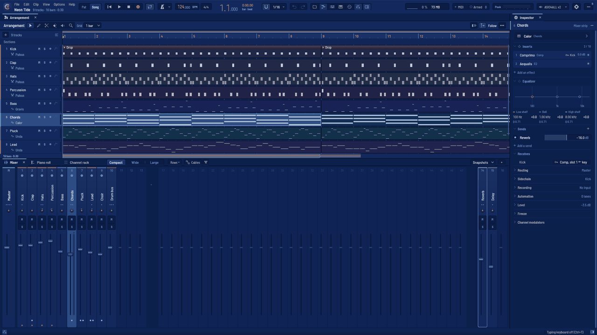

**Contenido**

1. [Instalación](#1-instalación)
2. [Primer inicio: configura tu audio](#2-primer-inicio-configura-tu-audio)
3. [El espacio de trabajo](#3-el-espacio-de-trabajo)
4. [Grabar audio y MIDI](#4-grabar-audio-y-midi)
5. [Editar: clips, piano roll, automatización](#5-editar-clips-piano-roll-automatización)
6. [Mezclar: el mezclador, inserciones y envíos](#6-mezclar-el-mezclador-inserciones-y-envíos)
7. [Masterizar: la cadena del máster, Fervor, Latitudo, Culmen](#7-masterizar-la-cadena-del-máster-fervor-latitudo-culmen)
8. [Exportar](#8-exportar)
9. [Sonidos: el explorador y los paquetes de sonidos](#9-sonidos-el-explorador-y-los-paquetes-de-sonidos)
10. [Instrumentos y efectos: el selector de dispositivos](#10-instrumentos-y-efectos-el-selector-de-dispositivos)
11. [Proyectos, autoguardado y ajustes](#11-proyectos-autoguardado-y-ajustes)
12. [Atajos de teclado](#12-atajos-de-teclado)
13. [Privacidad y actualizaciones](#13-privacidad-y-actualizaciones)
14. [Problemas conocidos y limitaciones](#14-problemas-conocidos-y-limitaciones)
15. [Reportar un error](#15-reportar-un-error)

Además: [Lo que un agente de IA puede hacer en Cantus](ai-tools.md) — las herramientas, el catálogo de unidades, el corrector musical.

Además: [Separar stems](stems.md) — una canción en batería, bajo, voces y el resto, en tu ordenador. <!-- r34:stems -->
Además: [Encontrar y escuchar presets](presets.md) — por estilo y función, escuchados antes de elegir. <!-- r37:library -->

Además: [Exportar un video con baile](video.md) — tus bailarines con la canción, para redes o un editor de video. <!-- r35:video -->

Además: [Convertir audio a MIDI](audio-to-midi.md) — una melodía, acordes o un loop de batería en notas sobre una pista nueva.

También: [Pulsus III: pads en canales propios, una cadena por pad, kits de donde sea](drum-kits.md) — separar un kit en canales, efectos en un pad, una carpeta o un SFZ como kit. <!-- r37:drums -->

Además: [El arreglo: tiempo, secciones y ripple](arrangement.md) — insertar y borrar tiempo en todas las pistas, arrastrar una sección para mover sus compases, el modo ripple. <!-- r40:ripple -->

Además: [Chorda: pianos grabados y el mezclador del piano](chorda-pianos.md) — el piano modelado o uno grabado (el Salamander, bitKlavier, tu propio SFZ), sus micrófonos en canales, Añadir nuestra sala, el retardo de un micro. <!-- r40:chorda-src -->

Además: [Tympanum, el baterista acústico](tympanum.md) — baterías modeladas y grabadas en su sala, sus micrófonos en canales, la fuga entre micros, la voz híbrida. <!-- r40:docs -->

Además: [El editor de audio](audio-editor.md) — cortar, silenciar, fundidos, normalizar, quitar ruido, quitar silencio y ver el espectro, sobre la toma de un clip.

Además: [Saltator, un personaje que baila tu canción](dancer.md) — la ventana del bailarín, sus pasos, Reaccionar a; Fuga, el ninja, y Volta, el mecha, encabezan el reparto. <!-- r35:dancer, r37:chars -->

Además: [El escenario](stage.md) — un bailarín sobre el espacio de trabajo, en la pestaña Escenario, en una ventana de compañía y en directo (OBS). <!-- r35:stage -->

Además: [El modo de grabación](recording-mode.md) — renderiza cada canal que alimenta el master para poder bajar el búfer mientras grabas. <!-- r36:record -->

Además: [Faders VCA e instantáneas de la mesa](mixing-studio.md) — mueve un grupo de franjas a la vez, guarda la mesa y recupérala, señálala en la línea de tiempo. <!-- r36:mix -->

También: [Equipo externo y superficies de control](external-gear.md) - un sintetizador o efecto de hardware en una pista con su latencia medida, y superficies Mackie Control / HUI. <!-- r36:external -->

Además: [Importar un personaje](import-characters.md) — un bailarín con tu propio personaje de Lottie, hoja de sprites o DragonBones. <!-- r35:import -->
Además: [Editar un clip con un plug-in ARA](ara.md) — un plug-in ARA 2, que ve toda la grabación, renderiza tu clip de audio. <!-- r36:ara -->

La IA en este manual: [Agentes de IA (MCP)](#agentes-de-ia-mcp) — conecta a Claude u otro
asistente; [El asistente de mastering](#el-asistente-de-mastering); [Escuchar, para agentes de IA](#escuchar-para-agentes-de-ia).

## 1. Instalación

Cantus funciona en Windows, macOS y Linux; cada versión tiene un archivo para cada uno, en
la [página de versiones](https://github.com/luis314159/cantus-daw/releases) y tras el
botón de descarga de [cantusdaw.com](https://cantusdaw.com), que te da el de tu sistema:

- **Windows 11, x64**: `Cantus-<versión>-windows-x64-setup.exe` (o el zip portátil).
- **macOS, Apple silicon o Intel**: `Cantus-<versión>-macos-universal.dmg`.
- **Linux x86-64**, Ubuntu 22.04 o más nuevo (o similar): `Cantus-<versión>-x86_64.AppImage`.

`SHA256SUMS.txt`, a su lado, te deja comprobar una descarga: `Get-FileHash <archivo>` en
Windows, `shasum -a 256 <archivo>` en Mac, `sha256sum <archivo>` en Linux. Unos 200 MB de
disco. Configurar el audio en cada sistema está en el
[capítulo 2](#2-primer-inicio-configura-tu-audio).

### En Windows

Necesitas Windows 11 de 64 bits (Windows 10 sin probar).

1. Descarga `Cantus-0.1.0-beta.1-windows-x64-setup.exe` de la
   [página de versiones](https://github.com/luis314159/cantus-daw/releases).
2. Ejecútalo. Se instala solo para ti, en `%LOCALAPPDATA%\Programs\Cantus`, y no pide
   permisos de administrador. Esta beta aún no está firmada, así que Windows puede mostrar
   *"Windows protegió su PC"*: elige *Más información ▸ Ejecutar de todas formas*.
3. Elige los componentes: el programa (obligatorio), *Abrir los proyectos .cantus con
   Cantus* (activado), un acceso directo en el escritorio (desactivado), los plug-ins CLAP
   y VST3 para otros DAW (activados) y *Controlador FlexASIO (se descarga ahora)*
   (desactivado — márcalo si tu tarjeta de sonido no tiene controlador ASIO propio; ver el
   [capítulo 2](#2-primer-inicio-configura-tu-audio)).
4. La página *Privacidad* dice qué envía Cantus por la red (solo una pregunta diaria por
   versiones nuevas, y las descargas que tú pidas). *Buscar actualizaciones una vez al día
   (recomendado)* viene marcada; desmárcala para apagar la búsqueda (también después, en
   *Ajustes ▸ Actualizaciones*).

**Copia portátil.** Descomprime `Cantus-0.1.0-beta.1-windows-x64-portable.zip` donde
quieras (una memoria USB sirve). Por el archivo `portable.txt` junto a `cantus.exe`, esa
copia guarda sus ajustes en la carpeta `data` de al lado y no escribe nada en tu perfil.

**Desinstalar** desde *Aplicaciones* de Windows. Tus ajustes, presets y autoguardados — y
la caché de muestras (hasta 16 GB, ver el [capítulo 11](#11-proyectos-autoguardado-y-ajustes)) —
solo se borran si marcas esa casilla; tus proyectos nunca se tocan.

### En Mac

1. Descarga `Cantus-<versión>-macos-universal.dmg` — una imagen de disco para Mac con
   Apple silicon e Intel.
2. Ábrela y arrastra **Cantus** a **Aplicaciones**. Expulsa la imagen de disco.
3. Abre Cantus desde *Aplicaciones* (o Launchpad). Una versión notarizada abre sin más;
   una que aún no lo está hace que macOS diga que *no puede verificar al desarrollador*:
   clic derecho en Cantus ▸ *Abrir* ▸ *Abrir* una vez (o *Ajustes del Sistema ▸
   Privacidad y seguridad ▸ Abrir igualmente*), y desde entonces abre normalmente.
4. La primera vez que grabes, macOS pregunta si Cantus puede usar el micrófono: permíteselo
   (después, en *Ajustes del Sistema ▸ Privacidad y seguridad ▸ Micrófono*).

Cantus guarda sus ajustes, presets y autoguardados en
`~/Library/Application Support/Cantus`. **Desinstalar**: mueve Cantus de *Aplicaciones* a
la Papelera; esa carpeta es tuya para borrarla o conservarla.

### En Linux

1. Descarga `Cantus-<versión>-x86_64.AppImage` — un solo archivo que funciona en la
   mayoría de las distribuciones de los últimos años, sin instalar nada ni pedir
   administrador.
2. Hazlo ejecutable y ábrelo: en el gestor de archivos, *Propiedades ▸ Permisos ▸ Permitir
   ejecutar como programa*, o en una terminal
   `chmod +x Cantus-*.AppImage && ./Cantus-*.AppImage`. Guárdalo donde quieras (una carpeta
   como `~/Applications` es buen lugar): Cantus actualiza ese archivo en su sitio.
3. Si no arranca y dice que falta FUSE, instala el `libfuse2` de tu distribución (Ubuntu
   22.04: `sudo apt install libfuse2`; 24.04: `libfuse2t64`).

Cantus guarda sus ajustes en `~/.config/cantus` y sus presets, autoguardados y sonidos en
`~/.local/share/cantus` (o donde digan `$XDG_CONFIG_HOME` y `$XDG_DATA_HOME`).
**Desinstalar**: borra el AppImage. Un Cantus de los paquetes de tu distribución o de
Flatpak lo instalan y actualizan ellos.

## 2. Primer inicio: configura tu audio

La primera vez que Cantus arranca, se abre la ventana **Configura tu audio** sobre la
música.

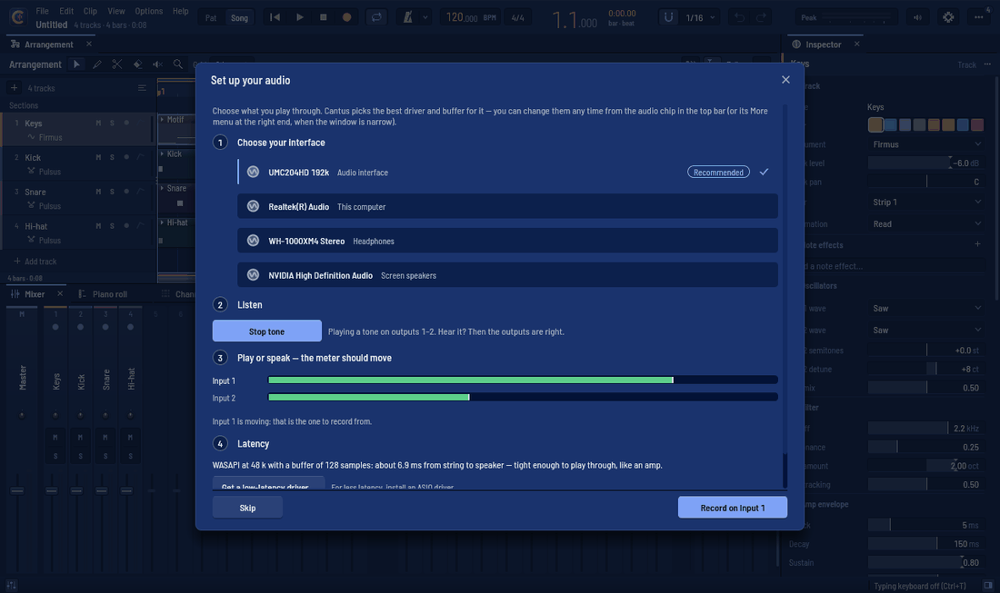

1. **Elige tu interfaz.** Cada dispositivo de audio tiene una tarjeta: *Interfaz de
   audio*, *Este equipo*, *Audífonos*… Haz clic en la que usas para tocar y escuchar.
   Cantus le elige controlador y búfer: **ASIO** a 128 muestras para una interfaz con
   controlador ASIO propio; si no, **WASAPI** (el audio de Windows) a 256.
2. **Escucha.** Haz clic en *Tono de prueba*: deberías oír un tono suave en las salidas
   1–2.
3. **Toca o habla — el medidor debe moverse.** Rasguea, canta o habla en lo que tengas
   conectado; la entrada que se mueve es la que vas a grabar.
4. **Latencia.** Cantus dice cuánto tarda el sonido de la cuerda a la bocina y si es lo
   bastante justo para tocar a través de él. Para tomas exactas, conecta con un cable la
   salida 1 a la entrada 1 y haz clic en *Medir latencia*; Cantus colocará cada toma a la
   muestra.

Haz clic en **Grabar en …** y Cantus añade una pista de audio en esa entrada, armada y
lista: pulsa `R` para grabar. *Omitir* cierra la ventana; no vuelve a abrirse sola (el
botón *Asistente…* del chip de audio la trae de vuelta).

**En un Mac** el controlador es **Core Audio**, el que usa toda interfaz: no hay ASIO que
instalar. Elige el búfer (128 muestras es un buen comienzo) y la frecuencia en la página
del dispositivo; un *dispositivo agregado* creado en *Configuración de Audio MIDI* (dos
interfaces como una) aparece como cualquier otro. La primera vez que grabas, macOS
pregunta si Cantus puede usar el micrófono: permítelo, o ninguna entrada llega a Cantus
(*Ajustes del Sistema ▸ Privacidad y seguridad ▸ Micrófono*). Los hilos de audio de
Cantus trabajan con los de Core Audio como un solo grupo, así que Apple silicon los corre
en sus núcleos rápidos.

### El chip de audio

El chip de la barra superior (o de su menú ⋯ cuando la ventana es estrecha) muestra el
dispositivo, el controlador, la
frecuencia, el búfer y la latencia — por ejemplo `UMC204HD · ASIO · 48 k · 128 · 6.1 ms`.
Su luz es verde cuando el audio funciona, ámbar tras un corte y roja cuando el dispositivo
se perdió o el controlador se detuvo. **Haz clic en él** para cambiar cualquier cosa; cada
cambio se aplica al instante y se recuerda para esa interfaz:

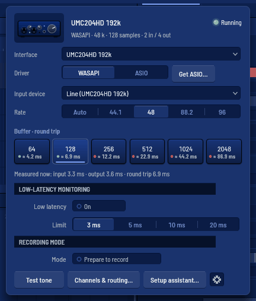

- **Interfaz**, **Controlador** (WASAPI o ASIO, con la lista *Controlador ASIO*),
  **Dispositivo de entrada**, **Frecuencia**;
- **Búfer · ida y vuelta**: de 64 a 2048 muestras, cada una con su latencia. Más pequeño
  es más justo para tocar; más grande es más seguro para mezclas grandes. Si la barra
  superior cuenta cortes, sube al siguiente tamaño;
- los problemas aparecen arriba con un botón que los arregla (*Reiniciar audio*, *Usar el
  audio de este equipo*, *Usar 48 kHz*…);
- *Tono de prueba*, *Canales y ruteo…* (nombra tus entradas y salidas, elige un par para
  la mezcla de audífonos), *Asistente…* y el engrane con todos los ajustes.

**¿Qué controlador?** Usa el controlador ASIO de tu interfaz si lo tiene (Behringer,
Focusrite, PreSonus, Steinberg, MOTU, RME…). Para el sonido integrado de una laptop, usa
WASAPI, o instala **FlexASIO** para menos latencia. *Obtener ASIO…* en la ventana del chip
abre otra con la página de descarga de FlexASIO, la de ASIO4ALL y las de los fabricantes;
tras instalar un controlador, haz clic en *Volver a buscar*. Cantus nunca instala
controladores por su cuenta.

Al conectar una interfaz, Cantus ofrece cambiar a ella; al desconectarla, ofrece el audio
de tu equipo y vuelve a ella cuando regresa. Si un controlador deja de responder, Cantus
reinicia el audio una vez por sí solo. No se puede cambiar el dispositivo mientras grabas.

## 3. El espacio de trabajo

Cantus abre con una canción — la segunda subida de la demo *Neon Tide*, en bucle — para
que lo primero que oigas sea música. Pulsa `Espacio` para reproducirla. Nada baila al
arrancar: la demo completa (*Archivo ▸ Canciones de demostración*) conserva su bailarín, y
puedes añadir uno a cualquier canción ([Saltator](dancer.md)).

- **La barra superior** (ver [más abajo](#la-barra-superior)): una sola fila — los menús sobre
  el nombre del proyecto, luego el transporte, el metrónomo, el tempo, el reloj, la rejilla,
  las ventanas, y a la derecha los medidores, el dispositivo de audio, Ajustes y **Más**.
- **El arreglo** (centro): las pistas y sus clips sobre una línea de tiempo.
- **El navegador de clips** (`Alt+F5`, *Ver ▸ Navegador de clips*): todos los clips de la
  canción como mosaicos, junto al arreglo (ver el [capítulo 5](#los-clips-en-el-arreglo)).
- **La zona inferior**: el Mezclador, el Piano roll y el Rack de canales en pestañas.
- **El inspector** (derecha, `I`): todo sobre la pista, el canal o el clip seleccionado.
- **La línea de estado** (abajo): la **línea de ayuda** — lo que hay bajo el puntero, su
  valor, qué lo mueve (un clip de automatización, un modulador, un controlador, un VCA) y las
  teclas que actúan sobre él —, luego la latencia de los plug-ins, las muestras que se cargan,
  la octava del teclado y los dispositivos minimizados. Cada control dice algo ahí; nada queda
  en blanco.

Cada área se muestra u oculta con su tecla de ventana o su tecla de función (`F5` arreglo,
`Alt+F5` navegador de clips, `F6` rack de canales, `F7` piano roll, `F9` mezclador,
`Alt+F8` explorador, `I` inspector). Arrastra los divisores para cambiar tamaños (clic derecho
devuelve uno a su sitio, doble clic lo pliega o despliega); clic derecho en una pestaña abre su
menú:

- **Plegar zona** (`Ctrl+Alt+C`) pliega el área a su barra de pestañas — o, en una fila, a un
  riel delgado con su glifo — y conserva su lugar; *Desplegar zona*, un clic en el riel o
  arrastrar la línea plegada la devuelve tal como estaba.
- **Maximizar zona** (doble clic en su pestaña, o `Ctrl+Alt+Enter`) le da el espacio de trabajo
  con **el inspector a su lado**, a su ancho, para que lo que eliges siga a mano; las áreas
  ocultas esperan en una fila de pestañas a su pie — un clic en una devuelve las áreas con esa
  delante, o *Mostrar los paneles*. Otra vez, o mostrar cualquier área, devuelve las demás; `I`
  oculta solo el inspector y la zona sigue maximizada. Las ventanas flotantes se quedan. Para
  darle todo el espacio: *Ajustes ▸ Apariencia ▸ Disposición y controles ▸ Al maximizar, queda: Nada*.
- **Flotar** la pone en su propia ventana; **Acoplar** la devuelve.

`Ctrl+F6` y `Ctrl+Shift+F6` pasan el foco del teclado de un área a otra (el glifo de la pestaña
con el foco se ilumina); `Shift+F10` abre lo que abriría un clic derecho sobre la selección;
`Esc` cierra lo último que se abrió. Toda área que tiene más de lo que muestra se desplaza.
Guarda la forma de la ventana en *Ver ▸ Disposición ▸ Guardar disposición…*; la disposición se
conserva entre sesiones.

**El aspecto.** Cantus se dibuja por defecto en **Pizarra lapislázuli**, en la luz de tu sistema
— **Papel** si es claro, **Noche** si es oscuro, hasta que elijas un modo en *Ajustes ▸
Apariencia*. Noche es el espacio tranquilo de
Pizarra, donde los paneles se separan por el tono y no por líneas, en un azul noche profundo;
un solo acento lapislázuli significa *activado* o *elegido* y nada más, y el oro del logo marca
el reloj, los números de las reglas, el cursor de reproducción y el bucle. Los colores de tus
pistas son una franja y un tinte hasta que eliges una pista — entonces se ilumina en toda la
ventana (su encabezado, sus clips, su canal y el inspector). La letra es Barlow Semi Condensed,
cuyas cifras no cambian de ancho al contar; las teclas y los campos son pozos planos con un
borde oscuro y un labio claro; en silencio nada dice «−∞». *Ajustes ▸ Apariencia* (`Ctrl+,`)
tiene todos los temas como imágenes, en cuatro grupos: las **familias** de la ronda 39 —
**Pizarra lapislázuli** (la predeterminada, la primera, Noche y Papel), **Pizarra** (el mismo
sistema en gris azulado con un acento azul celeste, la predeterminada de 0.1.0-beta.14 y
beta.15), **Grafito y oro** y **Tinta de estudio**; los temas
de versiones anteriores, **redibujados** en el aspecto nuevo — **Cantus Noche · Papel**
(espresso y el cobre del logo, cardenillo en la selección), **Hora azul · Luz de día** (azul
marino profundo, y blanco con azul), **Peltre · Tiza** (gris pizarra con naranja y lima, y
su gemelo de tiza: los antiguos *Pizarra* y *Papel*, con otro nombre), **Tinta y oro ·
Pergamino**, **Ultravioleta** y **Laguna**; los **nuevos** — **Siempreverde, Noche · Papel**
(verde bosque y latón, con cables de parcheo de verdad en el mezclador), **Burdeos** (vino y oro
rosa) e **Imprenta** (tinta negra sobre papel blanco y un solo bermellón); y la pareja de **alto
contraste** (todo el texto a 7:1). Un clic elige una familia en sus dos luces; un tema hecho en
una sola luz (Ultravioleta, Laguna, Burdeos, Imprenta) además pasa la ventana a ese modo. Luego
el modo (**Noche**, **Papel**, o seguir al sistema), el estilo de los cables, los colores del
icono de la barra de tareas y el recoloreado (tono, saturación, brillo, contraste, cada papel de
color, o un clic en un elemento para cambiarle el color). El tema que elegiste se conserva: un
ajuste guardado por una versión anterior abre en el tema que nombra, con tus cambios de color
conservados, y los temas que hiciste tú no se tocan. Si nunca elegiste uno — Pizarra sin tocar en
un ajuste de beta.14 o beta.15 —, Cantus abre en el tema predeterminado de hoy, Pizarra lapislázuli;
un clic en la imagen de Pizarra la devuelve, y se queda. En los temas de alto contraste y en tus
temas antiguos los faders siguen
ofreciendo dos capuchones (*Faders*: **Clásico** y **Metal**); los demás temas dibujan un solo
capuchón, iluminado desde arriba.

**Disposición y controles** (*Ajustes ▸ Apariencia*, bajo el aspecto): cinco elecciones de este ordenador, no
de la canción, cada una empezando donde la quiere casi todo el mundo —
- **Al maximizar, queda**: *El inspector al lado* (por defecto) o *Nada: todo el espacio*.
- **Extras de la barra**: *Ninguno* (por defecto), *Automatización* (su armado y sus modos),
  *Teclado* (el del ordenador) o *Ambos* — las teclas que la barra llevaba antes de la versión 0.1.0-beta.14 (ver
  [la barra superior](#la-barra-superior)).
- **Dock derecho del mezclador**: *En el borde de la ventana* (por defecto, como la mesa de FL
  Studio: el espacio de antes lo ocupan los siguientes canales vacíos, numerados) o *Tras la
  última tira*.
- **Valores del inspector**: *Barras de valor* (por defecto: un pozo lleno hasta el valor, la
  cifra dentro) o *Barras finas* (una barra delgada con su asa, la cifra al lado).
- **Botón M encendido**: *En color* (por defecto: la **M** de un canal o una pista en silencio
  encendida en el acento del tema) o *Gris*.

**Imágenes de instrumentos** (*Ajustes ▸ Apariencia ▸ Imágenes de instrumentos*): cómo se
dibujan el piano de Chorda y la batería de Tympanum en su sala. **Dibujadas** (por defecto) es
ligero y rápido: una imagen que se hace cuando algo cambia, nada que dibujar en reposo.
**Fotográficas** añade reflejos trazados (la tapa reflejando el arpa y las cuerdas, el suelo
reflejando el instrumento) y sombras suaves; tarda un momento en dibujarse — cerca de un segundo
una imagen completa, en un hilo aparte que nunca compite con el audio — y muestra una versión
rápida mientras arrastras un control. El sonido nunca cambia; la elección es de este ordenador,
no de la canción. <!-- r40:docs -->

**El tamaño** sigue a tu pantalla hasta que eliges uno: cerca del 125 % en una pantalla de 1920
píxeles (menos si Windows ya escala), nunca menos del 100 % ni más del 200 %. `Ctrl++`,
`Ctrl+-` y `Ctrl+0`, o *Ajustes ▸ Apariencia*, fijan el tuyo, que se conserva; un tamaño que
elegiste en una versión anterior también se conserva.

**Escribir un nombre o un valor** funciona igual en todas partes — renombrar una pista, un
clip, un pad o un canal, una búsqueda, un nivel: el campo se abre con su texto
seleccionado, así que lo que escribes lo reemplaza; `Enter` o un clic fuera conserva lo
escrito; `Esc` deja lo que había. Mientras escribes, ningún atajo se dispara. Los nombres
pueden ir en cualquier escritura — japonés, chino, coreano, hindi, tailandés, árabe,
hebreo…: Cantus usa para ellos las fuentes de tu sistema (ver los
[problemas conocidos](#14-problemas-conocidos-y-limitaciones) sobre las escrituras de
derecha a izquierda).

**Canciones de demostración.** *Archivo ▸ Canciones de demostración…* (`Ctrl+Shift+N`)
abre siete canciones hechas solo con los instrumentos y efectos de Cantus: De todo corazón
(pop cinematográfico: el piano de cola modelado Chorda, pedaleado desde su carril de
automatización, todos los efectos de modulación y dinámica de la ronda 28, Tonus afinando
la voz principal, moduladores y automatización, masterizada a −11 LUFS), Neon Tide
(house), Morning Light (balada pop), Sunday Strut (funk y soul), Paper Lanterns (hip-hop
lo-fi), Aurora (cinemática) y Midnight Static (trap). Abre una, escúchala, desármala.

### La paleta de comandos

`Ctrl+Shift+P` (*Vista ▸ Paleta de comandos…*) abre, cerca de lo alto de la ventana, un
campo que encuentra todo lo que Cantus sabe hacer. Escribe unas letras — de cualquier
palabra, en tu idioma o en inglés: `mez` encuentra *Mostrar el mezclador*, `pista nu`
*Pista nueva con…*, `div` *Dividir clip* — y la lista se acorta mientras escribes; las
flechas mueven, `Intro` ejecuta la fila, `Esc` cierra. Contiene:

- cada **acción** con su atajo a la derecha (los mismos que en los menús y las teclas);
- las **áreas** y las **ventanas** (el panel de dispositivos, los atajos, el editor de
  apariencia, la página de inicio…) y cada **página de Ajustes** (*Ajustes: Audio*…);
- cada **efecto** — se inserta en el canal seleccionado (o en el de la pista seleccionada,
  o en el máster) — y cada **instrumento**, en una pista nueva tras la seleccionada; también
  tus **plantillas de pista**;
- los **proyectos recientes** y las **plantillas de proyecto** (ver
  [Plantillas](#plantillas-y-la-página-de-inicio)).

Lo que eliges a menudo y hace poco aparece primero; sin nada escrito, la lista empieza por
lo último que usaste.

### El historial de deshacer

`Alt+H` (*Vista ▸ Mostrar el historial de deshacer*) muestra cada paso del historial del
proyecto, junto al inspector — acóplalo, apílalo o déjalo flotar como cualquier área. Cada
paso se llama por lo que hizo — *Mover 3 notas*, *Insertar Concentus en Lead*, *Renombrar
la pista a Bajo* — bajo una primera fila para el proyecto tal como se abrió. El paso actual
está iluminado; los posteriores, los que *Rehacer* traería, aparecen atenuados; el paso que
guarda tu archivo dice **GUARDADO**, y los pasos desde el último guardado llevan un punto.
**Pulsa cualquier fila para ir allí**: Cantus deshace (o rehace) cada paso intermedio, como
haría `Ctrl+Z` — no se pierde nada, y un clic en una fila posterior vuelve.

### La barra superior

La barra superior es una sola fila de 44 puntos de alto. Cada tecla va en un pozo hundido sobre
su línea central; una tecla activada se tiñe dentro de su pozo — verde para reproducir, rojo
para grabar, el acento para lo demás. Los grupos se agrupan en dos bloques: a la izquierda los
menús, Patrón / Canción, el transporte, el metrónomo, el tempo, el reloj, la rejilla, deshacer y
las ventanas; a la derecha los medidores del sistema, las entradas, el medidor del maestro, el
dispositivo de audio, las herramientas, **Ajustes** (el engranaje) y **Más**. A 1920 × 1080 y
al 100 % solo las herramientas esperan en Más (en español, también las entradas); a un tamaño
mayor se pliegan más grupos.

- **Los menús**: *Archivo, Edición, Clip, Ver, Ayuda* sobre el nombre del proyecto y su resumen
  (`9 pistas · 16 compases · 0:30`). **Haz clic en el nombre** para cambiarlo ahí mismo
  (`Intro` lo guarda, `Esc` lo deja); el título de la ventana lo sigue, con `•` mientras haya
  cambios sin guardar. En una barra estrecha los menús se vuelven una tecla ≡ que tiene cada
  menú como submenú. Cada fila de los menús muestra su atajo, o está en la paleta de comandos
  con las mismas palabras.
- **Patrón / Canción** (`L`): el *modo canción* reproduce el arreglo; el *modo patrón*
  reproduce el clip que editas en el piano roll o en el rack de canales —con lo que el
  rack muestra de las otras pistas en ese tramo— solo y en bucle, y el reloj cuenta desde
  el inicio del patrón; el cursor no sale del patrón (Inicio o un clic fuera de él lo
  llevan a su comienzo). Elegir otro clip de notas cambia lo que suena; seleccionar una
  pista, un clip de audio o nada conserva el patrón. Al salir del modo patrón el cursor
  vuelve a donde estaba la canción. El modo patrón no graba, y no se puede activar en
  mitad de una toma (una toma pertenece a la canción: pasa antes al modo canción); la
  exportación siempre renderiza la canción. Se guarda con el proyecto.
- **Transporte**: ir al inicio, reproducir, detener, grabar, bucle. **Clic derecho en la
  tecla de grabar** para las opciones de grabación (preconteo, pinchado, tomas).
- **Metrónomo** (`Ctrl+M`): su tecla y su ▾ en un mismo pozo. El ▾ tiene el **preconteo**
  (no, 1, 2, 4 compases), el **nivel** del clic, el **sonido** (*Clásico*, *Caja
  china*, *Pitido*), el **acento** en el primer tiempo de cada compás y **cuándo** suena
  (siempre, al grabar, durante el preconteo). El sonido y el acento se guardan con la canción.
- **Tempo**: `124.000 BPM` — arrástralo, gira la rueda, doble clic para 120; **clic en la
  unidad para marcarlo a golpes** (`Shift+T`): dice *TAP* en el acento mientras marcas; da al
  menos dos golpes — el tempo es la media de los últimos, una pausa empieza de nuevo, y cada
  serie de golpes es un paso de deshacer. A su lado el **compás**: clic para los tiempos, la
  figura y los compases usuales.
- **El reloj**: el tiempo grande y fino, `compás · tiempo` debajo; al grabar se pone rojo y el
  tiempo de la toma ocupa el lugar del tiempo.
- **Rejilla y ajuste**: el imán y la rejilla en un mismo pozo — la rejilla y el ajuste del
  editor en el que trabajas (el arreglo, el piano roll o el rack de canales); con un clip de
  audio en el lugar del piano roll, la rejilla del editor de afinación, y con un clip de
  automatización, la rejilla del arreglo. Los mismos valores que la barra del propio editor.
- **Deshacer** y **rehacer**, y las siete **teclas de ventana**: explorador, arreglo, rack,
  piano roll, la ventana del plug-in (`F8`), mezclador, inspector. La vista de sesión está en
  `Tab` y en *Ver*; el teclado del ordenador en `Ctrl+T` y en la línea de estado; el armado de
  la automatización y sus modos, en sus teclas y en la paleta. **¿Los quieres en la barra?**
  *Ajustes ▸ Apariencia ▸ Disposición y controles ▸ Extras de la barra*: el **armado de la automatización**
  vuelve tras la tecla de bucle (violeta mientras está armado; su ▾, o un clic derecho, pone el
  modo de todas las pistas a la vez y el deslizamiento de Touch), y la **tecla del teclado del
  ordenador** antes de las entradas (encendida mientras tus teclas tocan la pista elegida). Con
  ambos, a 1920 × 1080 y 100 % la barra sigue plegando solo las herramientas y las entradas.
- **CPU, memoria, cortes**: la carga de la llamada de audio como una pequeña gráfica con su
  número, la memoria que usa Cantus, y los cortes como una píldora roja cuando los hay (la
  causa del último, en la línea de estado).
- **Entradas**: la luz **MIDI** (se enciende cuando llegan notas) y el anillo de armado con
  cuántas pistas grabarán.
- **Medidor del maestro**: dos carriles finos con las marcas de la escala, surcos en reposo
  (nunca «−∞») y una luz de saturación. Sus cifras están en la línea de ayuda al apuntarlo:
  *Pico* muestra los picos izquierdo y derecho y mantiene el más alto de los dos últimos
  segundos; *LUFS* muestra la sonoridad del maestro —la momentánea, la de corto plazo, la
  integrada de la pasada (desde Reproducir; se mantiene tras Detener) y el pico real más alto
  desde que pulsaste reproducir (clic para reiniciarlo).
- **Sincronía** (se muestra mientras se sigue Link o un reloj externo, o si la muestras en
  *Personalizar la barra superior…*): **LINK** y sus pares, **Q** (el cuanto de Link) y
  **EXT** (el tempo de la fuente y su luz de enganche) — ver [Tocar en
  sincronía](#tocar-en-sincronía-ableton-link-reloj-midi-y-código-de-tiempo).
- **El dispositivo de audio** (ver [el chip de audio](#el-chip-de-audio)): su nombre, o el
  aviso ámbar con *Sin dispositivo*; luego las **herramientas**: el selector de elementos y el
  zoom de la interfaz; el engranaje abre **Ajustes**.

**Más.** Con la ventana más estrecha (o a un tamaño mayor) los grupos se pliegan en un orden
fijo — las herramientas, las entradas, la CPU y la memoria, las ventanas, y luego formas
compactas del dispositivo, el metrónomo, el medidor, el tempo, el reloj y los menús — y esperan
en **Más**, que muestra cuántos hay plegados. Su panel los ordena en secciones: *Metrónomo* (su
tecla, su interruptor y su atajo; preconteo, nivel, sonido, acento), *Ventanas* (cada tecla con
su atajo debajo), *Rendimiento* (CPU, memoria, voces y cortes como gráficas de los últimos 30 s
con sus números), *Entradas* (los puertos, las pistas armadas por su nombre) y *Herramientas y
zoom* (− 100 % +); las piezas pequeñas, bajo *También aquí*. Todo funciona ahí igual que en la
barra; un grupo vuelve a la barra en cuanto cabe. El transporte siempre se queda. **Personalizar
la barra superior…** (al pie de Más, en *Ver* o con clic derecho en la barra): marca un grupo
para mostrarlo u ocultarlo, arrástralo por su asa para moverlo, *Restablecer* para el orden por
defecto. Tu orden se conserva.

## 4. Grabar audio y MIDI

### Una pista de audio

1. Añade una pista de audio: `Ctrl+Shift+A`, o clic derecho en el **+** sobre las
   cabeceras de pista ▸ *Añadir pista de audio*. (El *Grabar en …* del primer inicio te
   crea una.)
2. **Ármala**: haz clic en la luz roja redonda de su cabecera (o `Alt+R`). Mayús+clic arma
   solo esa pista. Una pista armada muestra el medidor de su entrada.
3. **Elige su entrada**: el chip de entrada de la cabecera (*Ent 1*, *Ent 1-2*…; aparece
   cuando la fila de la pista es lo bastante alta), la sección *Grabación* del inspector
   o el menú de la pista.
4. **Escucha**: la tecla del altavoz de la cabecera alterna *No*, *Auto* (oyes la entrada
   mientras la pista está armada — lo predeterminado) y *Sí*. El inspector tiene además
   *Ajuste* (−24 a +24 dB antes de grabar).
5. Pulsa **`R`** (o la tecla de grabar). Graban todas las pistas armadas; pulsa `R` o
   `Espacio` para parar. Toda la pasada es un solo paso de deshacer.

Las tomas se escriben como archivos WAV de 32 bits flotantes: en la carpeta `Audio` del
proyecto una vez guardado; antes, en `%LOCALAPPDATA%\Cantus\recordings\`; al guardar se
mueven al proyecto. Cada toma se adelanta la latencia medida, para que cuadre con lo que
oíste.

**Sin FX o con FX** *(ronda 40)*. La sección *Grabación* del inspector tiene **Se graba:
Sin FX · Con FX**. *Sin FX* (lo predeterminado) graba la entrada tal como
llega, tras su ajuste: las inserciones del canal cambian lo que oyes, no la toma. *Con FX* graba
el canal tras sus inserciones (antes de su EQ, panorama y fader), en estéreo, como lo
oyes — el «grabar con efectos» de Logic y Studio One. La toma sigue cayendo donde tocaste: se
descuenta el retardo de una inserción con latencia. Dos cosas que saber: las inserciones oyen
la entrada solo mientras se escucha (*Auto* o *Sí*), y trabajan sobre todo lo que lleva el canal
en ese momento. La elección se guarda con la canción, por pista; un paso de deshacer.

### Opciones de grabación

La ▾ junto a la tecla de grabar (o clic derecho sobre ella) abre las **Opciones de
grabación**:

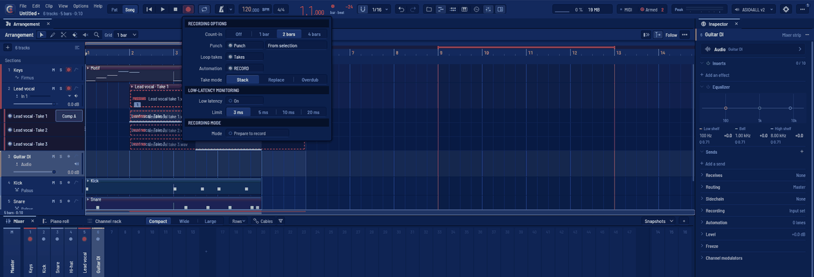

- **Claqueta**: no, 1, 2 o 4 compases antes de la toma (`Alt+C`). La claqueta suena
  aunque el **Metrónomo** (`Ctrl+M`) esté apagado. Suena **antes de grabar** con el
  transporte parado — el chip de la barra superior lo dice con un punto rojo, y su menú bajo *Antes de grabar* —, como en FL
  Studio y Ableton; Play solo arranca de inmediato. Para oírla también al reproducir, marca
  **También al reproducir** en el menú del chip (o en las opciones ▾ del metrónomo):
  apagado por defecto, vale para todos los proyectos.
- **Pinchazo**: graba solo dentro de un tramo. *Desde la selección* toma la selección de
  tiempo; `Alt+P` usa la selección, si no el bucle, si no dos compases desde el cursor. El
  tramo aparece como una llave roja bajo la regla: arrastra sus extremos. Todo lo tocado
  se conserva en el archivo; el pinchazo solo fija la ventana del clip.
- **Tomas en bucle**: con el bucle activado, cada vuelta es una toma.
- **Modo de toma**: *Apilar* (los clips anteriores pasan a carriles de tomas — lo
  predeterminado), *Reemplazar* (corta lo que cubre la toma) o *Sobregrabar* (MIDI: añade
  notas al clip).
- El clic —su nivel, su sonido, su acento y cuándo suena— es del metrónomo, en la
  [barra superior](#la-barra-superior).

### Escuchar con baja latencia

La compensación de retardo mantiene cada pista a tiempo con la más lenta: con un EQ de fase
lineal en alguna parte de la canción, todo —**también la entrada que escuchas**— lo
espera, y quien canta puede oírse 96 ms tarde. La **escucha con baja latencia**
(`Alt+Shift+R`, o su interruptor en las opciones de grabación, en el menú del chip de
audio y en las filas de grabación del inspector) lo cambia mientras está activa:

- Lo que escuchas (la entrada de una pista armada con su **Escucha** en *Auto*, cualquier
  entrada con la Escucha en *Sí*, o una pista de instrumento armada que tocas) llega a tus
  oídos **sin esperar a las otras pistas**: una voz por Tonus se oye 2,7 ms tarde en vez de
  96 ms. La base sigue a tiempo consigo misma.
- Una inserción del camino escuchado con más latencia que el **límite** (3 ms por
  omisión; 5, 10 o 20 ms en las mismas filas) se **salta** — la lista dice cuáles:
  *Escucha sin: Aequalis, Culmen* (y cuántas más, pasadas ocho). Vuelven en cuanto la
  apagas, sin nada de antes.
- El chip de audio muestra el viaje de ida y vuelta de lo que escuchas —el del driver,
  la espera de la entrada (para una entrada de audio: las notas que tocas solo salen) y la
  cadena escuchada— mientras está activa.
- Tu toma queda exactamente donde quedaría con ella apagada: lo que se graba es la entrada
  tal cual, colocada según la latencia que había cuando empezó la toma. Si la latencia del
  acompañamiento cambia durante la toma (cambias el modo, una anticipación automatizada),
  lo que tocas después se coloca según la nueva: cada parte queda donde la tocaste.

Para el menor retardo, escúchate por un canal propio: un bus que mezcla tu voz con otras
pistas grabadas las mantiene a tiempo, y tu voz las espera ahí.

### Tomas y comping

Cada toma se guarda en un **carril de tomas** bajo la pista: ábrelos con el pequeño
desplegable al pie de la celda de color de la pista, `Alt+T` o *Mostrar tomas* del menú de
la pista. **Arrastra sobre una toma** para pasar ese tramo a la pista; haz clic en una toma
para usarla entera. Clic derecho en un carril: *Usar esta toma*, *Borrar tomas sin usar*
(que también quita las grabaciones que ya nada reproduce), *Separar tomas en pistas
nuevas* y *Ocultar tomas*.

**Costuras.** Donde dos tomas se encuentran en la composición, se **funden**: a igual
potencia, 10 ms por defecto, centrado en la costura, y cada toma sigue leyendo su propia
grabación. Cada costura tiene un pequeño rombo al pie de la pista; **arrástralo** (o el
borde de cualquiera de las dos tomas ahí) y los dos lados se mueven juntos. Clic derecho
para su fundido —*Sin fundido*, 5, 10, 20 o 50 ms— o para usarlo en todas las costuras de
la pista. Cada trozo de la composición muestra el número de su toma, y los carriles de
tomas iluminan lo que está en la composición.

**Composiciones alternativas.** La cabecera del primer carril tiene la ficha de la
composición, *Comp. A*. Haz clic para las composiciones: cambia entre ellas (cada una
vuelve exactamente como la dejaste, con sus ediciones de afinación), *Composición nueva*
(una copia de esta, para probar otra idea), *Renombrar*, *Borrar*, **Consolidar** (queda la
composición, se van las tomas) y **Consolidar y fusionar** (la composición renderizada en
una sola grabación junto a las tomas; sus archivos se quedan en el disco). El mismo menú
apaga la **composición rápida** (entonces arrastrar en un carril selecciona tiempo y un
clic selecciona una toma) y enciende o apaga la **composición agrupada**: las pistas cuyos
canales están en un mismo grupo del mezclador —los micrófonos de una batería grabados
juntos— se componen juntas, el mismo tramo de la misma toma en cada una; sus costuras se
mueven juntas, toman los mismos fundidos, y sus composiciones se cambian y se crean
juntas. Cada cambio es un paso de deshacer.

**Qué forma parte de la composición.** Los trozos que hace un arrastre o *Usar esta toma*
son de la composición, y también la toma que suena sobre las demás tras una grabación (la
última pasada de un bucle, o una toma grabada sobre otras; una grabación donde no hay
ninguna toma es un clip sin más, que suena bajo todas las composiciones): cambian con la composición y siguen
siendo suyos al cortarlos, moverlos o deslizarlos. Una copia nunca es de la composición,
la pegues donde la pegues —justo sobre su toma también—: queda en el carril que suena en
todos los cambios, bajo todas las composiciones. Un trozo arrastrado a otra pista sale de
la composición; tras consolidar, los trozos son clips sin más. Los carriles de tomas
iluminan el tramo de cada toma que suena en la composición.

### MIDI

Arma una **pista de instrumento** (una sin entrada de audio) y pulsa `R`: se graban en un
clip las notas de todos los teclados MIDI que Cantus encontró (la luz MIDI de la barra
superior se enciende cuando llegan notas). Sin nada armado, `R` graba en la pista
seleccionada. ¿Sin teclado?
`Ctrl+T` activa el **teclado del ordenador**: `A`–`L` tocan notas, `Z`/`X` cambian de
octava. Mientras está activo, los atajos de letra (incluida la `R`) se apagan — usa
`Espacio` o la tecla de grabar.
La **inflexión de tono**, la **rueda de modulación**, los **pedales**, cualquier otro
controlador (CC 0–119), la **presión de canal** y lo rápido que sueltas cada tecla
(**velocidad de liberación**) también se graban: quedan en los carriles del clip, bajo las
notas del piano roll.

### MPE: expresión por nota

Un controlador MPE (un Seaboard, un LinnStrument, un Osmose, un Sensel) da a cada nota su
propia **inflexión** (pitch bend), **presión** y **timbre** (slide, CC 74). Cantus las graba
en las notas, las muestra y edita en el piano roll, y las toca en sus instrumentos y en los
plug-ins.

- **Activarlo.** Ajustes ▸ MIDI ▸ *MPE*: pon el puerto del controlador en *MPE*. Los demás
  puertos no cambian: un teclado en el canal 5 nunca se lee como miembro MPE. *Zonas*: una
  zona inferior de 15 canales miembro es lo que envían casi todos (miembros ±48 semitonos,
  maestro ±2); elige *Superior* o *Ambas* para un controlador dividido. Un controlador que
  envía su MCM fija sus propias zonas y rangos de inflexión.
- **Tocar y grabar.** Cada nota suena con su propia inflexión, presión y timbre, en vivo y al
  grabar; la toma los guarda en sus notas (aligerados a lo que el oído distingue). La
  inflexión, el pedal y la rueda del canal maestro siguen siendo carriles de la pista.
- **En el piano roll.** La inflexión de una nota es la línea que la atraviesa (un semitono
  llega a la fila siguiente), su presión el grosor de la línea, su timbre el color. El menú
  **+** del área de carriles muestra una fila por tipo —*Inflexión*, *Presión*, *Timbre (por
  nota)*— con las curvas de las notas seleccionadas (de todas si no hay selección): dibuja
  con el lápiz o la línea (Mayús ajusta la inflexión a semitonos enteros), clic derecho para
  *suavizar*, *aligerar*, *escalar*, *aplanar* o *borrar*. Cada gesto es un paso de deshacer.
  Cortar, mover, transponer, cuantizar, copiar y las copias enlazadas conservan las curvas.
- **Nuestros instrumentos.** Unda, Calor, Modulus y Gravis inflexionan cada nota según su
  curva (con suavidad, compatible con el glide). Un Unda, Calor o Modulus nuevo trae presión
  y timbre ya enrutados en sus dos últimas ranuras de la matriz (Unda: nivel y posición de
  tabla; Calor: su filtro; Modulus: nivel y brillo): rutas normales que puedes cambiar.
- **Plug-ins.** Inspector de la pista ▸ *Expresión de nota*: *Automática* (lo que el plug-in
  dice aceptar), *Expresiones de nota* (note expressions de CLAP y VST3), *MPE (MIDI)* (cada
  nota en un canal miembro propio, con el MCM y rango ±48, para plug-ins que solo aceptan
  MIDI) o *Desactivada*.
- **Archivos.** MIDI: una pista MPE se escribe como zona inferior (MCM, rango de inflexión,
  un canal miembro por nota); un archivo MPE —con su MCM o reconocido por cómo toca— se lee
  como una sola pista con las curvas de cada nota; la presión polifónica se conserva.
  DAWproject lleva las curvas como expresiones propias de las notas.

### Controladores MIDI

Cualquier perilla, fader, botón o pad de un controlador MIDI puede mover cualquier cosa
que Cantus pueda ajustar: un parámetro de cualquier dispositivo (de Cantus o de un plug-in
alojado), un fader, un panorama, una anchura, un envío, la cantidad de un modulador, un
silencio, un solo, un armado de grabación, el puenteo o la mezcla de un inserto, el tempo y
el transporte (reproducir, detener, grabar, bucle, el metrónomo, el tempo por pulsación,
los marcadores, PAT / SONG — todo lo que puede hacer una tecla).

**Aprender en dos clics.** Clic derecho en un control ▸ **Aprender controlador MIDI** y
mueve un control de tu equipo: listo. O haz clic en la casilla **MIDI** de la barra
superior (o pulsa `Ctrl+Shift+M`; con clic derecho abre los ajustes MIDI) para el **modo de
aprendizaje**: se marcan todos los controles
que se pueden aprender; haz clic en uno, mueve un control del equipo, haz clic en el
siguiente. Un control asignado lleva un puntito abajo a la derecha; en el modo de
aprendizaje se marca con el color de resalte, y el que espera a tu equipo se enciende. `Esc`
cancela un aprendizaje (también 15 segundos sin mover nada). Sin ninguna entrada MIDI
abierta, un clic en la casilla abre los ajustes MIDI. **Cambiar controlador MIDI** y **Olvidar el controlador MIDI** están
en el mismo menú. Los menús de canal e inserto del mezclador y el de la cabecera de pista
tienen filas *Aprender* para volumen, panorama, anchura, silencio, solo, armado, puenteo y
mezcla, y el de un canal para su interruptor de efectos y su armado de grabación (la
bombilla FX y el punto de grabación del canal se aprenden también en el modo de
aprendizaje); el menú de un envío las tiene para su nivel; las perillas y lámparas del rack de
canales, y los interruptores y opciones de un dispositivo, se aprenden como cualquier
perilla. En el inspector se aprenden también la lámpara (puenteo) y el anillo (mezcla) de
un inserto, el interruptor de los insertos y el LED de armado, y en la ventana de un
dispositivo su lámpara de puenteo. Un control que representa un valor de una opción
aprende ese valor: el LED *Solo* de una banda aprende esa banda (un botón la deja sola y la
suelta), una tecla de la escala de Tonus aprende su clic. Dentro de la ventana propia de un plug-in, mueve allí el parámetro, pulsa
`Alt+Shift+A` (**Vincular el último parámetro movido a un controlador**, como en FL Studio;
también en el menú **Clip** de la barra superior) y mueve el equipo.

Cantus distingue lo que moviste: una perilla normal, un **fader de 14 bits** (llegó también
su controlador fino), un **codificador sin fin** (y cuál de las tres codificaciones usa),
un botón, un pad (en un interruptor conmuta; en una perilla su velocidad fija el valor) o un
cambio de programa (sin la selección de banco que un teclado manda antes). Pulsa un botón y
suéltalo: pulsado y soltado, conmuta; un botón que se queda abajo por sí mismo (solo manda
su valor máximo) pone el destino encendido o apagado según esté. Todo parámetro de dos
estados (el encendido de un dispositivo, una lámpara) es un interruptor: un botón lo fija
al instante, sin toma de control. Los controles NRPN y RPN no se aprenden — Cantus lo
dice y sigue esperando otro control; configura el controlador para que mande CC normales.

**Cómo lee una asignación su control** — en el panel **Controladores** (menú Ver, o
`Ctrl+Shift+K`), una fila por asignación:

- **Modo**: *Absoluto* (donde está el control, está el destino), *Relativo* (un
  codificador: cada paso mueve el destino — en una opción, una opción por paso), *Conmutar* (cada pulsación lo invierte),
  *Momentáneo* (pulsado: activo; suelto: inactivo), *Disparo* (cada pulsación lanza una
  acción).
- **Desde / Hasta**: la parte del recorrido del destino que cubre el control, en las
  unidades del destino (−∞ dB a +6 dB, 200 Hz a 4 kHz, 60 a 180 BPM…), una opción por sus
  nombres (*Limpio* a *Opto*, *Fase lineal* a *Fase mínima*; las opciones de un plug-in con
  sus propias palabras), un interruptor sin nombres *No* y *Sí*; *Hasta* por debajo
  de *Desde* lo invierte. Arrastra una celda, o haz doble clic y escribe — un número o el
  nombre de una opción; clic derecho la restablece.
- **Curva**: una curvatura, para que la primera mitad del giro haga menos (o más); se
  escribe en porcentaje (−100 a 100) y se guarda tal cual.
- **Toma de control**, para un control que no se mueve solo cuando el valor cambia por
  otro lado: *Recoger* (por defecto: nada se mueve hasta que la perilla pasa por el valor —
  sin saltos), *Escalar* (el valor sigue a la perilla y ambos llegan juntos al final),
  *Saltar*. La cabecera fija la toma de control de las asignaciones nuevas; un
  interruptor no tiene.
- **Retorno** (*Enviar*): el valor vuelve al controlador cada vez que cambia — para faders
  motorizados y anillos de LED, y las luces de los botones del transporte y de cada
  interruptor con estado (reproducir, grabar, bucle, metrónomo, pinchazo, cuenta previa…).
  Desactivado por defecto; una acción sin estado (detener, deshacer) no tiene *Enviar*. Lo
  que un controlador o un puerto de bucle devuelve al instante se reconoce como el eco que
  es.

Un punto encendido a la izquierda de una fila indica que acaba de llegar un mensaje.
**Compartido** marca un control con varios destinos (se permite: una perilla puede abrir
dos filtros a la vez). Una fila cuyo destino ya no existe (una pista borrada) se conserva,
marcada **Falta**, y vuelve a funcionar si deshacer recupera el destino. El parámetro de un
plug-in se aprende con ese plug-in: si el instrumento o el inserto se cambia por otro — un
plug-in o uno de los de Cantus —, la fila dice **Otro plug-in**, con los nombres del plug-in
y del parámetro con los que se aprendió y su recorrido en porcentaje, y su perilla queda
libre (aprende el parámetro del nuevo; deshacer el cambio devuelve la vida a la fila
antigua). Un inserto cambiado por uno de los de Cantus conserva su puenteo y su mezcla, y
un parámetro que el efecto nuevo también tenga. **Sin cargar** indica que el plug-in está
en el proyecto pero no funciona aquí (o se detuvo); **Congelado**, que el sonido del
destino está congelado: un movimiento se rechaza y se dice, y la perilla no llega a ningún
otro instrumento; **No conectado**, que la entrada MIDI de la asignación no está abierta;
**Sin entrada**, que el armado de grabación de un canal no tiene ninguna pista con entrada
que armar.

**Dos mapas.** Las asignaciones de *Este proyecto* se guardan con el proyecto, y cada
cambio es un paso de deshacer. **En todas partes** — tus asignaciones globales, guardadas
junto a tus atajos de teclado — reúne lo que significa lo mismo en cualquier canción: el
transporte, el tempo, el máster, **la pista seleccionada** y **el canal seleccionado**
(volumen, panorama, silencio, solo, armado — los del máster cuando está seleccionado) y las ocho primeras perillas del **dispositivo
enfocado** (la ventana de dispositivo en la que hiciste clic por última vez). Aprender una
tecla de transporte o el máster la lleva allí; **Añadir asignación** en el panel los ofrece
todos, y la acción de cada atajo de teclado por su grupo (armar la pista seleccionada,
pinchar, deshacer, guardar, las vistas…). Cuando un control está en los dos, gana la asignación del proyecto. Si el archivo global no
se puede leer entero, se guarda una copia a su lado (el estado dice su nombre) y no se
pierde nada; si ni siquiera se puede copiar, nunca se escribe encima, y cada cambio en las
asignaciones globales avisa de que no se guardará.

**Mientras tocas y grabas.** Una perilla asignada ya no llega al instrumento (no mueve
además su filtro) y un pad asignado no toca ninguna nota. Un movimiento hecho con el ratón
o con un controlador es un paso de deshacer por gesto. Con un parámetro bajo un clip de
automatización, el clip lo toca — hasta que una pasada de grabación lo mueve: desde ese
momento el parámetro sigue tu mano (el clip queda aparte el resto de la pasada), y la
pasada escribe lo que hiciste como un clip de automatización, cada movimiento en el momento
en que llegó su mensaje, dentro de la pasada (la cuenta previa y lo que pase del final del
pinchazo no se escriben, y pasado el final del pinchazo el parámetro vuelve a seguir su
clip; Opciones de grabación ▸ *Grabar automatización*). Mientras se graba audio, una
perilla asignada al tempo no hace nada (el estado dice por qué): cambia el tempo antes o
después de la toma.

La presión de canal y la presión de tecla llegan ahora al instrumento (de Cantus y
alojados), y un cambio de programa llega a un instrumento alojado.

### Tocar en sincronía: Ableton Link, reloj MIDI y código de tiempo

Cantus sigue un reloj externo a la vez y envía el suyo por los puertos que elijas. El grupo
**Sincronía** de la barra superior lo muestra: **LINK** (su luz encendida mientras Link
está activo, al lado el número de otras aplicaciones en la sesión), **Q** (el cuanto de
Link, en tiempos) y **EXT** (la fuente que se sigue: su luz es la de enganche — encendida
cuando va enganchado, ámbar mientras se ajusta o espera su momento — y el tempo que toca).
*Personalizar la barra superior…* lo muestra u oculta como cualquier otro grupo.

**Ableton Link.** Haz clic en **LINK**: Cantus entra en la sesión Link de todas las
aplicaciones de tu red (Live, Bitwig, Traktor, apps del teléfono, otro Cantus). El tempo de
la sesión pasa a ser el de Cantus mientras Link está activo — el tempo del proyecto y su
pista de tempo se conservan y vuelven al apagar Link (como en Live, Link los manda mientras
está activo). El tempo de la barra superior muestra el de la sesión; arrastrarlo cambia el
tempo de la sesión para todos, y también lo cambia un cambio del tempo del proyecto. Pulsa reproducir y Cantus
arranca en el siguiente cuanto (**Q**: un clic recorre 1, 2, 3, 4 y 8 tiempos; 4 es un
compás de 4/4), en fase con los demás; nada de lo ya sonado se mueve, y el sonido sale por
los altavoces cuando lo hace el tiempo de la sesión (se descuenta la latencia del
dispositivo de audio). Con **Inicio/parada** activo (Ajustes ▸ MIDI), reproducir o parar
en cualquier aplicación arranca o para todas. La primera vez que se enciende Link, Windows
puede pedir que dejes pasar a Cantus por su cortafuegos (Link habla con las otras
aplicaciones por UDP en tu red, como Live): permítelo en redes privadas. Si Link no puede
abrir la red, su luz se pone roja y su descripción lo dice.

**Reloj MIDI de entrada.** En Ajustes ▸ MIDI, marca **Reloj** en la entrada por la que
llega el aparato maestro (o elige *Seguir ▸ Reloj* y el puerto). Cantus espera entonces al
maestro: su Start reproduce desde el principio, Continue desde su posición, Stop para; el
tempo sigue los relojes del maestro, filtrados para que un reloj tembloroso suene firme. Tu
propia tecla de reproducir también espera al maestro.

**Código de tiempo MIDI de entrada.** Marca **MTC** en la entrada: Cantus persigue el
código — un cuadro completo localiza, los cuartos de cuadro lo hacen correr, un corte breve
se salva y se para cuando el código se para. **Código inicial** dice qué código es el
principio de la canción (una hora, `01:00:00:00`, es lo habitual); el mapa de tempo del
proyecto convierte el tiempo en compases.

**Reloj y código de salida.** En la tabla de **Salidas**, marca **Reloj** en un puerto para
enviar reloj MIDI (24 por tiempo, el puntero de posición, inicio, parada y continuación,
siguiendo la pista de tempo) y **MTC** para enviar código de tiempo con los **Cuadros**
elegidos (24, 25, 29,97 drop-frame o 30) desde el **Código inicial**. Cada salida tiene un
**Desfase** (‹ › de medio milisegundo; un clic pone cero) para un aparato que responde
tarde; **Respuesta** dice si las luces de los controladores y los faders motorizados pueden
usar el puerto.

**La tabla de puertos.** Las **Notas** y los **Controles** de cada entrada se pueden
apagar (un teclado que solo debe mandar reloj, un controlador que solo debe mover el mapa);
las teclas y pedales ya pulsados se sueltan igual. En un puerto MPE, los Controles llevan
la inflexión, la presión y el timbre de cada nota: apagados, esos callan.
- **MPE**: las zonas MPE del puerto y sus rangos de inflexión (ver *MPE* en las páginas del
  piano roll).
- **Rejilla**: la rejilla de controlador (Launchpad, APC) que es el puerto, reflejo de la
  vista de sesión.

**La vista de sesión mientras se sigue.** Un clip o una escena lanzados desde parado
esperan a la fuente: con Link, el siguiente cuanto (o el inicio de la sesión, con
Inicio/parada); con reloj MIDI o código de tiempo, el Start del maestro. El tempo propio de
una escena se propone a la sesión Link al lanzarla, y las demás aplicaciones cambian con
él.

## 5. Editar: clips, piano roll, automatización

### Gestos rápidos

Como en FL Studio, el arreglo abre las cosas sin buscar en los menús:

- **Doble clic en la cabecera de una pista** (en cualquier sitio menos su nombre): se abre su
  **instrumento** — la ventana del instrumento (Unda, Pulsus II…) o la ventana propia de un
  plug-in CLAP/VST3. Firmus y las pistas de audio, que no tienen ventana, muestran el
  inspector.
- **Clic en el nombre de una pista** — sobre las letras mismas (el puntero se vuelve un
  cursor de texto) — para **renombrarla** allí mismo: el nombre queda seleccionado, escribe
  el nuevo, `Enter` lo guarda (un paso de deshacer), `Esc` devuelve el anterior. Un clic en
  otro lugar de la cabecera solo selecciona la pista, y escribir con una pista seleccionada
  nunca la renombra. (Los canales del mezclador y los pads del rack se renombran con doble
  clic.)
- **Doble clic en un clip**: se abre el **piano roll** en él, con el clip entero a la vista.
  Un patrón de pasos que el rack muestra sin perder nada — cada nota un golpe corto en un
  paso, un tono por canal (una batería puede usar todos sus pads; una melodía en un
  sintetizador se abre en el piano roll, como en FL) — se abre en el **rack de canales**,
  en la rejilla del propio patrón y desplazado hasta su pista. Un clip de automatización se
  abre en su editor grande; un clip de audio se abre en el **editor de afinación** (su
  ganancia, fundidos y archivo siguen en el inspector).
- **Abrir editor** — en el inspector, los menús del mezclador o el marco de un instrumento —
  trae una ventana ya abierta de la bandeja (o de la barra de tareas, si es de un
  instrumento o un efecto plug-in) y la pone delante; mientras la ventana de un plug-in está
  abierta, su botón dice *Mostrar*. `F8` y el botón de canal del rack hacen lo mismo cuando
  la ventana está minimizada, detrás de otra pestaña o bajo otra ventana, y solo la cierran
  cuando ya está delante. (Cantus no puede traer delante un plug-in que abre su propia
  ventana flotante: su botón dice *Cerrar*.)

### Los clips en el arreglo

- **Crear**: doble clic en un lugar vacío de una pista (un clip de 4 compases), o graba.
- **Seleccionar**: clic; `Ctrl+clic` añade; arrastra sobre el vacío para un recuadro;
  `Esc` limpia.
- **Mover**: arrastra (también a otra pista). `Alt+arrastrar` copia; `Ctrl` al arrastrar
  ignora la rejilla. `Izquierda`/`Derecha` desplazan según la rejilla, con `Shift` un
  compás.
- **Recortar**: arrastra el borde de un clip — su contenido se queda donde está.
  **Desplazar el contenido**: `Shift+arrastrar` lo mueve dentro del clip.
- **Cortar** en el cursor: `Ctrl+E`. **Unir**: `Ctrl+J`. **Duplicar**: `Ctrl+D` (púlsalo
  de nuevo para seguir en fila). **Silenciar**: `0`. **Renombrar**: `F2`. **Color**:
  `Ctrl+Shift+C`.
- **Selección de tiempo**: arrastra en el carril inferior de la regla; la franja de arriba
  es el bucle: un bucle dibujado ahí ya suena en bucle (un paso de deshacer). `Shift+L` pone el bucle en la selección, `Z` la amplía.
- **Los clips de audio** tienen tiradores de fundido de entrada, de salida y de ganancia
  (doble clic en uno lo restablece; clic derecho en un fundido para su curva) y un menú con
  *Normalizar*, *Invertir*, *Restablecer ganancia* y *Quitar fundidos*.
- **Fundidos cruzados**: arrastra un clip de audio para que empiece sobre otro y el
  solapamiento **se funde** solo, en el mismo paso de deshacer — el clip anterior se
  desvanece mientras el siguiente entra, dibujados como dos curvas sobre el solapamiento.
  Su cuadrito arriba del solapamiento: **arrástralo de lado** para alargar o acortar el
  fundido (los bordes de los dos clips se mueven en torno a su centro, hasta donde llega su
  audio); **doble clic** abre el editor del fundido (su curva dibujada, *Sin fundido ·
  Potencia constante · Lineal · Curva en S*, *Duración* en ms); **clic derecho** da las
  mismas opciones. *Potencia constante* (la predeterminada) mantiene el nivel entre dos
  grabaciones distintas; *Lineal* y *Curva en S* van mejor con dos tomas de lo mismo. Un
  solapamiento *sin fundido* suena con los dos clips sumados (bordes punteados). Apaga los
  fundidos automáticos (o elige su curva) en *Ajustes ▸ Edición* o en el menú del clic
  derecho de la línea de tiempo (*Fundidos cruzados automáticos*); *Fundir el solapamiento*
  del menú del clip funde (o deja de fundir) a mano los solapamientos de la selección. Un
  clip que queda entero dentro de otro se superpone, no se funde; dos clips que solo se
  tocan quedan unidos a tope.
- **Envolventes de ganancia de clip**: clic derecho en un lugar vacío del arreglo ▸
  *Mostrar envolventes de ganancia* (o desde el menú del clip). Cada clip de audio muestra
  una línea de ganancia — +12 dB arriba, 0 dB a un cuarto de la altura, −∞ abajo — y su
  forma de onda la sigue. En un clip seleccionado o bajo el puntero, **pulsa sobre la
  línea** para añadir un punto y arrastrarlo (Shift: fino); **doble clic** en un punto lo
  borra; arrastra el circulito a mitad de un tramo para **curvarlo** (doble clic lo
  endereza); clic derecho en un punto o en la línea para la forma del tramo (las seis del
  editor de automatización), *Borrar punto* o *Restablecer envolvente de ganancia*. La línea
  es del audio: desplaza el contenido y se mueve con él, recorta y queda oculta (no
  perdida), corta y las dos mitades la conservan, une y se juntan las líneas de las piezas,
  invierte y suena reflejada con el audio. Actúa sobre la ganancia y los fundidos del clip.
  Los clips MIDI no tienen línea de ganancia: su nivel es la velocidad de sus notas.
- **Importar audio**: arrastra archivos WAV, AIFF, FLAC u Ogg al arreglo (caen donde
  sueltas), o *Archivo ▸ Importar audio…*. Un archivo MIDI añade sus pistas.
- **Copias enlazadas**: pegar, `Ctrl+D` o `Alt+arrastrar` crean *el mismo clip* otra vez —
  editas uno y todas las copias lo siguen (las notas, o la ganancia, los fundidos y la
  inversión de un clip de audio). Lo muestran una marca de enlace y la cuenta ×N. *Hacer
  único* (`Alt+U`) saca la selección de su grupo; *Seleccionar enlazados* (`Shift+Alt+L`);
  *Enlazar la selección a este clip* (`Alt+L`); *Enlazar a…* (`Alt+N`) elige, por nombre o
  por pista, el grupo enlazado o el clip propio en que se convierte. En el inspector, la
  fila *Enlace* de un clip enlazado dice cuántas copias tiene y ofrece *Enlazar a…*;
  renombrarlo en la fila *Nombre* renombra todas las copias. Clic derecho en un lugar vacío
  del arreglo ▸ *Las copias quedan enlazadas* para hacer copias independientes.
- **El navegador de clips** (`Alt+F5`, o *Ver ▸ Navegador de clips*) muestra una vez cada
  grupo enlazado y cada clip propio, como mosaicos del color del clip con una miniatura de
  lo que contiene; escribe para filtrar por nombre o pista. **Arrastra un mosaico** al
  arreglo para colocar ahí una copia enlazada. **Haz clic en un mosaico** para elegirlo para
  la **herramienta de pintar**: con el arreglo enfocado, `B` (o `2`) la saca — un clic
  coloca una copia enlazada, arrastrar pinta copias seguidas a lo largo de la pista,
  arrastrar con el botón derecho (o `Alt`+arrastrar) borra solo las copias de ese clip;
  cada trazo es un paso de deshacer; `Esc` la desactiva. Doble clic en un mosaico
  selecciona todas sus copias.

Desplázate con la rueda, `Shift+rueda` en el tiempo, `Ctrl+rueda` para el zoom. Bajo los
carriles, el **mapa de la canción** es la barra de desplazamiento horizontal: cada pista una línea
donde tiene clips, la vista un marco — arrastra el marco, arrastra sus extremos para el zoom,
pulsa en otro sitio para ir ahí.

### Las herramientas del arreglo, Seguir y la rejilla

La barra del arreglo tiene su nombre, las **herramientas**, la **rejilla**, **Seguir** y el menú
del panel **…**. Las herramientas son un juego de opciones — la elegida se ilumina — y sus teclas
son las letras de FL y la fila de números mientras el arreglo tiene el foco (si no, las del piano
roll):

| Herramienta | Tecla | Qué hace |
|---|---|---|
| Seleccionar | `E` o `3` | Clic en un clip lo elige, arrastrarlo lo mueve, arrastrar su borde lo redimensiona; arrastrar en carriles vacíos selecciona. Es la que está en la mano al arrancar |
| Dibujar | `P` o `1` | Clic en un carril vacío añade un clip de un compás en la celda de rejilla pulsada; arrastra para dibujarlo del largo arrastrado. Sobre un clip lo mueve y redimensiona, como Seleccionar |
| Cortar | `C` o `6` | Clic en un clip lo parte en dos sobre la rejilla; el corte se dibuja antes bajo el puntero |
| Borrar | `D` o `4` | Clic en un clip, o arrastra sobre varios, para eliminarlos (un paso de deshacer) |
| Silenciar | `T` o `5` | Clic en un clip, o arrastra sobre varios, para silenciarlos o no |
| Zoom | `8` | Clic acerca en el puntero, `Alt`+clic aleja, arrastra sobre unos compases para encajarlos |

`B` (o `2`) sigue siendo la herramienta de pintar del navegador de clips (ver arriba), y `Z`
amplía la selección. Las demás acciones de la fila antigua — partir, pegar, duplicar, silenciar,
repetir, hacer único, borrar, poner en bucle y ampliar la selección, *Ajustar a la rejilla* —
están en el menú del panel **…** y en el menú del clip, con sus teclas.

- **Seguir** (activado al arrancar): mientras suena la canción, la vista pasa la página cuando el
  cursor de reproducción sale de ella, empieza fuera o da la vuelta al bucle. Una vista que
  desplazaste tú se respeta.
- **La rejilla** (empieza en un compás): su menú tiene los valores en orden musical —
  *Compás*, 1/2, *Tiempo*, 1/8, 1/16, 1/32 — con una marca en el actual, y luego **Tresillos**
  (`Shift+3`; un valor y su tresillo, «1/8T») y **Seguir el zoom** (la rejilla pasa a ser el
  valor más fino cuyas líneas quedan al menos a 12 puntos). `Ctrl` al arrastrar ignora la
  rejilla. El menú de la rejilla del piano roll es el mismo.
- Con la ventana estrecha la barra se pliega: primero las palabras de la rejilla y de Seguir,
  luego el nombre se vuelve su glifo, y luego las herramientas se vuelven la elegida y un
  chevrón que las lista todas.

**Lo que muestran los clips.** El contenido de un clip se dibuja a cuatro zooms: de lejos, el
contorno de alturas de un clip MIDI, el pulso de un clip de batería y la sonoridad de un clip de
audio; más cerca, las notas en filas ordenadas por altura (una melodía, en orden de altura), cada
tambor en una fila, los picos y la sonoridad de la onda; de cerca, las notas con su duración y
su brillo según la velocidad, los dos lados del estéreo por separado (*L*, *R*), y los valores de
un carril de automatización junto a sus puntos («−15.0 dB»). Los clips de la pista elegida se
iluminan un paso; mientras una pista está en solo, los clips de las demás se atenúan; un clip
bajo el cursor brilla mientras suena; un clip silenciado lleva un rayado. Al mover un clip, su
sitio anterior queda punteado y el clip va sobre una sombra suave, con «Drop → 3.1» en la línea
de ayuda; al redimensionar, el borde se ilumina y la línea de ayuda dice el largo en que cae
(`Alt` estira, `Ctrl` ignora la rejilla). Apunta a un clip MIDI y aparece una pequeña **muesca**
en su esquina superior derecha: arrástrala para repetir el clip a su largo (un paso de
deshacer).

### Secciones, carpetas, encabezados de pista y el icono de una pista

- **Las secciones** son tramos de compases con nombre en un carril bajo la regla
  (*Secciones*), cada uno con su largo («8 compases»); la que suena es la más marcada. Añade una
  desde el menú del carril o desde la tecla de carriles en la esquina sobre los encabezados (de
  la selección de tiempo, o de cuatro compases). Clic en una sección la elige, doble clic la
  renombra, arrástrala por los compases (un paso de deshacer), arrastra su final para cambiar su
  largo; su menú selecciona su tiempo o lo pone en bucle (*Repetirla en bucle*) y la quita.
  Arrastrar una sección mueve la sección; mover con ella la música que tiene debajo está
  planeado.
- **Carpetas**: *Carpeta* en el menú de añadir pista, o el menú de una pista ▸ *Meter en una
  carpeta nueva*. Una carpeta es una fila propia con un chevrón, su nombre y M · S (silencian y
  ponen en solo a sus miembros, en un paso); su carril muestra los clips de los miembros como
  barras finas. Cerrada, es una sola fila («Carpeta · 4 pistas → Drum bus») y sus miembros no
  ocupan altura; abierta, los miembros van sangrados bajo ella. Suelta un encabezado entre dos
  miembros para meterlo en su carpeta, en cualquier otro sitio para sacarlo; *Sacar de su
  carpeta* y *Desagrupar* lo hacen desde el menú.
- **Los encabezados de pista**: el número, el nombre, una línea debajo (el instrumento, la
  entrada armada con su medidor, o *Congelada*), un medidor fino, y M S ● A como letras en reposo
  — reunidas en un pozo bajo el puntero; solo la tecla activada se ilumina (S en ámbar, ● en rojo,
  A en violeta; M con un contorno ámbar cuando un solo silencia la pista). Alturas de 24, 32, 44
  (la predeterminada), 64 (con el nivel como deslizador) y 96 (con las inserciones en palabras),
  desde el menú de la pista ▸ *Altura*, o cualquier altura arrastrando el pie de una fila (`Alt`:
  todas las pistas). Arrastra el borde de los encabezados para su ancho (120–360).
- **Un modo por carril de automatización**: el encabezado de un carril de automatización muestra
  su **ficha de modo** (Read, Touch, Latch, Write); clic para darle a ese carril un modo propio
  sobre el de su pista.
- **El icono propio de una pista**: el menú de la pista ▸ *Icono…*, o un clic en el icono delante
  de su nombre, abre el **selector de iconos**: 316 dibujos en 17 familias (baterías, percusión,
  percusión afinada, guitarras y bajos, cuerdas, vientos y metales, teclados, electrónica, voz,
  sonido y efectos, mezcla, marcas y formas…), los que usaste hace poco en una fila arriba,
  **Ninguno** para quitarlo, y un campo de búsqueda que encuentra un icono por su nombre en
  español o en inglés o por un alias, con o sin acentos. El icono aparece delante del nombre de
  la pista, en la cabeza de su canal en el mezclador y en el inspector. Cada elección es un paso
  de deshacer.
- **Una canción vacía** ofrece *Empieza tu canción* con tres comienzos (una pista de
  instrumento, una batería, una pista de audio), un sitio para soltar un sonido, un bucle o un
  archivo MIDI, y *O abre una canción de demostración*.

### La pista de tempo y los marcadores

Una canción puede cambiar de tempo y de compás a lo largo de ella y llevar marcadores con
nombre (ronda 29).

- **La pista de tempo** es una franja bajo la regla (*Ver ▸ Pista de tempo*, o el menú de
  la regla): cada punto es un tempo, que se mantiene plano hasta el siguiente o hace una
  **rampa** recta hasta él. Doble clic en la franja para añadir un punto (en la rejilla, al
  tempo donde hiciste clic); arrastra un punto para moverlo (`Mayús` para pasos finos de
  tempo, `Ctrl` fuera de la rejilla); `Alt+clic` activa o quita la rampa de un punto;
  doble clic en un punto para escribir su tempo; clic derecho para *Rampa hasta el punto
  siguiente*, *Quitar el punto* y *Quitar la pista de tempo*. La cabecera junto a la franja
  muestra el tempo en el cursor de reproducción.
- **El tempo de la barra superior** muestra el tempo en el cursor (dentro de una rampa, su
  valor ahí). Arrastrarlo y la rueda (un paso, un BPM) mueven en esa cantidad el punto bajo
  el que está el cursor — dentro de una rampa, su inicio; un doble clic (120) o **TAP** lo
  fijan — el tempo de la canción cuando no hay pista de tempo.
- **Los cambios de compás** son fichas en la regla antes del número del compás ("7/8").
  Clic derecho en la franja de marcadores o en la regla ▸ *Añadir un cambio de compás aquí*
  (en el compás 1 abre el compás propio de la canción); clic en una ficha para editar su
  compás, arrástrala por las líneas de compás entre sus vecinas, clic derecho para quitarla. Los compases que siguen a un cambio conservan su
  número; las notas nunca se mueven. El compás de la barra superior edita el que rige en el
  cursor.
- **Los marcadores** aparecen en una franja bajo la del bucle. `Alt+M` añade uno en el
  cursor (o doble clic en la franja, o clic derecho en la regla ▸ *Añadir un marcador
  aquí*); clic en un marcador para llevar el cursor ahí; **doble clic** para renombrarlo;
  arrástralo por la rejilla; los marcadores de un mismo tick quedan uno junto a otro; clic
  derecho para *Cambiar el nombre…*, *Color…*, *Bucle hasta el marcador siguiente*, *Seleccionar hasta el marcador
  siguiente*, *Exportar hasta el marcador siguiente…* y *Quitar el marcador*. `Alt+,` y `Alt+.` van al
  marcador anterior y al siguiente; `Alt+Mayús+O` hace un bucle entre los marcadores que
  rodean el cursor. El menú de la franja lista todos los marcadores bajo *Ir a*.
- **Exportar entre marcadores**: *Archivo ▸ Exportar audio…* ▸ *Qué* ▸ *Marcadores*, y
  elige los dos marcadores por su nombre (dos en lugares distintos: si no, el diálogo lo
  dice, y nunca exporta la canción entera en su lugar).
- Todo sigue al tempo: las notas, los clips de audio, la automatización, los moduladores,
  los efectos sincronizados, el metrónomo (acentúa el primer tiempo de cada compás; un
  compás de 7/8 se cuenta en corcheas) y los plug-ins de otros. Un clip de audio sin warp
  suena a su velocidad natural a partir del punto de su archivo que cae en su inicio:
  divídelo, recórtalo o haz comping donde sea y cada trozo sigue sonando donde estaba;
  mueve o copia clips a otro lugar y cada uno cae en su propio compás con la misma parte
  de su archivo (los trozos de una misma toma movidos juntos siguen tocándose). Un cambio
  de tempo nunca cambia lo que suena donde entra una toma, y los trozos de una toma se
  mueven juntos, así que una división nunca salta; un cambio *dentro* de una toma deja
  que el resto siga a su propia velocidad — aplícale warp para que siga los compases. Un
  clip invertido conserva el punto de su archivo que suena en su final. Mientras se graba
  audio el tempo no cambia — tampoco al deshacer o rehacer un cambio de tempo; grabar
  notas lo deja libre.
- **Los archivos MIDI** llevan todo el mapa de tempo al exportar (una rampa como un cambio
  de tempo cada semicorchea — una muy larga, de más de 1 024 tiempos, en menos pasos y más
  largos, cada uno con el tempo medio de su tramo — y todos los marcadores, también los
  del final) y al importar —
  con *Poner el proyecto a … BPM en …* se conservan los cambios de tempo, de compás y los
  marcadores del archivo: al inicio de la canción pasan a ser los suyos; soltados en un
  compás posterior empiezan ahí (en la línea de compás más cercana), y la canción conserva
  su tempo y su compás antes. Los
  archivos **DAWproject** llevan la pista de tempo, los cambios de compás y los marcadores
  en ambos sentidos. Los puntos de tempo, cambios de compás o marcadores de un archivo
  situados más allá del millón de tiempos se omiten, y la importación lo dice.

### El piano roll

Selecciona un clip MIDI y muestra el piano roll (`F7`, o su pestaña bajo el arreglo):
edita las notas de ese clip.

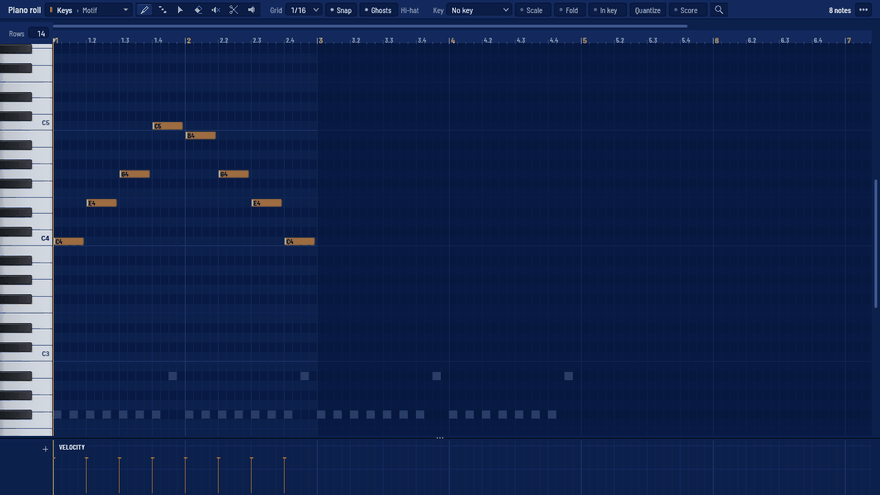

| Herramienta | Tecla | Qué hace |
|---|---|---|
| Dibujar | `P` o `1` | Clic añade una nota, arrastrar mueve, arrastrar el borde derecho cambia la duración, clic derecho borra |
| Pintar | `B` o `2` | Arrastra sobre la rejilla para pintar notas |
| Seleccionar | `E` o `3` | Arrastra para seleccionar; arrastra notas para moverlas |
| Borrar | `D` o `4` | Clic o arrastre sobre notas para borrarlas |
| Silenciar | `T` o `5` | Clic en una nota para silenciarla (se queda, sin sonar) |
| Cortar | `C` o `6` | Arrastra una línea para dividir notas |
| Escuchar | `Y` o `7` | Clic en notas o filas para oírlas |

`Arriba`/`Abajo` transportan la selección (`Shift`: una octava), `Izquierda`/`Derecha` la
desplazan, `Q` cuantiza, `Ctrl+C`/`Ctrl+V` copian y pegan. Las velocidades son tallos en
el carril bajo la rejilla: arrástralos, o `Alt+rueda` sobre una nota. Una batería muestra
una fila con nombre por pad.

**El teclado y las notas.** El teclado de la izquierda se dibuja como un piano: teclas de
marfil y ébano con los anchos de un piano real (de do a mi comparten cinco filas, de fa a si
siete, así que solo mi|fa y si|do caen en líneas de fila), cada do con su nombre en su tecla, el
do central más marcado. La tecla bajo el puntero se ilumina, la que suena con un clic se ilumina
más, y mientras suena la canción las teclas que suenan se encienden en el color de la pista. La
esquina de encima, **Filas**, fija la altura de las filas: *Compacta · 8*, *Normal · 12* o
*Alta · 18* (`Ctrl+Alt+rueda` sobre las notas las amplía libremente). El relleno de una nota
sigue su velocidad, con un ataque más brillante y su nombre dentro cuando cabe; una nota elegida
se eleva y lleva un aro; una nota silenciada va hueca.

**Fantasmas** (la luz *Fantasmas* de la cabecera, encendida por defecto) muestra tenues detrás
de este clip las notas de los demás — las de esta pista en su color, las de otras pistas en
gris — y la cabecera dice de quién son («Pluck · Lead · Choir»). Nunca se eligen ni se mueven.

**La cabecera** dice qué clip está abierto: la franja y el nombre de la pista › el nombre del
clip, un menú con los otros clips de esta pista y los de otras pistas (*Otras pistas*), y, con
notas elegidas, cuántas y su ámbito («6 notas seleccionadas · E4 – C5 · velocidad 90 – 95»). Sus
herramientas, la rejilla, el ajuste, Fantasmas y las partes de la escala se pliegan en una
ventana estrecha, como las del arreglo.

**Carriles bajo las notas.** Bajo la rejilla, cada clip muestra su carril de velocidad y los
carriles que tiene. El **+** de la celda del carril de velocidad añade uno: **Velocidad de
liberación** (lo rápido que se suelta cada nota — arrastra sus tallos; un aro en el suelo es
una nota sin ella), **Inflexión de tono**, **Presión de canal**, los controladores con nombre
(rueda de modulación, soplo, expresión, sustain, …) u **Otro controlador ▸** para cualquier
número del 0 al 119. En un carril:

| En un carril | Qué hace |
|---|---|
| Lápiz, línea, curva (las teclas de su celda) | Dibuja a mano alzada; arrastra una línea recta; arrastra una curva (`Alt` la dobla al otro lado). La línea y la curva se ajustan a la rejilla |
| Arrastrar un punto | Lo mueve (con los puntos seleccionados con él); `Ctrl` lo deja en su tiempo |
| `Mayús` + arrastrar | Selecciona los puntos del rectángulo; `Supr` los borra |
| Clic derecho en un punto | Lo borra |
| **×** en su celda | Quita el carril (Deshacer lo devuelve) |

El carril de inflexión muestra en sus bordes el rango del instrumento. Un carril es del clip:
se mueve, se divide, se repite, se copia y se enlaza con él; la inflexión, la presión y los
pedales vuelven a reposo donde termina el clip. Con **Los carriles siguen a las notas**
(activado, en el menú **+**), mover, copiar y pegar notas se lleva los controladores que hay
bajo ellas. Las filas comparten el espacio bajo el divisor; cuando no caben, la rueda sobre
sus celdas las desplaza. Los archivos MIDI traen sus inflexiones, presión y controladores a
estos carriles y los vuelven a sacar al exportar, con la velocidad de liberación de cada
nota.

### El rack de canales

El **rack de canales** (`F6`) muestra cada pista como una fila de pasos sobre los compases
del clip seleccionado: clic enciende un paso, clic derecho lo apaga, arrastrar pinta. Un
paso es una nota normal.

- **Una fila** es la luz del canal, sus dos perillas, su pista del mezclador, su **placa con el
  nombre** y sus pasos; el color del canal es una franja a la izquierda (entera si está
  elegido), y la fila elegida se tiñe a lo largo de la rejilla. Un paso encendido se llena desde
  abajo hasta su velocidad en el color del canal; los tiempos dos y cuatro van un paso más
  claros.
- **Una batería** lista sus pads bajo su propia fila, sangrados, con una línea de árbol; su
  placa dice cuántos pads tiene («3 pads»). **Su chevrón pliega los pads** bajo la fila de la
  batería (la fila sigue mostrando sus golpes) y los vuelve a abrir.
- **Un canal melódico** muestra su patrón como un pequeño piano roll en un pozo a lo largo de la
  página, y un canal de audio la forma de onda de su sonido.
- **Dos compases por página** cuando el rack está ajustado; el **mapa del patrón** a la derecha
  de la cabecera muestra cada compás del patrón (la página a la vista en relieve, los golpes de
  cada tiempo como una marca) — clic en un compás para ir a esa página; la barra de
  desplazamiento recorre el resto.
- **Al pie**: **Añadir un canal** abre el selector de instrumentos para un canal nuevo al final;
  debajo, una zona para soltar — *Suelta aquí un sonido para un canal nuevo*, *o sobre un canal
  para cambiar su muestra* — se ilumina mientras arrastras un sonido del explorador sobre ella.

### El editor de afinación

Doble clic en un clip de audio — o su menú ▸ *Editar afinación*, o *Editar afinación* en el
inspector — y su toma se abre en el lugar del piano roll, a la manera de Melodyne: cada
**nota** es una mancha en la fila de la nota que suena, tan gruesa como fuerte es la voz,
con la **curva de afinación** atravesándola (lo que se cantó, tenue, bajo lo que sonará).
Las sibilantes y las respiraciones se marcan abajo. La toma se analiza junto a la ventana
la primera vez (un segundo o así por minuto de audio; una toma grabada se analiza en
cuanto llega) y el resultado se guarda en la caché de Cantus, así que la próxima vez se
abre al instante. El archivo nunca cambia: el clip suena con un render de tus ediciones,
hecho junto a la ventana, y mientras un render está en camino se oye la toma tal como fue
(nunca silencio). La exportación espera a todos los renders.

- **Herramienta Editar**: haz clic en una nota para seleccionarla (`Mayús` añade; arrastra
  en el fondo para varias). Arrástrala **arriba o abajo** para mover su afinación — a las
  notas de la tonalidad (*Ajuste: Escala*), a semitonos o a cualquier punto (*Libre*;
  mantén `Alt` para cents). Arrástrala **a los lados** para moverla en el tiempo, o
  arrastra uno de sus **extremos** para estirarla: solo ceden los huecos a su lado, sus
  vecinas quedan exactamente como se cantaron. **Doble clic** en una nota lleva su centro a
  su nota (otra vez para soltarlo). `Arriba`/`Abajo` mueven la selección un paso (`Mayús`:
  una octava, `Alt`: 10 cents), `Ctrl+A` selecciona todas, `Ctrl+J` une, `Q` cuantiza,
  `Esc` deselecciona.
- **Herramienta Dividir**: haz clic dentro de una nota para cortarla en dos; **Unir** junta
  vecinas.
- **La nota** (el panel de abajo): lo que la selección *suena* y lo que se *cantó*, y su
  **centro** (cuánto se lleva su centro a su nota, conservando su deriva y su vibrato
  naturales), **deriva** (el vaivén lento: 100 % como se cantó, 0 % plano), **vibrato**
  (0–200 %), **formante** (el color de la voz, arriba o abajo, sin mover la afinación) y
  **ganancia**.
- **Las macros** actúan sobre la selección, o sobre todas las notas si no hay ninguna
  seleccionada: **Corregir afinación** según una cantidad (cada nota esa proporción hacia su
  nota — una nota fuera de la tonalidad, hacia su nota más cercana; al 0 % no se mueve),
  **Corregir deriva** según una cantidad, y **Cuantizar** el inicio de cada nota a lo que
  diga *Cuantizar a* en la barra: una rejilla, o **las notas de otra pista** (cada nota a la
  más cercana, a una corchea como mucho).
- **Tonalidad**: hallada a partir de las notas; cámbiala en la barra (las escalas de
  Tonus). **Original** compara con la toma tal como se cantó (A/B) — el inspector tiene el
  mismo interruptor. **Restablecer** deshace todas las ediciones de la selección. **▶**
  reproduce desde la primera nota seleccionada. Cada edición es un paso de deshacer.
- **MIDI**: arrástralo a una pista de instrumento del arreglo y la melodía cae allí, en el
  lugar de la voz; haz clic para una pista nueva. **Doblar**: una segunda voz una tercera o
  una quinta por encima en la tonalidad, de la misma toma, en su propia pista. MIDI y
  Doblar están también en el menú del clic derecho del clip de audio.
- Cuando el editor es estrecho, lo que no cabe en la barra está en su menú **…**, y el
  panel bajo las notas se desplaza a los lados.

**El carril de afinación**: clic derecho en la cabecera de una pista de audio ▸ **Carril de
afinación** muestra sus notas en un carril bajo ella, en el arreglo — arrastra una arriba o
abajo para moverla, doble clic para llevarla a su nota — para arreglos pequeños sin abrir
el editor.

Los formantes se conservan al mover una nota (medido: dentro de 3 dB a ±3 semitonos).
Trabaja sobre una voz o una línea de instrumento a la vez; los acordes no se separan en
notas.

### Warp y estiramiento del audio

El **warp** hace que un clip de audio suene al tiempo del proyecto: más rápido o más lento
de lo que se grabó, sin cambiar su tono, y siguiendo cada cambio de la pista de tempo. El
archivo nunca cambia: el clip reproduce un render hecho junto a la ventana.

- **Los loops se ajustan solos.** Importa un loop (desde *Archivo ▸ Importar audio…*,
  soltándolo desde Windows o desde el explorador) y Cantus encuentra su tempo, sus pulsos
  y su primer tiempo fuerte; un archivo de un número entero de compases (o uno cuyo WAV
  lleva su tempo) se ajusta al momento al tempo del proyecto, en el mismo paso de
  deshacer que la importación (un solo paso para todos los archivos que sueltes). Los
  archivos más largos, cada toma que grabas y cada toma recuperada tras un cierre
  inesperado suenan a su velocidad natural hasta que los ajustes: una grabación suena tal
  como se tocó.
- **Ajusta tú un clip**: clic derecho ▸ *Warp* ▸ **Seguir el tempo del proyecto** (o
  *Seguir* en el inspector o en el editor) — nada se mueve hasta que muevas un marcador,
  ni bajo una rampa de tempo —, **Detectar el tempo** (marcadores en cada compás
  encontrado) o **Ajustar desde aquí** (su tempo contado desde el pulso donde hiciste clic
  derecho; en el inspector, desde el cursor de reproducción). Quitar *Seguir* devuelve el
  clip a su velocidad natural y guarda sus marcadores para cuando lo vuelvas a poner;
  quitarlo, restablecer el warp o volver a ajustarlo nunca mueve lo que el clip suena al
  empezar (ni en sus copias enlazadas). Una copia enlazada bajo otro tempo que el de sus
  copias se vuelve única la primera vez que la ajustas, para que sigan sonando igual.
  *Usar su tempo en el proyecto* va al revés: el tempo del clip (el que encontró el
  análisis, mientras no sigue el tempo) pasa a ser el tempo donde empieza.
- Los **marcadores de warp** fijan un instante del audio a un pulso. Cualquier clip de
  audio bajo el puntero o seleccionado muestra sus **transitorios** (los golpes que
  contiene) como marcas en una banda en su parte superior; un clip que sigue el tempo
  muestra además sus marcadores como banderas doradas — también los de sus dos extremos —
  y su banda acepta clics. **Doble clic en la banda**
  añade un marcador (sobre un transitorio, cae sobre él); arrastrar en la banda añade uno y
  lo mueve a la vez. **Arrastra un marcador** para llevar ese instante del audio a otro
  pulso — se ajusta a la rejilla (mantén `Ctrl` para moverlo libre) y el audio entre sus
  vecinos se estira para encajar. Mantén **`Alt`** al arrastrar para deslizar en cambio el
  audio *bajo* el marcador. Doble clic en un marcador, o clic derecho ▸ *Quitar marcador de
  warp*, o un clic en él y `Supr`, para quitarlo. En un clip que no sigue el tempo la
  banda no responde: arrastrar cerca de su borde superior mueve el clip, como en
  cualquier otro punto de él.
- **Estira un clip entero**: mantén `Alt` y arrastra su **borde derecho** (`Mayús` sigue
  desplazando el contenido). Una copia enlazada se estira sola (sale de su grupo).
- **La pestaña Warp del editor del clip**: doble clic en el clip (o *Editar el warp*) — el
  editor tiene dos pestañas, **Afinación** y **Warp**, y se abre en la última que usaste.
  La pestaña Warp muestra el clip en grande sobre una regla de compases, con los mismos
  gestos en cualquier clip de audio, y una barra con el modo, su propia **rejilla** (de
  1/4 a 1/32, o libre), la transposición, *Formantes*, *Seguir*, el tempo del clip (**½**,
  **×2** cuando se contó a la mitad o al doble), *Detectar el tempo*, *Cuantizar…* y
  *Restablecer warp* — lo que no hace nada en el modo del clip aparece atenuado; en una
  ventana estrecha la barra ocupa una segunda fila. `Ctrl` y la rueda (o pellizcar)
  acercan el clip alrededor del puntero, la rueda (o la barra de abajo) lo desplaza, y `Q`
  abre *Cuantizar audio*.
- **Modos** (la sección *Warp* del inspector, o la barra) — elegir uno no ajusta el clip:
  - **Complejo** — cualquier cosa: mezclas completas, pads, acordes. Mantiene los ataques
    nítidos, las voces de un acorde estables y la imagen estéreo en su sitio.
  - **Ritmo** — baterías y loops percusivos: cada golpe suena exactamente como se grabó,
    solo desplazado; **Final de cortes** elige qué llena el hueco tras un golpe cuando se
    ralentiza (*Fundir*, *Bucle*, *Espejo*: de ida y vuelta).
  - **Melódico** — una voz o una línea de instrumento: el más limpio para un solo, con el
    color de la voz conservado al transponer.
  - **Varispeed** — como un tocadiscos: la velocidad y el tono cambian juntos (sin
    artefactos de procesado; *Transponer* queda desactivado).
- **Transponer** desplaza el clip en semitonos y cents sin cambiar su tiempo (un clip que
  no sigue el tempo conserva su velocidad natural); **Formantes ▸ Conservar** mantiene el
  color de una voz al transponerla (sin efecto "ardilla"). El nivel queda como estaba.
- **Detectado** y **Certeza** en el inspector: el tempo y los compases que encontró el
  análisis, y lo seguro que está. Sobre un marcador, la línea de ayuda da la velocidad a
  la que suena el audio tras él, frente al tempo vigente allí.
- **Cuantizar audio…** (el menú del clip o el inspector, sobre cada clip de audio
  seleccionado junto al que elegiste): acerca los transitorios a una rejilla con una
  *Intensidad*, solo los más fuertes si lo eliges (*Transitorios desde*) — un paso de
  deshacer para todos los clips; solo se mueven los golpes que se oyen (el periodo propio
  de un loop; los de un clip invertido, en las líneas donde suenan), el resto conserva su
  velocidad.
- **Renderizar el audio ajustado** escribe la ventana del clip tal como suena ahora en un
  archivo nuevo junto al audio del proyecto, y el clip pasa a reproducir ese archivo, sin
  warp (un paso de deshacer). **Restablecer warp** devuelve el clip a su velocidad
  natural.

Mientras llega un render (una fracción de segundo para un loop, unos segundos para un
archivo largo) oyes una vista previa rápida con el tiempo y el tono correctos — un clip
transpuesto por primera vez suena entretanto con su propio audio; uno cuyos marcadores
mueven su audio espera un momento a su vista previa, nunca suena en el compás que no es —
y el paso de una a otra se funde una vez. La exportación, los stems, la congelación, pasar a
audio en su lugar y la conversión de un modulador en automatización esperan al render
completo; si alguna vez tarda demasiado, la línea de estado lo dice al terminar. Los clips
ajustados viajan en los archivos DAWproject con sus marcadores y su modo (un archivo que
escribió Cantus vuelve con su warp tal como estaba); un clip a su velocidad natural viaja
como un archivo colocado en segundos, así conserva su velocidad en cualquier aplicación.
Abrir o soltar un `.dawproject` lo lee en segundo plano (su audio copiado al disco sobre
la marcha, un archivo referido a su lado encontrado allí); se abre cuando nada se graba
ni se arrastra, y nunca sobre otro proyecto abierto entretanto.

### Automatización

Clic derecho en cualquier perilla, fader o control de un efecto ▸ **Crear clip de
automatización**, o mueve un control y pulsa **`Alt+A`** (automatiza lo último que
tocaste). El clip cubre la selección de tiempo (si no, el bucle; si no, cuatro compases)
en un carril bajo su pista. En el carril: arrastra los puntos, arrastra el anillo entre
dos puntos para curvar, clic en la línea añade un punto, doble clic en un punto lo borra,
clic derecho para su forma (curva simple o doble, mantener, escalera, pulso, onda). Doble
clic en el clip abre el editor grande, con herramienta de dibujo y articuladores
(invertir, suavizar, azar, escala, LFO). Un control automatizado muestra un punto.

**Los plug-ins alojados** se automatizan como los de Cantus: clic derecho en un parámetro
del editor genérico de un plug-in (o en la lista *Parámetros* de un instrumento alojado, en
el inspector), o muévelo en la ventana del propio plug-in y pulsa `Alt+A`. Sus cambios le
llegan al plug-in en su muestra exacta dentro del bloque de audio.

**Grabar automatización.** Mientras grabas, cada control que muevas —en Cantus o en la
ventana de un plug-in— se escribe en un clip de automatización sobre el tramo en que lo
moviste (un paso de deshacer al terminar la pasada). Se apaga en las opciones de grabación
(*Automatización*).
(Es el modo **Retener** de abajo, para cada pista en Leer.)

**Escribir automatización mientras suena la canción: Leer, Escribir, Tocar, Retener.** Cada
pista tiene un modo de automatización — la insignia a la derecha de su cabecera (L, E, T, R;
haz clic en ella, o `Alt+Mayús+W` para la pista seleccionada), la fila *Automatización* del
inspector; el del máster está en su menú del
mezclador. El **armado de automatización** de la barra superior (la tecla de la envolvente,
tras el bucle) los hace escribir; su ▾ cambia todas las pistas a la vez y el **Regreso de
Tocar**.

| Modo | Mientras suena la canción, armado |
|---|---|
| **Leer** (L) | Reproduce la automatización. Mover un control no escribe nada |
| **Escribir** (E) | Sobrescribe todo lo que la pista automatiza, de reproducir a parar, cada parámetro donde estaba hasta que lo muevas. Tras la pasada, la pista pasa a Tocar |
| **Tocar** (T) | Escribe mientras sostienes un control; al soltarlo vuelve suavemente a la curva que había (en el tiempo de regreso, 250 ms por defecto) |
| **Retener** (R) | Escribe desde que tocas el control hasta que paras, manteniendo el último valor |

Lo que escribes se convierte en clips de automatización corrientes, justo sobre el tramo
escrito; el control vuelve a donde estaba antes del primer clip, y la pasada entera — con
los movimientos de tu mano — es **un solo paso de deshacer**. Sirve para cada control
automatizable: faders, panoramas, envíos, parámetros de efectos e instrumentos, los de los
plug-ins movidos en sus propias ventanas, profundidades de moduladores y los controladores
asignados a cualquiera de ellos. En un bucle, cada pasada escribe sobre la anterior donde la
toca; con el pinchazo activado, solo se escribe su rango.

### Moduladores

Un **modulador** mueve parámetros por ti: un **LFO** (cinco formas, sincronizado con la
canción o libre en Hz, reiniciado por las notas si quieres), una **envolvente** (ataque,
caída, sostén, liberación; la abren las notas de la pista o un nivel de audio), un
**seguidor** (el nivel de cualquier canal: hunde un pad bajo el bombo), **pasos** (hasta
32, sincronizados, con deslizamiento) y una fuente **aleatoria** (sostenida o suave,
repetible desde su semilla). Cada modulador mueve **cuantos parámetros quieras**, cada uno
con su profundidad, positiva o negativa; un parámetro puede recibir varios, que se suman
sobre su automatización. Hay dos más, **controladores** que tocas o programas, cada uno
con su propia ventana: [Tactus, el pad X-Y](#tactus-el-pad-x-y), y [Calculus, el
controlador por fórmula](#calculus-el-controlador-por-fórmula).

- **Dónde viven**: la sección *Moduladores* del inspector para la pista seleccionada, su
  canal o el máster (el **+** de la banda). Cada modulador muestra su movimiento en un
  dibujo, sus ajustes, su cantidad y una fila por parámetro que mueve: arrastra la
  profundidad, *conviértela* en automatización o desconéctala.
- **Conectar**: clic derecho en cualquier perilla, fader o parámetro de un plug-in ▸
  **Modular…** y elige un modulador o crea uno nuevo ya conectado; o **arrastra el asa de
  un modulador** (el agarre a la izquierda de su título) sobre cualquier perilla; o pulsa su
  tecla de **asignar** y arrastra cualquier perilla: el arrastre fija ahí la profundidad de
  ese modulador.
- **La profundidad en la perilla**: mantén `Alt` y arrastra una perilla modulada para
  cambiar la profundidad de su modulación (solo el arrastre: un doble clic sigue
  restableciendo el valor). Las perillas moduladas llevan anillos de color
  (la profundidad, en el color del modulador), un punto que se mueve donde está ahora el
  parámetro y una marca violeta.
- **En todas partes**: cada perilla de los instrumentos y efectos de Cantus, los faders,
  panoramas y anchuras del mezclador (también los del máster), el **nivel de cada envío**
  (su perilla y su fila en la mesa, el nivel de su cable, las filas de envíos y de entradas
  del inspector; el menú de un envío tiene *Automatizar* y *Modular…* para él), la sección
  *Nivel* del inspector y los parámetros de un plug-in alojado aceptan un modulador del mismo modo.
  También la **cantidad** de un modulador: deja que una fuente aleatoria mueva cuánto se
  mueve un LFO (un nivel de anidamiento). La afinación de Chorda (A4, estiramiento,
  rigidez) se fija; no se automatiza ni se modula.
- **Convertir en automatización**: la tecla de convertir de una ruta (o *Modular… ▸
  Convertir en automatización*) hace del efecto de ese modulador un clip de automatización
  sobre la selección de tiempo (si no, el bucle; si no, la canción) y quita la ruta, en un
  paso de deshacer.

Los moduladores sincronizados siguen la posición de la canción: tocar desde el compás 5
suena como suena ahí la canción entera; los libres empiezan con la reproducción. Las
exportaciones suenan exactamente como la reproducción.

### Tactus, el pad X-Y

**Tactus** (en latín, *el tacto*) pone dos parámetros bajo un solo dedo: arrastra el disco
por el pad y la posición horizontal (X) mueve uno y la vertical (Y) otro — el corte y la
resonancia de un filtro, un panorama y una anchura, dos envíos —, como el X-Y Controller de
FL Studio o un pad Kaoss. Es un modulador, así que vive donde viven los demás y mueve todo
lo que ellos mueven, tantos parámetros como quieras, cada uno con el eje y el rango que le
des.

**Crear uno**: en la sección *Moduladores* del inspector, haz clic en el **+** de la banda ▸
**Pad X-Y**, o clic derecho en una perilla ▸ **Modular…** ▸ **Pad X-Y** (llega ya conectado a
esa perilla). **Abrirlo**: la tecla **Abrir** de su fila (*Ventana*), o doble clic en su
dibujo. La ventana flota como el editor de un efecto: arrástrala por la cabecera, ciérrala
con su tecla o con `Esc`, minimízala o maximízala, escálala desde el agarre de su esquina.
La lámpara de la cabecera enciende y apaga el pad, y su menú **⋯** ofrece tres acabados —
**Titanio**, **Cobre** y **Escarcha** (los de la fórmula: **Baquelita**, **Marfil**, **Ébano**). Solo hay una ventana de controlador
abierta a la vez, y se cierra sola cuando se quita su modulador.

**Conectar lo que mueve**, como con cualquier modulador: clic derecho en un parámetro ▸
**Modular…** ▸ el pad, o arrastra el asa del pad (el agarre a la izquierda de su título en
el inspector) sobre una perilla. Después ajusta cada enlace en la lista **Lo que mueve** de
la ventana, una fila por parámetro:

- **El eje**: haz clic en la etiqueta **X** o **Y** de la fila para elegir qué eje lo
  mueve (un enlace nuevo lee X).
- **El rango**: la barra es el recorrido de la ruta, con el valor propio del parámetro en
  el centro, y la parte iluminada es lo que el eje recorre de ella. Arrastra un extremo de
  la parte iluminada para fijar dónde queda el parámetro con el disco a la izquierda (o
  abajo, para Y), y el otro extremo dónde queda a la derecha (o arriba) — el *rango de
  enlace* de FL; crúzalos para invertirlo. Arrastra el centro de la barra **arriba o abajo
  para curvar** el camino entre ambos (la misma curva de la automatización). **Doble clic**
  en la barra devuelve todo el recorrido, sin curva.
- **La profundidad** es la de la ruta, como en todo modulador: su fila en el inspector, o
  `Alt` y arrastrar la perilla.

Cada arrastre en la lista es un paso de deshacer; también un clic en el eje o un
restablecimiento. La lista crece con sus filas y se desplaza con la rueda cuando son
muchas; los rieles del pad nombran los dos primeros parámetros de cada eje y cuentan el
resto.

**Tocarlo.** Arrastra sobre el cristal: el disco te sigue, cada eje mueve sus parámetros y
el arrastre entero es **un paso de deshacer**. El anillo es donde está ahora el disco; la
cruz, adonde va (tu mano, la automatización o el trayecto); lo sigue una estela que se
apaga.

- **Polaridad** (tarjeta *Pad*): **En ambos sentidos** (lo predeterminado) hace del centro
  del pad el valor propio de cada parámetro: el disco lo sube hacia un lado y lo baja hacia
  el otro; **En un sentido** hace de los bordes izquierdo e inferior los valores propios de
  los parámetros, y el disco solo suma.
- **Inercia** (tarjeta *Movimiento*, de 0 a 10 000 ms; el volante junto al pad la muestra):
  el disco se desliza tras tu mano en vez de saltar, arranca suave y nunca se pasa. En 0
  sigue a la mano al instante. La perilla dedica tres cuartos de su giro a los dos primeros
  segundos (medio giro son unos 400 ms) y el último cuarto a los deslizamientos lentos, hasta
  diez segundos.
- **Horizontal** y **Vertical**, en la tarjeta *Pad*, colocan el disco con exactitud, como
  un arrastre; **Cantidad** es la cantidad del modulador y escala todas sus rutas a la vez.

**Grabar un gesto como automatización.** Mientras una pasada escribe automatización —
grabando con *Automatización* activada en las opciones de grabación, o con el armado de
automatización y la pista en Escribir, Tocar o Retener (ver
[Automatización](#automatización)) — arrastra el disco: Cantus escribe **dos carriles, X e
Y**, justo sobre el tramo en que lo moviste, y la pasada es un paso de deshacer. Al
reproducir, los carriles mueven el disco como lo movió tu mano; edítalos como cualquier
automatización. Para automatizar un eje a mano, haz clic derecho en su riel (las palabras
a lo largo del pie del pad para X, de su lado izquierdo para Y) o en su perilla de la
tarjeta *Pad*: el menú que tiene todo parámetro — *Crear clip de automatización* (*Editar
automatización* cuando ya lo tiene), *Modular…*, *Aprender controlador MIDI* (*Olvidar el controlador MIDI*
cuando está enlazado), *Volver al valor por defecto*. O mueve su perilla y pulsa `Alt+A`
(*automatiza lo último que tocaste*); `Alt+Shift+A` lo enlaza del mismo modo a un
controlador MIDI. *Cantidad* ofrece lo mismo; la inercia, los ajustes del trayecto y la
polaridad son ajustes propios del pad, no parámetros, y no ofrecen nada de esto.

**Lo último que tocaste es el pad.** Tras un arrastre en el pad, `Alt+A` crea los carriles
de **los dos ejes**, X e Y, en un solo paso de deshacer (como al grabar un gesto); si ambos
ya tienen el suyo, los muestra. `Alt+Shift+A` enlaza ambos a tu controlador MIDI: mueve un
control para X y luego otro para Y (la línea de estado dice cuál espera; el control recién
aprendido para X se ignora mientras Y espera; `Esc` cancela los dos). Cada enlace es un paso
de deshacer. Una perilla de la tarjeta *Pad* es un solo eje: `Alt+A` tras moverla crea solo
el carril de ese eje.

**Trayectos: gestos que se repiten con la canción.** Un trayecto es un bucle que el disco
sigue mientras suena la canción (parada, el pad vuelve a ser de tu mano), leído de la
posición de la canción: tocar desde el compás 9 suena como suena ahí la canción entera, y
una exportación suena igual.

- **Dibujar trayecto** (la tecla del lápiz, sobre el cristal): dibuja una forma
  arrastrando sobre el pad. Al soltar, se vuelve el trayecto repartido en un bucle (la
  duración de *Bucle en tiempos* en la tarjeta, 4 tiempos al principio) y suena.
- **Grabar trayecto** (la tecla de grabar, sobre el cristal): dale a reproducir y arrastra
  sobre el pad a tiempo con la música. Mientras tocas oyes tu mano; al soltar, lo que
  tocaste se vuelve el trayecto sobre el bucle en que empezó, así que suena donde lo
  tocaste. Si ya sonaba un trayecto, calla durante tu arrastre (oyes tu mano, no el
  trayecto viejo) y después suena el nuevo. Con la canción parada, el arrastre de esa
  tecla solo mueve el disco.
- En la tarjeta *Movimiento*: **Trayecto** (*Apagado* o *Suena*), **Bucle en tiempos**
  (de 0,25 a 64, en cuartos de tiempo), **Línea** (*Recta* o *Suave*: los puntos unidos por
  una curva). La inercia suaviza también el trayecto.

Dibujar o grabar un trayecto es un paso de deshacer, junto con los movimientos de la
grabación.

**Presets** — el pozo de la cabecera: sus flechas pasan de uno a otro; haz clic en el
nombre para la lista, cada uno con lo que hace. Elegir uno conserva las conexiones del pad
y fija el eje y el rango de sus primeras rutas por orden: conecta primero el parámetro que
quieras en X y después el de Y. El nombre se mantiene mientras tocas el pad y pasa a
*Personalizado* cuando cambias un ajuste.

| Preset | Qué hace |
|---|---|
| **Barrido de filtro** | Enlaza X al corte de un filtro e Y a su resonancia: X lo abre del todo (en un sentido, a la izquierda el valor de la perilla), Y suma hasta un 60 %, con curva; un deslizamiento de 80 ms |
| **Anchura y panorama** | Enlaza X a un panorama e Y a una anchura: desde el centro, X panoramiza a ambos lados e Y estrecha o ensancha en torno a las perillas; 120 ms |
| **Figura de ocho** | Un trayecto suave en forma de ocho de dos compases que suena con la canción: enlaza X e Y a dos parámetros cualesquiera |
| **Pad de interpretación** | A ambos lados del centro con un deslizamiento lento de 400 ms: para los dos parámetros que tocas en directo |

**Convertir en automatización** funciona con el pad como con cualquier modulador (la tecla
de convertir de una ruta, o *Modular… ▸ Convertir en automatización*): el clip es lo que
sonó por la ruta, con el eje, el rango, el trayecto, la inercia y la automatización de X e
Y incluidos. **Los agentes de IA** también crean, conectan y tocan pads ([Lo que un agente
de IA puede hacer](ai-tools.md)). Con el disco en el centro (En ambos sentidos), o conectado
con profundidad 0, un pad no cambia ninguna muestra.

### Calculus, el controlador por fórmula

**Calculus** (en latín, *la piedrecita de contar*) mueve parámetros con una **fórmula** que
escribes — de la posición de la canción, su tempo y tres perillas, **a**, **b** y **c** —
con la sintaxis del Formula Controller de FL Studio: `0.5*Sin(SongTime*Pi)+0.5` es un seno
de dos tiempos. Una fórmula mueve cuantos parámetros quieras, cada uno con su propio rango,
a tiempo con la canción; un render desde cualquier compás suena como suena ahí la canción
entera.

**Crearlo, abrirlo y conectarlo**, como el pad X-Y de arriba: el **+** de la banda ▸
**Fórmula** (o *Modular…* ▸ **Fórmula**), su tecla **Abrir** o doble clic en su dibujo, y
luego *Modular…* o su asa sobre cada parámetro. En **Lo que mueve**, la barra de cada fila
fija el rango y la curva de ese parámetro exactamente como en el pad (una fórmula tiene
una sola salida, así que no hay etiqueta X/Y).

**La ventana** es una calculadora científica:

- **La pantalla** muestra la fórmula. **Haz clic en ella** para escribir: aparece un cursor
  donde haces clic; escribe y usa Retroceso, `Supr`, las flechas, Inicio y Fin. Cada edición
  que forma una fórmula completa **se oye al momento**; toda la sesión de escritura es
  **un paso de deshacer**. Mientras lo escrito aún no es una fórmula, el controlador sigue
  tocando la última buena, y el motivo aparece bajo la pantalla con el carácter en que
  está (*Un paréntesis abierto en el carácter 5 nunca se cierra*). `Intro`, `Esc` o un clic
  en otro sitio terminan la escritura; `Esc` con una fórmula rota la descarta y vuelve a
  mostrar la última buena. Mientras escribes, los atajos de teclado de la aplicación
  esperan. Una fórmula larga se dibuja más pequeña y luego se desplaza para que el cursor
  siga a la vista.
- **La gráfica** de debajo dibuja el valor de la fórmula en los últimos cuatro tiempos y en
  los cuatro siguientes, con las perillas como están ahora: *Ahora* es el cursor, y el
  punto iluminado, el valor.
- **El teclado** escribe su palabra en el cursor: `Sin(`, `Cos(`, `tri(`, `saw(`, `Frac(`,
  `Round(`, `Int(`, `Rand`, `a`, `b`, `c`, `Pi` (π), `SongTime` (*beat*), `t`, los
  paréntesis, `+ − × ÷ ^` (que escriben `+ - * / ^`), `If(`, `Max(`, `Min(`.
- **Los diales a, b, c**, sobre las teclas: arrastra uno arriba o abajo (un paso de
  deshacer por arrastre); doble clic lo deja en 0,5. La tarjeta *Perillas* mueve las mismas
  tres. Automatiza una perilla (clic derecho en un dial o en su perilla de la tarjeta:
  *Crear clip de automatización*, o muévela y pulsa `Alt+A`), enlázala a un controlador MIDI
  (*Aprender controlador MIDI* en el mismo menú, o muévela y pulsa `Alt+Shift+A`) o deja que
  otro modulador la mueva, y la fórmula la sigue.
- **La tarjeta Salida**: **Polaridad** — **En un sentido** (la de FL: el valor, de 0 a 1,
  se suma al parámetro; 0 es su propio valor) o **En ambos sentidos** (0,5 es el valor
  propio del parámetro; por debajo, resta); **Cantidad**, la cantidad del modulador.

El valor se mantiene entre 0 y 1, como en FL (lo que no es un número vale 0), y luego se
aplican la profundidad y el rango de la ruta.

**Lo que puedes escribir.** Mayúsculas y minúsculas valen igual; un nombre también puede
escribirse con paréntesis vacíos (`SongTime()`). Los nombres son los de FL, en inglés.

| Tipo | Lo que escribes |
|---|---|
| **Valores** | `a`, `b`, `c` (las perillas, de 0 a 1); `SongTime` (o `beat`): la posición de la canción en negras; `t` (o `seconds`): segundos desde que empezó la reproducción; `Time`: milisegundos desde que empezó la reproducción; `GetTempo` (o `tempo`): el tempo en BPM; `Pi`; `e`; `Rand`: un aleatorio de 0 a 1 para cada posición de la canción; números, con exponente (`1e3`) — el decimal se escribe con punto (`0.5`) |
| **Aritmética** | `+ - * /`, `^` (una potencia; `2^3^2` es 2⁹, `2^-1` es un medio), `%` tras un número (una centésima: `50%` es 0.5), `!` (factorial), `div` y `mod` (división entera y resto de las partes enteras), `fmod`, `shl` y `shr` (por o entre una potencia de dos) |
| **Comparación y lógica** | `= <> < <= > >=` e `in` (1 si se cumple, si no 0); `and`, `or`, `xor`, `not` (más de 0.5 cuenta como verdadero) |
| **Funciones** | `Sin Cos Tan` (`Tg`) `Sec CoSec Ctg` (`Cot`) `ArcSin ArcCos ArcTg` (`ArcTan`) `ATan2(y, x)` `Sinh Cosh Tanh ArcCosh ArcTanh DegToRad RadToDeg`; `Int` (`Trunc`, hacia cero) `Floor Ceil Round` (las mitades al par) `Frac` (la parte decimal, con su signo) `Abs Neg`; `Sqrt Sqr` (el cuadrado) `Exp Ln Log10 Log2 LogN(base, x) Power(x, y)` (`Pow`) `IntPower(x, n)`; `Max(x, y) Min(x, y) Sum(x, y)`; `Fold` (refleja cualquier valor dentro de 0…1) |
| **Elecciones** | `If(condición, entonces, si no)`; `Case(a, b, c)` (b si a es 1, si no c); `IfE IfG IfGE IfL IfLE(x, y)` (1 si x =, >, ≥, <, ≤ y); `Inter(x, lo, hi)` (1 si x está entre ambos; `InterNoSwap` si lo ≤ x ≤ hi tal como están escritos); `Map(x, lo, hi)` (x de 0…1 a lo…hi); `clamp(x, lo, hi)` |
| **Azar** | `Rand` (arriba); `SeededRand(n)`: un aleatorio de 0 a 1 para cada número entero n, siempre el mismo |
| **Las ondas de Cantus** | De 0 a 1, un ciclo por cada número entero de su argumento: `sine(x)` (empieza en 0), `saw(x)`, `tri(x)`, `square(x)` (1 en la primera mitad), `pulse(x, ancho)` (1 durante el primer *ancho* del ciclo) |

Tres nombres de FL se comportan distinto para que **cada render suene igual**: `Time`
cuenta desde que empezó la reproducción (el de FL lee el reloj del ordenador), `Rand` sale
de la posición de la canción (el de FL es un generador que avanza) y `SeededRand` es una
secuencia propia de Cantus. Tres se rechazan porque un render dependería del momento en que
se hizo — `MouseX`, `MouseY`, `Date` — y dos porque el manual de FL no dice qué calculan:
`Tension` y `Warp`. Una fórmula es una sola expresión, de hasta 512 caracteres; una
demasiado compleja se rechaza con *acórtala o anídala menos*.

**Algunas fórmulas** (para una canción en 4/4):

| Fórmula | Lo que dibuja |
|---|---|
| `0.5*Sin(SongTime*Pi)+0.5` | Un seno de dos tiempos (la fórmula con la que empieza un Calculus nuevo) |
| `Frac(SongTime/4)` | Una rampa que sube en cada compás y cae en la línea de compás |
| `square(SongTime)` | Encendida la primera mitad de cada tiempo, apagada la segunda |
| `SongTime mod 4 < 1` | Encendida el primer tiempo de cada compás |
| `SeededRand(Int(SongTime*2))` | Un valor aleatorio nuevo en cada corchea, el mismo en cada render |
| `Map(sine(SongTime/8), 0.2, 0.8)` | Una oscilación lenta entre el 20 % y el 80 % en dos compases |
| `If(SongTime < 32, SongTime/32, 1)` | Una subida en los primeros ocho compases, y luego se mantiene |
| `a*Sin(SongTime*Pi*b)+c` | El ejemplo de perillas de FL: a el tamaño, b la velocidad, c el centro |

**Los presets** (el pozo de la cabecera, como en el pad) comparten **un mismo plan para las
perillas**: **a** es la **velocidad** (de un ciclo cada cuatro compases a cuatro por tiempo,
duplicando en cada paso: 0,34 es un compás, 0,67 un tiempo), **b** la **forma** y **c** la
**profundidad**. Sus textos son fórmulas corrientes: abre uno y cámbialo.

| Preset | Qué hace (a · b · c) |
|---|---|
| **Seno**, **Triángulo**, **Diente de sierra**, **Cuadrada** | A ambos lados del valor de la perilla, un compás por ciclo; a la velocidad, b la fase, c la profundidad |
| **Pulso** | Un alto breve y luego bajo, en cada tiempo; b el ancho del pulso |
| **Aleatorio por tiempo** | Un valor aleatorio nuevo en cada tiempo, el mismo en cada render; b otra secuencia |
| **Puerta por tiempos** | Se abre en cada tiempo durante el ancho b, con bordes suaves (en un sentido: para un nivel o un envío) |
| **Envolvente por compás** | Golpea en cada línea de compás y luego se apaga; a el ataque, b el decaimiento |
| **Subida** | Crece desde el inicio de la canción a lo largo de a (de 1 a 64 compases), curvada por b, hasta la altura c: una subida de tensión |

Un preset fija la fórmula, las perillas y la polaridad, conserva las conexiones y deja que
cada ruta lea la fórmula entera (sin rango); su nombre se mantiene mientras giras las
perillas.

**Convertir en automatización** vuelve una ruta el clip que sonó (con las perillas, su
automatización y el rango). **Los agentes de IA** también escriben fórmulas, y la que no es
una fórmula se rechaza con el carácter en que falla ([Lo que un agente de IA puede
hacer](ai-tools.md)). Una fórmula conectada con profundidad 0, o sin nada conectado, no cambia
ninguna muestra.

### Efectos de nota: arpegiador, acordes, escala

Una pista puede cambiar las notas que recibe **antes de que su instrumento las toque**: un
**arpegiador**, **acordes** y una **escala**, en cadena, en el orden que elijas (el *Arp* y
el *Chord* del canal en FL, los efectos MIDI de Ableton). Actúan igual sobre las notas de
los clips y sobre lo que tocas en vivo, con la canción en marcha y con ella parada.

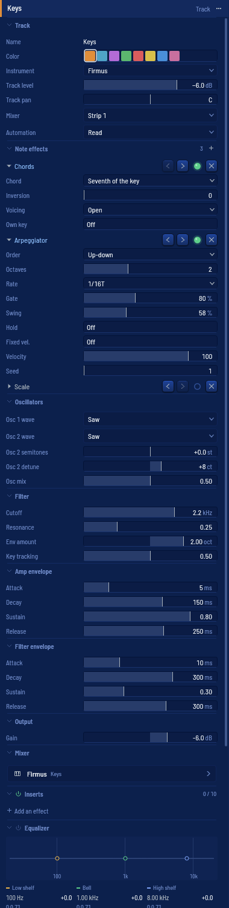

- **Añadir uno**: selecciona la pista; en la sección *Efectos de nota* del inspector pulsa
  el **+** de la banda (o la fila vacía) y elige *Arpegiador*, *Acordes* o *Escala*. Una
  pista admite hasta ocho. La fila del título de cada uno tiene **antes** / **después** (su
  lugar en la cadena), su luz de **encendido** y **quitar**; pulsa su nombre para plegarlo.
- **Arpegiador**: *Orden* (arriba, abajo, arriba-abajo, abajo-arriba, como se tocó, acorde,
  aleatorio), *Octavas* (1–4), *Paso* (de 1/1 a 1/64, con puntillo `.` y tresillo `T`,
  sincronizado con el tempo), *Duración* (cuánto suena cada nota, 5–200 % de un paso),
  *Swing* (al estilo MPC, 50–75 %), *Mantener* (las notas siguen sonando al soltar las teclas,
  hasta que tocas un acorde nuevo), *Vel. fija* con su *Velocidad* (o la de cada nota) y
  *Semilla* (de dónde saca *Aleatorio*: el mismo patrón cada vez). El primer paso suena donde
  empieza el acorde; un acorde en la rejilla se arpegia en la rejilla.
- **Acordes**: *Acorde* (maj, m, dim, aug, sus2, sus4, 7, maj7, m7, m(maj7), m7b5, dim7, 6, m6,
  add9, m(add9), 9, maj9, m9, 5, 5+8, 8va — o *Tríada de la tonalidad* y *Séptima de la
  tonalidad*, el acorde propio de cada grado: I, ii, iii… en una tonalidad mayor),
  *Inversión* (0–3) y *Disposición* (cerrada, abierta — la segunda voz una octava arriba — o
  amplia — abierta, con la tónica una octava abajo).
- **Escala**: las notas *Fuera* de la tonalidad van a su nota más cercana (*A la más
  cercana*; en empate, hacia abajo) o no suenan (*Descartar*).
- **Qué tonalidad**: los acordes de la tonalidad y la escala leen la **tonalidad de la
  canción** (abajo), salvo que enciendas su *Tonalidad propia* y elijas su *Tónica* y su
  *Escala*.
- **Todo parámetro se automatiza y se modula**: clic derecho en su fila ▸ *Crear clip de
  automatización* o *Modular…*, o suelta sobre él el asa de un modulador, como en cualquier
  perilla.
- **Quién los oye**: la reproducción, la exportación, las pistas separadas, congelar y
  convertir en audio tocan las notas que hace la cadena, muestra a muestra igual. Una
  inserción que escucha las notas de la pista (el disparo MIDI de Porta) también las oye; un
  modulador que abren o reinician las notas de la pista (una envolvente, un LFO que se
  reinicia) sigue las notas tal como están escritas, antes de la cadena: se abre una vez por
  acorde, no en cada paso del arpegio. Al grabar se guarda lo que tocaste (las teclas), no el
  arpegio.
- **Convertir en notas**: en el inspector de un clip MIDI, *Convertir en notas* sustituye el
  clip por otro con las notas que la cadena toca a partir de él (con su groove) — un solo
  paso de deshacer. El clip nuevo suena **sin pasar por los efectos de nota** (su luz
  *Efectos de nota ▸ Saltar* está encendida), para que no actúen dos veces; apágala para
  volver a pasar un clip por ellos.

### La tonalidad de la canción y la escala del piano roll

Elige la **tonalidad** de la canción en la barra del piano roll: pulsa *Tono* y elige una
tónica y una escala (mayor, menor, menor armónica y melódica, los modos, las pentatónicas,
blues, tonos enteros, las disminuidas, frigia dominante, húngara menor, japonesa,
cromática) — o *Sin tonalidad*. Se guarda con la canción.

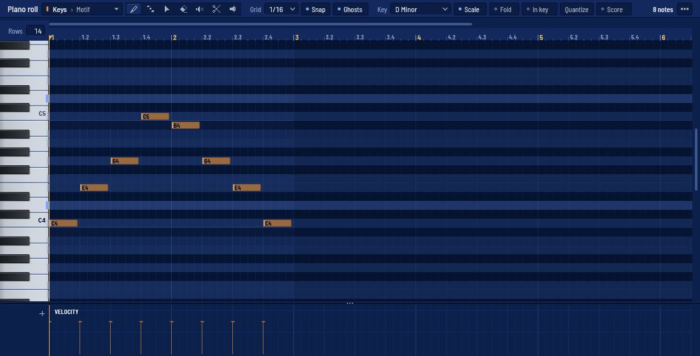

- **Escala**: se resaltan las filas de la tonalidad — las de fuera, un tono más oscuras; las
  de la tónica, teñidas — y el teclado marca las notas de la tonalidad (la tónica, más ancha).
- **Plegar**: el piano roll muestra solo las filas de la tonalidad (y cualquier fila donde
  haya una nota del clip, para que nada se esconda). Mover una nota una fila la mueve una
  nota de la tonalidad.
- **Ajuste**: dibujar, pintar, arrastrar y transportar (`Arriba`/`Abajo`) mantienen las notas
  en la tonalidad: una nota dibujada cae en la nota más cercana de la tonalidad, una
  arrastrada en la siguiente en el sentido del movimiento, `Arriba`/`Abajo` mueven un grado
  de la tonalidad (`Mayús`: una octava).

### Grooves

Un **groove** da a un clip una sensación — notas tarde o adelantadas, acentuadas, más
largas o más cortas — sin tocar sus notas. En el inspector de un clip MIDI, *Groove* abre la
lista: los swings incluidos (**corcheas** y **semicorcheas**, al estilo MPC, 50–75 %) y los
grooves del propio proyecto.

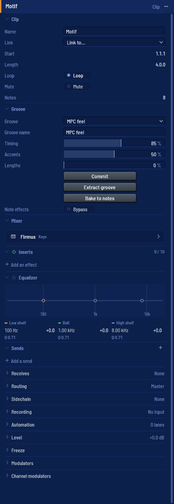

- **Cantidades**: *Tiempo* (0–150 %: pasado el 100 % exagera), *Acentos* (cuánto de las
  velocidades del groove) y *Duraciones*. Las notas se quedan como las escribiste; la
  reproducción, la exportación y todo lo demás las oyen con el groove.
- **Aplicar** escribe el groove en las notas y lo quita del clip (un solo paso de deshacer).
- **Extraer groove** lleva la sensación de un clip a los grooves del proyecto — un compás,
  en rejilla de semicorcheas: lo tarde, el acento y la duración medios de cada paso. En un
  **clip de audio** lee los transitorios del clip (los que encuentra *Warp*). El groove nuevo
  aparece entonces en la lista de todos los clips.
- **Patrones**: la barra del rack de canales tiene un campo *Groove*: lo que elijas va a
  todos los clips del patrón actual a la vez.
- Los **clips enlazados** comparten su groove, como comparten sus notas.

Al **exportar un archivo MIDI** se pregunta qué notas escribir: **Como suenan** (con el
groove de cada clip y los efectos de nota de cada pista escritos nota a nota: el archivo
toca lo que se oye) o **Como están escritas** (las notas de los clips, sin groove ni
efectos de nota).

### La partitura: notación, MusicXML, PDF e impresión

Cada clip de notas y cada pista MIDI se pueden leer como una partitura grabada, hecha como
la hacen Dorico, MuseScore y Sibelius: las notas **leídas** en figuras que muestran el
compás, ligadas donde hay que ver el pulso o la mitad del compás, barradas por pulso,
escritas en la tonalidad de la canción con alteraciones por compás, en la fuente SMuFL
Bravura.

- **El pentagrama bajo el piano roll**: la barra del piano roll tiene un interruptor
  **Partitura** (`Alt+S`). La parte del clip aparece como un pentagrama largo bajo el roll;
  arrastra su borde superior para hacerlo más alto. Sigue al cursor de reproducción
  (**Seguir**), muestra la selección del piano roll en el color de selección y se desplaza
  con la rueda; `Ctrl` + rueda o **−** / **+** lo hacen más pequeño o más grande.
- **El panel Partitura** (*Vista ▸ Partitura*, `Alt+Shift+S`): toda la parte de la pista elegida, cada
  clip de su carril, en sistemas que se ajustan al ancho del panel y se desplazan hacia
  abajo.
- **Leer, no mover**: la partitura redondea las notas solo para leerlas; las notas que
  suenan nunca se mueven. Cada pulso elige figuras normales o tresillos (también seisillos y
  quintillos) según lo que las notas piden; **Leer en** impone una rejilla (corcheas,
  semicorcheas, fusas, tresillos, seisillos) cuando un pasaje se lee mejor así.
- **Los ajustes de la parte** (en la barra de la partitura; cada uno es un paso del
  historial): **Clave** (Auto elige la que pide menos líneas adicionales; claves de octava
  para partes muy agudas o graves; los pasajes muy agudos o graves llevan una línea *8va* /
  *8vb*), **Pentagramas** (Auto da un sistema de piano a la parte que abarca las dos manos),
  **División** (el sistema de piano sigue a las manos —una melodía que baja del Do central
  se queda en la mano derecha— o divide en una nota fija), **Altura** (un instrumento
  transpositor: el clarinete o la trompeta en Si♭ se escriben un tono más arriba, el saxo
  alto en Mi♭ una sexta, la trompa en Fa una quinta; la armadura se mueve con ellos),
  **Dinámicas** (pp … ff a partir de la velocidad de las notas) y el **nombre de la parte**
  (vacío es el de la pista).
- **Tempo y compás** salen del mapa de tempo: una indicación ♩ = 120 al principio y en
  cada cambio (una negra con puntillo en 6/8 y 12/8; *accel.* o *rit.* donde empieza una
  rampa) y la indicación de compás en cada cambio de compás.
- **Editar en el pentagrama**: un clic en una nota la elige (`Mayús`+clic añade). Con la
  partitura como lo último pulsado, `Arriba` / `Abajo` mueven la selección un grado de la
  tonalidad (un semitono sin tonalidad), `Ctrl+Arriba` / `Ctrl+Abajo` una octava, `Supr` la
  borra. **Entrada** (o `N`) escribe notas como MuseScore: `3`–`7` eligen la figura (de
  semicorchea a redonda), `.` un puntillo, las letras `A`–`G` ponen una nota en el cursor —en
  la tonalidad, en la octava más cercana a la anterior— y avanzan el cursor; un clic en el
  pentagrama mueve el cursor; `Esc` termina (la entrada también se detiene al final del
  clip). En una parte transpuesta las letras son las notas escritas. Fuera de la entrada,
  `Mayús+Arriba` / `Mayús+Abajo` y `Esc` conservan su sentido de siempre (transponer una
  octava, quitar la selección). Cada cambio es un comando normal: `Ctrl+Z` lo
  deshace.
- **Archivos** (el menú **Archivos** de la partitura): **Exportar MusicXML…** escribe la
  parte del clip o de la pista, **Exportar la canción como MusicXML…** cada pista MIDI como
  una parte (MusicXML 4.0, que abren MuseScore, Dorico, Sibelius y Finale; la velocidad de
  cada nota va con ella). **Exportar PDF (A4 / Carta)…** escribe páginas vectoriales con las
  fuentes incrustadas, el nombre del proyecto como título y la etiqueta *Artista* de la
  exportación como compositor. **Importar MusicXML…** pone cada parte de un archivo
  `.musicxml` en una pista nueva como un clip (un `.mxl` comprimido hay que descomprimirlo
  antes); en una canción aún sin notas, el tempo, los compases y la tonalidad del archivo
  vienen con él, y una canción con notas conserva los suyos.
- **Imprimir**: **Imprimir…** crea el PDF y lo entrega a la impresión del sistema: en
  **Windows** lo imprime la aplicación de PDF predeterminada (Edge, Acrobat, SumatraPDF…; si
  ninguna está preparada para imprimir, el PDF se abre para imprimirlo desde allí); en
  **Linux** y **macOS** se envía a la impresora predeterminada con `lp` (CUPS), o se abre en
  el visor de PDF si no hay CUPS.

### La vista de sesión: lanzar clips y escenas

El panel **Sesión** es un lanzador de clips, como en Ableton Live y Bitwig: las mismas
pistas que el arreglo, una al lado de otra como columnas, y las **escenas** como filas.
Cada celda (una **ranura**) guarda un clip que puedes iniciar y detener mientras suena la
canción, a tiempo; una escena inicia una fila entera a la vez. Las pistas, el mezclador y
los instrumentos son los del arreglo: la sesión solo decide qué clip toca cada pista.

- **Cambiar de vista**: `Tab` trae al frente el panel Sesión, o devuelve el arreglo (la
  tecla de Live); las teclas de ventanas de la barra superior tienen una de Sesión, y
  *Ver ▸ Sesión* hace lo mismo. Lo elegido sigue elegido: un clip de sesión en el que haces
  clic es el clip del piano roll.
- **Lo que ves**: la cabecera de cada columna muestra el nombre y el color de la pista, y
  sus teclas de armar (●), silenciar (M), solo (S) y *volver al arreglo*. Una ranura con un
  clip muestra su nombre, una vista pequeña de sus notas (o de su forma de onda) y, mientras
  suena, una barra a lo largo de su pie. Su **▶** es el lanzador: verde mientras el clip
  suena, parpadeando mientras espera al compás (o a la rejilla elegida), rojo mientras graba.
  Una ranura vacía muestra un cuadrado pequeño —detiene su pista— o, con la pista armada, un
  punto rojo que graba en ella. Las escenas están a la derecha, con sus nombres y, cuando una
  escena los fija, su tempo y su compás ("128 · 4/4"); debajo, **Detener todo**, y bajo cada
  columna su botón de detener.
- **Lanzar**: haz clic en el **▶** de un clip (o pulsa `Intro` en la ranura del cursor): empieza
  en el próximo compás, o en la cuantización **Lanzar** de la parte superior del panel
  (ninguna, 8 compases … 1/32, tresillos). Haz clic en el **▶** de una escena (`Mayús+Intro`)
  para iniciar su fila; una escena que fija un tempo o un compás cambia los de la canción al
  empezar. `Ctrl+Intro` detiene la pista del cursor, `Ctrl+Mayús+Intro` lo detiene todo. Una
  pista que toca un clip de sesión deja su arreglo en silencio hasta que pulsas su tecla de
  *volver al arreglo* (o **Volver al arr.** arriba, `Alt+B`, para todas).
- **Editar en la rejilla** (cada edición es un paso de deshacer): **doble clic** en una ranura
  vacía crea un clip MIDI de un compás; en un clip, lo abre en el piano roll; **arrastrar** un
  clip a otra ranura lo mueve (`Alt` o `Ctrl`: una copia), y sobre el arreglo lo pone allí;
  arrastra clips del arreglo a una ranura para traerlos a la sesión (los de cada pista a su
  columna); suelta una muestra del navegador en una ranura vacía. Con el panel pulsado, las
  flechas mueven el cursor de ranuras (`Mayús`: de ocho en ocho), `F2` renombra,
  `Ctrl+Mayús+C` cambia el color, `Ctrl+D` duplica (un clip en la siguiente ranura libre de
  abajo; una escena debajo de sí misma), `Ctrl+C` / `Ctrl+X` / `Ctrl+V` copian, cortan y
  pegan clips, `Supr` borra, `Ctrl+Mayús+L` activa o no el bucle del clip. `Ctrl+I` inserta
  una escena, `Ctrl+Alt+I` **captura** una: una escena nueva con una copia de lo que suena
  ahora. Clic derecho en un clip, una ranura o una escena para lo demás: poner un clip en el
  arreglo en el cabezal, consolidar los clips de una pista en uno, quitar el botón de detener
  de una ranura vacía, hacer que una escena fije el tempo o el compás de la canción, subir o
  bajar una escena. Doble clic en el nombre de una escena para renombrarla.
- **El panel del clip** (al pie del panel; la tecla de arriba a la derecha lo muestra u
  oculta; arrastra su borde superior para hacerlo más alto): **Lanzamiento** — el modo
  (*Disparo* inicia el clip, *Puerta* lo toca mientras mantienes el botón, *Alternar* lo
  inicia y lo detiene, *Repetir* lo redispara mientras se mantiene), su propia cuantización
  (*Global* sigue la del panel), *Legato* (toma la posición del clip al que sustituye) y
  cuánto fija la velocidad de un pad su nivel. **Bucle** — el bucle sí o no, el marcador de
  inicio, dónde empieza el bucle y cuánto dura (como los escribe Live:
  compás.tiempo.semicorchea; arrastra un valor, `Mayús` para pasos finos, doble clic para
  restablecer). **Acciones de seguimiento** — qué ocurre después de que el clip ha sonado:
  la acción A o la B (detener, tocar de nuevo, anterior, siguiente, primero, último,
  cualquiera, otro, o saltar a una escena), la probabilidad de A frente a B, tras la duración
  del propio clip (*Enlazado*) o un tiempo, y cuántas veces. Las acciones de seguimiento
  toman sus probabilidades de la semilla de la sesión, así que una interpretación vuelve a
  sonar igual. **Envolventes** — elige un parámetro de la pista del clip (su volumen, su
  panorama, su canal del mezclador, sus efectos, su instrumento o el último que moviste) y
  dibuja su curva sobre el bucle del clip: un clic añade un punto, arrastrar lo mueve, doble
  clic o clic derecho lo borra. El clip mueve ese parámetro mientras suena y lo devuelve a la
  automatización de la pista cuando se detiene. Un panel bajo oculta el panel del clip para
  que la rejilla conserve sus filas: hazlo más alto.
- **Grabar en una ranura**: arma la pista (●) y haz clic en el punto rojo de una ranura vacía
  (o pulsa `Alt+Intro`): graba desde el próximo compás (tras la cuenta previa si el transporte
  está parado); haz clic otra vez, o lanza la ranura, para parar: el clip nuevo sigue sonando.
- **Grabar la sesión en el arreglo**: activa **Grab. arreglo** (`Ctrl+Alt+R`) y toca: todo lo
  que lanzas y detienes, y cada acción de seguimiento, se escribe en el arreglo tal como lo
  oíste, con las envolventes de los clips como automatización y los tempos de las escenas en
  la pista de tempo. Al desactivarlo, la toma entera es un paso de deshacer.
- **Controladores MIDI**: en el modo de aprendizaje MIDI (`Ctrl+Mayús+M`) cada ranura, cada
  lanzador de escena, cada botón de detener, **Detener todo**, **Grab. arreglo**, **Volver al
  arr.** y la cuantización **Lanzar** quedan recuadrados: haz clic en uno y pulsa un pad o
  gira una perilla. Un pad lanza su ranura y, al soltarlo, la suelta (un clip *Puerta* se
  detiene); su luz muestra el estado de la ranura. El cursor de escenas (*Escena anterior*,
  *Escena siguiente*) y cada acción de la sesión también se pueden asignar.
- **Rejillas Launchpad y APC**: conecta un **Launchpad Mini MK3**, **Launchpad X**,
  **Launchpad Pro MK3**, **APC mini mk2** o **APC40 mkII** y se convierte en una rejilla de la
  sesión: se reconoce por el nombre de su puerto (o se elige en *Ajustes ▸ MIDI* o al pie del
  panel de asignaciones de controladores, donde también puedes desactivarlo). Sus pads lanzan
  las ranuras de las columnas y filas que muestra (el **anillo de sesión**, dibujado como un
  recuadro naranja en el panel), iluminados con los colores de los clips: verde y latiendo
  mientras suenan, parpadeando mientras esperan, rojo mientras graban; los botones de escena
  lanzan filas; las flechas mueven el anillo (`Mayús`: una página); los botones de detener
  detienen pistas (en un Mini o un X, el botón de escena más bajo convierte la última fila de
  pads en botones de detener, y el botón *Session* lo detiene todo; en un APC mini, `Shift`
  con los cuatro primeros botones de pista mueve el anillo y `Shift` con el último botón de
  escena lo detiene todo). Los pads de una rejilla nunca tocan notas en la pista elegida.
### La sesión: cómo funcionan el lanzamiento, las follow actions y la grabación

*La página de la vista de sesión dice dónde está cada cosa; esta dice qué pasa cuando la
pulsas.*

**Las mismas pistas, el mismo mezclador.** Una columna de la sesión es una pista de la
canción: el mismo instrumento, la misma tira del mezclador, la misma automatización. Un clip
lanzado en una pista toma el lugar del arreglo de esa pista hasta que pulsas *Volver al
arreglo* (en la pista, o para todas) — aun después de que el clip se detenga, la pista sigue
con la sesión, como en Live.

**Cuándo ocurre un lanzamiento.** Un clip espera a su cuantización de lanzamiento — la suya
o la global de la sesión (un compás por defecto) — y empieza justo en ese límite, a la
muestra. Un lanzamiento pulsado justo antes de un límite, demasiado tarde para que el motor
lo tenga listo ahí (de unos milisegundos a unas decenas, según el búfer de audio), suena
igualmente en él — un instante tarde, alcanzado hasta donde estaría, nunca un compás
después; y lo mismo uno pulsado una fusa o menos después de un límite (con una cuantización
de fusa o más fina, un cuarto del paso). Con el transporte detenido, un lanzamiento lo
arranca enseguida, desde el cabezal. Una escena lanza toda su fila con la cuantización
global y fija allí su tempo y su compás (el compás en la siguiente barra).

**Siguiendo Link, reloj MIDI o código de tiempo.** Un lanzamiento con el transporte detenido
espera a que la fuente arranque: el siguiente cuanto de Link, o el Start del maestro — tarde
lo que tarde; el clip se muestra en cola mientras tanto, y el botón de parada lo cancela. Si
el maestro arranca desde otro sitio (el Start del reloj MIDI es desde el principio), el clip
suena desde ahí. Siguiendo Link, una escena con tempo fija el tempo de toda la sesión de
Link cuando entra, como en Live. Un reenganche de Link, o el maestro moviendo el cabezal, no
termina lo que suena en la sesión.

**Modos de lanzamiento.** *Disparo* arranca el clip (de nuevo) con cada pulsación.
*Mantener* lo toca mientras lo mantienes y lo detiene en el límite después de soltarlo.
*Alternar* lo arranca, y lo detiene al pulsarlo otra vez. *Repetir* lo reinicia en cada
límite mientras lo mantienes. *Legato* hace que el clip lanzado siga donde iba el que
reemplaza, en vez de empezar desde su marca de inicio.

**Follow actions.** Tras su tiempo (un tiempo, o *ligado* a su propia duración, por su
cuenta) un clip hace la acción A o la B — parar, repetir, el clip anterior, el siguiente, el
primero, el último, cualquiera u otro de su columna, o saltar a una fila — con la
probabilidad que fijes para A. Las probabilidades salen de la **semilla** de la sesión: la
misma actuación suena igual cada vez, y una exportación da exactamente lo que oíste. Cambia
la semilla para otra actuación.

**Grabar en un slot.** En una pista armada, el botón de grabar de un slot vacío graba desde
el siguiente límite (tras la cuenta previa, desde parado) hasta la barra después de que lo
detengas — o la duración fija de la sesión — y el clip nuevo sigue sonando enseguida, en
bucle. El MIDI se cuantiza con la *cuantización de grabación* de la sesión. Grabado sobre un
clip MIDI en bucle que suena, las notas van a ese clip (overdub). La toma se guarda como
cualquier grabación: un cierre inesperado no pierde nada.

**Grabar la sesión en el arreglo.** Con *grabar en el arreglo* activo, todo lo que lanzas,
detienes y cada follow action se escribe en el arreglo justo donde lo oíste — los clips, sus
envolventes como automatización, los tempos de las escenas — en un solo paso de deshacer, al
desactivarlo o al parar. El arreglo suena entonces exactamente como lo oíste, al bit.

**Conviene saber.** Los clips de una pista congelada no se lanzan (descongélala antes).
Congelar, rebotar y exportar dan el arreglo: graba antes la actuación en él para conservarla.
Parar el transporte, o saltar con el cabezal, termina la actuación. Un cambio de tempo hace
que un clip de audio sin warp siga tocando el mismo tramo de su archivo; uno con warp sigue
el tempo.

**Audio a MIDI.** Clic derecho en un clip de audio ▸ *Convertir a MIDI…* convierte una
melodía, una parte de acordes o un loop de batería en notas en una pista nueva: mira
[Convertir audio a MIDI](audio-to-midi.md).

## 6. Mezclar: el mezclador, inserciones y envíos

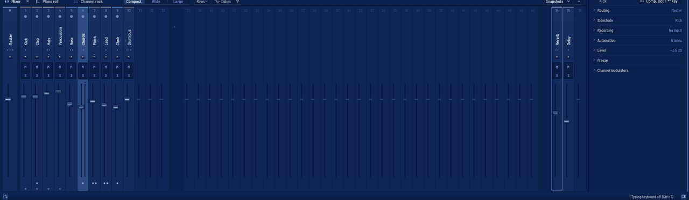

Cada pista alimenta un **canal** del mezclador (`F9`); los canales van al **máster**, a la
izquierda, o a otro canal (un bus). Un canal se lee de arriba abajo en el orden que sigue la
señal: su **cabeza** (el número sobre el nombre, el icono de la pista, el punto de armado), las
**inserciones** (un punto y el tipo de la unidad en cada una; la primera libre, un `+` tenue), su
propia **curva de EQ**, fase e intercambio, el **paneo** (y la perilla de anchura), **M | S** en
una sola píldora, el **fader** con su medidor al lado y su nivel debajo, los **envíos** como
perillas pequeñas y la **salida** («Master» discreto, o «→ Drum bus»). Nada dice «−∞» en reposo;
no hay columna de etiquetas. Tres anchos — **Compacto**, **Ancho** y **Grande** (el nombre de la
unidad en cada inserción, el nivel de los envíos en dB, las bandas de la EQ como puntos sobre la
curva, los LUFS de corto plazo del máster) — en la cabecera de la mesa o con `Ctrl+rueda`; una
mesa baja va cediendo filas (la EQ, la fila de fase, las inserciones a una línea de resumen, los
envíos…) y luego se desplaza. Cuando el mezclador está acoplado bajo una barra con sitio, su
cabecera — los anchos, **Filas ▾** (qué filas muestran los canales, entre ellas *Desde el canal
elegido*, y *Panel de inserciones*), la ficha de solo («1 en solo · Quitar»), **Cables**,
**Instantáneas** y `+` — va en la fila de pestañas del espacio de trabajo, a la derecha de las
pestañas. Clic selecciona un canal (su cuerpo teñido, su franja entera), `Ctrl+clic` añade,
`Shift+clic` toma un tramo; mover un fader de una selección mueve todos. Con el foco en el
mezclador, `M` silencia, `S` pone solo, `Alt+Izquierda`/`Alt+Derecha` mueven el canal. Un canal
silenciado se apaga en tinta y su **M** se enciende en el acento del tema (*Ajustes ▸ Apariencia ▸
Disposición y controles ▸ Botón M encendido: Gris* la enciende en gris); uno que calla por el solo de otro
muestra su M con un aro del color del solo. Los **retornos** acoplados a la derecha van en el
borde de la ventana, como en FL Studio, y el espacio entre el último canal y ellos lo ocupan los
siguientes canales vacíos, numerados — un clic en uno crea los canales hasta él (*Dock derecho del
mezclador: Tras la última tira* pone los retornos justo tras tus canales).

**Grupos, para quien viene de FL Studio.** FL no tiene un botón de «grupo»: se agrupa
enrutando. Cantus funciona igual, de dos maneras:
- **Un bus** — enruta los canales a uno: selecciónalos (clic, luego `Ctrl`+clic o
  `Mayús`+clic — canales en la mesa o cabeceras de pistas en el arreglo) y pulsa
  **`Ctrl+G`**, o clic derecho en uno ▸ *Enrutar la selección a un bus nuevo*. Un solo paso
  crea *Bus 1* justo después de ellos, los enruta a él y reúne sus pistas en una carpeta del
  arreglo con el nombre del bus, como los grupos de Live y Bitwig; un deshacer lo devuelve
  todo. O arrastra sus cables hasta un canal tuyo: un fader, unas inserciones y un medidor
  para la batería, como el *Drum bus* de la canción de ejemplo. Sus efectos procesan la suma.
- **Un grupo VCA** — un fader que mueve el nivel de sus miembros sin sumarlos (cada uno conserva
  sus inserciones y envíos); ver [Faders VCA e instantáneas de la mesa](mixing-studio.md).

**Bandas en la mesa.** Un grupo de canales se dibuja como una **banda** sobre ellos: un hueco y
una costura a cada lado, su nombre y cuántos son arriba. Selecciona canales y clic derecho ▸
*Grupo ▸ Nuevo grupo con los seleccionados* (doble clic en su cabecera para renombrarlo). Un clic
en su chevrón **pliega** la banda en un solo canal que nombra a sus miembros y muestra sus
medidores lado a lado (*Desplegar* los devuelve — un grupo plegado nunca se oculta); arrastra su
**borde derecho** para tomar el canal siguiente o devolver el último (`Esc` lo deja como estaba).
Cada cambio es un paso de deshacer. Un instrumento con salidas propias (Chorda,
[Tympanum](tympanum.md)) dibuja sus canales como una **familia** — una barra sólida con su glifo,
*Batería · Tympanum · 12 micros* — que se pliega igual; *Cada micro a su canal* hace un subgrupo
por familia de micrófonos (Bombo, Caja, Toms, Platillos, Aéreos, Sala) en el mismo paso, y *Todo a
Principal* los quita. Un canal está en una banda como mucho: un grupo vive dentro de una familia o
toma familias enteras. Un canal alimentado solo por las salidas de una familia — un bus de
batería, un compresor en paralelo — puede unirse a su banda (clic derecho ▸ *Añadir a la banda de
…*; se dibuja al final de la banda, marcado *añadido*) y la deja, con la razón en la línea de
estado, cuando su entrada deja de venir solo de esa familia. Mientras la mesa se desplaza, el
nombre de la banda sigue a la vista. <!-- r40:docs -->

- **Inserciones** (hasta diez por canal): clic en la fila `+` (o clic derecho en el canal ▸
  *Añadir efecto ▸*, donde arriba están los cinco efectos que usaste último) para elegir un
  efecto en el selector de dispositivos. Un clic en las inserciones muestra la cadena del canal
  en el inspector, donde cada inserción abre su ventana, tiene su luz (puentear) y una
  **Mezcla** (seco/procesado); clic derecho en una inserción del canal para su menú. Una
  inserción con llave muestra su glifo de llave («← Kick» al apuntarla, con el canal de origen
  remarcado).
- **Envíos**: un envío es una perilla pequeña bajo el nombre de su destino (en Ancho y Grande;
  en Compacto, un punto — clic para su perilla); su valor en dB aparece en lugar del nombre
  mientras lo apuntas o lo arrastras. Para crear uno, arrastra un cable (abajo), usa *Envíos ▸
  Añadir un envío* en el inspector, o activa *Filas ▾ ▸ Desde el canal elegido* y haz clic en el
  ▲ del canal al que quieres enviar. Cada envío toma la señal **después del fader (por
  defecto) o antes** — su menú ▸ *Antes del fader*; un envío antes del fader sigue sonando al
  bajar el fader.
- **Cables**: cada canal tiene dos **jacks** al pie — su entrada y su salida. Arrastra desde un
  jack de salida a otro canal, o haz clic en él y luego en el destino (`Esc` cancela): sin tecla
  es un envío a 0 dB, con `Ctrl` la única salida del canal, con `Alt` una llave de sidechain;
  mientras arrastras, la línea de ayuda dice qué hará («Enrutar Chords a Drum bus») o por qué no
  se puede (un bucle). En reposo no se dibuja nada; bajo un canal sus rutas se leen en palabras
  («→ Drum bus», «3 rutas»), y el canal bajo el puntero ilumina los canales a los que llega.
  **Cables** en la cabecera dibuja los cables del canal elegido en una banda bajo la mesa
  (*Mostrar todos*, en su menú, dibuja todas las rutas, las demás atenuadas); apunta a un cable y
  se ilumina **toda su ruta hasta el máster** mientras el resto se atenúa; clic en un cable lo
  selecciona, tirar de su clavija en el jack de entrada lo mueve, `Supr` lo quita. Cada cambio es
  un paso de deshacer. **Cuatro estilos**, en el menú de Cables ▸ *Estilo de cables* o en
  *Ajustes ▸ Apariencia*: **Latiguillo** (curvas que cuelgan entre los jacks), **Flujo** (el
  predeterminado: Latiguillo con una luz que recorre el cable mientras pasa sonido, más rápida
  cuanto más suena, quieta al parar), **Metro** (tramos rectos en carriles que nunca se
  solapan, con esquinas redondeadas) y **Jack** (clavijas y cables que se comban y se asientan un
  momento al soltarlos). *La del tema* sigue el estilo propio del aspecto.
- **Ruteo**: clic derecho en un canal ▸ *Enrutado* ▸ *Salida* o *Enviar a*, `Shift+F10`
  para el menú de ruta del canal seleccionado, o selecciona varios canales y `Ctrl+G`
  (*Enrutar la selección a un bus nuevo*). En el menú de ruta de un cable o un envío, *Nivel ▸
  Escribir un nivel…* toma un nivel en dB (de −∞ a 0; `Enter` o un clic fuera lo aplica,
  en un paso de deshacer; `Esc` cancela). **La matriz de ruteo** (`Alt+F9`) muestra cada origen
  frente a cada destino: clic en una celda para enrutar, arrastrar para el nivel (`Shift`
  para afinar), `Ctrl+arrastrar` copia hacia abajo en una columna. Los canales y grupos se
  mueven arrastrando o con `Alt+Izquierda`/`Alt+Derecha`; una cabecera de pista soltada
  sobre un canal suena por él.
- **Las ventanas de los dispositivos** tienen *Cambiar*, minimizar (a la bandeja de la
  barra de estado), maximizar y cerrar. `F8` abre el instrumento de la pista seleccionada
  (o lo trae delante, o lo cierra si ya está delante),
  `Esc` cierra el último dispositivo que usaste y `F12` cierra todos los flotantes.

**El solo** sigue el ruteo: un canal en solo se oye con lo que lo alimenta y aquello a lo
que alimenta.

### El inspector

El inspector (`I`) muestra la pista, el canal o el clip elegido como una hoja que sigue la señal.
Para un canal, bajo su cabeza (el color, el número, el nombre, *Canal del mezclador* y el menú ⋯):

- **Fuente** — lo que suena en el canal: el icono de la pista, el nombre del instrumento y el de
  la pista; un clic muestra la pista, la flecha abre el instrumento. Un bus o un retorno lista
  los canales que le llegan; el máster dice *La mezcla completa*.
- **Inserciones** — una fila por inserción (su número, la unidad y su tipo, su luz, la tecla de
  una vista mini bajo el puntero) y una fila *+ Añadir un efecto*. La **vista mini** se abre
  bajo la fila con tres valores de la unidad para arrastrar (un compresor: *Umbral*,
  *Proporción* y su reducción en vivo); cada uno conserva *Aprender*, *Modular…* y la
  automatización. Arrastra una fila por su número para reordenarla: se levanta, y una línea
  muestra dónde caerá.
- **Ecualizador** — la curva de EQ del canal para arrastrar, y debajo una tabla de bandas: la
  frecuencia, la ganancia y la Q de cada banda, cada cifra arrastrable.
- **Envíos** y **Recibe** — cada envío con su interruptor, nombre, barra de nivel y valor; una
  sección vacía es *+ Añadir un envío*.

Luego las secciones que se pliegan a una línea cada una, con su estado a la derecha — un clic en
el título la abre o la cierra:

- **Ruteo** — la salida, la entrada, la polaridad, el intercambio y el mono del canal, la
  compensación de retardo y la latencia.
- **Cadena lateral** — qué inserción lleva la llave y desde qué canal, y bajo cada inserción
  con llave **Escuchar la clave** *(ronda 40)*: el canal reproduce la llave de esa inserción en
  lugar de su propia señal — la de un compresor tal como la oye su detector (tras el nivel y la
  EQ de la llave) — para ajustarla de oído. Una inserción a la vez; otro clic vuelve al canal.
  Es un interruptor de escucha: nunca se guarda ni va en una exportación.
- **Grabación** — la entrada, la *Escucha*, **Se graba: Sin FX · Con FX** (ver
  más arriba, en la pista de audio), el *Ajuste*, *Armar*, *Baja latencia*.
- **Automatización** — el modo de la pista del canal (*Read · Touch · Latch · Write*), una línea
  por carril con una pequeña imagen y sus puntos, y **Mostrar en el arreglo**: abre los carriles
  de automatización de la pista, desplaza el arreglo hasta ellos y le da el foco (un paso de
  deshacer).
- **Nivel** — volumen, paneo y anchura como barras de valor (el pozo lleno hasta el valor, la
  cifra dentro; *Ajustes ▸ Apariencia ▸ Disposición y controles ▸ Valores del inspector: Barras finas* para
  barras delgadas), los VCA que sigue el canal,
  *Silencio · solo*, *A salvo de instantáneas* y *A salvo del solo*; bajo el volumen, un medidor
  fino en la misma escala (verde, amarillo, ámbar, el color de saturación encima, un pico
  retenido). Con varios canales elegidos, el volumen los mueve juntos. Nivel ocupa el lugar de
  la antigua tira fijada al pie del panel.
- **Congelar** — **Congelar la tira** (o *Descongelar*) y lo que hace; congelado, cuántas
  inserciones se renderizaron y cuánto ocupa el render en disco («2 inserciones renderizadas ·
  12 MB»).
- **Moduladores** — abiertos cuando el canal tiene alguno.

### Congelar y pasar a audio en su lugar

**Congelar** convierte una pista pesada en una grabación de sí misma, para que su
instrumento y sus efectos dejen de usar el procesador — y la devuelve, exacta, al
descongelarla.

- **Congelar una pista**: clic derecho en su cabecera ▸ *Congelar pista*, `Alt+Shift+F`,
  o la fila *Congelar* del inspector. Una pista con canal propio se congela con su canal:
  su instrumento, sus clips y las inserciones y el EQ del canal. Una pista que comparte su
  canal congela su propio instrumento y sus clips. **Congela un canal** (un bus, un
  retorno) desde el menú del canal: se congela con todo lo que recoge.
- Primero se hace el render (una tarjeta en la esquina dice cuánto falta, con
  **Detener**); la canción sigue sonando y nada cambia hasta que termina. Entonces la pista
  queda congelada en un solo paso de deshacer: un **copo de nieve** en su cabecera y en su
  canal, sus clips escarchados.
- Una pista o un canal congelado se sigue **mezclando**: su fader, su paneo, su anchura,
  su silencio, su solo y el nivel de sus envíos —y su automatización— siguen en vivo, y
  también el silencio y el solo de la cabecera de una pista congelada con su canal propio
    (su nivel y su balance están dentro del render: mézclala con el fader del canal). Salvo
  que un modulador dentro de lo que congela lo siga (o siga al bus al que suena): entonces
  su mezcla es parte de su sonido y también queda fija —la tarjeta lo dice—. Lo que
  cambiaría su sonido (sus notas, su instrumento, sus inserciones, el tempo, mover un canal
  entre los que recoge) se rechaza, y la tarjeta dice cómo devolverlo: **Descongelar** (las
  mismas entradas de menú, la misma tecla). Una perilla girada en la ventana propia de un
  plug-in congelado vuelve a donde estaba, con la misma tarjeta, y también un preset o una
  muestra cargados desde su propio navegador. Descongelado, vuelve a sonar en vivo,
  idéntico.
- Lo que también suena en otra parte sigue sonando: congelar un bus no calla un canal que
  hace de clave de su compresor y suena al máster, ni congelar un retorno el canal que le
  envía. El solo sigue siendo una ayuda para escuchar —se congela como si nada estuviera en
  solo—; con algo en solo **dentro** de lo que congelas, quítale antes el solo. Un solo que
  calla una parte de aquello con lo que suena un canal congelado (una de las pistas o de
  los canales que se oyen por él) hace sonar ese canal en vivo mientras dura; un solo que
    lo calla entero —un solo en otra parte— solo lo silencia, sin despertar sus plug-ins.
  Guardar un proyecto mueve una toma congelada a su carpeta *Audio* y la deja congelada.
- Sus plug-ins se descargan mientras está congelado y vuelven con sus ajustes. Congelar
  necesita los plug-ins de lo que se congela (uno en bypass no hace falta): si uno no está
  cargado, se nombra y no se congela nada. Lo mismo con un archivo que suena y aún no está
  (un paquete de sonidos descargándose, un disco desconectado; una toma en un carril de
  comp de abajo, o un clip en silencio, no cuenta): se nombra, y una pista congelada espera
    a sus archivos antes de rehacer su render. Una pista cuyos plug-ins cambian su latencia
  durante la canción (una anticipación o un sobremuestreo automatizados) no se puede
  congelar ni pasar a audio en su lugar: la línea de estado lo dice.
- Los renders se guardan en la carpeta propia del proyecto dentro de una carpeta *Freeze*
  junto a él (*Freeze/Canción* para *Canción.cantus*; en la caché de Cantus si el proyecto
  aún no se ha guardado), con el nombre de lo que contienen: volver a congelar lo que no
  cambió es instantáneo, y un proyecto abierto sin ellos (en otra computadora, a otra
  frecuencia de muestreo) suena en vivo mientras se rehacen en segundo plano. *Guardar
  como* se los lleva —copiados en segundo plano; al cerrar Cantus mientras copia, la ventana sigue abierta con una tarjeta hasta que
  termine (*Cerrar ya* no espera; lo que no se copió se encuentra donde estaba la próxima
  vez)—. Un
  proyecto renombrado o copiado junto al original encuentra sus renders en la carpeta del
  original, y al guardarlo los trae a la suya. Al guardar se quitan de la carpeta del
  proyecto los renders que ningún deshacer puede traer de vuelta; los de otros proyectos
  junto a él nunca se tocan.
- Con el bucle activo, una pista congelada toca su grabación de corrido: en el salto al
  inicio del bucle oyes lo que llevaba a ese compás, no la cola de una reverberación del
  final del bucle (como en otros DAW; descongélala para oír el salto exacto).

**Pasar a audio en su lugar** hace un render a un clip de audio, en una **pista nueva
justo debajo de la original**, en el mismo lugar:

- *Pasar a audio en su lugar* (menú de la pista, `Alt+Shift+B`): esta pista por las
  inserciones de su canal; la pista nueva tiene un canal propio con el fader, el paneo, la
  anchura y los envíos del anterior.
- *Pasar a audio (solo la fuente)*: el instrumento y los clips antes del nivel de la
  pista; la pista nueva suena por el mismo canal, por las mismas inserciones.
- *Pasar los clips a audio en su lugar* (el menú del clip): solo los clips elegidos (en
  varias pistas, uno por pista); con una selección de tiempo —elegida después de los clips,
  o sin clips elegidos— las teclas pasan a audio lo que suena dentro de ella, con sus bordes
  llevados hasta las notas que la cruzan. Con la cabecera de una pista elegida al final,
  las teclas pasan a audio la pista entera; con un canal elegido en el mezclador, el canal
  entero; el máster nunca se congela ni se pasa a audio. No se pueden pasar clips ni un
  tramo de tiempo mientras algo oye las notas de la pista (pasa la pista entera), y las
    ventanas de un comp unidas por un fundido cruzado se pasan juntas o no se pasan. Las
  entradas del menú del clip actúan sobre clips, nunca sobre un canal o el máster elegidos
  antes: el clip sobre el que hiciste clic derecho, con los clips elegidos con él.
- *Pasar el canal a audio en su lugar* (el menú del canal): todo lo que el canal recoge; lo
  que tenía su clave en él, o lo seguía, sigue al canal nuevo. Quita antes el solo de lo
  que esté en solo dentro de él.
- La original queda **en silencio** —o se quita, si marcas *Quitar el original al pasar a
  audio* en el menú de la pista (Cantus recuerda tu elección; una pista cuyas notas algo
  sigue oyendo queda en silencio en su lugar, y el resultado lo dice). Su automatización
  de nivel, de fader y de envíos va con el audio, y también su solo. Por un plug-in con
  latencia, el audio del clip nuevo queda en la cuadrícula y la pista nueva conserva el
    retardo (la fila *Retardo* del inspector; la tecla a su derecha lo quita), así que esa
  automatización y lo que tenga su clave en ella siguen a tiempo, y el clip suena a tiempo
  dondequiera que lo muevas, lo copies o lo exportes. La cola (la de una reverberación) se
  conserva hasta que se apaga. Un solo paso de deshacer. Si editas lo que se pasa a audio mientras
  se hace el render, se vuelve a pasar desde tu edición (una edición en otra parte no lo
  reinicia); **Detener** mientras se escribe su archivo no deja nada. Una pista que
  escucha una entrada en vivo —o una que hace de clave o le manda notas— no se pasa a audio
  (apaga antes su escucha).

## 7. Masterizar: la cadena del máster, Fervor, Latitudo, Culmen

El **máster** tiene su propia cadena de hasta diez inserciones, aplicada a toda la mezcla
antes del fader del máster. Haz clic en la cabecera del máster para ver su cadena en el
inspector (*La mezcla completa* → las inserciones → *Salida de audio*), o clic derecho en
su nombre ▸ *Efectos* ▸ *+ Añadir efecto*.

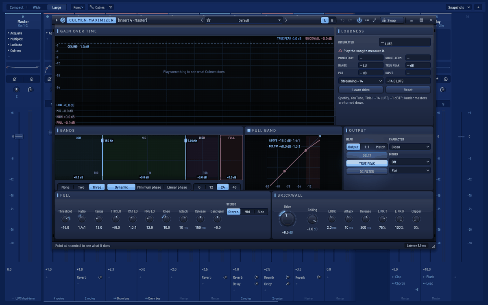

Las demos masterizan en este orden, y es un buen comienzo:

1. **Aequalis** (EQ): un pasa-altos bajo el sub, un poco de aire.
2. **Multiplex** o **Comprimo**: un pegamento suave.
3. **Latitudo** (estéreo): el preset *Máster: graves más firmes* o *Máster: agudos más
   anchos, graves en mono* deja los graves en mono y los agudos anchos. Vigila su medidor
   de correlación: debe quedar por encima de cero.
4. **Culmen** (maximizador): elige un **objetivo** — *Streaming −14* (−14 LUFS, −1 dBTP),
   *Apple −16*, *CD −9*, *Club −7*, *Emisión −23* — reproduce la parte más fuerte de la
   canción y haz clic en **Aprender empuje**: Culmen escucha, ajusta el empuje, vuelve a
   escuchar y se detiene en el objetivo, en un solo paso de deshacer. La tarjeta
   *Sonoridad* muestra la sonoridad momentánea, de corto plazo e integrada y el pico real;
   el veredicto dice *En el objetivo* o cuántos LU sobran o faltan. Culmen trabaja en tres
   bandas más la banda completa, hacia un muro de pico real en el techo; su *Carácter*
   (Limpio, Pegada, Fuerte, Bus, Seguro) y sus diez presets cubren casi cualquier máster.

**Fervor** (saturación) añade color: *Cinta*, *Válvula*, *Overdrive*, *Fuzz*, *Recorte*,
*Pliegue* o una *Curva* dibujada, con sobremuestreo, tono, mezcla e *Igualar nivel*, para
que lo más fuerte nunca te engañe. En el máster, los presets *Recorte de máster* y
*Válvula en el medio* son los suaves.

### El asistente de mastering

Haz clic derecho en el nombre del máster ▸ *Asistente de mastering…*, o abre la lista
*+ Añadir efecto* de la cadena del máster: la primera fila es el asistente. Escucha la
mezcla tal como llega al máster y propone una cadena de efectos de Cantus para
masterizarla; nada de lo que hace queda oculto: lo que propone son inserciones normales que
puedes abrir y cambiar.

1. Elige adónde va la canción: **Plataforma** (‹ › recorre Spotify, Apple Music, YouTube,
   TIDAL, Amazon Music, SoundCloud, CD, Club y EBU R 128). La línea de debajo dice a qué
   apunta la plataforma —Spotify reproduce cada canción a −14 LUFS y quiere el pico real
   igual o por debajo de −1 dBTP— y el pie del panel dice de dónde sale esa cifra y cuándo
   se comprobó.
2. Elige el **Equilibrio**: la curva de un género (Pop, Rock, Electrónica, Hip-hop,
   Acústica, Clásica) o *Cargar referencia…*: un tema terminado cuyo sonido te guste (WAV,
   FLAC, MP3, OGG, AIFF). Con una referencia el asistente iguala su tono y su anchura; la
   sonoridad la sigue fijando la plataforma.
3. **Escucha** toda la canción o solo el bucle. Si el máster ya tiene efectos, elige si la
   propuesta los **reemplaza** o se **añade después**.
4. Haz clic en **Escuchar y proponer**. Cantus renderiza la mezcla (una canción de tres
   minutos tarda lo que una exportación), la mide y prueba la cadena sobre ella hasta que la
   sonoridad cae en el objetivo. *Detener* lo para.

La tabla muestra, para la mezcla, el máster propuesto y el objetivo: sonoridad integrada,
pico real, rango de sonoridad, los tres segundos más fuertes, anchura (cuánto lado hay
frente al centro), lo que pierde la suma a mono y la correlación mínima. La gráfica dibuja
el equilibrio por octavas: barras para la mezcla, una línea para la propuesta, aros para el
objetivo. Debajo, cada unidad de la cadena y **por qué** está: un ecualizador hacia la curva
(como mucho ±3 dB por banda; ±6 con referencia), una compresión suave cuando la dinámica es
más amplia de lo que el género suele tener, anchura estéreo o grave en mono cuando la mezcla
suma mal a mono, y un limitador de pico real cuya ganancia deja la sonoridad de la
plataforma bajo su techo.

**A/B** reproduce la mezcla (A) o el máster propuesto (B) desde el mismo punto, bajando el
más fuerte a la sonoridad del otro: comparas tono y dinámica, no nivel —más fuerte siempre
parece mejor, y el A/B no deja que te engañe—. Mientras comparas no cambia nada del
proyecto.

**Aplicar** pone la cadena en el máster en **un solo paso de deshacer** (*Editar ▸
Deshacer* lo quita todo). Luego reproduce la canción y ajusta lo que quieras de oído: cada
perilla es tuya.

### Escuchar, para agentes de IA

Cuando permites que un asistente como Claude trabaje en Cantus (*Ajustes ▸ IA*), también
puede escuchar: `audition` renderiza un tramo —o una parte en solo, o la mezcla sin la
cadena del máster— y responde con las cifras de arriba para el tramo y cada sección, el
espectro frente a la curva de un género, los clics en los cambios de sección y un WAV de lo
que oyó (en la caché de Cantus); `analyse_tracks` mide cada pista dentro de la mezcla;
`masking_matrix` dice qué pistas se pelean por las mismas frecuencias, y dónde;
`set_mix_targets` lleva pistas a la sonoridad que pide el agente, en un paso de deshacer;
`master_assist`, `apply_master_chain` y `replace_master_chain` (que te pregunta antes: quita
los efectos propios del máster) son el asistente de mastering de arriba. Mientras
renderiza, Cantus guarda una copia del estado de la canción en cada marcador (o cada ocho
compases), así que cuando el agente cambia el último estribillo solo vuelve a oír el último
estribillo, con el mismo sonido, muestra a muestra, que al reproducir la canción entera. Con
un plug-in alojado en el proyecto esa copia no se puede hacer; el tramo empieza entonces
ocho segundos antes, y la respuesta lo dice. La indicación *Masterizar para streaming* le
pide a un agente que lo haga todo para la plataforma que digas.

## 8. Exportar

*Archivo ▸ Exportar audio…* (`Ctrl+Shift+E` con las teclas por defecto) abre la ventana de
exportación: los presets a la izquierda, las opciones a la derecha y una línea que dice
exactamente qué se va a escribir.

- **Presets**: *Streaming* (MP3 320 kbps, 44.1 kHz, −14 LUFS, −1 dBTP), *CD* (WAV 16 bits,
  44.1 kHz, dither con modelado), *Stems para masterizar* (cada canal, WAV 24 bits a la
  frecuencia de la sesión, sin normalizar) y *Podcast* (MP3 mono 128 kbps, −16 LUFS,
  −1 dBTP). Si cambias cualquier opción se ilumina la tarjeta *Personalizado*.
- **Qué**: la canción (del inicio al final del último clip, más la cola que elijas), la
  selección de tiempo, o **stems** — un archivo por canal del mezclador (después de su
  fader) o por pista (antes de su canal), todos desde el primer tiempo de la canción con la
  compensación de latencia incluida, y opcionalmente *a través de la cadena del máster*.
- **Formatos**: **WAV** de 16, 24 bits o 32 bits flotantes; **FLAC** de 16 o 24 bits; **MP3**
  CBR de 128 a 320 kbps o VBR V0/V2/V4/V6 (LAME), sin huecos; **Ogg Vorbis** calidad 3–10.
  Frecuencia: la de la sesión o 44.1, 48, 88.2, 96, 192 kHz (MP3 usa 44.1 o 48). Mono o
  estéreo.
- **Dither** (apagado, TPDF, con modelado) al escribir 16 o 24 bits.
- **Loudness**: apagado, o un objetivo (−9, −11, −14, −16, −19, −23 LUFS) con un techo de
  pico real (−0.1, −0.3, −1, −2 dBTP); el limitador de Culmen sostiene el techo cuando la
  ganancia lo necesita. Los stems nunca se normalizan.
- **Etiquetas**: título, artista, álbum, año, comentario y el crédito de codificador
  *Cantus*.

La exportación corre en segundo plano con una barra de progreso; *Detener* no deja archivos
a medias. Se recuerdan tus últimas opciones.

- **MIDI**: *Archivo ▸ Exportar MIDI…* — la canción entera, la pista seleccionada o el clip
  seleccionado, como archivo de tipo 1 con el tempo, el compás y los nombres de pista.
- **DAWproject**: *Archivo ▸ Exportar DAWproject…* para llevar un proyecto a Bitwig, Studio
  One y otros DAW que lo leen (un informe dice lo que no pudo viajar).

## 9. Sonidos: el explorador y los paquetes de sonidos

El **explorador** (`Alt+F8`, la primera tecla de ventana) se acopla a la izquierda. Lista tus
**Favoritos**, los paquetes de sonidos que instalaste (*Paquetes*) y *Mis carpetas* (haz clic en
**+** para añadir cualquier carpeta de muestras).

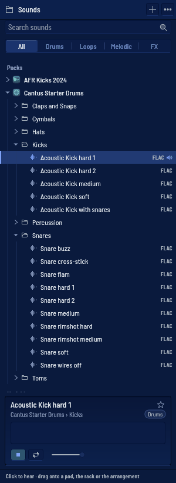

- **Clic** en un sonido para oírlo; otro clic lo detiene. Cada fila tiene una marca de lo que es:
  un paquete, su portada; una carpeta, el glifo de carpeta; un sonido, su propia forma de onda
  pequeña; las líneas de árbol muestran dónde vive cada sonido.
- **Buscar**: escribe en el campo de búsqueda para encontrar sonidos en todos los paquetes y
  carpetas. La coincidencia se ilumina dentro de cada nombre. Los resultados se **agrupan por el
  paquete o la carpeta donde están**, cada grupo con su título y su cuenta; cinco por grupo hasta
  *Mostrar los otros N sonidos*; cada resultado muestra su lugar bajo su nombre («Kicks › Hard»).
  Clic en el título de un grupo deja la búsqueda en ese lugar: una **ficha** lo dice (clic en su
  × para soltarla), y otra ficha nombra la pestaña de familia elegida.
- Las **pestañas** bajo la búsqueda (*Todo*, *Batería*, *Loops*, *Melódico*, *FX*) dejan
  una familia de sonidos, leída de sus nombres; las cuentas siguen a la pestaña.
- El sonido elegido tiene una **tarjeta**: su nombre con su **estrella** a la derecha, dónde
  está, sus etiquetas y un **pozo con la forma de onda** — un clic lo toca; mientras suena, lo
  oído se ilumina y una línea marca por dónde va. Bajo el pozo, las teclas de la tarjeta:
  **reproducir**, **bucle** (el sonido vuelve a empezar al terminar), el **nivel de escucha**
  (arrástralo mientras suena — no vuelve a empezar) y las cifras («0:00.4 / 0:01.2 · 48 kHz ·
  Estéreo»).
- **La estrella** guarda un sonido en **Favoritos**, que se listan primero en el explorador;
  pertenece a los ajustes de este equipo, no a la canción.
- **Arrastra** un sonido a un **pad de Pulsus** (el pad lo toca), al mapa de teclas de
  **Exemplar** (una zona en esa tecla), al **rack de canales** (un canal de muestra nuevo
  con su propio canal del mezclador, o sobre un canal para cambiar su muestra) o al
  **arreglo** (un clip de audio donde lo sueltas). Cada arrastre es un solo paso de deshacer.
- Sin nada instalado, el explorador ofrece **Empieza con una batería**: *Descargar* trae la
  *Batería inicial de Cantus* (81 golpes, 33 MB).

**La ventana de paquetes de sonidos** (*Paquetes de sonidos…*, o *Más paquetes…*) muestra cada
paquete como una **portada** dibujada a partir de lo que contiene (aros de batería, una forma de
onda, un teclado, una respuesta al impulso…), agrupados por categoría, con su nombre, qué es,
cuántos archivos tiene y su licencia, y **su estado**: *Obtener · 140 MB* (un clic lo descarga);
mientras se descarga, una barra fina, «42 % de 54 MB» y *Cancelar*; *Instalado* con una marca, y
*Abrir* (lo abre en el árbol del explorador); o *Actualizar · 4 MB*. Su cabecera cuenta los
paquetes («8 paquetes gratuitos · 3 instalados · 471 MB en disco») y los filtra (*Todos ·
Instalados* y cada categoría); **Orden**, a la derecha, los ordena por categoría, nombre o
tamaño. Clic en una portada para su página junto a la cuadrícula: detalles, licencia y créditos,
*Instalar*, *Actualizar*, *Quitar*, mostrar la carpeta e *Instalar desde un archivo…* para
equipos sin internet. *Dónde se guardan los paquetes ›*, al pie, muestra la carpeta. Los
paquetes: los propios de Cantus, las baterías de Karoryfer, la percusión de VCSL y VSCO 2, un
TX81Z para Exemplar, el **piano de cola Salamander** (un Yamaha C5, 16 capas de velocidad),
**DRSKit**, una batería acústica grabada por el equipo de DrumGizmo, y las **Respuestas al
impulso de OpenAIR** para [Aula](#aula-la-reverb-de-convolución).

Todos los paquetes son gratuitos. Casi todos son **CC0** (sin tener que citar); el piano
Salamander es **CC BY 3.0** y DRSKit **CC BY 4.0**: su crédito aparece en su página de
*Paquetes de sonidos…* y en *Ayuda ▸ Créditos*, y se guarda en la carpeta del paquete
(DrumGizmo pide además, con sus propias palabras citadas en la página del paquete, que se le
cite allí donde se den los demás créditos de una canción). En los dos casos, la música que
haces con ellos es tuya. Se guardan en `%LOCALAPPDATA%\Cantus\Content\`; cada archivo se
verifica con su SHA-256.

**Instrumentos de un paquete.** Un paquete instalado que trae instrumentos (el Salamander:
con 8 capas de velocidad, unos 120 MB de memoria, o con las 16, unos 185 MB) los muestra en
el estante *Teclados* del selector de dispositivos y en su página de *Paquetes de sonidos…*
(*Pista nueva con …*); cada uno suena en Exemplar. Las muestras largas se **leen del
disco**: en memoria queda solo su comienzo. La primera vez, Cantus descodifica las muestras
una sola vez en su **caché de muestras** (1 GB para las 8 capas del Salamander, 2 GB para
16), junto a la ventana, con *Cargando muestras… n de m* en la barra de estado; las cargas
siguientes tardan una fracción de segundo. Si el disco no llega a tiempo, la barra de estado
cuenta *Disco lento: n*.

**La batería acústica.** *DRSKit* (el equipo de DrumGizmo y Jes Eiler, de DRSDrums) se
grabó con 13 micrófonos; al instalarla (una descarga de 2,8 GB), Cantus los mezcla en una
batería estéreo —cada tambor en su lugar del campo estéreo, el micrófono inferior de la
caja en fase, los micrófonos cercanos de los toms y los platillos atenuados en los demás
tambores, como harían las puertas de un ingeniero de mezcla—, de modo que cada golpe suena
como una sola muestra estéreo. Tarda unos dos minutos tras la descarga y ocupa unos
470 MB; **mientras se instala necesita unos 7,6 GB libres** (la descarga, la batería
desempaquetada y la mezcla a la vez — la página del paquete lo dice, y una instalación sin
ese espacio se rechaza antes de descargar nada). Si la mezcla se cancela o falla, la
descarga se conserva: el siguiente intento parte de ella. *Batería acústica DRSKit*
aparece entonces en el estante *Baterías* del selector de dispositivos y suena en Exemplar
en las teclas de batería de General MIDI solo con sus propios tambores: bombo 36 (35, un
bombo más abierto), golpe de aro 37, caja 38 (40, una caja apagada), toms 41 · 43–45 ·
47–50, charles cerrado 42, de pedal 44 y abierto 46, crash 49 y 57, ride 51 y 59, campana
53. Las teclas de General MIDI para las que la batería no tiene sonido (pandereta,
cencerro, la percusión latina) quedan en silencio, así que una parte de General MIDI nunca
toca un platillo en su lugar; las otras articulaciones de DrumGizmo están por encima de la
percusión de General MIDI 2 y fuera de las teclas extra de los kits XG y GS por debajo de
ella (13–26): el ride con cadena en 88–90, las escobillas en 91–100, y el charles medio
abierto y las puntas en 101–106. Cada tambor tiene sus intensidades como capas de velocidad hasta 24 dB
por debajo de la más fuerte, y los golpes de una capa se turnan **en orden** — contados
por tambor y por capa, así que un redoble, un fill de toms entre las teclas del tambor o un
acento cada cuatro golpes de charles nunca repite la misma muestra dos veces seguidas; un
charles cerrado o de pedal apaga uno abierto. En el piano roll y en el rack de canales la
batería muestra **una fila por tambor**, con su nombre en el idioma de la interfaz (el
interruptor *Filas de batería* de Exemplar, en su vista *Editar*). El equilibrio de los micrófonos lo fija la mezcla: un fader por micrófono
necesita un instrumento con varias salidas, un paso posterior.

**Round robin en orden.** La vista *Editar* de Exemplar tiene el orden del round robin: *En
orden* (cada nota toma el siguiente turno de las muestras que alcanza — las teclas o
velocidades que alcanzan las mismas comparten los turnos — según su lugar en la canción,
así que reproducir desde cualquier punto elige lo mismo que la canción entera) o *Por
nota* (derivado de cada nota: como siguen sonando los Exemplar de proyectos y presets de
usuario guardados antes de esta versión). Un instrumento importado toca su round robin en
orden.

**Un paquete que falta.** Un proyecto que toca un paquete que este equipo no tiene abre una
tarjeta con el paquete y sus pistas en silencio: *Instalar en Paquetes de sonidos…*, *Usar
el paquete instalado* (cuando el proyecto apunta a otra copia, por ejemplo de otro equipo)
o *Buscar la carpeta…* (cuando se movieron archivos de un paquete instalado). El resto del
proyecto suena con normalidad.

## 10. Instrumentos y efectos: el selector de dispositivos

El **selector de dispositivos** muestra todos los instrumentos y efectos — los de Cantus y
los plug-ins CLAP y VST3 instalados en tu equipo — como mosaicos.

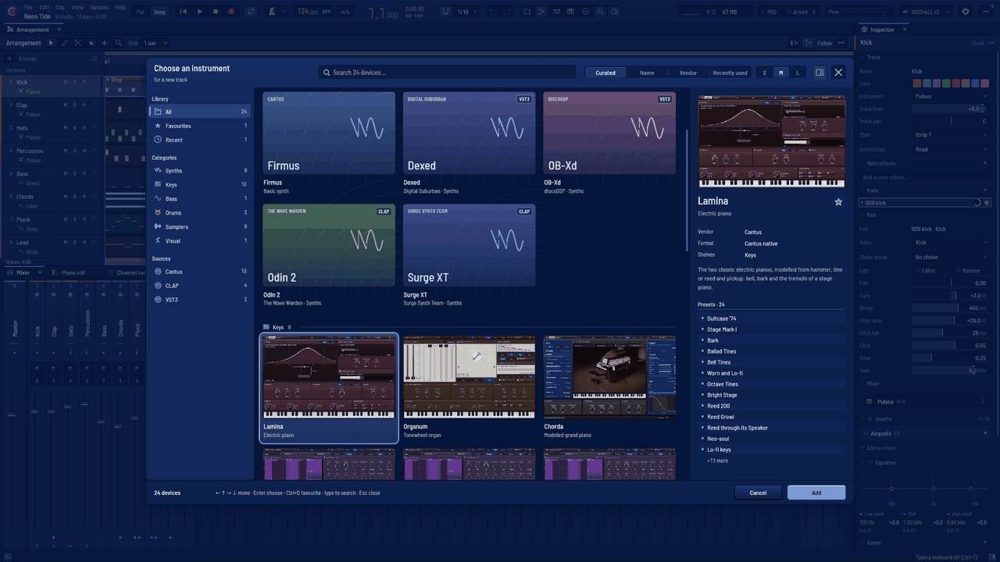

Ábrelo con el **+** sobre las cabeceras de pista (una pista de instrumento nueva), con un
clic en el chip de instrumento de una pista (cambiar el instrumento), con *Cambiar* en
cualquier ventana de dispositivo, con una ranura de inserción vacía o con *Ver ▸ Selector
de dispositivos…*. Busca por nombre, fabricante o tipo; filtra por estante (*Favoritos*,
*Recientes*, una categoría, o *Cantus / CLAP / VST3*); las flechas se mueven, `Enter`
elige, `Ctrl+D` marca un favorito, `Esc` cierra. Los instrumentos de los paquetes
instalados están en su estante: el piano Salamander en *Teclados*, DRSKit en *Baterías*. Cambiar un instrumento conserva sus
notas, clips, canal del mezclador y efectos; cambiar un efecto conserva su ranura, su
mezcla y su puenteo.

| Instrumento | Qué es |
|---|---|
| Firmus | El sintetizador sencillo con el que empieza cada pista nueva |
| Pulsus II | Caja de ritmos: tambores sintetizados y pads de muestras, grupos de corte |
| Unda | Sintetizador wavetable: tres osciladores, unísono, dos filtros, LFO dibujados |
| Calor | Polisintetizador analógico |
| Modulus | Sintetizador FM de ocho operadores; lee bancos DX7 |
| Exemplar | Sampler: SFZ, Decent Sampler y SoundFont |
| Gravis | Bajo: 808, sintetizado y eléctrico modelado |
| Lamina | Piano eléctrico |
| Organum | Órgano de ruedas fónicas con barras y altavoz rotatorio |
| Chorda | Piano de cola tocado desde un modelo físico: cuerdas, martillos, tabla armónica, pedales |
| Tympanum | Baterista acústico: kits modelados con micrófonos que se mueven y kits grabados con varios micrófonos, cada micro en su canal ([Tympanum](tympanum.md)) |

Los efectos son Aequalis (EQ), Comprimo (compresor), Porta (puerta y expansor), Sibilus
(de-esser), Multiplex (dinámica multibanda), Terminus (limitador), Culmen (maximizador),
Tonsor (recortador), Impetus (moldeador de transitorios), Discrimen (divisor de
transitorios), Spatium (reverb), Fervor (saturación), Latitudo (estéreo), Speculum
(analizador), Tonus (corrección de afinación), Concentus (chorus), Flexus (flanger), Phasis
(phaser), Tremor (trémolo y auto-pan), Vibrans (vibrato), Anulus (modulador en anillo),
Translatio (desplazador de frecuencia), Fluctus (moldeador de volumen), Cribrum (filtro automático),
Fragor (pedales de distorsión), Lapsus (moldeador de tiempo), Vetus (lo-fi), Libra (utilidad), Aula (reverb de convolución), Delay y Reverb.

### La cara de cada unidad

Cada efecto e instrumento de Cantus lleva una cara propia —todos menos el Reverb
sencillo y Firmus, el sintetizador con el que empieza cada pista nueva, que conservan el
aspecto sencillo del kit—, como el hardware y como los mejores plug-ins: su color y el material de su panel (metal cepillado, madera, pintura mate,
vinilo de amplificador, cristal…), el aspecto de su pantalla (una pantalla que brilla, un LCD, tinta sobre
papel, la cuadrícula de un osciloscopio), la forma de sus perillas e interruptores (un anillo
de valor, una perilla con falda, una cabeza de pollo, un dial graduado; una palanca, un
basculante, un botón luminoso) y la rotulación de su nombre. Reconoces una unidad de un
vistazo, aunque esté pequeña en una esquina de la pantalla.

Una cara cambia cómo se ve una unidad, nunca cómo funciona: cada control conserva su nombre
y su valor debajo, su menú del clic derecho (*Modular…*, *Aprender controlador MIDI*, automatización), el
teclado y el lector de pantalla; la ventana sigue cambiando de tamaño del 75 % al 200 %. Las
caras siguen tu tema — cada cara tiene una versión oscura y una clara, y las palabras se leen
bien sobre ella.

¿Prefieres todas las unidades con el aspecto sencillo de tu tema? *Ajustes ▸ Apariencia ▸
Cada unidad con su propia cara ▸ No*. La elección se guarda y se aplica en el acto a las
ventanas abiertas. Los plug-ins de otros fabricantes mostrados en la vista de Cantus conservan
el aspecto sencillo; los efectos de Cantus que usas como plug-ins CLAP o VST3 en otro programa
llevan siempre su cara.

### La cara de cada instrumento

Las caras de los instrumentos, una a una (los controles, el menú del clic derecho y el
teclado funcionan igual en todas):

| Instrumento | Su cara |
|---|---|
| Unda | Cristal índigo profundo; la tabla de ondas brilla cian en 3D, el cuadro que suena ahora en magenta |
| Calor | Un panel cepillado cálido con rótulos naranjas, perillas mecanizadas y un osciloscopio bajo el filtro |
| Modulus | Un panel marrón mate; operadores, envolventes y espectro en una pantalla verde de cristal líquido; teclas de membrana cuya barra de color se enciende |
| Exemplar | Una caja anodizada gris violeta; zonas y forma de onda que brillan en violeta sobre una pantalla de fósforo, los puntos del bucle en verde azulado |
| Gravis | Vinilo de amplificador negro con un piloto azul y perillas de puntero; el marcador de pulsación en rojo |
| Lamina | Laca burdeos en rosa; la púa con su barra de tono de latón y la pastilla tras un cristal |
| Organum | Nogal con el verde de un ojo mágico; barras en blanco, negro y marrón sobre un gráfico impreso, pestañas de marfil que se inclinan y se encienden, diales graduados |
| Chorda | Laca negra (blanca en un tema claro) y oro; las cuerdas sobre una tabla armónica de abeto, el borde del arpa de hierro, los martillos de fieltro |
| Pulsus II | Una caja oscura con teclas de lámpara amarillo 808; cada golpe en una pantalla fluorescente amarilla, su envolvente en naranja |

### Chorda: el piano de cola modelado

Chorda es un piano de cola que se calcula mientras tocas — sin muestras. Cada tecla tiene
sus propias una, dos o tres cuerdas, golpeadas por un martillo de fieltro y sonando sobre
una tabla armónica; las cuerdas de las demás teclas suenan con ellas cuando los apagadores
las dejan. Así responde como un piano: cuanto más fuerte tocas, más brillante; un acorde
sostenido sigue sonando, con el batido suave de sus cuerdas; con el **pedal derecho**
(controlador 64) resuena todo el instrumento, y el **medio pedal** funciona — un pedal a
medio bajar apaga a medias. El **pedal suave** (una corda, controlador 67) desplaza los
martillos para las notas siguientes: más suave y más oscuro.

Desde esta versión Chorda 2 toca una **nueva voz**, medida nota por nota contra un piano de cola
grabado (el Salamander): cada tecla afinada a menos de 10 cents de él, sus parciales, su caída y
sus unísonos ajustados tecla por tecla. Una canción guardada con una beta anterior que usa
Chorda 2 también toca la nueva voz; una canción en *Chorda 1* suena como siempre.

El pedal derecho también es una perilla — **Derecho**, en la tarjeta PEDALES de Tocar y
Editar —, así que una canción puede pedalear sin pedal: dibújalo como **carril de
automatización** (clic derecho en la perilla ▸ *Crear clip de automatización*; puntos sostenidos, arriba en
cada cambio de acorde y abajo justo después, es como pedalea un pianista) o deja que lo
mueva un **modulador**; el medio pedal también funciona ahí. El pedal que oyen las cuerdas
es el mayor entre la perilla y el controlador 64, así que un pedal real sigue funcionando
encima de un carril. La demo *De todo corazón* está pedaleada así.

- **Tocar** muestra **el piano en su sala** — el cuerpo y el acabado sobre la imagen; la sala,
  el suelo, las paredes y la alfombra en la tarjeta de su esquina (solo el aspecto, nunca el
  sonido; un paso de deshacer, guardado con la canción), *Dibujadas* o *Fotográficas*
  ([Imágenes de instrumentos](#3-el-espacio-de-trabajo)) —, la lista **Fuente** a su izquierda (el
  piano modelado, los grabados, los tuyos), el teclado debajo, las tarjetas **Martillo**,
  **Resonancia** y **Salida**, y **El piano**: la **Tapa**, **Perspectiva · Dónde escuchas** (con
  *Abrir el mezclador ›*) y los **Pedales** (*Derecho*, *Suave*, *Apagadores*, la curva de los
  apagadores contra el pedal). El nivel de la sala y la anchura viven ahora en la vista
  **Mezclador**; ver [Chorda: pianos grabados y el mezclador del piano](chorda-pianos.md). <!-- r40:docs -->
- **Editar** muestra el piano visto desde arriba — las cuerdas de cada tecla a su longitud
  sobre la tabla armónica de abeto, el puente, el borde del arpa de hierro, la fila de
  martillos de fieltro por donde golpean, los apagadores, la última tecla tocada
  iluminada — y añade la afinación (La4, el estiramiento que un afinador de oído da a las
  octavas de un piano, la rigidez de las cuerdas) con su curva en cents a lo largo del
  teclado, la rigidez del fieltro, lo que suena cada cuerda tecla por tecla, la abertura
  de los unísonos, el acople al puente y los parciales fantasma.
- Veinticuatro presets, cada uno etiquetado con los estilos y el papel para los que se hizo
  (el navegador de presets filtra por ellos): *Cola de concierto*, *Cola en sala*, *Tema de
  videojuego* y *Diapasón barroco* (La = 415 Hz) para cine; *Estudio brillante*, *Pop al
  frente*, *Cercano e íntimo* y *Estudio seco* para pop; *Balada cálida* y *Cola gospel* para
  alabanza; *Club de jazz*; *Teclas R&B*; *Montuno* y *Teclas reggaetón* para latina; *Piano
  rock* y *Honky-tonk*; *Teclas trap*; *Piano house*; *Piano de fieltro*, *Cola lo-fi* y
  *Piano de cola antiguo* para lo-fi; *Cinemático suave*, *Baño de pedal* y *Halo ambient*
  (pads). Cada uno con cuatro macros: dureza, resonancia, cuerpo y extinción.

**Modelo 2 (ronda 37).** Un Chorda que añadas ahora toca su segundo modelo: las cuerdas te
llegan a través de la tabla armónica y la caja tal como las oyen dos micrófonos sobre las
cuerdas (el cuerpo), en una sala, con el golpe del martillo, la tecla al llegar al fondo y
los apagadores al volver — y ningún golpe de una tecla es exactamente igual a otro. Tiene
dos perillas propias: **Sala** (en la tarjeta RESONANCIA: cuánto se oye la sala; 0 % es el
piano solo) y **Ruido de la mecánica** (en Editar: el golpe, el fondo de la tecla y los
apagadores; 0 % es ninguno). Una canción hecha antes conserva el primer modelo y suena
exactamente como sonaba; para pasar su piano al modelo 2, carga en él cualquiera de los
presets de Chorda (un paso de deshacer). El modelo se fija, no se automatiza.

**Desde dónde escuchas (modelo 2).** En un piano modelado la perspectiva es un control, no
una grabación. En la tarjeta MICRÓFONOS Y TAPA: **Micros** lleva el par desde sobre los
martillos (0 %: cerca, directo, se oye cada martillo y apagador) por el sitio del pianista
(35 %, el de partida) hasta el público (100 %: más resonancia de la tabla y de la sala, los
agudos suavizados por el aire); **Anchura** abre o estrecha el par (la suma en mono no
cambia, así que ningún ajuste suena a filtro de peine); **Tapa** lo cierra (cerrada: más
oscuro, las cuerdas cubiertas; a media altura; abierta). En Editar, la tarjeta SALA añade
**Tamaño**, de un estudio pequeño a un auditorio (se muestra la caída de la sala en
segundos). Todos se mueven sin saltos mientras el piano suena y se pueden automatizar. Los
presets los usan: *Cercano e íntimo* y *Pop al frente* están sobre los martillos, *Cola en
sala* en el público, *Piano de fieltro* con la tapa cerrada, *Club de jazz* a media altura.

Cambiar **La4, el estiramiento o la rigidez** vuelve a diseñar las cuerdas, junto a la
ventana, cuando la perilla se ha quedado quieta (uno o dos segundos; el editor dice
*diseñando las cuerdas* con cuánto lleva): el piano conserva su afinación anterior hasta
que la nueva esté lista. Una exportación siempre la espera. Estos tres se fijan, no se
automatizan.

### Sectio: cortar un bucle en Exemplar

Haz clic derecho en un bucle (WAV, AIFF, FLAC, OGG) del explorador de muestras y elige
**Cortar en una pista nueva de Exemplar** (o *Cortar en el Exemplar abierto*), o elige
*Importar ▸ Cortar un bucle…* en la vista Editar de un Exemplar: el bucle se corta en trozos,
**uno por tecla desde Do1** (MIDI 36), cada uno a su altura — un paso de deshacer. Dónde se
corta: en los **marcadores** del archivo (los cue points de un WAV, si no sus bucles de
sampler; los pulsos de un archivo ACID dan el tempo), si no en sus **transitorios**, o en una
**rejilla de pulsos**. Hasta 64 cortes (la barra de estado avisa si había más; una rejilla se hace más gruesa para caber, y un bucle sin tempo propio usa el
de la canción; no se cortan bucles de más de 5 min 49 s a 48 kHz). Un bucle
soltado en la tarjeta **Cortes** (desde el sistema o el explorador) vuelve a cortarse en ese
Exemplar.

La tarjeta **Cortes** dibuja el bucle con sus cortes numerados (donde caben los números) y
dice cuántos, el tempo y cómo se hallaron:

- **Editar los puntos**: arrastra una línea para moverla (cae en el cruce por cero más
  cercano), clic derecho para quitarla, doble clic en la onda para añadir una. Un paso de
  deshacer cada uno.
- **Volver a cortar**: elige *Marcadores*, *Transitorios* (arrastra su sensibilidad: más
  alta conserva golpes más débiles) o *Rejilla* (1/4 … 1/32): los puntos nuevos se ven sobre
  el bucle; **Aplicar** los conserva (un paso de deshacer), **Cancelar** los descarta.
- **Volcar al piano roll** escribe un clip que toca los cortes en orden, cada uno hasta el
  siguiente: al tempo del bucle suena igual que el archivo, muestra a muestra; a otro tempo
  los cortes siguen la rejilla. Un bucle sin tempo propio se lee al de la canción.
- **Aleatorio**, **Tartamudeo**, **Cuantizar** (semicorcheas) sobre ese clip — un paso de
  deshacer cada uno.

Los **estilos de corte** son presets de Exemplar en la biblioteca (etiqueta *Estilo de
corte*): *Break de batería* (transitorios, cada corte corta al anterior), *Golpes sueltos*
(resuenan), *Rejilla tartamuda* (1/32, con corte), *Marcadores del archivo*, *Corte vocal*
(pulsos, cada corte solo mientras se mantiene; un lead), *Frase melódica* (1/8, una voz con glide).
En un Exemplar cortado, un estilo vuelve a cortar **tu** bucle a su manera y lo toca a su
manera (un paso de deshacer); en uno vacío toca unos sonidos integrados hasta que cortes un
bucle en él. No incluyen audio.

Cada corte es una zona de Exemplar: su **altura**, **ganancia**, **panorama**, **reversa**,
**grupo de corte** y su propio **paso bajo** (*Paso bajo* en la tabla de zonas) son de la zona, su
**envolvente** de su grupo. Los puntos se guardan con el proyecto. Los agentes tienen
`slice_sample` (sobre archivos dentro de la carpeta del proyecto y las carpetas que
permitiste) y `dump_slices`.

### Los efectos de modulación

Ocho efectos mueven el sonido en el tiempo: **Concentus** (chorus), **Flexus** (flanger),
**Phasis** (phaser), **Tremor** (trémolo y autopaneo), **Vibrans** (vibrato), **Anulus**
(modulador en anillo), **Translatio** (desplazador de frecuencia) y **Fluctus** (modelador
de volumen). Cada uno se inserta **con un preset inicial** para que se oiga enseguida —
Concentus como *Juno I*, Flexus como *Avión a reacción*, Phasis como *Phase 90, logo script*,
Tremor como *Ampli surf*, Vibrans como *Cantante*, Anulus como *Campana*, Translatio como
*Fase lenta*, Fluctus como *Bombeo en negras* —, con su nombre en el pozo de presets del marco. El valor *predeterminado* de
cada control (al que vuelve con doble clic) sigue siendo el que no cambia nada. Para
insertar los efectos sin hacer nada, elige *Ajustes ▸ Edición ▸ Efectos ▸ Al insertar ▸
Ajustes neutros*. Otras unidades también empiezan donde son útiles: Fervor en *Cinta en el
bus*, Multiplex en *Pegamento de máster*, Impetus en *Más pegada*, Discrimen en *Más
ataque*;
Comprimo, Porta, Sibilus, Spatium y Tonus ya trabajan con sus valores predeterminados; un
ecualizador, Latitudo y el analizador empiezan planos, y Terminus, Culmen y Tonsor — las
protecciones del final de la cadena — empiezan sin hacer nada hasta que algo se pasa.
Nuestras versiones CLAP y VST3 empiezan con el mismo preset en otro DAW.

| Efecto | Qué hace | Conviene saber |
|---|---|---|
| Concentus | Engorda y ensancha | *Juno I, II, I+II* son el chorus del Juno-60 tal como barre su circuito; *Dimension 1–4* ensanchan sin vaivén; *Voces libres* son de 1 a 4 voces con tu propio LFO. La **prueba en mono** dice si la anchura sobrevive a un altavoz mono. |
| Flexus | El peine del avión a reacción | Por cero, el sonido seco espera 5 ms para que la copia en movimiento lo atraviese, como hacían dos magnetófonos; esos 5 ms son la latencia que dice el pie, y Cantus los compensa, aunque el interruptor esté automatizado. Apagado, Flexus no añade retardo. El barrido sigue al LFO, a lo fuerte que tocas (*Envolvente*) o a una perilla (*Manual*). *El peine ahora* dibuja las muescas que oyes. |
| Phasis | Muescas que barren | De 2 a 12 etapas (una muesca por cada dos), realimentación en ambos sentidos; el Phase 90 y el Small Stone son presets. |
| Tremor | Nivel o panorama a tempo | *Trémolo*, *Autopaneo* (un balance: el lado lejano baja, el cercano nunca sube) y *Armónico* (graves contra agudos, como los amplis marrones). Las formas cuadrada y de sierra tienen un **borde** suave: nunca hacen clic. |
| Vibrans | Una afinación que ondula | La profundidad va en **cents**, sea cual sea la velocidad; la **Subida** deja que el vibrato llegue después de cada nota, como el de un cantante. |
| Anulus | Campanas, metal, robots | La portadora se muestra como nota con sus cents; *En qué se convierte un tono* dibuja los parciales que crea de un tono de prueba, con su frecuencia (1 kHz) escrita en la pantalla. |
| Translatio | Mueve cada parcial los mismos hercios | No es un transpositor: los armónicos dejan de serlo. *Arriba*, *Abajo* o *Ambas* (una por lado); la realimentación hace las espirales de barbería. Su otra banda lateral queda más de 60 dB por debajo de 20 Hz a 20 kHz. |
| Fluctus | Bombeo de sidechain sin clave | Dibuja el nivel en un ciclo (una figura de 4/1 a 1/16): arrastra puntos (Mayús: fuera de la rejilla), doble clic para añadir o quitar uno, arrastra un tramo para curvarlo; las formas de los tramos son las del editor de automatización. |

**Al tempo de la canción.** Cada LFO puede seguir a la canción (*Al tempo*, una figura con
puntillos y tresillos, swing donde tiene sentido) o ir libre en Hz. Un LFO al tempo está
atado a la posición de la canción, no al momento en que pulsaste Reproducir: empieza en el
compás 5 y está donde habría estado; un bucle que vuelve lo devuelve a su sitio; la
exportación suena exactamente como la reproducción. La pantalla de cada efecto dibuja lo que
hará el LFO en los dos ciclos siguientes, con un cabezal donde está ahora.

**En otro DAW.** Las versiones CLAP y VST3 exportadas leen el tempo y la posición del
anfitrión, así que un Tremor o un Fluctus al tempo siguen también la canción de ese DAW.

**La cara de cada uno.** Los ocho llevan una cara propia, construida alrededor de la
pantalla que muestra cómo mueve cada uno el sonido; el otro canal o la otra voz se dibuja en
el segundo color de cada cara. Los controles funcionan como en todas partes (el valor sobre
cada perilla y su nombre debajo, clic derecho para *Modular…*, aprendizaje MIDI y automatización,
el teclado y el lector de pantalla); cada color conserva su contraste en los temas claros y
oscuros, y *Cada unidad con su propia cara* en *Ajustes ▸ Apariencia* las apaga para el
aspecto sencillo.

| Efecto | Su cara |
|---|---|
| Concentus | Plata cepillada con orejas de rack, perillas mecanizadas y teclas con luz para los modelos; el retardo de cada voz bajo un cristal como las cuentas de una cadena de cubos (BBD), las voces izquierdas en azul hielo, las derechas en ámbar |
| Flexus | Laca violeta, perillas con faldón e interruptores de palanca; el peine brilla en una pantalla de fósforo con una marca bajo cada muesca, y por cero la línea húmeda destella en lima donde cruza la seca |
| Phasis | Naranja mate como un pedal, perillas blandas; la respuesta en una pantalla fluorescente, cada muesca marcada en verde azulado |
| Tremor | Vinilo de amplificador verde espuma con diales graduados; la forma trazada por la pluma de un registrador sobre papel, el otro lado en ámbar |
| Vibrans | Lavanda tras un cristal ahumado, aros de valor; la afinación en cents en el panel de cristal líquido de un afinador, con su escala y una aguja en la afinación de ahora |
| Anulus | Una caja de nogal — *anulus* es «anillo» en latín — con perillas que son anillos; las bandas laterales en un osciloscopio de laboratorio en oro, cada par unido por un anillo alrededor de la entrada |
| Translatio | Rack de aluminio anodizado negro con perillas de puntero; el espectro en una pantalla de fósforo verde, una flecha que lleva cada armónico adonde llega, la banda lateral derecha en coral |
| Fluctus | Fibra de carbono; la forma en magenta bajo un cristal oscuro, el cabezal en cian con el nivel que recorre ahora |

**Tus plug-ins.** Al pulsar *Buscar plug-ins* (*Ajustes ▸ Plug-ins*), Cantus revisa las
carpetas estándar — `%LOCALAPPDATA%\Programs\Common\CLAP` y `…\VST3`,
`C:\Program Files\Common Files\CLAP` y `…\VST3` — y las que hayas añadido ahí. Además busca archivos nuevos o cambiados **cada vez que
inicia**, en segundo plano (*Buscar plug-ins nuevos en cada inicio*, activado por defecto),
y la línea de estado dice lo que encontró — *3 plug-ins nuevos: Odin 2, Surge XT,
ValhallaSupermassive*. Cada archivo se revisa en un
proceso aparte, así que un plug-in que falla al revisarse queda bloqueado, sin tumbar
Cantus. Los efectos de Cantus se instalan también en tus carpetas CLAP y VST3, para otros
DAW.

### Cribrum, el filtro automático

**Cribrum** (en latín, *una criba*) es un filtro que se mueve a tempo con la canción: dos
filtros de modelo analógico — los mismos cinco circuitos que los sintetizadores de Cantus
(SVF, ladder de transistores, OTA en cascada, diode ladder, Sallen-Key) — en serie o en
paralelo, movidos por un **LFO**, un **seguidor de envolvente** y una **curva que dibujas**. Se
inserta desde el selector (está en EQ y en Modulación); empieza en *Barrido de compás*, un
ladder resonante que sube y baja una vez por compás, para que se oiga al momento.

**Lo que pasa.** La imagen de la ventana es la música cribada: su espectro en granos,
iluminados hasta lo que sale de los filtros y con una marca donde entró, bajo la respuesta de
los dos filtros mientras se mueven. Arrastra el tirador de un filtro a lo ancho para su corte y
arriba y abajo para su resonancia (Mayús es más fino; un doble clic devuelve los dos). El
tirador del filtro elegido está sobre un riel que muestra hasta dónde puede llevarlo su
movimiento.

**Movimiento.** Elige el LFO, el seguidor o la curva en su tecla: su imagen se mueve en la pista
a tempo con la canción, sus controles están al lado y, debajo, sus **profundidades** hacia el
corte (en octavas), la resonancia y la vocal. Las tres fuentes se suman. El LFO va con la
canción de 1/64 a ocho compases (con puntillo y tresillo) o libre en Hz, con siete formas
(entre ellas muestreo y retención y una *deriva* suave) y fase estéreo. El seguidor oye la pista
o un **sidechain** — un bombo que abre el filtro de un pad; su **rango** decide cuánto del
nivel mueve el filtro (estrecho, solo el ataque de cada nota lo abre: el wah de envolvente del
preset *Wah que llora*). La curva se dibuja como la de
Fluctus y la de los clips de automatización (arrastra un punto, arrastra un tramo para curvarlo,
doble clic para añadir o quitar uno) y se suaviza para que un escalón nunca haga clic.

**Los filtros.** Cada uno tiene su modelo, su respuesta (paso bajo, paso banda, paso alto,
notch, pico donde el modelo la da, y un filtro de **vocal** que habla A-E-I-O-U), 12 o
24 dB/oct, corte, resonancia (todos los modelos cantan afinados desde el 95 %), drive y vocal.
El segundo filtro puede seguir el movimiento, ignorarlo o moverse al revés. La apertura
estéreo separa el corte de los dos canales.

**Exacto.** Con la mezcla al 0 % Cribrum deja pasar el sonido intacto, bit a bit. Un render
desde cualquier compás mueve los filtros como el render completo en ese punto; el render
offline es igual al tiempo real con cualquier tamaño de búfer. El sobremuestreo (2× o 4×)
mantiene limpio un filtro con drive; su latencia (una o dos muestras) se compensa.

### Vetus, lo-fi

**Vetus** (en latín, *viejo*) envejece un sonido como lo envejecía un medio antiguo.
Insértalo desde el selector (en Distorsión); empieza en *Casete gastado* — wow y flutter, el
siseo de la cinta, su banda y un poco de desgaste — así que se oye enseguida.

**Seis módulos**, en el orden que recorre una grabación — digitalizada, puesta en un medio,
gastada, reproducida —, cada uno encendido con la luz del título de su tarjeta (sus controles
responden aunque esté apagado, atenuados, para prepararlo antes de oírlo):

- **Bits** — de 1 a 24 bits (fraccionarios: un barrido nunca salta), *Redondeo*, *Truncado*
  (la aspereza de un conversor barato) o *Ley μ* (la del teléfono: los sonidos suaves
  conservan más niveles), con o sin **dither**. A 24 bits sin dither deja el sonido intacto.
- **Muestreo** — hasta 1 kHz. *Crudo*: lo que pasa del nuevo Nyquist se pliega y los escalones
  suenan por encima: el sonido de un sampler antiguo. *Filtrado* pone antes un filtro
  antialias (nada se pliega); *Suavizado* añade otro después (solo se pierde el ancho de banda).
- **Wow y flutter** — la oscilación lenta y la rápida de la velocidad de una cinta, en cents
  sea cual sea su ritmo; el wow libre o con la canción, en parte a la deriva como el de una
  cinta de verdad.
- **Edad** — cortes (el nivel cae y los agudos se apagan un momento) y desgaste (el nivel y el
  brillo vagan despacio).
- **Ruido** — el crujido y los golpes de un disco, el siseo de la cinta o del vinilo, el
  zumbido de la red a 50 o 60 Hz. *Seguir* hace que solo suene mientras suena la música.
- **Tono** — la banda del medio que lo reproduce: cinta, radio, teléfono o gramófono, cada uno
  con su color (el realce del cabezal, el pico del micrófono de carbón, las resonancias de una
  bocina). Elegir un medio pone su banda; sus dos bordes y su resonancia siguen siendo tuyos.

**Carácter** es el mando que lo envejece todo a la vez: cada módulo encendido se acerca a su
estado más viejo (menos bits, menos muestreo, más wow, más crujido, una banda más estrecha) y
la etiqueta imprime el año al que lleva el sonido. Qué módulos están encendidos decide el
sabor; el Carácter, cuánto atrás.

**La ventana.** En el centro, el objeto que envejece — un **casete** (los carretes girando, la
ventana de nivel con el último segundo de la música, la cinta arrugada por la edad, una chispa
en el cabezal cuando cae un chasquido) o un **LP** en su tocadiscos (el surco con la música de
sus últimas vueltas, descentrado por el wow, con polvo y rayas): elígelo en el menú **⋯** de la
ventana, junto al acabado. Gira el objeto hacia atrás (arrastra a su alrededor contra las
agujas del reloj) para subir el Carácter; doble clic para dejarlo nuevo. A su lado, **lo que
sale**: el espectro de la salida sobre el de la entrada, con el Nyquist del conversor
(arrástralo a los lados para el muestreo), el suelo de ruido de los bits (arriba, menos bits) y
la banda del medio (arrastra sus bordes).

**Exacto.** Con todos los módulos apagados Vetus deja pasar el sonido intacto, bit a bit. El
ruido, el dither, los cortes y el desgaste van fijados a la canción: un render desde cualquier
compás, offline o en reproducción, con cualquier tamaño de búfer, tiene el mismo crujido en los
mismos sitios.

### Libra, la utilidad

**Libra** (en latín, *la balanza*) reúne las correcciones de cada día de un canal. Se
inserta como un cable: nada cambia hasta que lo pides.

**Los canales.** *Estéreo*, *Intercambiar*, *Mono* (los dos sumados: comprueba una mezcla
en mono), *Izquierdo* o *Derecho* en ambos lados, *Mid* o *Side* solos (escucha la anchura
por sí sola). **Invierte la polaridad** de cualquiera de los canales; **Quitar DC** elimina
una continua; **Silencio**.

**Los retardos** atrasan cada canal hasta 100 ms, en muestras enteras: dos micrófonos sobre
una misma fuente alineados a la muestra. Muéstralos en ms o en muestras.

**La imagen y la ganancia.** El **balance** baja un lado, nunca sube el otro (el balance del
máster); la **anchura** de mono (0 %) al doble (200 %); la **ganancia** ±36 dB.

**La ventana.** En el centro una **balanza** de latón: su brazo se inclina con el balance y
lo marca en una escala fina, sus brazos alcanzan tanto como la imagen, cada platillo lleva el
nivel, el retardo y la polaridad de su canal, y la **correlación** recorre su pie (hacia −1,
los canales se cancelan en mono). Arrástrala a los lados para el balance y arriba y abajo
para la anchura; doble clic para centrarla. A su lado el **afinador** — la nota, sus cents y
su frecuencia, su La de referencia (de 415 a 466 Hz) arrastrado arriba y abajo — y el
**goniómetro**.

### Saltus, el tono

**Saltus** (en latín, *el salto*) mueve el tono de lo que oye. Insértalo desde **Añadir
inserción ▾ ▸ Tono ▸ Saltus**; empieza como *Octava arriba, doce cuerdas* (el motor poli)
— o con el preset de inicio que hayas elegido (abajo).

**Cuatro modos**, las leyendas de lo alto de su pantalla:

- **Desplazar**: dos voces a intervalos fijos, ±24 semitonos y ±100 cents cada una, con su
  nivel y su balance, sobre el seco.
- **Armonía**: dos voces a un número de **grados de la escala** desde la nota oída — *dos*
  es una tercera, *cuatro* una quinta, mayor o menor según la tonalidad. Cuentan en la
  **tonalidad y escala**, en el **acorde sostenido** por MIDI (elige la pista cuyos acordes
  sigue) o cantan la **melodía MIDI** (las notas sostenidas, con el vibrato del cantante).
- **Octava**: una y dos octavas abajo y una arriba. **Analógica** es un divisor que sigue la
  nota, sin latencia; **Limpia** mueve la nota misma, con sus formantes.
- **Whammy**: una voz llevada por el **pedal** del intervalo del talón al de la punta,
  seguida con el **deslizamiento** — mece el pedal en la pantalla, automatízalo, asígnalo a
  un controlador o deja que lo toquen **notas MIDI**: una nota sostenida pisa la punta.

**Mono o poli.** El selector de arriba a la derecha de la pantalla muestra la latencia de
cada motor: **Mono** sigue una nota a la vez con los formantes de la voz (2,7 ms — para
tocar y cantar a través de él), **Poli** mueve cada nota de un acorde o una mezcla entera
(85 ms — la compensación de latencia lo cubre en una mezcla). Los presets de fábrica vienen
en ambos.

**Los formantes** se quedan donde están (una voz conserva la suya) o se mueven con el tono
(la cinta acelerada o frenada); la **garganta** los mueve por sí sola.

**La ventana.** El **salto**: un teclado, la nota oída encendida en él y nombrada en grande,
y un arco desde ella hasta cada voz, tan grueso como suena la voz, con el nombre del
intervalo y la nota donde cae — arrastra un aterrizaje a otra tecla para cambiar su
intervalo. Encima, un **pentagrama doble** escribe los últimos segundos tal como se tocan, y
las notas de ahora en su borde derecho, cada una cayendo a su tecla. En Whammy el pedal se
dibuja junto al teclado.

**Elige su preset de inicio.** La lista de presets de cada unidad ofrece **Usar como preset
de inicio**: sus ajustes de ahora pasan a ser con lo que empieza al insertarla, en todos los
proyectos. **Volver al preset de inicio de fábrica** trae de vuelta el de fábrica. *Ajustes ▸ Edición
▸ Efectos ▸ Al insertar ▸ Ajustes neutros* sigue insertando cada unidad en sus valores por
defecto.

**En Tabula** Saltus es un pedal con las perillas Intervalo, Nivel, Seco y Pedal.

### Arca, amplificador y caja

**Arca** (en latín, *el cofre*) es un amplificador de válvulas y su caja, para guitarra,
bajo, teclados o voz. Insértalo desde **Añadir inserto ▾ ▸ Distorsión ▸ Arca**; empieza como
*Combo limpio*.

**Cinco amplificadores**, las leyendas en lo alto de su pantalla: **Limpio**, **Crujiente**,
**Campanilla**, **Alta ganancia** y **Bajo** — cada uno su circuito resuelto válvula a
válvula, de la entrada al altavoz. **Ninguno** deja solo la caja (un cargador de respuestas
al impulso). El **sobremuestreo** (2×, 4×, 8×) muestra la latencia de cada opción; la
compensación de retardo la cubre.

**El chasis** muestra el amplificador trabajando: las válvulas en el orden en que las
encuentra la señal, sus filamentos encendidos, cada placa enrojeciendo según trabaja, una
barra bajo cada una; la aguja de la derecha muestra **la alimentación cediendo** ante un
acorde fuerte. Junto a ellas, sus válvulas de potencia, su bias y su rectificador.

**El panel**: Ganancia; los Graves, Medios y Agudos de la red de tono; la Presencia de la
etapa de potencia (en la campanilla, **Corte**, al revés), el Maestro y el **Sag** (la
alimentación de firme a blanda); Mezcla y Salida.

**La caja**: elige una de cinco, o **Archivo cargado** para tu propia respuesta al impulso
(WAV, AIFF, FLAC u OGG). Elige el **micrófono** (dinámico, cinta, condensador),
**arrástralo por el cono** — brillante en el centro, más oscuro hacia el borde — y
**aléjalo de la rejilla** en la vista lateral (de 1 a 30 cm: más cerca, más graves). Debajo
se dibuja la respuesta que resulta.

Dieciséis presets de fábrica cubren cada amplificador, la caja sola, teclados y voz. En sus
valores por defecto (sin amplificador ni caja) Arca no toca ninguna muestra. Como pedal en
**Tabula** muestra Ganancia, Graves, Agudos y Maestro.

### Rota, el altavoz rotatorio

**Rota** (en latín, *la rueda*) es el mueble rotatorio del órgano de Cantus, para cualquier
pista. Insértalo desde **Añadir inserto ▾ ▸ Modulación ▸ Rota**; empieza como *Coral*
(lento).

**El cambio**, arriba: **Parado** (el freno detiene ambos rotores), **Lento** y **Rápido**.
Cada rotor llega a su nueva velocidad a su ritmo — la bocina en una fracción de segundo, el
tambor en segundos; la **Rampa** escala esos tiempos. Con **Cambio por notas** activado,
cada nota de la pista que oye Rota cambia la velocidad, a la muestra.

**La pantalla** dibuja el mueble **en corte**, la bocina y el tambor girando como los gira
el motor (difuminados a velocidad); el mueble **desde arriba**, donde **arrastras los
micrófonos** a su alrededor (su ángulo) y lejos de él (su distancia); y **las rampas**: la
velocidad de cada rotor desde el cambio, con un punto donde está ahora.

Las tarjetas fijan las velocidades lenta y rápida de la bocina y del tambor, el ángulo y la
distancia de los micrófonos y el **Balance** entre bocina y tambor, la **trasera** del
mueble (abierta o cerrada) y la **Saturación** de su amplificador, y la Mezcla y la Salida.
Trece presets de fábrica. En sus valores por defecto (mezcla 0) Rota no toca ninguna
muestra; no tiene latencia.

### Loquax, el vocoder

**Loquax** (en latín, *el que habla mucho*) hace hablar a una voz a través de otro sonido.
Insértalo en la pista de la voz desde **Añadir inserción ▾ ▸ Tono ▸ Loquax**; empieza como
*Robot* — el sintetizador sostiene un Do3 mientras la voz habla, así que la oyes vocodificada
enseguida, sin notas y sin llave.

**Quién habla y quién canta.** El sonido de la propia pista es la **voz** (la moduladora).
La **portadora** se elige en la tarjeta *Portadora*:

- **Sintetizador** — el sintetizador polifónico de Loquax (sierra, pulso y ruido, hasta siete
  copias desafinadas por voz), tocado por **las notas de la pista que escucha la ranura**:
  elígela como fuente MIDI del efecto, como el disparo de Porta. Una pista de teclado puede
  estar silenciada — sus notas siguen tocando Loquax.
- **Cadena lateral** — el sonido de otra pista, enviado a la ranura como su **llave** (el campo de
  cadena lateral, como en un compresor): un pad, una guitarra (un talk-box), un loop de batería.
- **Ambas** — las notas y la llave juntas.

**Quién habla** los intercambia: *Cadena lateral* habla y esta pista es la portadora — una batería
o un loop que hablan. **Robot** sostiene su propia nota (cualquiera, de Do1 a Do7) mientras la
voz supera su puerta, sin ninguna nota.

**La pantalla.** A la izquierda, **el objeto en el que habla la voz** — el micrófono de
cuello de cisne, **el tubo del talk-box** que sube desde su motor, o **el micrófono de mesa**
sobre su base pesada — con su piloto de «en el aire» y su brillo siguiendo a la voz. Elígelo
en el menú **⋯**, bajo *Micrófono*, junto a los acabados: es de la inserción (se guarda en la
canción, un paso de deshacer) y nunca se oye. Cada preset de fábrica sugiere su objeto (*Talk-box* el tubo, *Radio* el
micrófono de mesa, *Robot* el cuello de cisne) y al cargarlo lo pone; un preset tuyo guarda el
que tenías al guardarlo. A/B no lo toca, y cambiarlo nunca marca el preset como modificado. En el
centro, **el banco**: cada banda una columna de celdas encendidas por lo que dice ahora;
**arrastra sobre las bandas para dibujar sus niveles** (de −24 a +12 dB, cada trazo un paso de
deshacer). El desplazamiento de formantes se dibuja arriba. A la derecha, **el puente de
medidores**: la aguja de la voz y la de la portadora, los pilotos de consonante, retención y
robot.

**Las tarjetas**: la portadora y los papeles, la portadora en bruto **directa**; las
**bandas** (de 8 a 64, pendientes de orden 4, 6 u 8, su rango y su anchura); los
**seguidores** (ataque, liberación, **Retener** congela la vocal); el **carácter**
(desplazamiento de formantes en semitonos, de bandas, inclinación, aplanado, abertura
estéreo); las **consonantes** (la sibilancia que pasa por encima de su esquina, siempre o
solo en consonantes, y ruido en la portadora en ellas); los osciladores, el unísono y la
envolvente del sintetizador; el robot; mezcla y salida.

Quince presets de fábrica, con ambas portadoras (*Talk-box* y *Portadora por cadena lateral* usan
la llave; *Vocoder clásico*, *Coro* y *Máquina de cuerdas* las notas). En el navegador cada
uno se escucha con la línea de la propia fuente como sus notas y su llave. En sus valores por
defecto (mezcla 0) Loquax no toca ninguna muestra; no tiene latencia.

**En otro DAW** Loquax es el plug-in *Cantus Loquax* (CLAP y VST3): oye las notas que le
envía el anfitrión, y su portadora por la entrada de sidechain una vez que su propio
interruptor *Sidechain* está en *Entrada de sidechain*.

### Fractus, el secuenciador de glitch

**Fractus** (en latín, *roto*) son diez efectos en diez carriles de un secuenciador por pasos
que sigue a la canción, con una nube de granos a su lado. Insértalo desde **Añadir inserción ▾
▸ Modulación ▸ Fractus**; empieza como *Tartamudeo del último tiempo* — el último tiempo de cada
compás repite una fusa, el resto del compás intacto — así que lo oyes enseguida en una batería,
un loop o un rasgueo.

**Los carriles**, uno por módulo: **Repetición** (el primer trozo del evento suena y se guarda,
luego se repite — cada repetición más aguda o más baja si lo pides, y con *Aceleración* el
tartamudeo que parte cada trozo a la mitad), **Reverso**, **Parada de cinta** (o *Arranque*,
desde quieta), **Barajado** (trozos de hasta ocho atrás, algunos al revés), **Salto de tono**
(el trémolo clásico de línea de retardo, o *Limpio* en su *Estilo*), **Trituración**, **Barrido de filtro**,
**Puerta**, **Lanzamiento de eco** (los ecos siguen sonando tras el paso) y **Nube** (los
granos toman el relevo durante el evento). La rejilla se fija en la tarjeta *Rejilla*: pasos
de 1/4 a 1/64 (también tresillos), de uno a cuatro compases, swing. Cada comienzo, final y
salto tiene un fundido cruzado, así que nada chasquea: su duración (*Uniones*) y la *Semilla*
de cada tirada están en la tarjeta *Eventos* de la página *Cortes*. El tiempo, la realimentación, el tono, el nivel y el **ping-pong** del
lanzamiento de eco están en la página *Secuenciador*.

**Pintar.** En la ventana de los carriles:

- **Pulsa en un paso y arrastra por el carril**: un bloque desde el paso que pulsaste hasta el
  paso bajo el puntero. **Su altura es su cantidad** — el pad se enciende desde su suelo hasta
  donde sueltas (en pasos de 5 %); la cantidad es la mezcla del módulo para ese evento. Un
  bloque pintado sobre otro se queda con lo que cubre.
- **Mayús y arrastrar**: un trazo de **probabilidad** — cada bloque por el que pasa suena con
  esa frecuencia (la línea discontinua bajo un bloque que puede no sonar).
- **Clic derecho en un bloque** para borrarlo.

Cada trazo es un paso de deshacer. El **nombre** de un carril abre la página de tarjetas donde
se ajusta su módulo; las cuatro **teclas de página** bajo la ventana (*Secuenciador*,
*Cortes*, *Color*, *Nube de granos*) hacen lo mismo, y sus puntos muestran qué carriles están
pintados y cuáles suenan ahora.

**Tocado por notas.** En la tarjeta *Interpretación*, *Tocado por* elige **Pasos**, **Notas** o
**Ambos**. Con notas, **las notas de la pista que escucha la ranura** (su fuente MIDI, como en
Porta y Loquax; la pista del teclado puede estar silenciada) tocan los carriles mientras se
mantienen: la *Primera tecla* (Do3 por defecto) toca Repetición, la siguiente Reverso, y así
hasta Nube. *Las notas* **En el paso** espera a la siguiente línea de la rejilla;
**Enseguida** actúa en la muestra de la propia nota. Las teclas que tocan los carriles se
encienden en la pantalla.

**La nube de granos.** Su nivel corre junto a la cadena en todo momento (0: apagada): granos
leídos de hasta dos segundos atrás, su tamaño, densidad, dispersión, tono (en una escala:
cromática, mayor, menor, pentatónica, quintas, octavas), abertura y la parte al revés,
dibujados en vivo en el osciloscopio — cada grano donde lee y a su tono, con su estela.
**Congelada** (el piloto sobre el osciloscopio, o el interruptor de la tarjeta de la nube)
retiene lo que la nube ha oído mientras siga encendida.

Dieciocho presets de fábrica: tartamudeos y subidas, paradas y arranques de cinta, reversos,
puertas, barridos de filtro, lanzamientos de eco, barajados, redobles lo-fi, pads de granos,
una nube para congelar y juegos tocados por notas (*Notas: el kit entero*, *Notas:
tartamudeos*, *Pasos y teclas*). Un preset trae sus carriles. En sus valores por defecto —
nada pintado, la nube a 0 — Fractus no toca ninguna muestra; no tiene latencia.

**En otro DAW** Fractus es el plug-in *Cantus Fractus* (CLAP y VST3): sus carriles se guardan
en el estado del plug-in y se pintan en su propia ventana, sus pasos siguen el tempo y la
posición del anfitrión, y las notas que envía el anfitrión tocan los carriles.

### Caelum, la reverb shimmer

**Caelum** (en latín, *el cielo*) es una reverb para espacios que ningún edificio contiene: su
cola sube de tono mientras suena. Se inserta desde **Añadir inserción ▾ ▸ Espacio ▸ Caelum**;
empieza como *Shimmer de octava* — un espacio amplio, un tercio húmedo, cuya cola sube de
octava en octava — de modo que un acorde sube al cielo en cuanto lo tocas.

**Cómo sube.** En cada vuelta del tanque, una parte de la cola (la *Cantidad* de la tarjeta
*Shimmer*) se cambia por el mismo sonido transportado por la **primera voz** (+12 semitonos,
una octava, al principio) y, a su propio nivel, por la **segunda voz** (+7, una quinta, muda
hasta que subes *Nivel segunda*). Cada voz puede ir de tres octavas abajo a tres arriba. El
cambio mueve la energía del sonido sin crearla, así que la caída que fijas es la que oyes, con
shimmer o sin él. *Tono del shimmer* corta los graves y los agudos dentro del bucle: las
octavas que suben se apagan arriba en vez de amontonarse.

**La ventana** es un observatorio de noche:

- **El cielo** muestra los últimos ocho segundos: la cola brillando en el horizonte sobre el
  agua del tanque y las octavas del shimmer como bandas de luz sobre ella, cada una encendida
  cuando la energía la alcanza — las más altas más tarde, mientras la cola envejece. Infinita
  escribe ∞ en el cristal; Congelar lo escarcha; la atenuación enciende una ranura en el riel
  derecho del marco.
- **El alféizar** de abajo tiene los controles sin fin: **Infinita**, un pulsador iluminado (la
  cola nunca cae: se sostiene al nivel que tiene cuando lo pulsas — activarla no cambia nada
  de lo que oyes en ese momento — y lo que toques después se le suma bajo un techo suave, el
  nivel que una cola de la caída fijada alcanzaría con lo que tocas, así que nunca se
  desborda), **Congelar** (el tanque guarda lo que tiene y no deja entrar nada; el shimmer
  deja de subir) y **Sostenido**, un indicador de vidrio con un cursor de latón: lo que hace el
  colchón de Infinita cuando dejas de tocar. Al **100 %** (por defecto — infinito es infinito)
  se sostiene para siempre y conserva su timbre: la subida del shimmer se asienta en un
  equilibrio fijo, así que el colchón nunca se vuelve chillón, ni a los diez minutos. Más bajo,
  la subida se lo lleva despacio; al **0 %** sube fuera del oído en segundos (unos −30 dB en
  diez). Un clic acciona un pulsador y un clic o un arrastre en el indicador mueve su cursor
  (un paso de deshacer cada uno; un doble clic lo devuelve al 100 %); el clic derecho,
  automatización, modulación y aprendizaje MIDI.
- **El astrolabio** fija las voces: **arrastra la alidada** (la regla ancha) para elegir la
  primera voz y **la aguja fina** para la segunda. El ángulo es la nota dentro de la octava
  (los doce semitonos alrededor del borde); la distancia al centro, la octava en la espiral
  (−36 junto al eje, +36 en el borde). Un clic en la lámina lleva allí la aguja más cercana.
  Cada arrastre es un paso de deshacer.
- **Caída por octava**: ocho tubos de vidrio, cada uno encendido hasta la caída que el tanque
  alcanza de verdad en su octava (de 63 Hz a 8 kHz), según la tarjeta *Amortiguación*. La línea
  de puntos que los cruza es la caída que fijas: **arrastra arriba o abajo sobre los tubos**
  para fijarla (un paso de deshacer). Con Infinita encendida, los tubos marcan ∞ y no se
  arrastran.

**Las tarjetas**: *Espacio* (tamaño, caída, pre-retardo — libre o una figura al tempo de la
canción, *Sincronía* —, difusión y las 8 o 16 líneas del tanque: ocho cuestan la mitad),
*Amortiguación* (las esquinas aguda y grave y sus caídas frente a la del medio), *Shimmer*,
*Tono del shimmer*, *Movimiento* (la modulación de las líneas y **Florecer**, el sonido que
crece hacia el espacio durante hasta cuatro segundos), *Atenuación* (rango, umbral, ataque,
liberación) y *Salida* (corte de graves y agudos, anchura, mezcla, salida).

**La atenuación** (ducking) aparta la reverb mientras suena la señal seca y la deja florecer
en los huecos. Escucha a la propia pista o a **otra pista** enviada a la inserción como su
llave (el campo de cadena lateral, como en un compresor): el shimmer de una voz que se aparta
bajo la batería.

Diecinueve presets de fábrica: shimmers de octava y de quinta, catedrales, un pad que
florece, *Crecida para congelar* (infinita; acciona Congelar sobre un acorde para retenerlo
como un pad — ningún preset empieza congelado, porque un tanque congelado desde su primera
muestra retendría silencio), un ascenso sin fin (su Sostenido al 60 %: sigue subiendo y se apaga hacia lo alto cuando
dejas de tocar) y un drone infinito que crecen mientras tocas,
un shimmer vocal que se aparta, ambiente de guitarra, pre-retardos sincronizados con la
canción (*Ecos de corchea*, *Subida con puntillo*), una nube una octava abajo, placas, una caja
con shimmer y una bruma de bus. En sus valores por defecto (mezcla 0) Caelum no toca ninguna
muestra; no tiene latencia.

**En la pedalera de Tabula** Caelum también es un pedal (la caída, el shimmer, la primera voz
y la mezcla en su cara); una pedalera con Caelum acepta una llave, y la llave llega a su
atenuación.

**En otro DAW** Caelum es el plug-in *Cantus Caelum* (CLAP y VST3): su atenuación escucha la
entrada de sidechain cuando su propio interruptor *Sidechain* está en *Entrada de
sidechain*, y un pre-retardo sincronizado sigue el tempo del anfitrión.

### Vinculum, el compresor de bus

**Vinculum** (en latín, *un vínculo*) es el compresor que une una mezcla, en un bus, un grupo
o el máster. Insértalo desde **Añadir inserto ▾ ▸ Dinámica ▸ Vinculum**; empieza como
*Pegamento* (el VCA a 4:1, ataque de 30 ms, liberación automática, −18 dB).

**Tres modelos**, elegidos en el primer conmutador de la placa:

- **VCA** — el compresor de bus de una consola: **Proporción** 2:1, 4:1 o 10:1, **Ataque**
  de 0,1 a 30 ms y **Liberación** de 0,1 a 1,2 s o **Auto** (un golpe aislado se suelta
  pronto y el trabajo sostenido despacio, de modo que la mezcla respira sin bombear).
- **Óptico** — un nivelador de fotocélula encendida por la salida: suave al principio, unos
  3:1 a fondo en **Comprimir**, cerca de 10:1 en **Limitar**. Sus tiempos son los del
  nivelador clásico: unos 10 ms para atrapar, la mitad soltada en unos 60 ms y el resto en
  menos de un segundo tras una ráfaga corta y en unos diez segundos tras un pasaje largo y
  fuerte — la célula recuerda cuánto tiempo y cuánto ha trabajado, y una célula que ha
  descansado vuelve a soltar pronto.
- **Mu variable** — una válvula cuya proporción sube a medida que trabaja (hasta 4:1 en
  Comprimir, hasta 20:1 en Limitar), con seis posiciones de **Constante de tiempo** (la 5 y la 6 siguen
  al programa) y un **Color de válvula** en su propia tarjeta.

**La placa** responde a un clic: un clic en una posición grabada la elige, un clic en una
perilla la hace avanzar, un clic en la palanca cambia entre Comprimir y Limitar. Sus
**pilotos** también son controles: **Clave externa** abre la lista de la clave (su propia
entrada o cualquier canal de la mesa), **Liberación automática** enciende Auto (un segundo
clic devuelve la liberación que tenía), **Limitar** cambia el carácter. Las dos agujas
muestran la **reducción de ganancia** y la **salida**; entre ellas, una ventana muestra
trabajando el elemento de ganancia del modelo. La pantalla dibuja la **curva de
transferencia** con el punto de la señal y ocho segundos de reducción.

**Las tarjetas**: Umbral y Compensación; la **Cadena lateral** — la clave (también en su
propio campo) y el **Paso alto** que impide que los graves arrastren al detector; Válvula (el
color del mu variable); **Mezcla** (compresión en paralelo) y Salida. Catorce presets de
fábrica cubren cada modelo: pegamento para un bus o la mezcla, batería aplastada y en
paralelo, un bus de voces, pegamento de máster y un límite en cada uno. En sus valores por
defecto (el umbral a +24 dB) Vinculum no toca ninguna muestra; no tiene latencia. Como pedal
en **Tabula** muestra Modelo, Umbral, Compensación y Mezcla.

### Lenis, el supresor de resonancias

**Lenis** (en latín, *suave*) suaviza lo que resuena: los silbidos, los picos ásperos y las
acumulaciones de caja que sobresalen del propio espectro de un sonido, encontrados momento a
momento y bajados en una parte, sin tocar las notas ni el tono. Insértalo desde **Añadir
inserto ▾ ▸ EQ ▸ Lenis** (también en Dinámica); empieza como *Suave* (la mitad de cada
resonancia, la curva Suave, desde 150 Hz).

**La pantalla** es la de un analizador de banco: el espectro de entrada como una línea
luminosa con el corte colgando bajo ella como un velo, una barra por frecuencia arriba con
cuánto se quita, y el **enfoque** al pie — dos compuertas, **Desde** y **Hasta**, más allá de
las cuales nada se toca, y seis **bandas** numeradas. Arrastra una compuerta a la izquierda o
a la derecha; arrastra el nodo de una banda a los lados para su frecuencia y arriba o abajo
para su cantidad (sobre la línea trabaja más, bajo ella más suave, abajo del todo deja esa
región intacta); la rueda sobre un nodo fija su anchura; un doble clic enciende o apaga una
banda. Una banda arrastrada mientras está apagada se enciende en el mismo paso. Cada arrastre
es un paso de deshacer.

**El panel** a su lado: el dial de **Profundidad** (arrástralo arriba o abajo; doble clic
para ninguna) — al 100 % una resonancia baja hasta el contorno del propio espectro, al 50 % a
medio camino; las lecturas de la **máxima atenuación** ahora y de la **latencia**; y las teclas:
**Calidad** (Rápida, Estándar, Precisa: 5, 11 o 21 ms de latencia a 48 kHz — Precisa
resuelve los medios graves, Rápida oye antes), **Curva** (Suave apenas toca un pico que pasa
la línea, Dura toma cada pico en su parte), **Escuchar · Lo que se quita** (solo las
resonancias, nunca la música) y **Canales** (Enlazados, Independientes, Medio y lados). Un
clic hunde una tecla; el menú de cada tecla ofrece automatización y aprendizaje MIDI.

**Las tarjetas**: Detección (**Nitidez** — solo resonancias estrechas, o también
acumulaciones anchas — y **Selectividad**, cuánto debe sobresalir un pico), Tiempo
(**Ataque**, **Liberación**), Enfoque (las frecuencias de las compuertas), Banda de enfoque (la
banda elegida en sus números o en la pantalla: su piloto, frecuencia, cantidad y anchura) y
Salida (**Mezcla**, **Salida**).

La latencia la compensa el mezclador como la de cualquier inserto con latencia — un cambio de
calidad empieza el análisis de nuevo (un hueco de una latencia) y el mezclador vuelve a
alinear enseguida. Catorce presets de fábrica: voz áspera, domador de sibilancia,
chisporroteo de guitarra, resonancia de piano, bus de mezcla suave, pulido de máster,
resonancia de sala en la batería, retumbe de acústica, voz de pódcast, resonancia de caja,
aire amplio (medio y lados), cuerdas y metales, quirúrgico. En sus valores por defecto
(profundidad 0) Lenis es su entrada retrasada por su latencia, al bit. Como pedal en
**Tabula** muestra Profundidad, Nitidez, Selectividad y Enfoque desde.

### Cedo, el atenuador

**Cedo** (en latín, *cedo el paso*) hace sitio: el bajo cede ante el bombo, la música ante la
voz, o toda la pista bombea al pulso con una forma que dibujas. Insértalo desde **Añadir
inserto ▾ ▸ Dinámica ▸ Cedo**; empieza como *Bombeo clásico* (el tempo lo dispara en cada
negra, 9 dB abajo) y suena enseguida, sin enrutar nada.

**Qué lo dispara** — el conmutador **Disparo** de su tarjeta (o un clic en la bandera del
disparo sobre la bancada):

- **Cadena lateral**: elige en **Clave** la tira cuyo sonido atenúa esta (un bombo, una
  voz). La clave puede pasar por un **Filtro** (un paso alto o un paso banda, con su
  **Frecuencia** y su **Q**); su **Detector** lee su pico o su RMS frente al **Umbral**; la
  atenuación ataca en S, se **mantiene** desde la última muestra de la clave sobre el umbral
  y se suelta en la **Liberación** con su forma. La **Anticipación** (hasta 10 ms) deja la
  atenuación abajo antes de que llegue un transitorio.
- **Tempo**: la forma dibujada suena en cada **Ciclo** de la canción (de 8/1 a 1/32, con
  puntillos y tresillos), con **Swing** y **Suavizado de bordes** para que nunca chasquee.
- **MIDI**: elige en **Notas de** la pista cuyas notas lo disparan; cada nota toca la forma
  una vez, un ciclo de largo, y la **Velocidad** puede escalar la profundidad.

**La pantalla** muestra la forma sobre un ciclo con lo que se atenúa ahora barrido por el
cursor. Arrastra un punto para moverlo (se ajusta a las semicorcheas; con Mayús, libre),
arrastra entre puntos para curvar el tramo, haz doble clic para añadir o quitar un punto y
clic derecho en un punto para cambiar su tramo (curva, S o mantenido). En Cadena lateral la
pantalla muestra la envolvente en cada golpe: arrastra en el tiempo las asas del ataque, el
mantenimiento y la liberación. Debajo, los últimos cuatro segundos de reducción con los
golpes; en Cadena lateral arrastra arriba o abajo la línea discontinua del umbral. Arrastra
hacia abajo el **indicador de nivel** junto al fuelle para atenuar más.

**Banda**: atenúa la banda **Completa**, solo los **Graves** o solo los **Agudos**, divididos en
el **Cruce** (arrástralo por la franja de la banda) en **Fase mínima** (sin latencia) o **Fase
lineal** (sin giro de fase; haz clic en la palabra de la división en la franja para
cambiarla). El **Suelo de la fase lineal** fija para qué se dimensiona su latencia:
**Automático** (por defecto) una octava bajo el cruce — la menor latencia que necesita,
cambiada solo cuando sueltas el cruce — o un fijo de 40, 60, 80 o 120 Hz (55,3, 36,8, 27,6 o
18,3 ms a 48 kHz), para una latencia que nunca cambia; cada opción muestra su latencia. El
mezclador la compensa.

**Salida**: **Profundidad** (∞ en su tope es silencio), **Enlace estéreo**, **Mezcla**,
**Salida** y **Escuchar** (la salida, la **Diferencia** que quita, o la **Clave** filtrada).

Diecisiete presets de fábrica: bombeos clásico, a medio tiempo, en corcheas y con swing,
respiración en tresillos, puerta trance, crescendo invertido, bombeos solo en los graves en
fase mínima y lineal, un bombeo por MIDI, el bombo atenúa el bajo, el bombo en los graves
del bajo, cadena lateral dura, locución, fondo musical de pódcast, radio suave y sala de la
caja (los de Cadena lateral y MIDI necesitan elegir su clave o sus notas). En sus valores por
defecto (profundidad 0) Cedo deja el sonido intacto, al bit. Como pedal en **Tabula** muestra
el disparo, la profundidad, el ciclo y el umbral; lo disparan la clave de una pedalera con
clave, su pulso y sus notas.

### Purus, la restauración en tiempo real

**Purus** (en latín, *limpio*) repara una pista mientras suena: el zumbido de la red, los
clics y la crepitación, la cola de una sala en una voz. Se inserta desde **Añadir inserción ▾
▸ Utilidades ▸ Purus**; empieza como *Zumbido de red 50 Hz* — el módulo del zumbido
encendido, a 50 Hz, seguido mientras la red deriva, ocho armónicos recortados — así el
zumbido de un lazo de masa se va al momento. (*Quitar ruido* y *Quitar clics* del editor de
audio reparan una toma sin conexión; Purus lo hace mientras suena la canción, en cualquier
canal.)

**Tres módulos**, cada uno con su interruptor, su mezcla y su salida, apagados hasta que los
enciendes:

- **Quitar zumbido** saca la fundamental de la red y hasta dieciséis armónicos. La
  *Frecuencia* es **Fija** (exactamente la fundamental que pones), **Seguida** (la red
  deriva; la sigue a ±2 Hz) o **Hallada sola** (decide entre 50 y 60 Hz y luego la sigue).
  La *Profundidad* y la *Anchura* de las muescas dicen cuánto y con qué precisión. **Suave**
  aprende el zumbido y lo resta en lugar de recortarlo: una nota grave en 50, 100 o 150 Hz
  conserva su peso (retiene lo aprendido mientras suena la nota). Suave mira 50 ms por
  delante, que es su latencia.
- **Quitar clics y crepitación** encuentra cada clic y lo rehace con la música que lo rodea
  (la misma reparación del editor de audio) y, con *Crepitación* por encima de 0, saca la
  crepitación de un disco de la banda alta. La *Sensibilidad* se detiene en 0,70: más alta
  empezaría a remendar la propia música. 16 ms de latencia.
- **Quitar sala** baja la cola de una sala en una voz. La *Reducción* dice cuánto (hasta
  30 dB); el *Decaimiento* es el de la sala, puesto a mano o **Estimado** en las
  pausas; el *Sonido directo* dice lo cerca que estaba el micrófono (0 dB por defecto, va bien casi
  siempre; más para uno muy cercano). Solo quita tanta sala como muestran las pausas: una voz
  seca pasa intacta; las *Primeras reflexiones* conservan los
  primeros milisegundos, que llevan la voz. 21 ms de latencia (23 a 44,1 kHz).

La latencia es solo la de los módulos encendidos, y Cantus la compensa en el canal, así la
pista sigue a tiempo con el resto.

**La ventana** es un banco de restauración:

- **La pantalla** es un espectrograma de los últimos seis segundos, los graves abajo. Lo que
  oyes brilla cálido; **lo que Purus quita** de cada lugar se pone encima en un color frío,
  así el zumbido, los clics y la cola de la sala se ven como lo que cayó del cuadro. Los
  armónicos del zumbido son un peine de agujas en el riel de la izquierda: **arrastra una
  aguja arriba o abajo y la fundamental la sigue**.
- **El carril de los clics**, debajo, marca cada reparación, con la cuenta.
- **La cola de la sala**, a la derecha, muestra el decaimiento de la sala tal como era (la
  línea clara) y tras la reparación (la línea cálida), la diferencia sombreada. **Arrastra
  sobre ella para fijar la reducción** (el tirador del borde la sigue) y **arrastra la
  marca** donde terminan las primeras reflexiones para conservar más o menos de ellas.
- **Tres cartuchos**, uno por módulo: su palanca, una lámpara que se enciende con lo que hace,
  lo que lee ahora (la frecuencia del zumbido, los clics rehechos, el decaimiento) y sus
  teclas — **50 Hz**, **60 Hz** y **Suave** en el del zumbido, **A mano** y
  **Estimado** en el de la sala, y **Oír lo que se quita** en cada uno: oyes solo lo que ese
  módulo quita, para juzgarlo. Cada clic y cada arrastre es un paso de deshacer; clic
  derecho en una tecla para automatización y aprendizaje MIDI.
- **Las tarjetas** tienen todos los controles: Quitar zumbido, Quitar clics y crepitación,
  Quitar sala, Salida.

Dieciséis presets de fábrica: zumbido de red a 50 o 60 Hz o hallado solo, el zumbido de un
amplificador de guitarra, una guitarra en directo y un bajo por DI (suaves), clics de vinilo,
los clics y la crepitación de un disco gastado, un casete antiguo, un pódcast en una sala
pequeña, un diálogo en una sala reverberante, una entrevista con micrófono lejano, un aula
magna, una grabación de campo, una videollamada y una limpieza a fondo. En sus valores por
defecto todos los módulos están apagados y Purus no toca ninguna muestra.

**En el tablero de Tabula** Purus también es un pedal — un pedal antizumbido antes de la
distorsión (la fundamental, los armónicos, la profundidad y la mezcla en su cara).

**En otro DAW** Purus es el plug-in *Cantus Purus* (CLAP y VST3); cuando se enciende o apaga un
módulo, le dice al anfitrión su nueva latencia.

### Comparatio, el comparador con referencia

**Comparatio** (en latín, *una comparación, poner lado a lado*) pone tu mezcla junto a los
discos con los que quieres que esté. Insértalo en el **último hueco del máster** desde
**Añadir inserción ▾ ▸ Masterización ▸ Comparatio** (o Utilidades); empieza en sus valores
por defecto — se oye tu mezcla, intacta — y mide.

**Carga una referencia**: pulsa **Cargar referencia…** al pie de la consola, o **suelta**
archivos de audio (WAV, AIFF, FLAC, Ogg) sobre la consola. Hasta ocho referencias quedan en
la lista, cada una una tecla numerada; pulsa un número para comparar esa, **Quitar** para
sacarla. Los archivos se leen de tu disco donde están — nunca se copian al proyecto — y cada
uno guarda su propio análisis, así que su duración, su sonoridad y su tono se ven en cuanto se
lee. Si un archivo ha desaparecido, o ha cambiado desde que lo cargaste, la tira lo dice en
rojo: cárgalo de nuevo.

**Compara**: gira el **gran selector** (o pulsa una lámpara, o **A** y **B** en el cajón a
ciegas) para oír la referencia en lugar de tu mezcla, **a la sonoridad de tu mezcla** — el
cambio es un fundido corto que no se oye como un clic. Las tarjetas dicen cómo se iguala la
referencia: *Igualar* **Integrada** (sobre lo que ha sonado, o con *Medida sobre* **El archivo
entero**, estable desde el primer segundo), **A corto plazo** (siguiendo tu mezcla sección a
sección) o **A mano**, un *Desfase* en todos los modos, y el *Fundido*. *Reproducción de la
referencia* la toca con **Su propio cabezal** mientras suena la canción, **Unida a la
canción** (con *Adelantada*), o **En bucle** — **arrastra sobre la vista general** para
repetir el tramo que quieras. Cada referencia guarda su propia reproducción: compara otra y
vuelven su bucle y su adelanto; la igualación, el fundido y la pantalla quedan como están.
Solo la referencia que se compara se guarda en memoria: otra se vuelve a leer del disco
cuando la eliges (mientras tanto suena tu mezcla y la tira dice que se está leyendo).

**La pantalla** muestra ambos **equilibrios tonales** (el de la referencia de su archivo
entero, el de tu mezcla mientras suena) y **tu mezcla frente a la referencia** — sobre la
línea lo que tu mezcla tiene de más, debajo lo que tiene de más la referencia, la banda suave
cuán segura es la comparación. La línea naranja es la **igualación tonal**: lo que acercaría
tu mezcla a la referencia, tanto como diga la *Cantidad* de la tarjeta *Igualación tonal* y
nunca más que el *Mayor realce o corte*. Pulsa **Enviar a Aequalis** y se convierte en un
Aequalis justo antes de Comparatio, en bandas editables, con la ganancia de salida que deja
tu mezcla tan sonora como era — un paso de deshacer; envíala otra vez y se actualiza ese
Aequalis. Debajo, **Dinámica** (los dos histogramas de sonoridad, el factor de cresta, el
pico frente a la sonoridad, el rango de sonoridad) y **Estéreo** (correlación y anchura, en
total y en tres bandas). Los dos platos leen la sonoridad a corto plazo, integrada y
momentánea, el pico real y el rango de sonoridad.

**Prueba a ciegas**: pulsa **X** para oír una de las dos, oculta; responde *X es tu mezcla* o
*X es la referencia*; cada respuesta enciende una lámpara, y el cajón da tu resultado y la
probabilidad de lograrlo adivinando. **Nueva prueba** empieza de nuevo en otro orden.

Cada pulsación y cada arrastre es un paso de deshacer; con el botón derecho sobre el selector
o una lámpara, automatización y aprendizaje MIDI (un pedal para A/B). Catorce preajustes de
fábrica son maneras de comparar: masterizar por el archivo entero, mezclar sección a sección,
a mano, la referencia un decibelio más baja, unida a la canción, dos bucles, cambio rápido y
suave, graves en detalle, una igualación tonal suave y una completa, las canciones de un álbum
lado a lado, una mezcla de alabanza frente a un disco en vivo.

**Los renders nunca oyen una referencia**: una exportación, una pista separada, una
congelación o un bounce oyen siempre tu mezcla, diga lo que diga el selector. Comparatio no es
un pedal en el tablero de Tabula: una referencia es la escucha del máster.

**En otro DAW** Comparatio es el plug-in *Cantus Comparatio* (CLAP y VST3): **Cargar
referencia…** en su ventana, o suelta un archivo encima; la sesión guarda la ruta, el tamaño y la huella de cada
referencia (nunca su audio) y dice cuándo falta un archivo o ha cambiado; el bounce sin
conexión del anfitrión oye tu mezcla. *Enviar a Aequalis* es solo de Cantus.

<!-- r41:nitor -->
### Nitor, el realzador

**Nitor** (en latín, *brillo, esplendor*) hace brillar una pista o una mezcla con una perilla:
lo que hacen Soundgoodizer, Low Lifter y los excitadores de Maximus de FL Studio, en una
unidad. Insértelo desde **Añadir inserción ▾ ▸ Masterización ▸ Nitor**; empieza como *Brillo
suave*, un tercio del carácter *Claro*. Gire la perilla grande, **Cantidad**, en medio de la
corona: es todo lo que la mayoría de las pistas necesita.

**Con el nivel igualado.** Nitor mantiene su salida tan fuerte como su entrada (*Igualar
nivel*, encendido por omisión): lo que oye al girarlo es el color, no el volumen — una
comparación honrada. Apáguelo cuando quiera también el empuje.

**Los caracteres** — las cinco facetas a la izquierda de la corona (pulse una):

- **Claro**: pulido general — los graves sujetos, los detalles levantados desde abajo, un poco de aire.
- **Pegada**: para ritmos — los graves apretados, los golpes dejados pasar, presencia.
- **Cálido**: armónicos pares en el cuerpo, los agudos suavizados, el bajo más redondo.
- **Aire**: los agudos abiertos por compresión hacia arriba y aire excitado.
- **Fuerte**: densidad — cada banda apretada por arriba y por abajo.

Cada carácter son cuatro bandas de dinámica (la *fase dinámica* de Multiplex: sin latencia,
sin giro de fase mientras ninguna banda se mueve) con el excitador y los graves que necesita.
Actúa igual sobre una pista suave que sobre un bus fuerte: Nitor mide la sonoridad de la
entrada y ajusta a ella los umbrales del carácter.

**Los graves** (su tarjeta, y su lectura a la derecha de la corona):

- **Sub**, siguiendo **al bajo, una octava abajo** (una senoide atada al bajo que suena —
  siempre afinada con él) o **a la tónica de la canción** (una senoide en la nota de la
  tonalidad, de 32,7 Hz para Do a 61,7 Hz para Si, abierta por cada golpe de los graves: un
  808 bajo el bombo, afinado).
- **Armónicos del bajo**: del segundo al quinto armónico del bajo, para que un teléfono o un
  portátil toquen la línea que no alcanzan (el oído oye la fundamental que falta).
- **Apretar**: tras cada golpe los graves suenan 30 ms y luego bajan (hasta −12 dB al 100 %)
  hasta el siguiente — el retumbo acortado, el golpe intacto.
- **Realce en la tónica**: la nota de la tonalidad florece — hasta +6 dB en su fundamental y
  +3 dB en su octava.
- **Banda grave hasta**: dónde acaban los graves (40–250 Hz).

**La tonalidad** viene de la canción (su *Tonalidad* en la barra del piano roll): cambie la del proyecto y el sub
y el realce se mueven con ella al instante. *Tonalidad* en la tarjeta de Salida fija una
(Do … Si) — una muestra en otra tonalidad, o el complemento en otro DAW.

**El excitador**: añade armónicos — y solo armónicos — en **Cuerpo** (hacia 400 Hz),
**Presencia** (2,5 kHz) y **Aire** (sobre 7 kHz), sobremuestreado cuatro veces. **Color** va
de los armónicos pares (cálidos, como una válvula) a los impares (brillantes, ásperos). Cada
banda añade la misma parte de armónicos por fuerte que suene.

**Salida**: *Igualar nivel*, *Tonalidad*, *Mezcla* (seco y procesado) y *Salida*.

En sus valores por omisión — la cantidad a 0 y cada parte a 0 — Nitor deja el sonido
intacto, bit a bit. No añade latencia. Trece preajustes de fábrica: brillo suave, pulido de
mezcla, resplandor del máster, pegada de ritmo, un bombo apretado con sub afinado, voz cálida,
aire en la voz, acústica brillante, fuerte y denso, un 808 bajo el bombo, bajo en altavoces
pequeños, sub a la octava, la tónica florece.

**En otro DAW** Nitor es el complemento *Cantus Nitor* (CLAP y VST3): sin canción que seguir,
ponga su *Tonalidad* en la de la canción (lee Do si se deja en *La de la canción*).

### Aula, la reverb de convolución

**Aula** (en latín, *la sala*) es la reverb de un espacio real: hace sonar el sonido a través de
una **respuesta al impulso** — la grabación de cómo responde una sala a un solo chasquido — como
lo haría la propia sala. Se inserta desde **Añadir inserción ▾ ▸ Espacio ▸ Aula**; empieza en la
*Sala de conciertos* de Cantus, a un cuarto de mezcla y con 12 ms de pre-retardo (el preset *Sala al 25 %*).

**De dónde viene la respuesta** (la tarjeta *Origen*):

- **De Cantus** — quince respuestas que hace el propio Cantus, iguales en todo ordenador y sin
  nada que descargar: *Sala de estudio*, *Sala pequeña*, *Sala de madera*, *Sala en vivo*,
  *Ambiente*, *Cámara*, *Cámara de piedra*, *Sala de conciertos*, *Sala grande*, *Catedral*,
  *Placa*, *Placa vocal*, *Placa oscura*, *Muelle* y *Muelle largo*. Todas son estéreo real: un
  sonido a la izquierda se oye en los dos lados, como en una sala.
- **Un archivo** — **Cargar archivo** (o soltar un archivo sobre el editor) toma una respuesta
  WAV, AIFF, FLAC u Ogg: un canal (mono), dos (estéreo: izquierda a izquierda, derecha a
  derecha) o cuatro (**estéreo real**, en el orden izquierda→izquierda, izquierda→derecha,
  derecha→izquierda, derecha→derecha, como lo escriben Waves, Altiverb y REAPER), de 16, 24 o
  32 bits flotante, a cualquier frecuencia de muestreo (Aula la convierte), hasta 20 segundos.
  El archivo se queda donde está; el proyecto recuerda su ruta. Si falta, la tarjeta lo dice y
  la reverb calla hasta que vuelva. **Volver a las de Cantus** olvida el archivo.
- **Un paquete libre** — *Muestras ▸ Conseguir más ▸ Respuestas al impulso de OpenAIR* descarga
  ocho espacios reales medidos por la biblioteca OpenAIR de la Universidad de York (dos iglesias
  de Nashville, la catedral de York, un mausoleo, el salón de un club de mujeres, una sala de
  mármol, una sala de mecanografía y un muelle de juguete), bajo CC BY 4.0. Su crédito aparece
  en la tarjeta cuando suena uno de sus archivos; da crédito a OpenAIR (www.openairlib.net) y a
  los autores que allí se nombran cuando publiques música hecha con ellos.

**La imagen** es la respuesta en decibelios a lo largo del tiempo, después del pre-retardo, tal
como la moldean los controles de abajo: se mueve en cuanto se mueve una perilla. Mientras se
prepara una respuesta nueva, la pantalla dice *Preparando la respuesta…*; la anterior sigue
sonando hasta que la nueva entra entera, sin chasquido, y se conserva la cola de lo que sonaba.

| Tarjeta | Controles |
|---|---|
| Longitud y tiempo | **Estirar** (50–200 %: una sala más grande o más pequeña, más grave o más aguda), **Longitud** (la parte que se conserva, con un desvanecido al final), **Invertir** (la respuesta al revés: una crecida hacia el sonido) |
| Envolvente | **Ataque** (la respuesta entra gradualmente), **Caída** (100 % tal como se grabó; menos, la cola muere antes), **Puerta** (donde la respuesta cae tanto bajo su pico, termina: quita el ruido de fondo de una grabación; *No* a −120 dB) |
| Tono | **Corte grave** y **Corte agudo** (12 dB por octava, sobre la respuesta), **Amortiguación** (los agudos se apagan antes a medida que avanza la cola) |
| Salida | **Pre-retardo** (0–500 ms), **Anchura** (0 mono … 200 %), **Mezcla** (seco y húmedo en fundido cruzado), **Nivel** |

**Exacta y ligera.** Aula no añade latencia: las primeras 64 muestras de la respuesta suenan en
forma directa y el resto en particiones que crecen de ocho en ocho, con el trabajo de cada una
repartido por igual en los bloques previos, así que una sala larga cuesta lo mismo en cada
bloque. Queda a −130 dB de una convolución directa, da los mismos bits con cualquier tamaño de
búfer y exporta, congela y separa en stems exactamente como suena. Con la mezcla al 0 % deja el
sonido intacto, bit a bit.

**En otro DAW.** El *Cantus Aula* exportado en CLAP y VST3 suena con las quince respuestas de
Cantus (el estado de un plug-in guarda números, no archivos). Los agentes ajustan sus números con
`set_effect` y cargan un archivo con `set_impulse_response` (solo si permitiste los archivos, y
solo dentro de las carpetas que permitiste).

### Fragor, los pedales

**Fragor** (latín, *estruendo*) es una tabla de pedales de distorsión y fuzz: hasta tres
pedales en cualquier orden, cada uno modelado a partir de su circuito — las perillas mueven
las resistencias del propio circuito, así que cada posición suena como el pedal. Insértalo
desde **Añadir inserto ▾ ▸ Distorsión ▸ Fragor**; empieza con el overdrive verde en la
tabla, empujando suavemente.

**Los pedales:**

- **Overdrive verde** — Ganancia, Tono, Nivel. Recorte suave en el lazo de un amplificador
  operacional y medios realzados: el empuje clásico para un solo, y para apretar una
  distorsión detrás.
- **Distorsión operacional** — Distorsión, Filtro, Volumen. Un amplificador operacional
  lento hacia diodos de recorte duro; sube el Filtro para quitar el zumbido agudo.
- **Distorsión de silicio** — Dist, Tono, Nivel. Un realce de transistor y recorte duro,
  los medios hundidos por el tono.
- **Fuzz de germanio** — Fuzz, Bias, Volumen. Dos transistores de germanio; **Bias** es la
  batería: al 100 % está nueva, al bajarla se agota, y por debajo de un tercio una nota que
  se apaga chisporrotea y se corta como con una batería moribunda.
- **Muff triangular** — Sustain, Tono, Volumen. Dos etapas de recorte para un sustain sin
  fin, los medios hundidos de su control de tono.

**La tabla:** arrastra un pedal a otra posición (los dos se intercambian); haz clic en una
posición vacía para añadir un pedal; con clic derecho sobre un pedal pones otro en su lugar
o lo quitas de la tabla. El interruptor de pie de cada pedal lo anula sin chasquido. Clic
derecho sobre una perilla abre su menú (automatizar, modular, aprender un controlador,
restablecer); doble clic la restablece.

**Sobre la tabla,** la pantalla muestra un ciclo de la nota que entra (tenue) y que sale al
nivel que suena, y sus armónicos — los impares macizos, los pares rayados, los dominantes
marcados — con la distorsión total. Las válvulas del amplificador brillan un poco más
mientras suena.

**Al lado:** **Puerta** (antes de los pedales: apagada en −90 dB), **Entrada** (el nivel que
entra a los pedales), **Mezcla**, **Salida**, **Calidad** (sobremuestreo 2×, 4× u 8×; más
quita más aliasing y cuesta más) y **Estéreo / Mono** (un solo circuito para los dos
canales, como un pedal de verdad).

**Su aspecto:** el menú **⋯** de la ventana ofrece tres acabados — **Válvula** (el ámbar de
un amplificador de válvulas de noche, su cara), **Crema** (cartón crema y latón) y **Acero**
(acero con un solo rojo de señal). La elección es tuya para todos los Fragor y se guarda
entre sesiones; nunca cambia el sonido.

*Historia:* los cinco circuitos son los del Ibanez TS808 Tube Screamer, el ProCo RAT, el
Boss DS-1, el Dallas Arbiter Fuzz Face y el Electro-Harmonix Big Muff π, modelados a partir
de sus esquemas publicados; los nombres y los dibujos en Cantus son propios.

### Tabula, la pedalera

**Tabula** (latín, *la tabla*) es una pedalera de los efectos de Cantus: hasta dieciséis de
ellos como pedales, en cualquier orden, con una división A/B opcional y ocho macros. Cada
pedal es el propio efecto, así que una pedalera de un solo pedal suena exactamente como ese
efecto solo. Insértala desde **Añadir inserto ▾ ▸ Guitarra y amplificador ▸ Tabula**; empieza
con un equipo de guitarra — el overdrive verde bajo, un chorus, un delay y una reverb de
muelle — para que se oiga enseguida.

**La pedalera.** Los pedales están sobre una tabla oscura; los cables llevan la señal entre
ellos y brillan tan fuerte como suena en cada punto. Gira las perillas de un pedal donde
están; pulsa su interruptor para encenderlo o apagarlo (un fundido de 10 ms que nunca cambia
la latencia). Arrastra un pedal para moverlo (suéltalo entre otros dos, o sobre el carril A o
B para dividir la cadena). Haz doble clic en él, o elige *Abrir su editor completo*, para
abrir la ventana del propio efecto en lugar de la pedalera; *Volver a la pedalera* regresa.
Con muchos pedales la pedalera se reparte en filas, con el cable corriendo entre ellas.

**Añadir y quitar.** *Añadir pedal*, al final de la cadena, abre el selector: los estantes a
su izquierda, los efectos del estante como pedales pequeños; haz clic en uno y se suma a la
pedalera, sonando enseguida. Bajo la pedalera, *Su lugar en la pedalera* fija el
**Tamaño** del pedal elegido (mini, estándar, ancho, doble, redondo), su **Lugar en la
cadena** (Antes, A, B, Después) y su interruptor, y *Quitar* lo saca.

**La división.** Un pedal en el carril A o B abre la división: la caja divisora alimenta los
dos carriles y la caja de mezcla los une, con su perilla **A/B** (a la izquierda solo A, a
la derecha solo B). El carril más corto espera al más largo, así que nunca se emborronan (no
hay filtro de peine).

**Macros.** Ocho perillas arriba. Pulsa **Aprender**, toca una macro y luego la perilla de un
pedal: queda asignada, desde donde está hasta el extremo más lejano de su rango, y lleva un
anillo. Una macro mueve todo lo asignado a ella y manda sobre la automatización de esa misma
perilla. **Al azar** da a las perillas de cada pedal valores nuevos dentro de rangos
musicales (un solo paso de deshacer).

**Bajo la pedalera,** los controles principales del pedal elegido (cada uno con su menú:
automatizar, modular, aprender un controlador) y la **Entrada**, la **Mezcla** y la
**Salida** de la pedalera.

**El teclado.** Haz clic en la pedalera y luego: Tab y Mayús+Tab eligen un pedal; Espacio su
interruptor; Intro su editor completo; Supr lo quita; Ctrl+← y Ctrl+→ lo mueven; ← y →
eligen una de sus perillas y ↑ y ↓ la giran (con Mayús, finamente).

**Los circuitos de Fragor como pedales propios.** Además de Fragor (tres ranuras en un solo
pedal), el estante *Distorsión* de la pedalera ofrece cada uno de los cinco circuitos de
Fragor como un pedal propio: el **overdrive verde**, la **distorsión de op-amp**, la
**distorsión de silicio**, el **fuzz de germanio** y el **muff triangular** — así varias
saturaciones pueden estar en cualquier punto de la cadena, un phaser entre un empuje y un
fuzz, un muff después del compresor, más de tres. Cada uno lleva la caja, la pintura y la
rotulación de su circuito, como en la pedalera de Fragor, y sus tres perillas con los nombres
de su pedal (Ganancia, Tono, Nivel; Distorsión, Filtro, Volumen; Dist, Tono, Nivel; Fuzz,
Bias, Volumen; Sustain, Tono, Volumen). Cada uno es el mismo circuito que el de
Fragor, bit a bit: un pedal suena exactamente como Fragor con solo ese circuito en su
pedalera, en cualquier posición de las perillas. Solo viven en una pedalera (Fragor es el
inserto). No tienen ventana propia: bajo la pedalera, el elegido muestra lo que se ajusta —
sus perillas, **Puerta**, **Mezcla** y **Salida**, **Sobremuestreo** (2×, 4×, 8×),
**Canales** (estéreo, o mono como un pedal de verdad: la mitad de trabajo) y **Circuito**
(dentro, o fuera: un cable; su luz se apaga). Su propio nivel de entrada, como el de Fragor,
queda para la automatización y el asistente. Uno nuevo empieza en su primer preset, con el
circuito dentro; cada uno tiene tres o cuatro presets propios.

**Presets.** Cada preset de Tabula es una pedalera entera: *Equipo de guitarra*, *Crujido de
blues*, *Oleadas ambientales*, *Solo con fuzz*, *Funk con phaser*, *Húmedo, seco, húmedo*,
*Saturaciones en cadena* (el overdrive verde como empuje, un phaser, el muff triangular, un
amplificador limpio, un eco y una sala; su macro *Saturación* gira las dos), dos para bajo,
dos para sintetizadores, dos para batería y dos para voz. Tus propios presets guardan también
la pedalera entera.

**En otro DAW,** la Tabula exportada muestra la misma ventana; el anfitrión automatiza las
macros, la entrada, la mezcla, la salida y el balance A/B, y la pedalera se guarda en su
estado.

### Lapsus, el moldeador de tiempo

**Lapsus** (en latín, *un desliz*) dobla el tiempo y el nivel al compás, como el Gross Beat de
FL Studio: paradas y arranques de cinta, medio tiempo, tartamudeos y redobles, reversa,
scratch, puertas y bombeos. Tiene dos bancos de treinta y seis patrones — patrones de
**tiempo** y patrones de **volumen** — elegidos por separado y tocados juntos. Insértalo desde
el selector (en Modulación); empieza en *Medio tiempo* (el primer tiempo de cada medio compás
una octava abajo), así que se oye enseguida.

**La línea de tiempo.** La curva de tiempo arriba y el nivel abajo, sobre el ciclo más largo
de los dos patrones. La altura de la curva de tiempo es **cuánto lee por detrás de la
música**: plana arriba es la música tal como llega; bajando por la diagonal, la cinta parada;
la mitad de esa pendiente, media velocidad; más empinada, reversa; un escalón sostenido, una
repetición. Lo que hay antes del inicio del ciclo nunca se lee (*Antes del ciclo: silencio*).
Mientras suena, el cursor cruza las dos franjas y **el desliz** — la línea discontinua hasta
la regla — muestra de dónde se lee la música. Arrastra un punto (Mayús: fuera de la
rejilla), doble clic para añadir o quitar uno, arrastra una línea para curvarla; elige
*Lápiz* para pintar escalones de una celda de la rejilla. Cada edición es un paso de deshacer.

**Los bancos.** Los botones muestran el banco de tiempo o el de volumen (el selector de arriba
nombra lo que toca cada uno). Un clic toca un patrón; un clic derecho devuelve a la ranura el
patrón de fábrica. Las notas también los tocan: desde *Nota tiempo* (C4) hacia arriba el banco
de tiempo, desde *Nota volumen* (C1) el de volumen — cambiando hasta la siguiente nota, o solo
mientras se mantienen (*Cada nota*), y desde su inicio con *Reinicio con nota*. Envíale las
notas de una pista desde el menú del inserto.

**Exacto.** Con los dos bancos en *Directo* (patrón 1) Lapsus deja pasar el sonido intacto,
bit a bit. Los saltos de la curva de tiempo se funden (*Fundido*, 2 ms) y el nivel se desliza
(*Suavizado*); una parada de cinta termina en la muestra exacta del compás a cualquier tempo,
y un render desde cualquier compás es el render completo ahí. *Anticipo* deja que la curva
lea el futuro a cambio de esa latencia (compensada).

### Delay, el delay estéreo

**Delay** es el eco estéreo de Cantus: un tiempo de hasta dos segundos o una figura que sigue el
tempo, realimentación, un filtro
de tono en el lazo para que cada repetición sea más oscura que la anterior, y ping-pong entre los
lados. Se inserta desde **Añadir inserción ▾ ▸ Espacio ▸ Delay**; un clic en su inserción abre su
ventana (la vista reducida bajo la inserción deja a mano el tiempo, la realimentación, el tono y la
mezcla).

**Los ecos** son la imagen de la ventana y su control: el lado izquierdo sobre la línea central,
el derecho debajo; el sonido en 0 y luego cada repetición en su tiempo, su altura su nivel frente
a la primera, su color enfriándose del coral de su cara al óxido a medida que el tono le quita
agudos. Con **Ping-pong** activo, la primera repetición va a la izquierda y cruzan de un lado a
otro; sin él, cada lado se repite a sí mismo. **Arrastra** sobre la imagen: a lo ancho para el
tiempo (la primera repetición sigue al puntero), arriba y abajo para la realimentación (las líneas
de nivel discontinuas lo siguen) — un paso de deshacer. Mayús es fino; un doble clic vuelve a
375 ms y 40 %. Mientras suena, cada repetición se ilumina cuando el sonido la alcanza; en reposo
nada se mueve.

| Tarjeta | Controles |
|---|---|
| Lo que se oye | las repeticiones hasta −60 dB, la cola que hacen, lo que el tono quita a cada repetición a 8 kHz, el lado de la primera |
| Tiempo | **Tiempo** (1 ms … 2 s), o la **figura** con la sincronía; **Tempo**: *Libre · Al tempo*, la figura (1/64 … 4/1, normal, con puntillo ·, tresillo T, cada una con su tiempo al tempo de la canción) y lo que es el tiempo ahora |
| Repeticiones | **Realimentación** (0–95 %), **Tono** (200 Hz … 20 kHz, en el lazo) |
| Salida | **Ping-pong**, **Mezcla** (las repeticiones frente al sonido seco) |

Un cambio de tiempo se desliza, así que un barrido dobla el tono como una cinta.

**Al tempo** (ronda 40). Con **Al tempo** el tiempo es una figura al tempo de la canción, y
sigue cada cambio de tempo y la pista de tempo: dentro de una rampa las repeticiones se
deslizan con ella, como un eco de cinta cuya velocidad sigue la rampa; en un cambio brusco
de tempo o una figura nueva pasan al tiempo nuevo con un fundido de 50 ms — sin clic ni
barrido. *Al tempo* elige la figura más cercana al tiempo que tenías; elegir una figura en la
lista activa la sincronía; **Libre** conserva en milisegundos el tiempo que sonaba (así, una
figura fijada una vez es *Al tempo* y luego *Libre*). Con la sincronía, la perilla grande
gira la figura, y arrastrar a lo ancho sobre los ecos va a la figura más cercana al puntero.
Una canción guardada antes de la ronda 40 suena como sonaba. Las figuras largas ocupan más
memoria (una redonda unos 5 MB, 4/1 unos 18 MB a 48 kHz); un 4/1 con puntillo por debajo de
30 BPM es más largo que la línea y se queda en 48 s (la ventana lo dice). Los presets que
llevan el nombre de una figura (*Eco de corcheas*, *Corchea con puntillo*, *Lanzamiento de
negras*, *Eco vocal trap*, *Rebote de semicorcheas*, *Eco de tresillos*) siguen el tempo.

**En otro DAW.** Delay también es un plug-in CLAP y VST3, *Cantus Delay*, con esta ventana;
con la sincronía sigue el tempo de ese DAW.

### Plug-ins de otros fabricantes: instalarlos y usarlos

Cantus toca instrumentos y efectos de otros fabricantes en los formatos **CLAP** y
**VST3**, de 64 bits. Los plug-ins VST2 (un `.dll` suelto) y los AU de Apple no están
soportados: cuando un plug-in ofrece varios formatos, instala su versión CLAP o VST3.

**En un Mac** los plug-ins viven en `/Library/Audio/Plug-Ins/CLAP` y `…/VST3` (para todos
los usuarios) o en las mismas carpetas dentro de la `Library` de tu carpeta personal (solo
para ti); Cantus lee ambas. Ahí un plug-in es un paquete (`Nombre.clap`, `Nombre.vst3`) y
su editor se abre en una ventana propia que queda sobre Cantus mientras trabajas en ella.

1. **Instálalo** con el instalador de su fabricante, descargado de la página del propio
   fabricante. Déjalo en la carpeta estándar que propone el instalador
   (`C:\Program Files\Common Files\VST3` o `…\CLAP`).
2. **Haz que Cantus lo encuentre.** Reinicia Cantus: al iniciar busca plug-ins nuevos solo
   y dice lo que encontró. Sin reiniciar, elige **OPCIONES ▸ Buscar plug-ins** (los menús de
   la barra superior, junto al logo), o pulsa *Buscar plug-ins* en el estante **CLAP** o
   **VST3** vacío del selector. Los ajustes están en **OPCIONES ▸ Plug-ins y carpetas…**
   (`Ctrl+,` abre Ajustes; su página **Plug-ins** está en la barra lateral; *Buscar más
   plug-ins…* del selector lleva también ahí). Las búsquedas siguientes solo leen archivos
   nuevos o cambiados. Para un plug-in en otra
   carpeta, añade antes la carpeta en *Carpetas* (*Examinar…* y luego *Añadir*)
   (*Volver a leer todo* lee de nuevo todos los archivos, también los bloqueados). Lo que
   encontró aparece en *Encontrados*; un archivo que falló al leerse aparece en
   *Bloqueados*, con *Reintentar*.
3. **Un instrumento**: pulsa el **+** sobre las cabeceras de pista (una pista de instrumento
   nueva), o haz clic en el chip de instrumento de una pista para cambiar su instrumento.
   En el selector de dispositivos, busca por nombre o elige el estante *CLAP* o *VST3*, y
   pulsa `Enter`.
4. **Un efecto**: haz clic en una ranura de inserción vacía — en una tira del mezclador o en
   el inspector — y elígelo igual.
5. **Su ventana propia, o la vista de Cantus.** Un plug-in abre **su propio editor** al
   insertarlo o elegirlo. La **vista de Cantus** muestra en cambio sus parámetros, dibujados
   como los dispositivos de Cantus: agrupados por las páginas del plug-in, con un campo de
   **búsqueda** (por nombre o por página) y como medidores las lecturas que da (una
   reducción de ganancia, un nivel). Cambia entre ambas con *Ventana del plug-in | Vista
   de Cantus* arriba en la vista de Cantus, bajo **Editor** en el menú del inserto (clic
   derecho en una ranura, o su ⋯) o en la fila **Editor** del inspector de un instrumento.
   **Por defecto** (*Usar por defecto para este plug-in*) hace que la vista que se ve sea
   la que este plug-in abra desde entonces, en todos los proyectos; otro clic vuelve a su
   propio editor. La elección es tuya, guardada en tus ajustes —no en el proyecto— por el
   plug-in mismo, así que una actualización la conserva. Un plug-in sin editor propio solo
   tiene la vista de Cantus. Cambiar de vista nunca toca su sonido, su estado ni su
   automatización. Sus valores se automatizan, se modulan y se asignan a un controlador
   MIDI como los de los dispositivos de Cantus, desde cualquiera de las dos vistas.

Cada plug-in corre por defecto en un proceso ayudante, así que uno que falla se detiene
solo y Cantus sigue sonando (ver *Cuando un plug-in falla*, más abajo).

**Plug-ins gratuitos que vale la pena probar** (cada uno desde la página de su fabricante;
Cantus no tiene relación con ellos):

| Plug-in | Qué es | Dónde |
|---|---|---|
| Surge XT (CLAP, VST3) | Un gran sintetizador de código abierto: pads, bajos, leads, miles de presets | <https://surge-synthesizer.github.io/> |
| Vital | Un sintetizador de wavetable; su edición gratuita trae muchos presets | <https://vital.audio/> |
| Odin 2 (CLAP, VST3) | Un sintetizador analógico virtual muy completo | <https://thewavewarden.com/pages/odin-2> |
| Dexed | Un clon del Yamaha DX7: pianos eléctricos y bajos FM | <https://asb2m10.github.io/dexed/> |
| Decent Sampler | Un reproductor de bibliotecas de muestras; cientos de instrumentos gratuitos para él, entre ellos los de Pianobook | <https://www.decentsamples.com/product/decent-sampler-plugin/>, <https://www.pianobook.co.uk/> |
| Valhalla Supermassive | Reverbs y delays enormes y espaciales | <https://valhalladsp.com/shop/reverb/valhalla-supermassive/> |
| TDR Nova, TDR Kotelnikov | Un EQ dinámico y un compresor de mastering | <https://www.tokyodawn.net/tdr-nova/> |
| ChowTapeModel | Saturación de cinta analógica | <https://chowdsp.com/products.html> |
| Airwindows Consolidated (CLAP, VST3) | Cientos de efectos de Airwindows en un solo plug-in | <https://www.airwindows.com/consolidated/> |
| Dragonfly Reverb | Salas, placas y cuartos; de código abierto | <https://michaelwillis.github.io/dragonfly-reverb/> |
| Kilohearts Essentials | Una caja de herramientas de efectos pequeños: chorus, distorsión, filtros y más | <https://kilohearts.com/products/kilohearts_essentials> |
| Youlean Loudness Meter | Un medidor de sonoridad en LUFS | <https://youlean.co/youlean-loudness-meter/> |

### Tonus: corrección de afinación para la voz

**Tonus** (en el estante *Afinación · voz* del selector) afina una voz cantada mientras entra:
para el efecto duro, a saltos; para una corrección natural; o para escucharte mientras
grabas (añade 2,7 ms, que la compensación de retardo tiene en cuenta).

1. Pon Tonus en la pista de la voz. Elige la **tónica** y la **escala**; en el teclado,
   haz clic en una nota para quitarla (×) o devolverla (●), y clic derecho para dejarla
   sin corregir (○).
2. **Velocidad**: 0 ms (*Dura*) salta de nota en nota; 50–100 ms corrige y conserva la
   vida de la voz. **Cantidad** fija cuánto se aplica.
3. Para afinar a lo que tocas: **Notas MIDI** (las notas que suenan en una pista, en
   cualquier octava) o **Melodía MIDI** (la voz canta exactamente la última nota); elige
   la pista bajo el selector: cuentan sus clips y lo que tocas en ella en vivo.
4. **Más** guarda humanizar (las notas largas conservan su movimiento), tolerancia (las
   desviaciones pequeñas no se tocan), vibrato (el del cantante, quitado o doblado; o uno
   creado), los formantes y la **garganta** (más brillante o más oscura sin cambiar la
   altura), la transposición y el La4 de referencia.

La pantalla muestra lo que cantaste (tenue) y lo que sale (brillante), y la nota que
cantas con su distancia en cents. Preajustes: *Natural*, *Ajustada*, *Afinación dura*,
*Garganta arriba*, *Garganta abajo*, *Melodía MIDI* y más. Detalles:
`docs/plugins/tonus.md`.

### Dinámica y análisis: Tonsor, Impetus, Discrimen, Speculum

Cuatro efectos moldean los picos y los ataques de un sonido y muestran lo que hay en él.
Impetus empieza en *Más pegada* y Discrimen en *Más ataque*; Tonsor, una protección,
empieza a 0 dBFS y no cambia nada hasta que un pico se pasa, y Speculum solo mira.

| Efecto | Qué hace | Conviene saber |
|---|---|---|
| Tonsor | Un clipper: recorta los picos | **Techo**, **Empuje**, una **Rodilla** y tres hombros (*Dura*, *Suave*, *Analógica*). El **sobremuestreo** hasta 16× evita que los armónicos que crea se plieguen hacia abajo; **True peak** mantiene el techo también entre las muestras (cerca de 1 ms de anticipación), así que el −1 dBTP de un servicio de streaming es de verdad −1. **Igualar nivel** quita el empuje después de la curva, para que lo más fuerte nunca gane. El medidor dice cuánto (la reducción más honda), cuán a menudo (la parte de las muestras recortadas en el último segundo), los sobrepicos entre muestras de la entrada y el pico real de la salida. |
| Impetus | Más o menos ataque y sostenido | Trabaja con **diferencias de nivel, no con un umbral**: un golpe suave y uno fuerte se moldean igual. **Rapidez** es lo que dura un ataque; **Duración**, cuánto cuenta una cola como tal. *Agudos* o *Graves* moldean solo un lado de un cruce (chasquido sin que bombeen los graves, o el golpe de un bombo); un **sidechain** deja que los golpes de otra pista lo muevan. *Un golpe procesado* dibuja lo que hace antes de tocar. |
| Discrimen | Separa cada golpe en su **transitorio** y su **cuerpo** | Cada parte tiene su **ganancia**, un **compresor** de una perilla y una **inclinación**; *Escuchar* toca una parte sola. Sin tocarlas, las dos suman la entrada exactamente. *Sin latencia* no cuesta nada; *Anticipación* (2 ms, compensados) atrapa cada ataque desde su primera muestra. |
| Speculum | Un analizador que nunca toca el sonido | Pestañas: *Resumen*, *Espectro* (promedio, pendiente, retención de picos, medio/lados/izquierda/derecha), *Espectrograma*, *Osciloscopio* (libre, con disparo o **en el pulso**), *Vectorial* (y la **correlación**: por debajo de 0 hay problemas en mono), *Sonoridad* (LUFS momentánea, a corto plazo e integrada, rango, pico real, frente a un objetivo: las lecturas de EBU R128). ⋯ ▸ **Acoplar en el espacio de trabajo** lo vuelve una pestaña que puedes redimensionar, dividir o sacar como ventana; acopla varios y míralos a la vez. |

Páginas: `docs/plugins/tonsor.md`, `impetus.md`, `discrimen.md`, `speculum.md`.

### La cara de cada efecto de dinámica

Los efectos de dinámica llevan una cara propia, construida alrededor de la pantalla que
cuenta su historia: cuánto quitan. Los controles funcionan como en todas partes (la
etiqueta y el valor bajo cada perilla, clic derecho para *Modular…*, aprendizaje MIDI y
automatización, el teclado y el lector de pantalla); cada color conserva su contraste en
los temas claros y oscuros, y *Cada unidad con su propia cara* en *Ajustes ▸ Apariencia* las
apaga para el aspecto sencillo.

| Efecto | Su cara |
|---|---|
| Comprimo | Un frente de rack de aluminio anodizado negro con orejas, rótulos ámbar y perillas con faldón; una aguja marca la reducción de ganancia, y el historial y la transferencia se dibujan en papel de gráfica color crema |
| Terminus | Grafito mate con una línea roja bajo el nombre — el techo; la salida en azul hielo y lo que quita en rojo tras un cristal oscuro, aros de valor por perillas |
| Multiplex | Cristal ahumado violeta; las bandas brillan en el violeta, el cian y los tonos entre ellos de su cara, en una pantalla de fósforo |
| Sibilus | Plata cepillada con tornillos y rejillas; la sibilancia brilla en cian helado, perillas mecanizadas |
| Porta | Una puerta de caoba — *porta* es «puerta» en latín — con verde para abierta y ámbar para cerrada en un panel de cristal líquido, perillas blandas |
| Culmen | Laca zafiro profunda con orejas de rack, perillas rodeadas de LED; las bandas y la sonoridad en una pantalla fluorescente |
| Tonsor | Fibra de carbono; la curva de transferencia trazada por un haz naranja sobre la retícula de un osciloscopio |
| Impetus | Vinilo de amplificador negro como un amplificador de batería, perillas de puntero; el ataque en lima, el sostenido en violeta |
| Discrimen | Una tarjeta impresa de laboratorio con diales graduados; el transitorio en magenta y el cuerpo en verde azulado, como los dos canales de un osciloscopio |

### La cara de cada efecto de tono, espacio y análisis

Los efectos de tono, espacio y análisis también llevan una cara propia, construida
alrededor de su pantalla. Los controles funcionan como en todas partes (la etiqueta y el
valor bajo cada perilla, clic derecho para *Modular…*, aprendizaje MIDI y automatización, el
teclado y el lector de pantalla). Cada color conserva su contraste en los temas claros y
oscuros, y *Cada unidad con su propia cara* en *Ajustes ▸ Apariencia* las apaga para el
aspecto sencillo.

| Efecto | Su cara |
|---|---|
| Aequalis | Aluminio anodizado azul, como un instrumento de precisión: la curva en cian tras un cristal ahumado, el analizador en ámbar detrás, perillas pequeñas con tapa, el nombre grabado, valores en cifras de igual ancho |
| Fervor | Vinilo de amplificador marrón cálido con tornillos y rejillas, perillas de pico de gallo y palancas, el nombre en una placa: la curva brilla en una ventana fluorescente ámbar, y los armónicos pares se ven en ámbar y los impares en amarillo de filamento |
| Spatium | Laca índigo profunda, una sala de noche: el decaimiento y la cola brillan en una pantalla de fósforo azul, las primeras reflexiones en cian frío, con perillas suaves y teclas con luz |
| Latitudo | Acero cepillado en un rack con tornillos y orejas, como un medidor de fase de radiodifusión: el campo estéreo y el tono se dibujan en la retícula de un osciloscopio, el centro en verde y los lados en naranja, con diales graduados y basculantes |
| Speculum | Esmalte gris verdoso, como un analizador de banco: el espectro, el osciloscopio y la sonoridad se dibujan en un panel de cristal líquido retroiluminado, el pico retenido en rojo, con aros de valor y mayúsculas estrechas |
| Tonus | Magenta tras un cristal ahumado, como una cabina de voz: la afinación se dibuja en papel de gráfica, lo que sale en magenta y lo cantado en verde azulado, con perillas suaves y teclas con luz |

### Cuando un plug-in falla

Un plug-in de terceros — un efecto o instrumento CLAP o VST3 — puede fallar o colgarse.
Cantus ejecuta esos plug-ins **en un proceso ayudante propio** (`cantus-sandbox`), así que
cuando uno falla, el ayudante se detiene y **Cantus sigue sonando**:

- un efecto detenido deja pasar el sonido intacto, a tiempo con el resto de la mezcla
  (como si estuviera en bypass); un instrumento detenido se queda en silencio;
- una tarjeta en la esquina inferior derecha lo dice — *"Glacier dejó de funcionar. Cantus
  siguió sonando sin él."* — con **Recargar** y **Dejarlo apagado**, y qué pasó en una línea
  propia. Señala cualquier punto de la tarjeta para leer el relato entero;
- **Recargar** vuelve a cargar el plug-in con lo que tenías: su último estado bueno y todos
  los valores del proyecto. Varios plug-ins que se detuvieron juntos comparten una tarjeta
  y **Recargar todos**;
- *Dejarlo apagado* lo deja detenido: su ranura muestra *detenido* en rojo (la pista de un
  instrumento muestra la señal en su icono y el botón de canal con borde; señálalos para
  saber por qué), y su menú — en el inspector y en la línea de inserciones de la tira del
  mezclador — ofrece **Recargar plug-in** cuando quieras recuperarlo. Pedir su ventana
  vuelve a mostrar su tarjeta;
- un plug-in que falla mientras se carga se avisa igual: recárgalo, o elige dónde se
  ejecuta, y Cantus lo intenta de nuevo. Uno que se niega a cargarse, o no se carga a
  tiempo, se dice *sin cargar* — nunca como uno que haya que instalar — y ofrece **Recargar
  plug-in** en su menú; Cantus nunca vuelve a intentarlo solo;
- **Cantus nunca espera a un plug-in.** Cargarlo, su ventana, su estado, moverlo: cada cosa
  se le pide a su ayudante, y la ventana sigue mientras tanto. Una ranura cuyo plug-in aún
  se carga deja pasar el sonido, y una pista cuyo instrumento se carga calla, el momento que
  tarde;
- **el proyecto no pierde nada, y guardar nunca finge**: al guardar se pide a cada plug-in
  su estado tal como está y el archivo se escribe cuando han respondido. Uno que no puede
  responder a tiempo se guarda con el último estado que dio, y la línea de estado lo
  nombra. Las exportaciones, los bounces y las congelaciones esperan a sus plug-ins igual,
  y lo dicen cuando uno no pudo dar su estado tal como estaba;
- un plug-in colgado tiene dos segundos; después su ayudante se termina; mientras está
  colgado, el audio nunca lo espera más de unos milisegundos, y la ventana no lo espera
  nunca. Un plug-in que muestra un diálogo propio (un archivo que abrir, una licencia) no
  está colgado: Cantus te espera;
- un plug-in que hace esperar a su ayudante — un diálogo suyo, quizá detrás de Cantus —
  tiene una tarjeta propia — *"Glacier te espera"*, su nombre entero en la pista de la
  tarjeta — con **Mostrarlo** (su diálogo al frente) y **Detenerlo** (su ayudante se
  termina, Cantus sigue sonando y puedes recargarlo; la tarjeta avisa cuando otros
  plug-ins comparten ese ayudante y se detendrían con él). Lo que pidas a ese ayudante
  entretanto — la ventana de otro plug-in, un guardado — se hace en cuanto el diálogo se
  cierra;
- las notas y los movimientos de mandos enviados mientras un plug-in iba tarde no se
  pierden: le llegan en cuanto responde.

**Dónde se ejecuta un plug-in.** Ajustes ▸ Plug-ins ▸ *Dónde se ejecutan los plug-ins de
terceros* fija el valor de este equipo: **Juntos** (un ayudante para todos; el
predeterminado), **Por fabricante** (uno por fabricante), **Por separado** (un ayudante
para cada uno: un fallo detiene solo ese plug-in) o **Dentro de Cantus** (sin ayudante: lo
más rápido, y un fallo cierra Cantus). Cada plug-in puede ser distinto: clic derecho en su
ranura (o *Se ejecuta* en la fila de un instrumento alojado del inspector) y elige. La
elección se guarda con el proyecto; cambiarla mueve el plug-in en el acto, con su sonido.
A un plug-in que falla tres veces en una sesión su tarjeta le ofrece **Ejecutar por
separado** — con su nombre, cuando la tarjeta lista los plug-ins que arrastró consigo, que
se recargan donde estaban. Solo se cuenta el plug-in que falló. El gestor de plug-ins lista
los que alguna vez se detuvieron en este equipo
(*Olvidar* borra uno). Los efectos e instrumentos propios de Cantus siempre se ejecutan
dentro.

**Lo que cuesta.** Un plug-in en un ayudante añade una ida y vuelta por bloque de audio:
unos microsegundos mientras los plug-ins se suceden, unas decenas tras una pausa (la ADR
0063 tiene las medidas). Señala una ranura alojada para ver dónde se ejecuta y su
**CPU**; la barra de estado cuenta *Plug-ins tarde* cuando un ayudante no respondió a
tiempo (el sonido siguió sin el plug-in un momento; un búfer mayor le da más tiempo). Las
exportaciones, las pistas por separado, los congelados y los bounces esperan cada bloque,
así que siempre son exactamente lo que hace el plug-in; si un plug-in deja de funcionar
durante uno, Cantus lo dice en vez de darlo por terminado, y *Detener* lo acaba aunque un
plug-in esté colgado.

## 11. Proyectos, autoguardado y ajustes

- *Archivo ▸ Nuevo proyecto* (`Ctrl+N`), *Abrir…* (`Ctrl+O`), *Guardar* (`Ctrl+S`),
  *Guardar como…* (`Ctrl+Shift+S`). Un proyecto es un archivo `.cantus`; al guardar, el
  anterior queda como `.cantus.bak`.
- **Los archivos de audio** se reúnen al guardar: las grabaciones pasan a la carpeta
  `Audio` del proyecto y los archivos importados se copian ahí, así que la carpeta viaja
  completa. *Reunir audio y guardar* lo hace cuando quieras. Un archivo que falta muestra
  **FALTA** en su clip; clic derecho ▸ *Buscar archivo…*.
- **El autoguardado** escribe una copia de recuperación cada minuto si algo cambió
  (*Ajustes ▸ Guardado*, de 10 s a 10 min): `<proyecto>.cantus.autosave` junto a un
  proyecto guardado, o en `%LOCALAPPDATA%\Cantus\autosave\` para uno sin guardar. Nunca
  sobrescribe tu archivo, y escribirla nunca congela la ventana (se hace en segundo plano).
- **Recupera tu trabajo**: si Cantus se cierra de forma inesperada —o lo cierras sin
  guardar—, el siguiente inicio te ofrece lo que quedó: los cambios autoguardados y las tomas
  grabadas que no están en ningún archivo guardado. *Restaurar* los devuelve como un solo
  paso de deshacer (`Ctrl+Z` muestra el último guardado); *Descartar* no borra nada. *Nuevo*
  y *Abrir* preguntan antes de reemplazar trabajo sin guardar.

### Plantillas y la página de inicio

*Archivo ▸ Nuevo desde plantilla…* (o *Página de inicio* en la [paleta de
comandos](#la-paleta-de-comandos)) abre la **página de inicio**: a la izquierda una tarjeta
por plantilla, a la derecha tus **proyectos recientes** (los últimos doce que abriste o
guardaste; uno que ya no está donde estaba lo dice). Pulsa una tarjeta para un proyecto
nuevo, sin título, hecho a partir de ella — Cantus pregunta antes si el abierto tiene
cambios sin guardar, como *Nuevo*; pulsa un proyecto reciente para abrirlo.

- **Al iniciar.** La página de inicio se abre sola cuando Cantus arranca — después de la
  configuración de audio de la primera vez y de una oferta de recuperación tras un
  cierre inesperado, y junto al versículo de inicio, nunca encima — salvo que Cantus
  reciba un proyecto que abrir (un archivo con doble clic, la línea de órdenes) o
  recupere trabajo tras un cierre inesperado. *Mostrar al iniciar*, en la propia página o
  en *Ajustes ▸ General*, la desactiva. Cerrarla (su ✕, `Esc` o un clic fuera) deja la
  canción con la que Cantus se abrió, como antes.
- **Cuatro plantillas de inicio** vienen con Cantus, hechas con sus propios instrumentos y
  efectos: *Canción vacía* (una pista de instrumento), *Ritmo* (el kit de Pulsus II, Gravis
  en el bajo, un piano eléctrico, un retorno *Reverb*, 92 BPM), *Grabación de banda*
  (pistas de audio de voz, guitarra, bajo y teclado en las entradas 1 y 2, un retorno
  *Reverb*, el metrónomo encendido) y *Masterización* (una pista para tu mezcla y la cadena
  del máster: ecualizador, compresor multibanda, herramienta estéreo, maximizador y
  Speculum).
- **Las tuyas:** *Archivo ▸ Guardar como plantilla…* guarda el proyecto tal como está con
  un nombre (una plantilla del mismo nombre se reemplaza — el panel lo dice). Aparece entre
  las tarjetas; pasa el puntero por encima y pulsa su × dos veces para borrarla.
- **Plantillas de pista:** *Archivo ▸ Guardar pista como plantilla…* guarda la pista
  seleccionada — su instrumento, color, icono, nivel y panorama, entrada y moduladores —
  con su canal del mezclador: efectos, ecualizador, fader, envíos y salida (no sus clips:
  una plantilla es un sonido, no una canción). Aparecen en el estante **Plantillas de
  pista** del selector de dispositivos y en el panel de dispositivos (arrastra una a la
  cabecera de una pista: llega tras esa pista) y en la paleta de comandos; la página de inicio las lista bajo los proyectos
  recientes, donde su × (dos veces) borra una. Insertar una es un solo paso de deshacer: la pista
  llega tras la seleccionada, su canal ocupa el primer canal del mezclador vacío, y lo que
  tenía ruteado se busca **por nombre** — un envío a *Reverb* va al retorno *Reverb* de
  este proyecto; lo que este proyecto no tiene se omite, y la línea de estado dice qué.

Las plantillas viven en la carpeta de datos de Cantus (`%LOCALAPPDATA%\Cantus\templates`):
las de proyecto en `projects`, las de pista en `tracks`; cada una es un archivo `.cantus`,
así que una plantilla de una versión anterior se abre como cualquier proyecto.

**Ajustes** (`Ctrl+,`, o el menú **Opciones**, que además abre cada página directamente;
*Ver ▸ Ajustes…* sigue funcionando). La ventana tiene una barra lateral de páginas, como
las opciones de FL, y abre en la página donde la dejaste, también en la sesión siguiente: *General* (el versículo al iniciar, sí o no, y la Biblia en
español), *Audio* (controlador, dispositivos, frecuencia, búfer, latencia, la corrección
de grabación y los *Núcleos de audio* que trabajan — el hilo de audio y los núcleos que lo
ayudan, `1` para el hilo de audio solo — cada número con un motor y un modelo por el que
se le conoce, dibujado a la derecha de la lista y en grande bajo el campo:
`4 · V4 · Fulvia`, `12 · V12 · Enzo`, más de 16 un turborreactor-estatorreactor; la línea de
debajo dice cuántos trabajan ahora, contados igual; la prioridad de tiempo real que recibió
cada hilo de audio es la última línea del bloque), *MIDI*, *Apariencia* (idioma — English o Español —, la familia del aspecto y su modo —
mira [el aspecto](#3-el-espacio-de-trabajo) —, tamaño de la interfaz, el estilo de los cables, *Cada unidad
con su propia cara* — sí o no, mira [La cara de cada unidad](#la-cara-de-cada-unidad) —,
colores, los colores del icono de la barra de tareas, atajos de teclado), *Guardado*, *Caché de muestras* (su tamaño máximo — 16 GB
de forma predeterminada; cuando se llena, salen primero las muestras que llevan más tiempo
sin usarse — y *Vaciar caché*; vive en `%LOCALAPPDATA%\Cantus\cache\samples`, o en la
carpeta `data` de una copia portátil), *Actualizaciones*, *Plug-ins* e *IA* (mira
[Agentes de IA](#agentes-de-ia-mcp) abajo).

### Agentes de IA (MCP)

Un asistente de IA que ya uses — Claude Code, Claude Desktop, Cursor, VS Code, Gemini CLI,
LM Studio — puede manejar Cantus mediante el *Model Context Protocol* (MCP). El asistente
pone su modelo; Cantus pone las herramientas: pistas, notas, el mezclador, los efectos y
sus parámetros, la automatización, la exportación. **Cada cambio de un agente es un paso
del historial de deshacer**, llamado *IA: …* (*IA: escribir la estrofa*), y **Ctrl+Z** lo
deshace como cualquiera de los tuyos. Cantus no envía nada a ningún servicio de IA; lo que
tu asistente envíe al suyo es cosa suya (lee sus condiciones de privacidad).

**Actívalo.** *Ajustes ▸ IA ▸ Permitir agentes externos: Activada*. Cantus abre una puerta
solo en este ordenador — `http://127.0.0.1:39571/mcp`, el puerto se cambia debajo —
protegida por un token guardado en tu carpeta de ajustes, legible solo por ti. *Copiar el
token* lo pone en el portapapeles; *Crear un token nuevo* desconecta a todos los agentes
(configura de nuevo cada cliente).

**Conecta un cliente.** *Copiar configuración para* tiene un botón por cliente; cada uno
copia lo que ese cliente pide, con su propio token, y dice dónde va:

- **Claude Code**: una orden — ejecútala en una terminal (`claude mcp add --transport http
  cantus …`); luego `claude mcp list` muestra *cantus* conectado mientras Cantus está abierto.
- **Claude Desktop**: las líneas para `claude_desktop_config.json`, que arrancan el
  **puente** `cantus-mcp` (instalado junto a Cantus); o *Guardar la extensión (.mcpb)…* y
  abre el archivo que guarda.
- **Cursor, VS Code, Gemini CLI, LM Studio**: el JSON para su archivo MCP
  (`~/.cursor/mcp.json`, `.vscode/mcp.json`, `~/.gemini/settings.json`, el `mcp.json` de
  LM Studio).

Un cliente que arranca un programa en vez de una dirección también usa el puente; si Cantus
no está abierto, o no permite agentes externos, responde con un mensaje que lo dice.

**Qué puede hacer un agente.** Leer el proyecto y el transporte (reproducir, parar, ir a)
se hacen al momento. **Las ediciones te preguntan antes**: una tarjeta abajo a la derecha
dice qué quiere hacer el agente — *Claude Code quiere: …*, lo que tocaría — con *Permitir*,
*Permitir en esta sesión* (esa herramienta, de ese agente, hasta que se desconecte) y
*Denegar*; sin respuesta en dos minutos no se hace nada. *Ediciones: Sin preguntar* deja
que las ediciones se hagan al momento. **Quitar o reemplazar tu material, deshacer y los
archivos siempre preguntan**, diga lo que diga ese ajuste. Los *Archivos* están
desactivados hasta que eliges *Preguntar cada vez*, y entonces solo alcanzan la carpeta del
proyecto y las carpetas que añadas debajo. *No permitir nunca* rechaza una herramienta por
su nombre. Los nombres y las notas dentro de un proyecto se tratan como datos, nunca como
instrucciones.

**Vigila y deshaz.** Mientras un agente está conectado, una ficha en la barra superior
muestra su nombre (su luz se vuelve azul mientras una de sus llamadas te espera). Un clic
abre la **actividad de IA**: los agentes, cada uno con *Deshacer todos sus cambios* — deshace
los pasos del agente desde el más reciente y se detiene en el primero que no es suyo,
diciendo cuál — y *Desconectar*; los trabajos en curso (renders largos), con su progreso; y
cada llamada y lo que pasó con ella, rechazos incluidos. Clic derecho en la ficha abre
*Ajustes ▸ IA*.

**Un solo interruptor.** *Área de IA: Desactivada* rechaza a todo agente, cierra la puerta
y oculta el área; Cantus es un DAW completo sin ella.

## 12. Atajos de teclado

*Ayuda ▸ Atajos de teclado* lista todos los atajos y permite cambiarlos, o cargar los
presets de FL Studio, Ableton Live o Bitwig Studio. Los predeterminados:

| Teclas | Acción |
|---|---|
| `Espacio` | Reproducir / pausar (también detiene una grabación) |
| `R` | Grabar |
| `Inicio` | Ir al principio |
| `Ctrl+L` · `Ctrl+M` | Bucle sí/no · metrónomo sí/no |
| `L` · `Shift+T` | Modo patrón / canción · marcar el tempo |
| `Alt+R` · `Alt+C` · `Alt+P` · `Alt+T` | Armar la pista seleccionada · claqueta · pinchazo · mostrar tomas |
| `Ctrl+Shift+A` | Añadir una pista de audio |
| `Ctrl+N` · `Ctrl+O` · `Ctrl+S` · `Ctrl+Shift+S` | Nuevo · abrir · guardar · guardar como |
| `Ctrl+Shift+N` | Canciones de demostración |
| `Ctrl+Shift+E` | Exportar audio |
| `Ctrl+Z` · `Ctrl+Y` | Deshacer · rehacer |
| `Ctrl+X` · `Ctrl+C` · `Ctrl+V` · `Ctrl+D` | Cortar · copiar · pegar · duplicar |
| `Ctrl+A` · `Supr` · `Esc` | Seleccionar todo · eliminar · vaciar la selección |
| `Ctrl+E` · `Ctrl+J` · `0` · `F2` | Cortar el clip · unir · silenciar el clip · renombrar |
| `Izquierda` `Derecha` (`Shift`: un compás) | Desplazar |
| `Arriba` `Abajo` (`Shift`: una octava) | Transportar notas |
| `Q` | Cuantizar |
| `P` `B` `E` `D` `T` `C` `Y` o `1`–`7` | Herramientas del piano roll; en el arreglo `E` `P` `C` `D` `T` (o `3` `1` `6` `4` `5`) eligen Seleccionar, Dibujar, Cortar, Borrar y Silenciar, `8` Zoom, y `B` o `2` es la herramienta de pintar |
| `Shift+3` | Los tresillos de la rejilla |
| `Shift+L` · `Z` | Bucle en la selección de tiempo · ampliarla |
| `Alt+A` | Automatizar el último parámetro que moviste |
| `Alt+Shift+A` | Vincular el último parámetro que moviste a un controlador MIDI |
| `Ctrl+Shift+M` | Modo de aprendizaje MIDI |
| `Ctrl+Shift+K` | Mostrar las asignaciones de controladores |
| `F5` `F6` `F7` `F9` · `Alt+F8` · `I` | Arreglo, rack de canales, piano roll, mezclador · explorador · inspector |
| `Alt+F5` | Navegador de clips |
| `F8` · `F12` | El instrumento de la pista seleccionada · cerrar los dispositivos flotantes |
| `M` · `S` · `Alt+Izquierda`/`Alt+Derecha` | Mezclador: silenciar · solo · mover el canal |
| `Alt+F9` | La matriz de ruteo |
| `Alt+U` · `Alt+L` · `Shift+Alt+L` · `Alt+N` | Hacer único · enlazar la selección a este clip · seleccionar enlazados · enlazar a… |
| `Ctrl+T` | El teclado del ordenador toca notas |
| `Ctrl++` · `Ctrl+-` · `Ctrl+0` | Zoom de la interfaz |
| `Ctrl+,` | Ajustes |
| `Ctrl+Shift+P` · `Alt+H` | La paleta de comandos · el historial de deshacer |
| `Ctrl+F` | Buscar un preset para el instrumento de la pista elegida |
| `Ctrl+F6` · `Ctrl+Shift+F6` | El área siguiente · la anterior |
| `Ctrl+Alt+Enter` · `Ctrl+Alt+C` | Maximizar el área en la que trabajas (otra vez: devolver las demás) · plegarla o desplegarla |
| `Shift+F10` | El menú de la selección (en el mezclador: el menú de ruta del canal seleccionado) |
| `Alt+S` · `Alt+Shift+S` | La partitura bajo el piano roll · el panel Partitura |
| `Tab` · `Intro` · `Mayús+Intro` | Sesión ⇄ arreglo · lanzar la ranura · lanzar la escena |
| `Ctrl+Intro` · `Ctrl+Mayús+Intro` · `Alt+Intro` | Detener el clip de la pista · detener todo · grabar en la ranura |
| `Ctrl+I` · `Ctrl+Alt+I` · `Alt+B` · `Ctrl+Alt+R` | Insertar escena · capturar escena · volver al arreglo · grabar en el arreglo |

**En un Mac** `Cmd` (⌘) ocupa el lugar de `Ctrl` y `Opción` (⌥) el de `Alt`, y el preset
*macOS* es el predeterminado: las teclas de la tabla, salvo que el metrónomo es `Cmd+K` (o `K` con el teclado del ordenador apagado; ⌘M
minimiza la ventana, como en toda aplicación de Mac) y rehacer es `Cmd+Shift+Z`. La barra
de menús de arriba de la pantalla tiene los menús de Cantus con sus atajos, que siguen
cualquier cambio que hagas aquí. En un trackpad, pellizca para hacer zoom en el tiempo de
un editor y desliza con dos dedos para desplazarte; `Cmd` con el deslizamiento también
hace zoom.

## 13. Privacidad y actualizaciones

Cantus **no tiene telemetría**. Una copia instalada o portátil pregunta a GitHub una vez al
día si hay una versión nueva — una petición anónima, sin versión, equipo ni datos tuyos —
y te pregunta antes de descargar nada; *Ajustes ▸ Actualizaciones ▸ Buscar a diario* la
apaga.

Cuando dices que sí, Cantus descarga el archivo de la versión nueva para tu sistema,
comprueba su SHA-256 con el de la versión (y, en Windows, la firma del editor cuando la
compilación está firmada) y lo aplica al cerrar Cantus — o ya, con *Reiniciar y
actualizar*:

- **Windows**: el instalador corre en silencio y conserva los componentes que elegiste.
- **Linux (AppImage)**: el AppImage nuevo reemplaza al que usas, en el mismo lugar y con el
  mismo nombre. El anterior se guarda a su lado, terminado en `.old`, hasta que el nuevo
  arranca; si alguna vez el nuevo no arranca, devuélvele su nombre al `.old`. En una
  carpeta que Cantus no puede modificar, lo dice y la página de la versión tiene el
  archivo.
- **macOS**: la imagen de disco nueva se abre al cerrar Cantus (*Cerrar y abrir la imagen
  de disco* lo hace ya); arrastra Cantus a *Aplicaciones* y elige *Reemplazar*. (Que la
  app se reemplace sola está previsto.)

Una copia portátil, una de los paquetes de una distribución de Linux o de Flatpak, y un
sistema para el que ninguna versión tiene archivo reciben el aviso de la versión nueva y
su página. Los paquetes de sonidos se descargan solo cuando haces clic en *Instalar*. Todo lo
demás se queda en tu equipo. Los detalles están en [PRIVACY.md](../../../PRIVACY.md); las
licencias de todo aquello con lo que está hecho Cantus, en
[THIRD-PARTY-NOTICES.md](../../../THIRD-PARTY-NOTICES.md) (también en *Ayuda ▸ Acerca de
Cantus*).

## 14. Problemas conocidos y limitaciones

Esto es una beta. Lo que ya sabemos:

- **El warp** se midió y se ajustó de oído con material de prueba: cuéntanos cómo suena un
  estiramiento con tu música. Un plug-in que corre *Juntos* con muchos otros gasta un poco
  más de CPU que dentro de Cantus (unas 1,3 veces con 32 instancias); elige *Dentro de
  Cantus* para un plug-in de confianza cuando la CPU vaya justa (§10, *Cuando un plug-in
  falla*).
- Una **pista congelada que hace bucle** suena, en el salto al inicio del bucle, lo que
  llevaba a ese compás y no la cola del final del bucle (congelar es una sola pasada, §6).
- **No se pueden importar MP3** (sí WAV, AIFF, FLAC y Ogg).
- Sin fundidos cruzados entre clips distintos (las costuras de una composición de tomas
  sí los hacen, §4) ni envolventes de ganancia por clip.
- La automatización grabada escribe cada movimiento hecho mientras graba una pasada
  (todavía sin modos latch ni touch). En los stems exportados *a través de la cadena del
  máster*, un efecto de terceros en el máster no entra en los stems (la mezcla completa sí
  lo lleva).
- Cortar un clip **en bucle** silencia su mitad derecha: en su lugar, selecciona el rango
  de tiempo que necesitas, cópialo y pégalo (la parte pegada conserva el bucle).
- Los clips de automatización solo se pegan dentro del proyecto del que vienen, mientras
  Cantus siga abierto; un primer guardado o un *Guardar como* que copia el audio importado
  a la carpeta del proyecto puede detener la ventana mientras se copian los archivos; Ctrl+V sin
  nada copiado no hace nada ni lo dice.
- **Chorda** diseña sus cuerdas para la frecuencia de muestreo del dispositivo de audio
  cuando se le necesita: una canción con Chorda las pide al abrirse, y abrir el selector de
  instrumentos empieza el piano de referencia, para que esté listo cuando lo elijas (uno o
  dos segundos, junto a la ventana — la ventana nunca espera; al arrancar no se diseña
  nada para una canción sin él).
  Tocado antes, o a una frecuencia que aún no conoce (tras cambiar de dispositivo), queda
  en silencio hasta que el diseño está listo, y su editor dice *diseñando las cuerdas* con
  cuánto lleva. Sus parámetros de afinación (La4, estiramiento, rigidez) se fijan, no se
  automatizan ni se modulan: no ofrecen clip de automatización.
- **Lamina** suena un poco más bajo que los demás instrumentos (unos 4 dB) con el mismo
  fader, y el **piano Salamander** unos 5 dB más bajo. **DRSKit** es una batería en bruto,
  sin compresión: un ritmo queda en torno a −26 LUFS con picos cerca de −8 dBFS (a toda
  intensidad llega a −0,8 dBFS, cerca de lo máximo que permite la regla de margen) — sube su fader o
  pon un compresor en su canal, como con una batería grabada.
- La **primera carga del Salamander** descodifica sus muestras en la caché de muestras
  (1–2 GB en disco; unos 10 s), junto a la ventana; una nota tocada antes de que lleguen
  sus muestras no suena. Las cargas siguientes son rápidas.
- Los nombres en otras escrituras usan las fuentes de tu sistema (se leen cuando hacen
  falta; Cantus no las distribuye). **El árabe y el hebreo se ven de izquierda a derecha y
  con las letras sin unir**, y las escrituras que unen o reordenan letras (devanagari,
  tailandés…) se muestran sin hacerlo: la biblioteca de la interfaz aún no da forma al
  texto.
- **Audio**: el controlador ASIO integrado de Realtek no da sonido en algunas laptops (usa
  WASAPI o FlexASIO); ASIO4ALL puede tardar varios segundos en arrancar; muchos
  controladores ASIO fijan el búfer en su propio panel; conecta la interfaz *antes* de
  abrir Cantus. No se ofrece WASAPI exclusivo.
- **Rendimiento**: en equipos modestos, un proyecto denso con búfer pequeño puede cortarse;
  sube el búfer si la barra superior cuenta cortes.
- No se puede cambiar el dispositivo de audio mientras grabas; el explorador aún no se navega con el teclado; los proyectos
  guardan las muestras de los paquetes con su ruta completa.
- **macOS es una vista previa**: la imagen de disco aún no está firmada por Apple y se ha
  probado en las máquinas macOS de GitHub, todavía no en un Mac de escritorio. **Mackie
  Control y HUI** se probaron con unidades emuladas; cuéntanos cómo se porta tu superficie
  ([Equipo externo](external-gear.md)).
- **Fuera de esta beta**: varios arreglos por proyecto. Arrastrar una **sección** mueve la
  sección, no la música que hay debajo; insertar y borrar tiempo no están en esta beta.
- **El aspecto nuevo** (Pizarra, ronda 39) se revisó en imágenes que dibuja el propio programa,
  todavía no en muchas pantallas reales: si algo se solapa, sale cortado o se ve borroso a la
  escala de tu pantalla, mándanos una captura. Los temas de versiones anteriores vuelven,
  redibujados en él.
- **Sectio** (el cortador, §10) encuentra alrededor del 92 % de los golpes a menos de 10 ms en
  loops limpios y del 76 % en baterías grabadas de verdad (88 % a menos de 20 ms); la
  batería de jazz con escobillas o ride es la más difícil (43–65 %). Donde falle, mueve el
  corte a mano o vuelve a cortar con otra sensibilidad. Los cortes aún no pueden ir a
  salidas separadas.
- **Pulsus**: la cadena de un pad que lleva un efecto con latencia llega tarde esa latencia
  en el stem de la *pista* (la mezcla completa y la salida propia del pad van alineadas).
- Los **presets** están nivelados y comprobados con mediciones (cada uno en su ventana de
  sonoridad, sin saturar, dentro de su presupuesto de CPU), todavía no todos afinados de
  oído; unos veinte presets dinámicos y suaves quedan por debajo de su ventana a propósito.
  Los presets de ducking (Porta y Comprimo *Duck*) necesitan que les llegue una señal clave
  para hacer algo.
- **IA**: un panel de asistente dentro de Cantus (con tu propia clave o un modelo local) y
  la generación de audio no están en esta beta — los agentes se conectan desde fuera por
  MCP (§11). Los stems y el audio a MIDI corren en el procesador (la tarjeta gráfica solo se
  usa donde el motor de ejecución la ofrece, en macOS); separar una canción de tres minutos
  tarda alrededor de un minuto. Un rango que escucha un agente empieza unos segundos antes
  cuando el proyecto tiene un plug-in alojado, y la modulación de Space y el rotativo de
  Organum giran desde su inicio, así que ese rango se parece mucho, sin ser idéntico, a la
  canción entera (la respuesta lo dice).

## 15. Reportar un error

*Ayuda ▸ Reportar un error…* abre el formulario de errores en GitHub (necesitas una cuenta
gratuita de GitHub). Di qué hiciste, qué esperabas y qué pasó; incluye tu versión de
Cantus (*Ayuda ▸ Acerca de Cantus*), tu versión de Windows, tu interfaz de audio, el
controlador, la frecuencia y el búfer (todo está en el chip de audio); adjunta un proyecto
pequeño que muestre el problema si puedes. Cuéntanos de tu interfaz de audio aunque
funcione, con el [reporte de hardware](https://github.com/luis314159/cantus-daw/issues/new?template=hardware_report.yml),
y manda ideas con *Ayuda ▸ Sugerir una función…*. En español o en inglés, como prefieras.

*Cantus lo hace Luis Ángel Almazán — [lalmazan.com](https://lalmazan.com) — y es software
libre bajo la GPL de GNU, versión 3 o posterior.*
