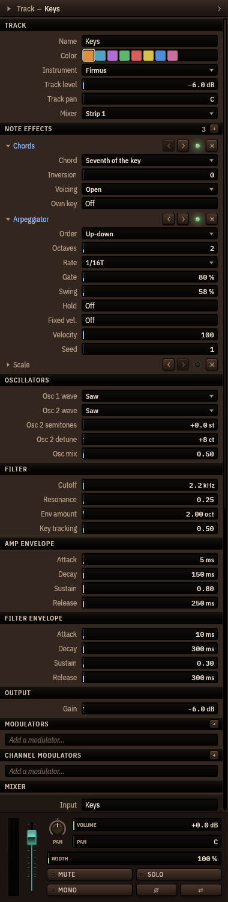
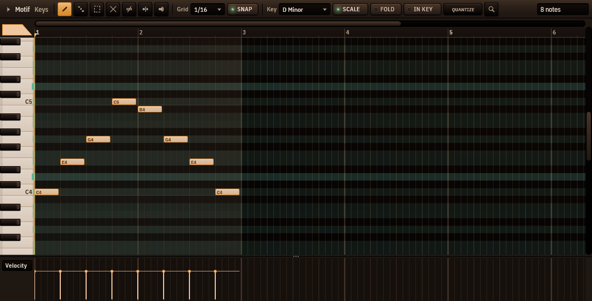
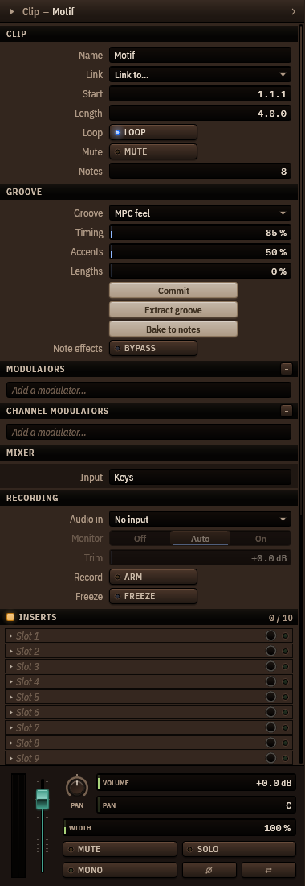

# Cantus — manual de inicio rápido

*Para Cantus 0.1.0-beta.1 y posteriores, en Windows, macOS y Linux · [Read in English](../en/README.md)*

Cantus es una estación de trabajo de audio digital libre y de código abierto: graba,
compón, mezcla y masteriza una canción, de la primera nota al archivo terminado. Este
manual te lleva hasta ahí en una tarde. Todo lo que nombra está en el programa tal como es
hoy; donde la beta aún tiene huecos, el [capítulo 14](#14-problemas-conocidos-y-limitaciones)
lo dice.

**Contenido**

1. [Instalación](#1-instalación)
2. [Primer inicio: configura tu audio](#2-primer-inicio-configura-tu-audio)
3. [El espacio de trabajo](#3-el-espacio-de-trabajo)
4. [Grabar audio y MIDI](#4-grabar-audio-y-midi)
5. [Editar: clips, piano roll, automatización](#5-editar-clips-piano-roll-automatización)
6. [Mezclar: el mezclador, inserciones y envíos](#6-mezclar-el-mezclador-inserciones-y-envíos)
7. [Masterizar: la cadena del máster, Fervor, Latitudo, Culmen](#7-masterizar-la-cadena-del-máster-fervor-latitudo-culmen)
8. [Exportar](#8-exportar)
9. [Sonidos: el explorador y los paquetes de sonidos](#9-sonidos-el-explorador-y-los-paquetes-de-sonidos)
10. [Instrumentos y efectos: el selector de dispositivos](#10-instrumentos-y-efectos-el-selector-de-dispositivos)
11. [Proyectos, autoguardado y ajustes](#11-proyectos-autoguardado-y-ajustes)
12. [Atajos de teclado](#12-atajos-de-teclado)
13. [Privacidad y actualizaciones](#13-privacidad-y-actualizaciones)
14. [Problemas conocidos y limitaciones](#14-problemas-conocidos-y-limitaciones)
15. [Reportar un error](#15-reportar-un-error)

## 1. Instalación

Cantus funciona en Windows, macOS y Linux; cada versión tiene un archivo para cada uno, en
la [página de versiones](https://github.com/luis314159/cantus-daw/releases) y tras el
botón de descarga de [cantusdaw.com](https://cantusdaw.com), que te da el de tu sistema:

- **Windows 11, x64**: `Cantus-<versión>-windows-x64-setup.exe` (o el zip portátil).
- **macOS, Apple silicon o Intel**: `Cantus-<versión>-macos-universal.dmg`.
- **Linux x86-64**, Ubuntu 22.04 o más nuevo (o similar): `Cantus-<versión>-linux-x86_64.AppImage`.

`SHA256SUMS.txt`, a su lado, te deja comprobar una descarga: `Get-FileHash <archivo>` en
Windows, `shasum -a 256 <archivo>` en Mac, `sha256sum <archivo>` en Linux. Unos 200 MB de
disco. Configurar el audio en cada sistema está en el
[capítulo 2](#2-primer-inicio-configura-tu-audio).

### En Windows

Necesitas Windows 11 de 64 bits (Windows 10 sin probar).

1. Descarga `Cantus-0.1.0-beta.1-windows-x64-setup.exe` de la
   [página de versiones](https://github.com/luis314159/cantus-daw/releases).
2. Ejecútalo. Se instala solo para ti, en `%LOCALAPPDATA%\Programs\Cantus`, y no pide
   permisos de administrador. Esta beta aún no está firmada, así que Windows puede mostrar
   *"Windows protegió su PC"*: elige *Más información ▸ Ejecutar de todas formas*.
3. Elige los componentes: el programa (obligatorio), *Abrir los proyectos .cantus con
   Cantus* (activado), un acceso directo en el escritorio (desactivado), los plug-ins CLAP
   y VST3 para otros DAW (activados) y *Controlador FlexASIO (se descarga ahora)*
   (desactivado — márcalo si tu tarjeta de sonido no tiene controlador ASIO propio; ver el
   [capítulo 2](#2-primer-inicio-configura-tu-audio)).
4. La página *Privacidad* dice qué envía Cantus por la red (solo una pregunta diaria por
   versiones nuevas, y las descargas que tú pidas). *Buscar actualizaciones una vez al día
   (recomendado)* viene marcada; desmárcala para apagar la búsqueda (también después, en
   *Ajustes ▸ Actualizaciones*).

**Copia portátil.** Descomprime `Cantus-0.1.0-beta.1-windows-x64-portable.zip` donde
quieras (una memoria USB sirve). Por el archivo `portable.txt` junto a `cantus.exe`, esa
copia guarda sus ajustes en la carpeta `data` de al lado y no escribe nada en tu perfil.

**Desinstalar** desde *Aplicaciones* de Windows. Tus ajustes, presets y autoguardados — y
la caché de muestras (hasta 16 GB, ver el [capítulo 11](#11-proyectos-autoguardado-y-ajustes)) —
solo se borran si marcas esa casilla; tus proyectos nunca se tocan.

### En Mac

1. Descarga `Cantus-<versión>-macos-universal.dmg` — una imagen de disco para Mac con
   Apple silicon e Intel.
2. Ábrela y arrastra **Cantus** a **Aplicaciones**. Expulsa la imagen de disco.
3. Abre Cantus desde *Aplicaciones* (o Launchpad). Una versión notarizada abre sin más;
   una que aún no lo está hace que macOS diga que *no puede verificar al desarrollador*:
   clic derecho en Cantus ▸ *Abrir* ▸ *Abrir* una vez (o *Ajustes del Sistema ▸
   Privacidad y seguridad ▸ Abrir igualmente*), y desde entonces abre normalmente.
4. La primera vez que grabes, macOS pregunta si Cantus puede usar el micrófono: permíteselo
   (después, en *Ajustes del Sistema ▸ Privacidad y seguridad ▸ Micrófono*).

Cantus guarda sus ajustes, presets y autoguardados en
`~/Library/Application Support/Cantus`. **Desinstalar**: mueve Cantus de *Aplicaciones* a
la Papelera; esa carpeta es tuya para borrarla o conservarla.

### En Linux

1. Descarga `Cantus-<versión>-linux-x86_64.AppImage` — un solo archivo que funciona en la
   mayoría de las distribuciones de los últimos años, sin instalar nada ni pedir
   administrador.
2. Hazlo ejecutable y ábrelo: en el gestor de archivos, *Propiedades ▸ Permisos ▸ Permitir
   ejecutar como programa*, o en una terminal
   `chmod +x Cantus-*.AppImage && ./Cantus-*.AppImage`. Guárdalo donde quieras (una carpeta
   como `~/Applications` es buen lugar): Cantus actualiza ese archivo en su sitio.
3. Si no arranca y dice que falta FUSE, instala el `libfuse2` de tu distribución (Ubuntu
   22.04: `sudo apt install libfuse2`; 24.04: `libfuse2t64`).

Cantus guarda sus ajustes en `~/.config/cantus` y sus presets, autoguardados y sonidos en
`~/.local/share/cantus` (o donde digan `$XDG_CONFIG_HOME` y `$XDG_DATA_HOME`).
**Desinstalar**: borra el AppImage. Un Cantus de los paquetes de tu distribución o de
Flatpak lo instalan y actualizan ellos.

## 2. Primer inicio: configura tu audio

La primera vez que Cantus arranca, se abre la ventana **Configura tu audio** sobre la
música.

1. **Elige tu interfaz.** Cada dispositivo de audio tiene una tarjeta: *Interfaz de
   audio*, *Este equipo*, *Audífonos*… Haz clic en la que usas para tocar y escuchar.
   Cantus le elige controlador y búfer: **ASIO** a 128 muestras para una interfaz con
   controlador ASIO propio; si no, **WASAPI** (el audio de Windows) a 256.
2. **Escucha.** Haz clic en *Tono de prueba*: deberías oír un tono suave en las salidas
   1–2.
3. **Toca o habla — el medidor debe moverse.** Rasguea, canta o habla en lo que tengas
   conectado; la entrada que se mueve es la que vas a grabar.
4. **Latencia.** Cantus dice cuánto tarda el sonido de la cuerda a la bocina y si es lo
   bastante justo para tocar a través de él. Para tomas exactas, conecta con un cable la
   salida 1 a la entrada 1 y haz clic en *Medir latencia*; Cantus colocará cada toma a la
   muestra.

Haz clic en **Grabar en …** y Cantus añade una pista de audio en esa entrada, armada y
lista: pulsa `R` para grabar. *Omitir* cierra la ventana; no vuelve a abrirse sola (el
botón *Asistente…* del chip de audio la trae de vuelta).

**En un Mac** el controlador es **Core Audio**, el que usa toda interfaz: no hay ASIO que
instalar. Elige el búfer (128 muestras es un buen comienzo) y la frecuencia en la página
del dispositivo; un *dispositivo agregado* creado en *Configuración de Audio MIDI* (dos
interfaces como una) aparece como cualquier otro. La primera vez que grabas, macOS
pregunta si Cantus puede usar el micrófono: permítelo, o ninguna entrada llega a Cantus
(*Ajustes del Sistema ▸ Privacidad y seguridad ▸ Micrófono*). Los hilos de audio de
Cantus trabajan con los de Core Audio como un solo grupo, así que Apple silicon los corre
en sus núcleos rápidos.

### El chip de audio

El chip de la barra superior (o de su menú ⋯ cuando la ventana es estrecha) muestra el
dispositivo, el controlador, la
frecuencia, el búfer y la latencia — por ejemplo `UMC204HD · ASIO · 48 k · 128 · 6.1 ms`.
Su luz es verde cuando el audio funciona, ámbar tras un corte y roja cuando el dispositivo
se perdió o el controlador se detuvo. **Haz clic en él** para cambiar cualquier cosa; cada
cambio se aplica al instante y se recuerda para esa interfaz:

- **Interfaz**, **Controlador** (WASAPI o ASIO, con la lista *Controlador ASIO*),
  **Dispositivo de entrada**, **Frecuencia**;
- **Búfer · ida y vuelta**: de 64 a 2048 muestras, cada una con su latencia. Más pequeño
  es más justo para tocar; más grande es más seguro para mezclas grandes. Si la barra
  superior cuenta cortes, sube al siguiente tamaño;
- los problemas aparecen arriba con un botón que los arregla (*Reiniciar audio*, *Usar el
  audio de este equipo*, *Usar 48 kHz*…);
- *Tono de prueba*, *Canales y ruteo…* (nombra tus entradas y salidas, elige un par para
  la mezcla de audífonos), *Asistente…* y el engrane con todos los ajustes.

**¿Qué controlador?** Usa el controlador ASIO de tu interfaz si lo tiene (Behringer,
Focusrite, PreSonus, Steinberg, MOTU, RME…). Para el sonido integrado de una laptop, usa
WASAPI, o instala **FlexASIO** para menos latencia. *Obtener ASIO…* en la ventana del chip
abre otra con la página de descarga de FlexASIO, la de ASIO4ALL y las de los fabricantes;
tras instalar un controlador, haz clic en *Volver a buscar*. Cantus nunca instala
controladores por su cuenta.

Al conectar una interfaz, Cantus ofrece cambiar a ella; al desconectarla, ofrece el audio
de tu equipo y vuelve a ella cuando regresa. Si un controlador deja de responder, Cantus
reinicia el audio una vez por sí solo. No se puede cambiar el dispositivo mientras grabas.

## 3. El espacio de trabajo

Cantus abre con una canción — la segunda subida de la demo *Neon Tide*, en bucle — para
que lo primero que oigas sea música. Pulsa `Espacio` para reproducirla.

- **La barra superior** (ver [más abajo](#la-barra-superior)): los menús sobre el nombre
  del proyecto y el panel de ayuda, y luego el transporte, el tempo, el metrónomo, la
  posición, los medidores y más: un grupo por función.
- **El arreglo** (centro): las pistas y sus clips sobre una línea de tiempo.
- **El navegador de clips** (`Alt+F5`, *Ver ▸ Navegador de clips*): todos los clips de la
  canción como mosaicos, junto al arreglo (ver el [capítulo 5](#los-clips-en-el-arreglo)).
- **La zona inferior**: el Mezclador, el Piano roll y el Rack de canales en pestañas.
- **El inspector** (derecha, `I`): todo sobre la pista, el canal o el clip seleccionado.
- **La barra de estado** (abajo): lo que hay bajo el puntero, la latencia de los plug-ins,
  las muestras que se cargan, la octava del teclado y los dispositivos minimizados.

Cada área se muestra u oculta con su tecla de ventana o su tecla de función (`F5` arreglo,
`Alt+F5` navegador de clips, `F6` rack de canales, `F7` piano roll, `F9` mezclador,
`Alt+F8` explorador, `I` inspector). Arrastra los divisores para cambiar tamaños; clic derecho en una pestaña para
que flote en su propia ventana; guarda la forma de la ventana en *Ver ▸ Disposición ▸
Guardar disposición…*. La interfaz se amplía del 75 % al 200 % (`Ctrl++`, `Ctrl+-`,
`Ctrl+0`). Doce temas — Cantus Noche (el predeterminado), Cantus Papel, Luz de día, Hora
azul, alto contraste oscuro y claro y más, cada uno con su vista previa —, los colores, el
logo y el color del icono de la barra de tareas están en *Ver ▸ Apariencia*.

**Escribir un nombre o un valor** funciona igual en todas partes — renombrar una pista, un
clip, un pad o un canal, una búsqueda, un nivel: el campo se abre con su texto
seleccionado, así que lo que escribes lo reemplaza; `Enter` o un clic fuera conserva lo
escrito; `Esc` deja lo que había. Mientras escribes, ningún atajo se dispara. Los nombres
pueden ir en cualquier escritura — japonés, chino, coreano, hindi, tailandés, árabe,
hebreo…: Cantus usa para ellos las fuentes de tu sistema (ver los
[problemas conocidos](#14-problemas-conocidos-y-limitaciones) sobre las escrituras de
derecha a izquierda).

**Canciones de demostración.** *Archivo ▸ Canciones de demostración…* (`Ctrl+Shift+N`)
abre siete canciones hechas solo con los instrumentos y efectos de Cantus: De todo corazón
(pop cinematográfico: el piano de cola modelado Chorda, pedaleado desde su carril de
automatización, todos los efectos de modulación y dinámica de la ronda 28, Tonus afinando
la voz principal, moduladores y automatización, masterizada a −11 LUFS), Neon Tide
(house), Morning Light (balada pop), Sunday Strut (funk y soul), Paper Lanterns (hip-hop
lo-fi), Aurora (cinemática) y Midnight Static (trap). Abre una, escúchala, desármala.

### La paleta de comandos

`Ctrl+Shift+P` (*Vista ▸ Paleta de comandos…*) abre, cerca de lo alto de la ventana, un
campo que encuentra todo lo que Cantus sabe hacer. Escribe unas letras — de cualquier
palabra, en tu idioma o en inglés: `mez` encuentra *Mostrar el mezclador*, `pista nu`
*Pista nueva con…*, `div` *Dividir clip* — y la lista se acorta mientras escribes; las
flechas mueven, `Intro` ejecuta la fila, `Esc` cierra. Contiene:

- cada **acción** con su atajo a la derecha (los mismos que en los menús y las teclas);
- las **áreas** y las **ventanas** (el panel de dispositivos, los atajos, el editor de
  apariencia, la página de inicio…) y cada **página de Ajustes** (*Ajustes: Audio*…);
- cada **efecto** — se inserta en el canal seleccionado (o en el de la pista seleccionada,
  o en el máster) — y cada **instrumento**, en una pista nueva tras la seleccionada; también
  tus **plantillas de pista**;
- los **proyectos recientes** y las **plantillas de proyecto** (ver
  [Plantillas](#plantillas-y-la-página-de-inicio)).

Lo que eliges a menudo y hace poco aparece primero; sin nada escrito, la lista empieza por
lo último que usaste.

### El historial de deshacer

`Alt+H` (*Vista ▸ Mostrar el historial de deshacer*) muestra cada paso del historial del
proyecto, junto al inspector — acóplalo, apílalo o déjalo flotar como cualquier área. Cada
paso se llama por lo que hizo — *Mover 3 notas*, *Insertar Concentus en Lead*, *Renombrar
la pista a Bajo* — bajo una primera fila para el proyecto tal como se abrió. El paso actual
está iluminado; los posteriores, los que *Rehacer* traería, aparecen atenuados; el paso que
guarda tu archivo dice **GUARDADO**, y los pasos desde el último guardado llevan un punto.
**Pulsa cualquier fila para ir allí**: Cantus deshace (o rehace) cada paso intermedio, como
haría `Ctrl+Z` — no se pierde nada, y un clic en una fila posterior vuelve.

### La barra superior

La barra superior es la de FL Studio, en dos filas: un grupo por función y una línea fina
entre las columnas. Los grupos que tienen dos líneas propias —PATRÓN / CANCIÓN, el
metrónomo, el reloj, CPU/RAM y el medidor— ocupan toda la altura; los demás ocupan una
fila y se apilan de dos en dos (el transporte sobre el tempo, la rejilla sobre deshacer,
las ventanas sobre las entradas, el chip de audio sobre las herramientas). A 1920 píxeles y
al 100 % todos los grupos están en la barra, en inglés y en español, con el chip de tu
interfaz: en una barra llena el chip acorta por el medio una línea de dispositivo larga
(apunta a él para leerla entera) y se ensancha cuando hay sitio.

- **Los menús y el panel de ayuda**: *Archivo, Edición, Clip, Ver, Ayuda* sobre el nombre
  del proyecto y la ayuda de lo que hay bajo el puntero. **Haz clic en el nombre** para
  cambiarlo ahí mismo (`Intro` lo guarda, `Esc` lo deja); el título de la ventana lo
  sigue, con `•` mientras haya cambios sin guardar.
- **PATRÓN / CANCIÓN** (`L`): el *modo canción* reproduce el arreglo; el *modo patrón*
  reproduce el clip que editas en el piano roll o en el rack de canales —con lo que el
  rack muestra de las otras pistas en ese tramo— solo y en bucle, y el reloj cuenta desde
  el inicio del patrón; el cursor no sale del patrón (Inicio o un clic fuera de él lo
  llevan a su comienzo). Elegir otro clip de notas cambia lo que suena; seleccionar una
  pista, un clip de audio o nada conserva el patrón. Al salir del modo patrón el cursor
  vuelve a donde estaba la canción. El modo patrón no graba, y no se puede activar en
  mitad de una toma (una toma pertenece a la canción: pasa antes al modo canción); la
  exportación siempre renderiza la canción. Se guarda con el proyecto.
- **Transporte**: ir al inicio, reproducir, detener, grabar y sus opciones ▾, bucle.
- **Tempo**: los BPM (arrastra, usa la rueda, doble clic para 120); **TAP** (`Shift+T`):
  pulsa al menos dos veces —el tempo es la media de tus últimas pulsaciones; tras una
  pausa, vuelve a empezar, y cada tanda es un solo paso de deshacer—; el **compás**: haz
  clic para los tiempos (‹ ›), la figura y los compases habituales.
- **Metrónomo** (`Ctrl+M`): su interruptor, la **claqueta** (no, 1, 2, 4 compases) y el
  **nivel** del clic (arrastra, rueda, doble clic para 0 dB). Su ▾ guarda el **sonido**
  (*Clásico*, *Caja china*, *Pitido*), el **acento** en el primer tiempo de cada compás y
  **cuándo** suena (siempre, al grabar, durante la claqueta). El sonido y el acento se
  guardan con la canción.
- **Posición**: compases.tiempos.ticks y el tiempo, con el compás al lado; al grabar, el
  tiempo de la toma.
- **Rejilla y ajuste**: la rejilla y la luz IMÁN del editor en el que trabajas —el arreglo,
  el piano roll o el rack de canales (siempre sobre su rejilla); con un clip de audio en el
  lugar del piano roll, la rejilla del editor de afinación (a la que *Cuantizar* mueve las
  notas), y con un clip de automatización, la del arreglo, a la que se ajusta el editor de
  automatización—. Los mismos valores que la barra del propio editor.
- **Deshacer** y **rehacer**, y las **teclas de ventana** (explorador, arreglo, rack, piano
  roll, mezclador, inspector).
- **CPU, RAM, voces, cortes**: la carga del audio (su histograma en la información
  emergente), la memoria que usa Cantus, las voces que suenan y los cortes contados (la
  causa del último en la información emergente, y dicha en la barra de estado cuando
  ocurre).
- **Medidor maestro**: *Pico* muestra los picos izquierdo y derecho y retiene el más alto
  de los dos últimos segundos (clic en el número para reiniciarlo); *LUFS* muestra la
  sonoridad del maestro —la momentánea arriba, la de corto plazo debajo, con una marca en
  −14 LUFS (el nivel de los servicios de streaming)— y debajo la de corto plazo, la
  integrada de la pasada (desde Reproducir; se mantiene tras Detener) y el pico real más
  alto desde que pulsaste reproducir (clic en el número para reiniciarlo).
- **Entradas**: el teclado del ordenador (`Ctrl+T`), la luz **MIDI** (se enciende cuando
  llegan notas; el número son las entradas abiertas) y **Armadas** (cuántas pistas
  grabarán; clic para armar la seleccionada).
- **El chip de audio** (ver [el chip de audio](#el-chip-de-audio)) y las **herramientas**:
  el selector de elementos, la página de apariencia y el zoom de la interfaz.

**Con la ventana estrecha** los grupos menos importantes se pliegan —enteros— en el menú
**⋯** del extremo derecho, donde funcionan igual que en la barra, con sus propios menús y
ventanas emergentes; un grupo plegado vuelve en cuanto cabe. Los menús nunca se pliegan:
están sobre el panel de ayuda, en su mismo ancho. Un punto en ⋯ avisa de que hay algo
plegado (rojo si es el chip de audio y el audio necesita atención). **Personalizar la
barra superior…** (en ⋯, en *Ver* o con clic derecho en la barra): marca un grupo para
mostrarlo u ocultarlo, arrástralo por su asa para moverlo, *Restablecer* para volver al
orden por defecto. Tu disposición se recuerda.

## 4. Grabar audio y MIDI

### Una pista de audio

1. Añade una pista de audio: `Ctrl+Shift+A`, o clic derecho en el **+** sobre las
   cabeceras de pista ▸ *Añadir pista de audio*. (El *Grabar en …* del primer inicio te
   crea una.)
2. **Ármala**: haz clic en la luz roja redonda de su cabecera (o `Alt+R`). Mayús+clic arma
   solo esa pista. Una pista armada muestra el medidor de su entrada.
3. **Elige su entrada**: el chip de entrada de la cabecera (*Ent 1*, *Ent 1-2*…; aparece
   cuando la fila de la pista es lo bastante alta), la sección *Grabación* del inspector
   o el menú de la pista.
4. **Escucha**: la tecla del altavoz de la cabecera alterna *No*, *Auto* (oyes la entrada
   mientras la pista está armada — lo predeterminado) y *Sí*. El inspector tiene además
   *Ajuste* (−24 a +24 dB antes de grabar).
5. Pulsa **`R`** (o la tecla de grabar). Graban todas las pistas armadas; pulsa `R` o
   `Espacio` para parar. Toda la pasada es un solo paso de deshacer.

Las tomas se escriben como archivos WAV de 32 bits flotantes: en la carpeta `Audio` del
proyecto una vez guardado; antes, en `%LOCALAPPDATA%\Cantus\recordings\`; al guardar se
mueven al proyecto. Cada toma se adelanta la latencia medida, para que cuadre con lo que
oíste.

### Opciones de grabación

La ▾ junto a la tecla de grabar (o clic derecho sobre ella) abre las **Opciones de
grabación**:

- **Claqueta**: no, 1, 2 o 4 compases antes de la toma (`Alt+C`). La claqueta suena
  aunque el **Metrónomo** (`Ctrl+M`) esté apagado. Suena **antes de grabar** con el
  transporte parado — el chip de la barra superior lo dice con un punto rojo, y su menú bajo *Antes de grabar* —, como en FL
  Studio y Ableton; Play solo arranca de inmediato. Para oírla también al reproducir, marca
  **También al reproducir** en el menú del chip (o en las opciones ▾ del metrónomo):
  apagado por defecto, vale para todos los proyectos.
- **Pinchazo**: graba solo dentro de un tramo. *Desde la selección* toma la selección de
  tiempo; `Alt+P` usa la selección, si no el bucle, si no dos compases desde el cursor. El
  tramo aparece como una llave roja bajo la regla: arrastra sus extremos. Todo lo tocado
  se conserva en el archivo; el pinchazo solo fija la ventana del clip.
- **Tomas en bucle**: con el bucle activado, cada vuelta es una toma.
- **Modo de toma**: *Apilar* (los clips anteriores pasan a carriles de tomas — lo
  predeterminado), *Reemplazar* (corta lo que cubre la toma) o *Sobregrabar* (MIDI: añade
  notas al clip).
- El clic —su nivel, su sonido, su acento y cuándo suena— es del metrónomo, en la
  [barra superior](#la-barra-superior).

### Escuchar con baja latencia

La compensación de retardo mantiene cada pista a tiempo con la más lenta: con un EQ de fase
lineal en alguna parte de la canción, todo —**también la entrada que escuchas**— lo
espera, y quien canta puede oírse 96 ms tarde. La **escucha con baja latencia**
(`Alt+Shift+R`, o su interruptor en las opciones de grabación, en el menú del chip de
audio y en las filas de grabación del inspector) lo cambia mientras está activa:

- Lo que escuchas (la entrada de una pista armada con su **Escucha** en *Auto*, cualquier
  entrada con la Escucha en *Sí*, o una pista de instrumento armada que tocas) llega a tus
  oídos **sin esperar a las otras pistas**: una voz por Tonus se oye 2,7 ms tarde en vez de
  96 ms. La base sigue a tiempo consigo misma.
- Una inserción del camino escuchado con más latencia que el **límite** (3 ms por
  omisión; 5, 10 o 20 ms en las mismas filas) se **salta** — la lista dice cuáles:
  *Escucha sin: Aequalis, Culmen* (y cuántas más, pasadas ocho). Vuelven en cuanto la
  apagas, sin nada de antes.
- El chip de audio muestra el viaje de ida y vuelta de lo que escuchas —el del driver,
  la espera de la entrada (para una entrada de audio: las notas que tocas solo salen) y la
  cadena escuchada— mientras está activa.
- Tu toma queda exactamente donde quedaría con ella apagada: lo que se graba es la entrada
  tal cual, colocada según la latencia que había cuando empezó la toma. Si la latencia del
  acompañamiento cambia durante la toma (cambias el modo, una anticipación automatizada),
  lo que tocas después se coloca según la nueva: cada parte queda donde la tocaste.

Para el menor retardo, escúchate por un canal propio: un bus que mezcla tu voz con otras
pistas grabadas las mantiene a tiempo, y tu voz las espera ahí.

### Tomas y comping

Cada toma se guarda en un **carril de tomas** bajo la pista: ábrelos con el pequeño
desplegable al pie de la celda de color de la pista, `Alt+T` o *Mostrar tomas* del menú de
la pista. **Arrastra sobre una toma** para pasar ese tramo a la pista; haz clic en una toma
para usarla entera. Clic derecho en un carril: *Usar esta toma*, *Borrar tomas sin usar*
(que también quita las grabaciones que ya nada reproduce), *Separar tomas en pistas
nuevas* y *Ocultar tomas*.

**Costuras.** Donde dos tomas se encuentran en la composición, se **funden**: a igual
potencia, 10 ms por defecto, centrado en la costura, y cada toma sigue leyendo su propia
grabación. Cada costura tiene un pequeño rombo al pie de la pista; **arrástralo** (o el
borde de cualquiera de las dos tomas ahí) y los dos lados se mueven juntos. Clic derecho
para su fundido —*Sin fundido*, 5, 10, 20 o 50 ms— o para usarlo en todas las costuras de
la pista. Cada trozo de la composición muestra el número de su toma, y los carriles de
tomas iluminan lo que está en la composición.

**Composiciones alternativas.** La cabecera del primer carril tiene la ficha de la
composición, *Comp. A*. Haz clic para las composiciones: cambia entre ellas (cada una
vuelve exactamente como la dejaste, con sus ediciones de afinación), *Composición nueva*
(una copia de esta, para probar otra idea), *Renombrar*, *Borrar*, **Consolidar** (queda la
composición, se van las tomas) y **Consolidar y fusionar** (la composición renderizada en
una sola grabación junto a las tomas; sus archivos se quedan en el disco). El mismo menú
apaga la **composición rápida** (entonces arrastrar en un carril selecciona tiempo y un
clic selecciona una toma) y enciende o apaga la **composición agrupada**: las pistas cuyos
canales están en un mismo grupo del mezclador —los micrófonos de una batería grabados
juntos— se componen juntas, el mismo tramo de la misma toma en cada una; sus costuras se
mueven juntas, toman los mismos fundidos, y sus composiciones se cambian y se crean
juntas. Cada cambio es un paso de deshacer.

**Qué forma parte de la composición.** Los trozos que hace un arrastre o *Usar esta toma*
son de la composición, y también la toma que suena sobre las demás tras una grabación (la
última pasada de un bucle, o una toma grabada sobre otras; una grabación donde no hay
ninguna toma es un clip sin más, que suena bajo todas las composiciones): cambian con la composición y siguen
siendo suyos al cortarlos, moverlos o deslizarlos. Una copia nunca es de la composición,
la pegues donde la pegues —justo sobre su toma también—: queda en el carril que suena en
todos los cambios, bajo todas las composiciones. Un trozo arrastrado a otra pista sale de
la composición; tras consolidar, los trozos son clips sin más. Los carriles de tomas
iluminan el tramo de cada toma que suena en la composición.

### MIDI

Arma una **pista de instrumento** (una sin entrada de audio) y pulsa `R`: se graban en un
clip las notas de todos los teclados MIDI que Cantus encontró (la luz MIDI de la barra
superior se enciende cuando llegan notas). Sin nada armado, `R` graba en la pista
seleccionada. ¿Sin teclado?
`Ctrl+T` activa el **teclado del ordenador**: `A`–`L` tocan notas, `Z`/`X` cambian de
octava. Mientras está activo, los atajos de letra (incluida la `R`) se apagan — usa
`Espacio` o la tecla de grabar.
La **inflexión de tono**, la **rueda de modulación**, los **pedales**, cualquier otro
controlador (CC 0–119), la **presión de canal** y lo rápido que sueltas cada tecla
(**velocidad de liberación**) también se graban: quedan en los carriles del clip, bajo las
notas del piano roll.

### Controladores MIDI

Cualquier perilla, fader, botón o pad de un controlador MIDI puede mover cualquier cosa
que Cantus pueda ajustar: un parámetro de cualquier dispositivo (de Cantus o de un plug-in
alojado), un fader, un panorama, una anchura, un envío, la cantidad de un modulador, un
silencio, un solo, un armado de grabación, el puenteo o la mezcla de un inserto, el tempo y
el transporte (reproducir, detener, grabar, bucle, el metrónomo, el tempo por pulsación,
los marcadores, PAT / SONG — todo lo que puede hacer una tecla).

**Aprender en dos clics.** Clic derecho en un control ▸ **Aprender controlador MIDI** y
mueve un control de tu equipo: listo. O haz clic en la casilla **MIDI** de la barra
superior (o pulsa `Ctrl+Shift+M`; con clic derecho abre los ajustes MIDI) para el **modo de
aprendizaje**: se marcan todos los controles
que se pueden aprender; haz clic en uno, mueve un control del equipo, haz clic en el
siguiente. Un control asignado lleva un puntito abajo a la derecha; en el modo de
aprendizaje se marca con el color de resalte, y el que espera a tu equipo se enciende. `Esc`
cancela un aprendizaje (también 15 segundos sin mover nada). Sin ninguna entrada MIDI
abierta, un clic en la casilla abre los ajustes MIDI. **Cambiar controlador MIDI** y **Olvidar el controlador MIDI** están
en el mismo menú. Los menús de canal e inserto del mezclador y el de la cabecera de pista
tienen filas *Aprender* para volumen, panorama, anchura, silencio, solo, armado, puenteo y
mezcla, y el de un canal para su interruptor de efectos y su armado de grabación (la
bombilla FX y el punto de grabación del canal se aprenden también en el modo de
aprendizaje); el menú de un envío las tiene para su nivel; las perillas y lámparas del rack de
canales, y los interruptores y opciones de un dispositivo, se aprenden como cualquier
perilla. En el inspector se aprenden también la lámpara (puenteo) y el anillo (mezcla) de
un inserto, el interruptor de los insertos y el LED de armado, y en la ventana de un
dispositivo su lámpara de puenteo. Un control que representa un valor de una opción
aprende ese valor: el LED *Solo* de una banda aprende esa banda (un botón la deja sola y la
suelta), una tecla de la escala de Tonus aprende su clic. Dentro de la ventana propia de un plug-in, mueve allí el parámetro, pulsa
`Alt+Shift+A` (**Vincular el último parámetro movido a un controlador**, como en FL Studio;
también en el menú **Clip** de la barra superior) y mueve el equipo.

Cantus distingue lo que moviste: una perilla normal, un **fader de 14 bits** (llegó también
su controlador fino), un **codificador sin fin** (y cuál de las tres codificaciones usa),
un botón, un pad (en un interruptor conmuta; en una perilla su velocidad fija el valor) o un
cambio de programa (sin la selección de banco que un teclado manda antes). Pulsa un botón y
suéltalo: pulsado y soltado, conmuta; un botón que se queda abajo por sí mismo (solo manda
su valor máximo) pone el destino encendido o apagado según esté. Todo parámetro de dos
estados (el encendido de un dispositivo, una lámpara) es un interruptor: un botón lo fija
al instante, sin toma de control. Los controles NRPN y RPN no se aprenden — Cantus lo
dice y sigue esperando otro control; configura el controlador para que mande CC normales.

**Cómo lee una asignación su control** — en el panel **Controladores** (menú Ver, o
`Ctrl+Shift+K`), una fila por asignación:

- **Modo**: *Absoluto* (donde está el control, está el destino), *Relativo* (un
  codificador: cada paso mueve el destino — en una opción, una opción por paso), *Conmutar* (cada pulsación lo invierte),
  *Momentáneo* (pulsado: activo; suelto: inactivo), *Disparo* (cada pulsación lanza una
  acción).
- **Desde / Hasta**: la parte del recorrido del destino que cubre el control, en las
  unidades del destino (−∞ dB a +6 dB, 200 Hz a 4 kHz, 60 a 180 BPM…), una opción por sus
  nombres (*Limpio* a *Opto*, *Fase lineal* a *Fase mínima*; las opciones de un plug-in con
  sus propias palabras), un interruptor sin nombres *No* y *Sí*; *Hasta* por debajo
  de *Desde* lo invierte. Arrastra una celda, o haz doble clic y escribe — un número o el
  nombre de una opción; clic derecho la restablece.
- **Curva**: una curvatura, para que la primera mitad del giro haga menos (o más); se
  escribe en porcentaje (−100 a 100) y se guarda tal cual.
- **Toma de control**, para un control que no se mueve solo cuando el valor cambia por
  otro lado: *Recoger* (por defecto: nada se mueve hasta que la perilla pasa por el valor —
  sin saltos), *Escalar* (el valor sigue a la perilla y ambos llegan juntos al final),
  *Saltar*. La cabecera fija la toma de control de las asignaciones nuevas; un
  interruptor no tiene.
- **Retorno** (*Enviar*): el valor vuelve al controlador cada vez que cambia — para faders
  motorizados y anillos de LED, y las luces de los botones del transporte y de cada
  interruptor con estado (reproducir, grabar, bucle, metrónomo, pinchazo, cuenta previa…).
  Desactivado por defecto; una acción sin estado (detener, deshacer) no tiene *Enviar*. Lo
  que un controlador o un puerto de bucle devuelve al instante se reconoce como el eco que
  es.

Un punto encendido a la izquierda de una fila indica que acaba de llegar un mensaje.
**Compartido** marca un control con varios destinos (se permite: una perilla puede abrir
dos filtros a la vez). Una fila cuyo destino ya no existe (una pista borrada) se conserva,
marcada **Falta**, y vuelve a funcionar si deshacer recupera el destino. El parámetro de un
plug-in se aprende con ese plug-in: si el instrumento o el inserto se cambia por otro — un
plug-in o uno de los de Cantus —, la fila dice **Otro plug-in**, con los nombres del plug-in
y del parámetro con los que se aprendió y su recorrido en porcentaje, y su perilla queda
libre (aprende el parámetro del nuevo; deshacer el cambio devuelve la vida a la fila
antigua). Un inserto cambiado por uno de los de Cantus conserva su puenteo y su mezcla, y
un parámetro que el efecto nuevo también tenga. **Sin cargar** indica que el plug-in está
en el proyecto pero no funciona aquí (o se detuvo); **Congelado**, que el sonido del
destino está congelado: un movimiento se rechaza y se dice, y la perilla no llega a ningún
otro instrumento; **No conectado**, que la entrada MIDI de la asignación no está abierta;
**Sin entrada**, que el armado de grabación de un canal no tiene ninguna pista con entrada
que armar.

**Dos mapas.** Las asignaciones de *Este proyecto* se guardan con el proyecto, y cada
cambio es un paso de deshacer. **En todas partes** — tus asignaciones globales, guardadas
junto a tus atajos de teclado — reúne lo que significa lo mismo en cualquier canción: el
transporte, el tempo, el máster, **la pista seleccionada** y **el canal seleccionado**
(volumen, panorama, silencio, solo, armado — los del máster cuando está seleccionado) y las ocho primeras perillas del **dispositivo
enfocado** (la ventana de dispositivo en la que hiciste clic por última vez). Aprender una
tecla de transporte o el máster la lleva allí; **Añadir asignación** en el panel los ofrece
todos, y la acción de cada atajo de teclado por su grupo (armar la pista seleccionada,
pinchar, deshacer, guardar, las vistas…). Cuando un control está en los dos, gana la asignación del proyecto. Si el archivo global no
se puede leer entero, se guarda una copia a su lado (el estado dice su nombre) y no se
pierde nada; si ni siquiera se puede copiar, nunca se escribe encima, y cada cambio en las
asignaciones globales avisa de que no se guardará.

**Mientras tocas y grabas.** Una perilla asignada ya no llega al instrumento (no mueve
además su filtro) y un pad asignado no toca ninguna nota. Un movimiento hecho con el ratón
o con un controlador es un paso de deshacer por gesto. Con un parámetro bajo un clip de
automatización, el clip lo toca — hasta que una pasada de grabación lo mueve: desde ese
momento el parámetro sigue tu mano (el clip queda aparte el resto de la pasada), y la
pasada escribe lo que hiciste como un clip de automatización, cada movimiento en el momento
en que llegó su mensaje, dentro de la pasada (la cuenta previa y lo que pase del final del
pinchazo no se escriben, y pasado el final del pinchazo el parámetro vuelve a seguir su
clip; Opciones de grabación ▸ *Grabar automatización*). Mientras se graba audio, una
perilla asignada al tempo no hace nada (el estado dice por qué): cambia el tempo antes o
después de la toma.

La presión de canal y la presión de tecla llegan ahora al instrumento (de Cantus y
alojados), y un cambio de programa llega a un instrumento alojado.

## 5. Editar: clips, piano roll, automatización

### Gestos rápidos

Como en FL Studio, el arreglo abre las cosas sin buscar en los menús:

- **Doble clic en la cabecera de una pista** (en cualquier sitio menos su nombre): se abre su
  **instrumento** — la ventana del instrumento (Unda, Pulsus II…) o la ventana propia de un
  plug-in CLAP/VST3. Firmus y las pistas de audio, que no tienen ventana, muestran el
  inspector.
- **Clic en el nombre de una pista** — sobre las letras mismas (el puntero se vuelve un
  cursor de texto) — para **renombrarla** allí mismo: el nombre queda seleccionado, escribe
  el nuevo, `Enter` lo guarda (un paso de deshacer), `Esc` devuelve el anterior. Un clic en
  otro lugar de la cabecera solo selecciona la pista, y escribir con una pista seleccionada
  nunca la renombra. (Los canales del mezclador y los pads del rack se renombran con doble
  clic.)
- **Doble clic en un clip**: se abre el **piano roll** en él, con el clip entero a la vista.
  Un patrón de pasos que el rack muestra sin perder nada — cada nota un golpe corto en un
  paso, un tono por canal (una batería puede usar todos sus pads; una melodía en un
  sintetizador se abre en el piano roll, como en FL) — se abre en el **rack de canales**,
  en la rejilla del propio patrón y desplazado hasta su pista. Un clip de automatización se
  abre en su editor grande; un clip de audio se abre en el **editor de afinación** (su
  ganancia, fundidos y archivo siguen en el inspector).
- **Abrir editor** — en el inspector, los menús del mezclador o el marco de un instrumento —
  trae una ventana ya abierta de la bandeja (o de la barra de tareas, si es de un
  instrumento o un efecto plug-in) y la pone delante; mientras la ventana de un plug-in está
  abierta, su botón dice *Mostrar*. `F8` y el botón de canal del rack hacen lo mismo cuando
  la ventana está minimizada, detrás de otra pestaña o bajo otra ventana, y solo la cierran
  cuando ya está delante. (Cantus no puede traer delante un plug-in que abre su propia
  ventana flotante: su botón dice *Cerrar*.)

### Los clips en el arreglo

- **Crear**: doble clic en un lugar vacío de una pista (un clip de 4 compases), o graba.
- **Seleccionar**: clic; `Ctrl+clic` añade; arrastra sobre el vacío para un recuadro;
  `Esc` limpia.
- **Mover**: arrastra (también a otra pista). `Alt+arrastrar` copia; `Ctrl` al arrastrar
  ignora la rejilla. `Izquierda`/`Derecha` desplazan según la rejilla, con `Shift` un
  compás.
- **Recortar**: arrastra el borde de un clip — su contenido se queda donde está.
  **Desplazar el contenido**: `Shift+arrastrar` lo mueve dentro del clip.
- **Cortar** en el cursor: `Ctrl+E`. **Unir**: `Ctrl+J`. **Duplicar**: `Ctrl+D` (púlsalo
  de nuevo para seguir en fila). **Silenciar**: `0`. **Renombrar**: `F2`. **Color**:
  `Ctrl+Shift+C`.
- **Selección de tiempo**: arrastra en el carril inferior de la regla; la franja de arriba
  es el bucle. `Shift+L` pone el bucle en la selección, `Z` la amplía.
- **Los clips de audio** tienen tiradores de fundido de entrada, de salida y de ganancia
  (doble clic en uno lo restablece; clic derecho en un fundido para su curva) y un menú con
  *Normalizar*, *Invertir*, *Restablecer ganancia* y *Quitar fundidos*.
- **Fundidos cruzados**: arrastra un clip de audio para que empiece sobre otro y el
  solapamiento **se funde** solo, en el mismo paso de deshacer — el clip anterior se
  desvanece mientras el siguiente entra, dibujados como dos curvas sobre el solapamiento.
  Su cuadrito arriba del solapamiento: **arrástralo de lado** para alargar o acortar el
  fundido (los bordes de los dos clips se mueven en torno a su centro, hasta donde llega su
  audio); **doble clic** abre el editor del fundido (su curva dibujada, *Sin fundido ·
  Potencia constante · Lineal · Curva en S*, *Duración* en ms); **clic derecho** da las
  mismas opciones. *Potencia constante* (la predeterminada) mantiene el nivel entre dos
  grabaciones distintas; *Lineal* y *Curva en S* van mejor con dos tomas de lo mismo. Un
  solapamiento *sin fundido* suena con los dos clips sumados (bordes punteados). Apaga los
  fundidos automáticos (o elige su curva) en *Ajustes ▸ Edición* o en el menú del clic
  derecho de la línea de tiempo (*Fundidos cruzados automáticos*); *Fundir el solapamiento*
  del menú del clip funde (o deja de fundir) a mano los solapamientos de la selección. Un
  clip que queda entero dentro de otro se superpone, no se funde; dos clips que solo se
  tocan quedan unidos a tope.
- **Envolventes de ganancia de clip**: clic derecho en un lugar vacío del arreglo ▸
  *Mostrar envolventes de ganancia* (o desde el menú del clip). Cada clip de audio muestra
  una línea de ganancia — +12 dB arriba, 0 dB a un cuarto de la altura, −∞ abajo — y su
  forma de onda la sigue. En un clip seleccionado o bajo el puntero, **pulsa sobre la
  línea** para añadir un punto y arrastrarlo (Shift: fino); **doble clic** en un punto lo
  borra; arrastra el circulito a mitad de un tramo para **curvarlo** (doble clic lo
  endereza); clic derecho en un punto o en la línea para la forma del tramo (las seis del
  editor de automatización), *Borrar punto* o *Restablecer envolvente de ganancia*. La línea
  es del audio: desplaza el contenido y se mueve con él, recorta y queda oculta (no
  perdida), corta y las dos mitades la conservan, une y se juntan las líneas de las piezas,
  invierte y suena reflejada con el audio. Actúa sobre la ganancia y los fundidos del clip.
  Los clips MIDI no tienen línea de ganancia: su nivel es la velocidad de sus notas.
- **Importar audio**: arrastra archivos WAV, AIFF, FLAC u Ogg al arreglo (caen donde
  sueltas), o *Archivo ▸ Importar audio…*. Un archivo MIDI añade sus pistas.
- **Copias enlazadas**: pegar, `Ctrl+D` o `Alt+arrastrar` crean *el mismo clip* otra vez —
  editas uno y todas las copias lo siguen (las notas, o la ganancia, los fundidos y la
  inversión de un clip de audio). Lo muestran una marca de enlace y la cuenta ×N. *Hacer
  único* (`Alt+U`) saca la selección de su grupo; *Seleccionar enlazados* (`Shift+Alt+L`);
  *Enlazar la selección a este clip* (`Alt+L`); *Enlazar a…* (`Alt+N`) elige, por nombre o
  por pista, el grupo enlazado o el clip propio en que se convierte. En el inspector, la
  fila *Enlace* de un clip enlazado dice cuántas copias tiene y ofrece *Enlazar a…*;
  renombrarlo en la fila *Nombre* renombra todas las copias. Clic derecho en un lugar vacío
  del arreglo ▸ *Las copias quedan enlazadas* para hacer copias independientes.
- **El navegador de clips** (`Alt+F5`, o *Ver ▸ Navegador de clips*) muestra una vez cada
  grupo enlazado y cada clip propio, como mosaicos del color del clip con una miniatura de
  lo que contiene; escribe para filtrar por nombre o pista. **Arrastra un mosaico** al
  arreglo para colocar ahí una copia enlazada. **Haz clic en un mosaico** para elegirlo para
  la **herramienta de pintar**: con el arreglo enfocado, `B` (o `2`) la saca — un clic
  coloca una copia enlazada, arrastrar pinta copias seguidas a lo largo de la pista,
  arrastrar con el botón derecho (o `Alt`+arrastrar) borra solo las copias de ese clip;
  cada trazo es un paso de deshacer; `Esc` la desactiva. Doble clic en un mosaico
  selecciona todas sus copias.

La **rejilla** (barra del arreglo) empieza en un compás; elige valores más finos para el
detalle. Desplázate con la rueda, `Shift+rueda` en el tiempo, `Ctrl+rueda` para el zoom.

### La pista de tempo y los marcadores

Una canción puede cambiar de tempo y de compás a lo largo de ella y llevar marcadores con
nombre (ronda 29).

- **La pista de tempo** es una franja bajo la regla (*Ver ▸ Pista de tempo*, o el menú de
  la regla): cada punto es un tempo, que se mantiene plano hasta el siguiente o hace una
  **rampa** recta hasta él. Doble clic en la franja para añadir un punto (en la rejilla, al
  tempo donde hiciste clic); arrastra un punto para moverlo (`Mayús` para pasos finos de
  tempo, `Ctrl` fuera de la rejilla); `Alt+clic` activa o quita la rampa de un punto;
  doble clic en un punto para escribir su tempo; clic derecho para *Rampa hasta el punto
  siguiente*, *Quitar el punto* y *Quitar la pista de tempo*. La cabecera junto a la franja
  muestra el tempo en el cursor de reproducción.
- **El tempo de la barra superior** muestra el tempo en el cursor (dentro de una rampa, su
  valor ahí). Arrastrarlo y la rueda (un paso, un BPM) mueven en esa cantidad el punto bajo
  el que está el cursor — dentro de una rampa, su inicio; un doble clic (120) o **TAP** lo
  fijan — el tempo de la canción cuando no hay pista de tempo.
- **Los cambios de compás** son fichas en la regla antes del número del compás ("7/8").
  Clic derecho en la franja de marcadores o en la regla ▸ *Añadir un cambio de compás aquí*
  (en el compás 1 abre el compás propio de la canción); clic en una ficha para editar su
  compás, arrástrala por las líneas de compás entre sus vecinas, clic derecho para quitarla. Los compases que siguen a un cambio conservan su
  número; las notas nunca se mueven. El compás de la barra superior edita el que rige en el
  cursor.
- **Los marcadores** aparecen en una franja bajo la del bucle. `Alt+M` añade uno en el
  cursor (o doble clic en la franja, o clic derecho en la regla ▸ *Añadir un marcador
  aquí*); clic en un marcador para llevar el cursor ahí; **doble clic** para renombrarlo;
  arrástralo por la rejilla; los marcadores de un mismo tick quedan uno junto a otro; clic
  derecho para *Cambiar el nombre…*, *Color…*, *Bucle hasta el marcador siguiente*, *Seleccionar hasta el marcador
  siguiente*, *Exportar hasta el marcador siguiente…* y *Quitar el marcador*. `Alt+,` y `Alt+.` van al
  marcador anterior y al siguiente; `Alt+Mayús+O` hace un bucle entre los marcadores que
  rodean el cursor. El menú de la franja lista todos los marcadores bajo *Ir a*.
- **Exportar entre marcadores**: *Archivo ▸ Exportar audio…* ▸ *Qué* ▸ *Marcadores*, y
  elige los dos marcadores por su nombre (dos en lugares distintos: si no, el diálogo lo
  dice, y nunca exporta la canción entera en su lugar).
- Todo sigue al tempo: las notas, los clips de audio, la automatización, los moduladores,
  los efectos sincronizados, el metrónomo (acentúa el primer tiempo de cada compás; un
  compás de 7/8 se cuenta en corcheas) y los plug-ins de otros. Un clip de audio sin warp
  suena a su velocidad natural a partir del punto de su archivo que cae en su inicio:
  divídelo, recórtalo o haz comping donde sea y cada trozo sigue sonando donde estaba;
  mueve o copia clips a otro lugar y cada uno cae en su propio compás con la misma parte
  de su archivo (los trozos de una misma toma movidos juntos siguen tocándose). Un cambio
  de tempo nunca cambia lo que suena donde entra una toma, y los trozos de una toma se
  mueven juntos, así que una división nunca salta; un cambio *dentro* de una toma deja
  que el resto siga a su propia velocidad — aplícale warp para que siga los compases. Un
  clip invertido conserva el punto de su archivo que suena en su final. Mientras se graba
  audio el tempo no cambia — tampoco al deshacer o rehacer un cambio de tempo; grabar
  notas lo deja libre.
- **Los archivos MIDI** llevan todo el mapa de tempo al exportar (una rampa como un cambio
  de tempo cada semicorchea — una muy larga, de más de 1 024 tiempos, en menos pasos y más
  largos, cada uno con el tempo medio de su tramo — y todos los marcadores, también los
  del final) y al importar —
  con *Poner el proyecto a … BPM en …* se conservan los cambios de tempo, de compás y los
  marcadores del archivo: al inicio de la canción pasan a ser los suyos; soltados en un
  compás posterior empiezan ahí (en la línea de compás más cercana), y la canción conserva
  su tempo y su compás antes. Los
  archivos **DAWproject** llevan la pista de tempo, los cambios de compás y los marcadores
  en ambos sentidos. Los puntos de tempo, cambios de compás o marcadores de un archivo
  situados más allá del millón de tiempos se omiten, y la importación lo dice.

### El piano roll

Selecciona un clip MIDI y muestra el piano roll (`F7`, o su pestaña bajo el arreglo):
edita las notas de ese clip.

| Herramienta | Tecla | Qué hace |
|---|---|---|
| Dibujar | `P` o `1` | Clic añade una nota, arrastrar mueve, arrastrar el borde derecho cambia la duración, clic derecho borra |
| Pintar | `B` o `2` | Arrastra sobre la rejilla para pintar notas |
| Seleccionar | `E` o `3` | Arrastra para seleccionar; arrastra notas para moverlas |
| Borrar | `D` o `4` | Clic o arrastre sobre notas para borrarlas |
| Silenciar | `T` o `5` | Clic en una nota para silenciarla (se queda, sin sonar) |
| Cortar | `C` o `6` | Arrastra una línea para dividir notas |
| Escuchar | `Y` o `7` | Clic en notas o filas para oírlas |

`Arriba`/`Abajo` transportan la selección (`Shift`: una octava), `Izquierda`/`Derecha` la
desplazan, `Q` cuantiza, `Ctrl+C`/`Ctrl+V` copian y pegan. Las velocidades son tallos en
el carril bajo la rejilla: arrástralos, o `Alt+rueda` sobre una nota. Una batería muestra
una fila con nombre por pad.

**Carriles bajo las notas.** Bajo la rejilla, cada clip muestra su carril de velocidad y los
carriles que tiene. El **+** de la celda del carril de velocidad añade uno: **Velocidad de
liberación** (lo rápido que se suelta cada nota — arrastra sus tallos; un aro en el suelo es
una nota sin ella), **Inflexión de tono**, **Presión de canal**, los controladores con nombre
(rueda de modulación, soplo, expresión, sustain, …) u **Otro controlador ▸** para cualquier
número del 0 al 119. En un carril:

| En un carril | Qué hace |
|---|---|
| Lápiz, línea, curva (las teclas de su celda) | Dibuja a mano alzada; arrastra una línea recta; arrastra una curva (`Alt` la dobla al otro lado). La línea y la curva se ajustan a la rejilla |
| Arrastrar un punto | Lo mueve (con los puntos seleccionados con él); `Ctrl` lo deja en su tiempo |
| `Mayús` + arrastrar | Selecciona los puntos del rectángulo; `Supr` los borra |
| Clic derecho en un punto | Lo borra |
| **×** en su celda | Quita el carril (Deshacer lo devuelve) |

El carril de inflexión muestra en sus bordes el rango del instrumento. Un carril es del clip:
se mueve, se divide, se repite, se copia y se enlaza con él; la inflexión, la presión y los
pedales vuelven a reposo donde termina el clip. Con **Los carriles siguen a las notas**
(activado, en el menú **+**), mover, copiar y pegar notas se lleva los controladores que hay
bajo ellas. Las filas comparten el espacio bajo el divisor; cuando no caben, la rueda sobre
sus celdas las desplaza. Los archivos MIDI traen sus inflexiones, presión y controladores a
estos carriles y los vuelven a sacar al exportar, con la velocidad de liberación de cada
nota.

El **rack de canales** (`F6`) muestra cada pista como una fila de pasos sobre los compases
del clip seleccionado: clic enciende un paso, clic derecho lo apaga, arrastrar pinta. Un
paso es una nota normal.

### El editor de afinación

Doble clic en un clip de audio — o su menú ▸ *Editar afinación*, o *Editar afinación* en el
inspector — y su toma se abre en el lugar del piano roll, a la manera de Melodyne: cada
**nota** es una mancha en la fila de la nota que suena, tan gruesa como fuerte es la voz,
con la **curva de afinación** atravesándola (lo que se cantó, tenue, bajo lo que sonará).
Las sibilantes y las respiraciones se marcan abajo. La toma se analiza junto a la ventana
la primera vez (un segundo o así por minuto de audio; una toma grabada se analiza en
cuanto llega) y el resultado se guarda en la caché de Cantus, así que la próxima vez se
abre al instante. El archivo nunca cambia: el clip suena con un render de tus ediciones,
hecho junto a la ventana, y mientras un render está en camino se oye la toma tal como fue
(nunca silencio). La exportación espera a todos los renders.

- **Herramienta Editar**: haz clic en una nota para seleccionarla (`Mayús` añade; arrastra
  en el fondo para varias). Arrástrala **arriba o abajo** para mover su afinación — a las
  notas de la tonalidad (*Ajuste: Escala*), a semitonos o a cualquier punto (*Libre*;
  mantén `Alt` para cents). Arrástrala **a los lados** para moverla en el tiempo, o
  arrastra uno de sus **extremos** para estirarla: solo ceden los huecos a su lado, sus
  vecinas quedan exactamente como se cantaron. **Doble clic** en una nota lleva su centro a
  su nota (otra vez para soltarlo). `Arriba`/`Abajo` mueven la selección un paso (`Mayús`:
  una octava, `Alt`: 10 cents), `Ctrl+A` selecciona todas, `Ctrl+J` une, `Q` cuantiza,
  `Esc` deselecciona.
- **Herramienta Dividir**: haz clic dentro de una nota para cortarla en dos; **Unir** junta
  vecinas.
- **La nota** (el panel de abajo): lo que la selección *suena* y lo que se *cantó*, y su
  **centro** (cuánto se lleva su centro a su nota, conservando su deriva y su vibrato
  naturales), **deriva** (el vaivén lento: 100 % como se cantó, 0 % plano), **vibrato**
  (0–200 %), **formante** (el color de la voz, arriba o abajo, sin mover la afinación) y
  **ganancia**.
- **Las macros** actúan sobre la selección, o sobre todas las notas si no hay ninguna
  seleccionada: **Corregir afinación** según una cantidad (cada nota esa proporción hacia su
  nota — una nota fuera de la tonalidad, hacia su nota más cercana; al 0 % no se mueve),
  **Corregir deriva** según una cantidad, y **Cuantizar** el inicio de cada nota a lo que
  diga *Cuantizar a* en la barra: una rejilla, o **las notas de otra pista** (cada nota a la
  más cercana, a una corchea como mucho).
- **Tonalidad**: hallada a partir de las notas; cámbiala en la barra (las escalas de
  Tonus). **Original** compara con la toma tal como se cantó (A/B) — el inspector tiene el
  mismo interruptor. **Restablecer** deshace todas las ediciones de la selección. **▶**
  reproduce desde la primera nota seleccionada. Cada edición es un paso de deshacer.
- **MIDI**: arrástralo a una pista de instrumento del arreglo y la melodía cae allí, en el
  lugar de la voz; haz clic para una pista nueva. **Doblar**: una segunda voz una tercera o
  una quinta por encima en la tonalidad, de la misma toma, en su propia pista. MIDI y
  Doblar están también en el menú del clic derecho del clip de audio.
- Cuando el editor es estrecho, lo que no cabe en la barra está en su menú **…**, y el
  panel bajo las notas se desplaza a los lados.

**El carril de afinación**: clic derecho en la cabecera de una pista de audio ▸ **Carril de
afinación** muestra sus notas en un carril bajo ella, en el arreglo — arrastra una arriba o
abajo para moverla, doble clic para llevarla a su nota — para arreglos pequeños sin abrir
el editor.

Los formantes se conservan al mover una nota (medido: dentro de 3 dB a ±3 semitonos).
Trabaja sobre una voz o una línea de instrumento a la vez; los acordes no se separan en
notas.

### Warp y estiramiento del audio

El **warp** hace que un clip de audio suene al tiempo del proyecto: más rápido o más lento
de lo que se grabó, sin cambiar su tono, y siguiendo cada cambio de la pista de tempo. El
archivo nunca cambia: el clip reproduce un render hecho junto a la ventana.

- **Los loops se ajustan solos.** Importa un loop (desde *Archivo ▸ Importar audio…*,
  soltándolo desde Windows o desde el explorador) y Cantus encuentra su tempo, sus pulsos
  y su primer tiempo fuerte; un archivo de un número entero de compases (o uno cuyo WAV
  lleva su tempo) se ajusta al momento al tempo del proyecto, en el mismo paso de
  deshacer que la importación (un solo paso para todos los archivos que sueltes). Los
  archivos más largos, cada toma que grabas y cada toma recuperada tras un cierre
  inesperado suenan a su velocidad natural hasta que los ajustes: una grabación suena tal
  como se tocó.
- **Ajusta tú un clip**: clic derecho ▸ *Warp* ▸ **Seguir el tempo del proyecto** (o
  *Seguir* en el inspector o en el editor) — nada se mueve hasta que muevas un marcador,
  ni bajo una rampa de tempo —, **Detectar el tempo** (marcadores en cada compás
  encontrado) o **Ajustar desde aquí** (su tempo contado desde el pulso donde hiciste clic
  derecho; en el inspector, desde el cursor de reproducción). Quitar *Seguir* devuelve el
  clip a su velocidad natural y guarda sus marcadores para cuando lo vuelvas a poner;
  quitarlo, restablecer el warp o volver a ajustarlo nunca mueve lo que el clip suena al
  empezar (ni en sus copias enlazadas). Una copia enlazada bajo otro tempo que el de sus
  copias se vuelve única la primera vez que la ajustas, para que sigan sonando igual.
  *Usar su tempo en el proyecto* va al revés: el tempo del clip (el que encontró el
  análisis, mientras no sigue el tempo) pasa a ser el tempo donde empieza.
- Los **marcadores de warp** fijan un instante del audio a un pulso. Cualquier clip de
  audio bajo el puntero o seleccionado muestra sus **transitorios** (los golpes que
  contiene) como marcas en una banda en su parte superior; un clip que sigue el tempo
  muestra además sus marcadores como banderas doradas — también los de sus dos extremos —
  y su banda acepta clics. **Doble clic en la banda**
  añade un marcador (sobre un transitorio, cae sobre él); arrastrar en la banda añade uno y
  lo mueve a la vez. **Arrastra un marcador** para llevar ese instante del audio a otro
  pulso — se ajusta a la rejilla (mantén `Ctrl` para moverlo libre) y el audio entre sus
  vecinos se estira para encajar. Mantén **`Alt`** al arrastrar para deslizar en cambio el
  audio *bajo* el marcador. Doble clic en un marcador, o clic derecho ▸ *Quitar marcador de
  warp*, o un clic en él y `Supr`, para quitarlo. En un clip que no sigue el tempo la
  banda no responde: arrastrar cerca de su borde superior mueve el clip, como en
  cualquier otro punto de él.
- **Estira un clip entero**: mantén `Alt` y arrastra su **borde derecho** (`Mayús` sigue
  desplazando el contenido). Una copia enlazada se estira sola (sale de su grupo).
- **La pestaña Warp del editor del clip**: doble clic en el clip (o *Editar el warp*) — el
  editor tiene dos pestañas, **Afinación** y **Warp**, y se abre en la última que usaste.
  La pestaña Warp muestra el clip en grande sobre una regla de compases, con los mismos
  gestos en cualquier clip de audio, y una barra con el modo, su propia **rejilla** (de
  1/4 a 1/32, o libre), la transposición, *Formantes*, *Seguir*, el tempo del clip (**½**,
  **×2** cuando se contó a la mitad o al doble), *Detectar el tempo*, *Cuantizar…* y
  *Restablecer warp* — lo que no hace nada en el modo del clip aparece atenuado; en una
  ventana estrecha la barra ocupa una segunda fila. `Ctrl` y la rueda (o pellizcar)
  acercan el clip alrededor del puntero, la rueda (o la barra de abajo) lo desplaza, y `Q`
  abre *Cuantizar audio*.
- **Modos** (la sección *Warp* del inspector, o la barra) — elegir uno no ajusta el clip:
  - **Complejo** — cualquier cosa: mezclas completas, pads, acordes. Mantiene los ataques
    nítidos, las voces de un acorde estables y la imagen estéreo en su sitio.
  - **Ritmo** — baterías y loops percusivos: cada golpe suena exactamente como se grabó,
    solo desplazado; **Final de cortes** elige qué llena el hueco tras un golpe cuando se
    ralentiza (*Fundir*, *Bucle*, *Espejo*: de ida y vuelta).
  - **Melódico** — una voz o una línea de instrumento: el más limpio para un solo, con el
    color de la voz conservado al transponer.
  - **Varispeed** — como un tocadiscos: la velocidad y el tono cambian juntos (sin
    artefactos de procesado; *Transponer* queda desactivado).
- **Transponer** desplaza el clip en semitonos y cents sin cambiar su tiempo (un clip que
  no sigue el tempo conserva su velocidad natural); **Formantes ▸ Conservar** mantiene el
  color de una voz al transponerla (sin efecto "ardilla"). El nivel queda como estaba.
- **Detectado** y **Certeza** en el inspector: el tempo y los compases que encontró el
  análisis, y lo seguro que está. Sobre un marcador, el panel de ayuda da la velocidad a
  la que suena el audio tras él, frente al tempo vigente allí.
- **Cuantizar audio…** (el menú del clip o el inspector, sobre cada clip de audio
  seleccionado junto al que elegiste): acerca los transitorios a una rejilla con una
  *Intensidad*, solo los más fuertes si lo eliges (*Transitorios desde*) — un paso de
  deshacer para todos los clips; solo se mueven los golpes que se oyen (el periodo propio
  de un loop; los de un clip invertido, en las líneas donde suenan), el resto conserva su
  velocidad.
- **Renderizar el audio ajustado** escribe la ventana del clip tal como suena ahora en un
  archivo nuevo junto al audio del proyecto, y el clip pasa a reproducir ese archivo, sin
  warp (un paso de deshacer). **Restablecer warp** devuelve el clip a su velocidad
  natural.

Mientras llega un render (una fracción de segundo para un loop, unos segundos para un
archivo largo) oyes una vista previa rápida con el tiempo y el tono correctos — un clip
transpuesto por primera vez suena entretanto con su propio audio; uno cuyos marcadores
mueven su audio espera un momento a su vista previa, nunca suena en el compás que no es —
y el paso de una a otra se funde una vez. La exportación, los stems, la congelación, pasar a
audio en su lugar y la conversión de un modulador en automatización esperan al render
completo; si alguna vez tarda demasiado, la línea de estado lo dice al terminar. Los clips
ajustados viajan en los archivos DAWproject con sus marcadores y su modo (un archivo que
escribió Cantus vuelve con su warp tal como estaba); un clip a su velocidad natural viaja
como un archivo colocado en segundos, así conserva su velocidad en cualquier aplicación.
Abrir o soltar un `.dawproject` lo lee en segundo plano (su audio copiado al disco sobre
la marcha, un archivo referido a su lado encontrado allí); se abre cuando nada se graba
ni se arrastra, y nunca sobre otro proyecto abierto entretanto.

### Automatización

Clic derecho en cualquier perilla, fader o control de un efecto ▸ **Crear clip de
automatización**, o mueve un control y pulsa **`Alt+A`** (automatiza lo último que
tocaste). El clip cubre la selección de tiempo (si no, el bucle; si no, cuatro compases)
en un carril bajo su pista. En el carril: arrastra los puntos, arrastra el anillo entre
dos puntos para curvar, clic en la línea añade un punto, doble clic en un punto lo borra,
clic derecho para su forma (curva simple o doble, mantener, escalera, pulso, onda). Doble
clic en el clip abre el editor grande, con herramienta de dibujo y articuladores
(invertir, suavizar, azar, escala, LFO). Un control automatizado muestra un punto.

**Los plug-ins alojados** se automatizan como los de Cantus: clic derecho en un parámetro
del editor genérico de un plug-in (o en la lista *Parámetros* de un instrumento alojado, en
el inspector), o muévelo en la ventana del propio plug-in y pulsa `Alt+A`. Sus cambios le
llegan al plug-in en su muestra exacta dentro del bloque de audio.

**Grabar automatización.** Mientras grabas, cada control que muevas —en Cantus o en la
ventana de un plug-in— se escribe en un clip de automatización sobre el tramo en que lo
moviste (un paso de deshacer al terminar la pasada). Se apaga en las opciones de grabación
(*Automatización*).
(Es el modo **Retener** de abajo, para cada pista en Leer.)

**Escribir automatización mientras suena la canción: Leer, Escribir, Tocar, Retener.** Cada
pista tiene un modo de automatización — la insignia a la derecha de su cabecera (L, E, T, R;
haz clic en ella, o `Alt+Mayús+W` para la pista seleccionada), la fila *Automatización* del
inspector; el del máster está en su menú del
mezclador. El **armado de automatización** de la barra superior (la tecla de la envolvente,
tras el bucle) los hace escribir; su ▾ cambia todas las pistas a la vez y el **Regreso de
Tocar**.

| Modo | Mientras suena la canción, armado |
|---|---|
| **Leer** (L) | Reproduce la automatización. Mover un control no escribe nada |
| **Escribir** (E) | Sobrescribe todo lo que la pista automatiza, de reproducir a parar, cada parámetro donde estaba hasta que lo muevas. Tras la pasada, la pista pasa a Tocar |
| **Tocar** (T) | Escribe mientras sostienes un control; al soltarlo vuelve suavemente a la curva que había (en el tiempo de regreso, 250 ms por defecto) |
| **Retener** (R) | Escribe desde que tocas el control hasta que paras, manteniendo el último valor |

Lo que escribes se convierte en clips de automatización corrientes, justo sobre el tramo
escrito; el control vuelve a donde estaba antes del primer clip, y la pasada entera — con
los movimientos de tu mano — es **un solo paso de deshacer**. Sirve para cada control
automatizable: faders, panoramas, envíos, parámetros de efectos e instrumentos, los de los
plug-ins movidos en sus propias ventanas, profundidades de moduladores y los controladores
asignados a cualquiera de ellos. En un bucle, cada pasada escribe sobre la anterior donde la
toca; con el pinchazo activado, solo se escribe su rango.

### Moduladores

Un **modulador** mueve parámetros por ti: un **LFO** (cinco formas, sincronizado con la
canción o libre en Hz, reiniciado por las notas si quieres), una **envolvente** (ataque,
caída, sostén, liberación; la abren las notas de la pista o un nivel de audio), un
**seguidor** (el nivel de cualquier canal: hunde un pad bajo el bombo), **pasos** (hasta
32, sincronizados, con deslizamiento) y una fuente **aleatoria** (sostenida o suave,
repetible desde su semilla). Cada modulador mueve **cuantos parámetros quieras**, cada uno
con su profundidad, positiva o negativa; un parámetro puede recibir varios, que se suman
sobre su automatización.

- **Dónde viven**: la sección *Moduladores* del inspector para la pista seleccionada, su
  canal o el máster (el **+** de la banda). Cada modulador muestra su movimiento en un
  dibujo, sus ajustes, su cantidad y una fila por parámetro que mueve: arrastra la
  profundidad, *conviértela* en automatización o desconéctala.
- **Conectar**: clic derecho en cualquier perilla, fader o parámetro de un plug-in ▸
  **Modular…** y elige un modulador o crea uno nuevo ya conectado; o **arrastra el asa de
  un modulador** (el agarre a la izquierda de su título) sobre cualquier perilla; o pulsa su
  tecla de **asignar** y arrastra cualquier perilla: el arrastre fija ahí la profundidad de
  ese modulador.
- **La profundidad en la perilla**: mantén `Alt` y arrastra una perilla modulada para
  cambiar la profundidad de su modulación (solo el arrastre: un doble clic sigue
  restableciendo el valor). Las perillas moduladas llevan anillos de color
  (la profundidad, en el color del modulador), un punto que se mueve donde está ahora el
  parámetro y una marca violeta.
- **En todas partes**: cada perilla de los instrumentos y efectos de Cantus, los faders,
  panoramas y anchuras del mezclador (también los del máster), el **nivel de cada envío**
  (su perilla y su fila en la mesa, el nivel de su cable, las filas de envíos y de entradas
  del inspector; el menú de un envío tiene *Automatizar* y *Modular…* para él), la tira fija
  del inspector y los parámetros de un plug-in alojado aceptan un modulador del mismo modo.
  También la **cantidad** de un modulador: deja que una fuente aleatoria mueva cuánto se
  mueve un LFO (un nivel de anidamiento). La afinación de Chorda (A4, estiramiento,
  rigidez) se fija; no se automatiza ni se modula.
- **Convertir en automatización**: la tecla de convertir de una ruta (o *Modular… ▸
  Convertir en automatización*) hace del efecto de ese modulador un clip de automatización
  sobre la selección de tiempo (si no, el bucle; si no, la canción) y quita la ruta, en un
  paso de deshacer.

Los moduladores sincronizados siguen la posición de la canción: tocar desde el compás 5
suena como suena ahí la canción entera; los libres empiezan con la reproducción. Las
exportaciones suenan exactamente como la reproducción.

### Efectos de nota: arpegiador, acordes, escala

Una pista puede cambiar las notas que recibe **antes de que su instrumento las toque**: un
**arpegiador**, **acordes** y una **escala**, en cadena, en el orden que elijas (el *Arp* y
el *Chord* del canal en FL, los efectos MIDI de Ableton). Actúan igual sobre las notas de
los clips y sobre lo que tocas en vivo, con la canción en marcha y con ella parada.

- **Añadir uno**: selecciona la pista; en la sección *Efectos de nota* del inspector pulsa
  el **+** de la banda (o la fila vacía) y elige *Arpegiador*, *Acordes* o *Escala*. Una
  pista admite hasta ocho. La fila del título de cada uno tiene **antes** / **después** (su
  lugar en la cadena), su luz de **encendido** y **quitar**; pulsa su nombre para plegarlo.
- **Arpegiador**: *Orden* (arriba, abajo, arriba-abajo, abajo-arriba, como se tocó, acorde,
  aleatorio), *Octavas* (1–4), *Paso* (de 1/1 a 1/64, con puntillo `.` y tresillo `T`,
  sincronizado con el tempo), *Duración* (cuánto suena cada nota, 5–200 % de un paso),
  *Swing* (al estilo MPC, 50–75 %), *Mantener* (las notas siguen sonando al soltar las teclas,
  hasta que tocas un acorde nuevo), *Vel. fija* con su *Velocidad* (o la de cada nota) y
  *Semilla* (de dónde saca *Aleatorio*: el mismo patrón cada vez). El primer paso suena donde
  empieza el acorde; un acorde en la rejilla se arpegia en la rejilla.
- **Acordes**: *Acorde* (maj, m, dim, aug, sus2, sus4, 7, maj7, m7, m(maj7), m7b5, dim7, 6, m6,
  add9, m(add9), 9, maj9, m9, 5, 5+8, 8va — o *Tríada de la tonalidad* y *Séptima de la
  tonalidad*, el acorde propio de cada grado: I, ii, iii… en una tonalidad mayor),
  *Inversión* (0–3) y *Disposición* (cerrada, abierta — la segunda voz una octava arriba — o
  amplia — abierta, con la tónica una octava abajo).
- **Escala**: las notas *Fuera* de la tonalidad van a su nota más cercana (*A la más
  cercana*; en empate, hacia abajo) o no suenan (*Descartar*).
- **Qué tonalidad**: los acordes de la tonalidad y la escala leen la **tonalidad de la
  canción** (abajo), salvo que enciendas su *Tonalidad propia* y elijas su *Tónica* y su
  *Escala*.
- **Todo parámetro se automatiza y se modula**: clic derecho en su fila ▸ *Crear clip de
  automatización* o *Modular…*, o suelta sobre él el asa de un modulador, como en cualquier
  perilla.
- **Quién los oye**: la reproducción, la exportación, las pistas separadas, congelar y
  convertir en audio tocan las notas que hace la cadena, muestra a muestra igual. Una
  inserción que escucha las notas de la pista (el disparo MIDI de Porta) también las oye; un
  modulador que abren o reinician las notas de la pista (una envolvente, un LFO que se
  reinicia) sigue las notas tal como están escritas, antes de la cadena: se abre una vez por
  acorde, no en cada paso del arpegio. Al grabar se guarda lo que tocaste (las teclas), no el
  arpegio.
- **Convertir en notas**: en el inspector de un clip MIDI, *Convertir en notas* sustituye el
  clip por otro con las notas que la cadena toca a partir de él (con su groove) — un solo
  paso de deshacer. El clip nuevo suena **sin pasar por los efectos de nota** (su luz
  *Efectos de nota ▸ Saltar* está encendida), para que no actúen dos veces; apágala para
  volver a pasar un clip por ellos.

### La tonalidad de la canción y la escala del piano roll

Elige la **tonalidad** de la canción en la barra del piano roll: pulsa *Tono* y elige una
tónica y una escala (mayor, menor, menor armónica y melódica, los modos, las pentatónicas,
blues, tonos enteros, las disminuidas, frigia dominante, húngara menor, japonesa,
cromática) — o *Sin tonalidad*. Se guarda con la canción.

- **Escala**: se resaltan las filas de la tonalidad — las de fuera, un tono más oscuras; las
  de la tónica, teñidas — y el teclado marca las notas de la tonalidad (la tónica, más ancha).
- **Plegar**: el piano roll muestra solo las filas de la tonalidad (y cualquier fila donde
  haya una nota del clip, para que nada se esconda). Mover una nota una fila la mueve una
  nota de la tonalidad.
- **Ajuste**: dibujar, pintar, arrastrar y transportar (`Arriba`/`Abajo`) mantienen las notas
  en la tonalidad: una nota dibujada cae en la nota más cercana de la tonalidad, una
  arrastrada en la siguiente en el sentido del movimiento, `Arriba`/`Abajo` mueven un grado
  de la tonalidad (`Mayús`: una octava).

### Grooves

Un **groove** da a un clip una sensación — notas tarde o adelantadas, acentuadas, más
largas o más cortas — sin tocar sus notas. En el inspector de un clip MIDI, *Groove* abre la
lista: los swings incluidos (**corcheas** y **semicorcheas**, al estilo MPC, 50–75 %) y los
grooves del propio proyecto.

- **Cantidades**: *Tiempo* (0–150 %: pasado el 100 % exagera), *Acentos* (cuánto de las
  velocidades del groove) y *Duraciones*. Las notas se quedan como las escribiste; la
  reproducción, la exportación y todo lo demás las oyen con el groove.
- **Aplicar** escribe el groove en las notas y lo quita del clip (un solo paso de deshacer).
- **Extraer groove** lleva la sensación de un clip a los grooves del proyecto — un compás,
  en rejilla de semicorcheas: lo tarde, el acento y la duración medios de cada paso. En un
  **clip de audio** lee los transitorios del clip (los que encuentra *Warp*). El groove nuevo
  aparece entonces en la lista de todos los clips.
- **Patrones**: la barra del rack de canales tiene un campo *Groove*: lo que elijas va a
  todos los clips del patrón actual a la vez.
- Los **clips enlazados** comparten su groove, como comparten sus notas.

Al **exportar un archivo MIDI** se pregunta qué notas escribir: **Como suenan** (con el
groove de cada clip y los efectos de nota de cada pista escritos nota a nota: el archivo
toca lo que se oye) o **Como están escritas** (las notas de los clips, sin groove ni
efectos de nota).

## 6. Mezclar: el mezclador, inserciones y envíos

Cada pista alimenta un **canal** del mezclador (`F9`); los canales van al **máster**, a la
izquierda, o a otro canal (un bus). Un canal tiene su medidor, silencio y solo, paneo,
fader, fase e intercambio, anchura, EQ de tres bandas, sus inserciones y sus envíos. Clic
selecciona, `Ctrl+clic` añade, `Shift+clic` toma un tramo; mover un fader de una selección
mueve todos. Con el foco en el mezclador, `M` silencia, `S` pone solo,
`Alt+Izquierda`/`Alt+Derecha` mueven el canal. `Ctrl+rueda` cambia el ancho de los canales;
en *Extra grande* cada canal muestra un resumen de su cadena en una línea (un clic abre el
inspector).

- **Inserciones** (hasta diez por canal): clic en una ranura vacía para elegir un efecto
  en el selector, o clic derecho para la lista rápida. En una ranura ocupada, clic en la
  luz la puentea y en el nombre abre su ventana; clic derecho para cambiarla, moverla o
  quitarla. En el inspector, cada inserción tiene un anillo de **Mezcla** (seco/procesado).
- **Envíos**: selecciona un canal y mira la fila *Envíos* de los demás — haz clic en el ▲
  del canal al que quieres enviar (un retorno de reverb, un compresor en paralelo); una
  perilla fija entonces el nivel del envío. Cada envío toma la señal **después del fader
  (POST, por defecto) o antes (PRE)** — clic en su chip PRE/POST; un envío PRE sigue sonando
  al bajar el fader.
- **Cables**: cada canal tiene un puerto. Arrastra desde él a otro canal, o haz clic en él y
  luego en el destino (`Esc` cancela): sin tecla es un envío a 0 dB, con `Ctrl` la única
  salida del canal, con `Alt` una llave de sidechain. Los cables del canal seleccionado (o
  todos, o ninguno — el interruptor sobre la mesa, con un filtro de tipos) se dibujan en
  una banda bajo la mesa; clic en un cable lo selecciona, arrastrar su extremo lo mueve,
  `Supr` lo quita. Un camino doble se permite y se marca. Cada cambio es un paso de deshacer.
- **Ruteo**: clic derecho en un canal ▸ *Enrutado* ▸ *Salida* o *Enviar a*, `Shift+F10`
  para el menú de ruta del canal seleccionado, o selecciona varios canales y *Crear
  submezcla con los seleccionados*. En el menú de ruta de un cable o un envío, *Nivel ▸
  Escribir un nivel…* toma un nivel en dB (de −∞ a 0; `Enter` o un clic fuera lo aplica,
  en un paso de deshacer; `Esc` cancela). **La matriz de ruteo** (`Alt+F9`) muestra cada origen
  frente a cada destino: clic en una celda para enrutar, arrastrar para el nivel (`Shift`
  para afinar), `Ctrl+arrastrar` copia hacia abajo en una columna. Los canales y grupos se
  mueven arrastrando o con `Alt+Izquierda`/`Alt+Derecha`; una cabecera de pista soltada
  sobre un canal suena por él.
- **Las ventanas de los dispositivos** tienen *Cambiar*, minimizar (a la bandeja de la
  barra de estado), maximizar y cerrar. `F8` abre el instrumento de la pista seleccionada
  (o lo trae delante, o lo cierra si ya está delante),
  `Esc` cierra el último dispositivo que usaste y `F12` cierra todos los flotantes.

**El solo** sigue el ruteo: un canal en solo se oye con lo que lo alimenta y aquello a lo
que alimenta.

### Congelar y pasar a audio en su lugar

**Congelar** convierte una pista pesada en una grabación de sí misma, para que su
instrumento y sus efectos dejen de usar el procesador — y la devuelve, exacta, al
descongelarla.

- **Congelar una pista**: clic derecho en su cabecera ▸ *Congelar pista*, `Alt+Shift+F`,
  o la fila *Congelar* del inspector. Una pista con canal propio se congela con su canal:
  su instrumento, sus clips y las inserciones y el EQ del canal. Una pista que comparte su
  canal congela su propio instrumento y sus clips. **Congela un canal** (un bus, un
  retorno) desde el menú del canal: se congela con todo lo que recoge.
- Primero se hace el render (una tarjeta en la esquina dice cuánto falta, con
  **Detener**); la canción sigue sonando y nada cambia hasta que termina. Entonces la pista
  queda congelada en un solo paso de deshacer: un **copo de nieve** en su cabecera y en su
  canal, sus clips escarchados.
- Una pista o un canal congelado se sigue **mezclando**: su fader, su paneo, su anchura,
  su silencio, su solo y el nivel de sus envíos —y su automatización— siguen en vivo, y
  también el silencio y el solo de la cabecera de una pista congelada con su canal propio
    (su nivel y su balance están dentro del render: mézclala con el fader del canal). Salvo
  que un modulador dentro de lo que congela lo siga (o siga al bus al que suena): entonces
  su mezcla es parte de su sonido y también queda fija —la tarjeta lo dice—. Lo que
  cambiaría su sonido (sus notas, su instrumento, sus inserciones, el tempo, mover un canal
  entre los que recoge) se rechaza, y la tarjeta dice cómo devolverlo: **Descongelar** (las
  mismas entradas de menú, la misma tecla). Una perilla girada en la ventana propia de un
  plug-in congelado vuelve a donde estaba, con la misma tarjeta, y también un preset o una
  muestra cargados desde su propio navegador. Descongelado, vuelve a sonar en vivo,
  idéntico.
- Lo que también suena en otra parte sigue sonando: congelar un bus no calla un canal que
  hace de clave de su compresor y suena al máster, ni congelar un retorno el canal que le
  envía. El solo sigue siendo una ayuda para escuchar —se congela como si nada estuviera en
  solo—; con algo en solo **dentro** de lo que congelas, quítale antes el solo. Un solo que
  calla una parte de aquello con lo que suena un canal congelado (una de las pistas o de
  los canales que se oyen por él) hace sonar ese canal en vivo mientras dura; un solo que
    lo calla entero —un solo en otra parte— solo lo silencia, sin despertar sus plug-ins.
  Guardar un proyecto mueve una toma congelada a su carpeta *Audio* y la deja congelada.
- Sus plug-ins se descargan mientras está congelado y vuelven con sus ajustes. Congelar
  necesita los plug-ins de lo que se congela (uno en bypass no hace falta): si uno no está
  cargado, se nombra y no se congela nada. Lo mismo con un archivo que suena y aún no está
  (un paquete de sonidos descargándose, un disco desconectado; una toma en un carril de
  comp de abajo, o un clip en silencio, no cuenta): se nombra, y una pista congelada espera
    a sus archivos antes de rehacer su render. Una pista cuyos plug-ins cambian su latencia
  durante la canción (una anticipación o un sobremuestreo automatizados) no se puede
  congelar ni pasar a audio en su lugar: la línea de estado lo dice.
- Los renders se guardan en la carpeta propia del proyecto dentro de una carpeta *Freeze*
  junto a él (*Freeze/Canción* para *Canción.cantus*; en la caché de Cantus si el proyecto
  aún no se ha guardado), con el nombre de lo que contienen: volver a congelar lo que no
  cambió es instantáneo, y un proyecto abierto sin ellos (en otra computadora, a otra
  frecuencia de muestreo) suena en vivo mientras se rehacen en segundo plano. *Guardar
  como* se los lleva —copiados en segundo plano; al cerrar Cantus mientras copia, la ventana sigue abierta con una tarjeta hasta que
  termine (*Cerrar ya* no espera; lo que no se copió se encuentra donde estaba la próxima
  vez)—. Un
  proyecto renombrado o copiado junto al original encuentra sus renders en la carpeta del
  original, y al guardarlo los trae a la suya. Al guardar se quitan de la carpeta del
  proyecto los renders que ningún deshacer puede traer de vuelta; los de otros proyectos
  junto a él nunca se tocan.
- Con el bucle activo, una pista congelada toca su grabación de corrido: en el salto al
  inicio del bucle oyes lo que llevaba a ese compás, no la cola de una reverberación del
  final del bucle (como en otros DAW; descongélala para oír el salto exacto).

**Pasar a audio en su lugar** hace un render a un clip de audio, en una **pista nueva
justo debajo de la original**, en el mismo lugar:

- *Pasar a audio en su lugar* (menú de la pista, `Alt+Shift+B`): esta pista por las
  inserciones de su canal; la pista nueva tiene un canal propio con el fader, el paneo, la
  anchura y los envíos del anterior.
- *Pasar a audio (solo la fuente)*: el instrumento y los clips antes del nivel de la
  pista; la pista nueva suena por el mismo canal, por las mismas inserciones.
- *Pasar los clips a audio en su lugar* (el menú del clip): solo los clips elegidos (en
  varias pistas, uno por pista); con una selección de tiempo —elegida después de los clips,
  o sin clips elegidos— las teclas pasan a audio lo que suena dentro de ella, con sus bordes
  llevados hasta las notas que la cruzan. Con la cabecera de una pista elegida al final,
  las teclas pasan a audio la pista entera; con un canal elegido en el mezclador, el canal
  entero; el máster nunca se congela ni se pasa a audio. No se pueden pasar clips ni un
  tramo de tiempo mientras algo oye las notas de la pista (pasa la pista entera), y las
    ventanas de un comp unidas por un fundido cruzado se pasan juntas o no se pasan. Las
  entradas del menú del clip actúan sobre clips, nunca sobre un canal o el máster elegidos
  antes: el clip sobre el que hiciste clic derecho, con los clips elegidos con él.
- *Pasar el canal a audio en su lugar* (el menú del canal): todo lo que el canal recoge; lo
  que tenía su clave en él, o lo seguía, sigue al canal nuevo. Quita antes el solo de lo
  que esté en solo dentro de él.
- La original queda **en silencio** —o se quita, si marcas *Quitar el original al pasar a
  audio* en el menú de la pista (Cantus recuerda tu elección; una pista cuyas notas algo
  sigue oyendo queda en silencio en su lugar, y el resultado lo dice). Su automatización
  de nivel, de fader y de envíos va con el audio, y también su solo. Por un plug-in con
  latencia, el audio del clip nuevo queda en la cuadrícula y la pista nueva conserva el
    retardo (la fila *Retardo* del inspector; la tecla a su derecha lo quita), así que esa
  automatización y lo que tenga su clave en ella siguen a tiempo, y el clip suena a tiempo
  dondequiera que lo muevas, lo copies o lo exportes. La cola (la de una reverberación) se
  conserva hasta que se apaga. Un solo paso de deshacer. Si editas lo que se pasa a audio mientras
  se hace el render, se vuelve a pasar desde tu edición (una edición en otra parte no lo
  reinicia); **Detener** mientras se escribe su archivo no deja nada. Una pista que
  escucha una entrada en vivo —o una que hace de clave o le manda notas— no se pasa a audio
  (apaga antes su escucha).

## 7. Masterizar: la cadena del máster, Fervor, Latitudo, Culmen

El **máster** tiene su propia cadena de hasta diez inserciones, aplicada a toda la mezcla
antes del fader del máster. Haz clic en la cabecera del máster para ver su cadena en el
inspector (*La mezcla completa* → las inserciones → *Salida de audio*), o clic derecho en
su nombre ▸ *Efectos* ▸ *+ Añadir efecto*.

Las demos masterizan en este orden, y es un buen comienzo:

1. **Aequalis** (EQ): un pasa-altos bajo el sub, un poco de aire.
2. **Multiplex** o **Comprimo**: un pegamento suave.
3. **Latitudo** (estéreo): el preset *Máster: graves más firmes* o *Máster: agudos más
   anchos, graves en mono* deja los graves en mono y los agudos anchos. Vigila su medidor
   de correlación: debe quedar por encima de cero.
4. **Culmen** (maximizador): elige un **objetivo** — *Streaming −14* (−14 LUFS, −1 dBTP),
   *Apple −16*, *CD −9*, *Club −7*, *Emisión −23* — reproduce la parte más fuerte de la
   canción y haz clic en **Aprender empuje**: Culmen escucha, ajusta el empuje, vuelve a
   escuchar y se detiene en el objetivo, en un solo paso de deshacer. La tarjeta
   *Sonoridad* muestra la sonoridad momentánea, de corto plazo e integrada y el pico real;
   el veredicto dice *En el objetivo* o cuántos LU sobran o faltan. Culmen trabaja en tres
   bandas más la banda completa, hacia un muro de pico real en el techo; su *Carácter*
   (Limpio, Pegada, Fuerte, Bus, Seguro) y sus diez presets cubren casi cualquier máster.

**Fervor** (saturación) añade color: *Cinta*, *Válvula*, *Overdrive*, *Fuzz*, *Recorte*,
*Pliegue* o una *Curva* dibujada, con sobremuestreo, tono, mezcla e *Igualar nivel*, para
que lo más fuerte nunca te engañe. En el máster, los presets *Recorte de máster* y
*Válvula en el medio* son los suaves.

## 8. Exportar

*Archivo ▸ Exportar audio…* (`Ctrl+Shift+E` con las teclas por defecto) abre la ventana de
exportación: los presets a la izquierda, las opciones a la derecha y una línea que dice
exactamente qué se va a escribir.

- **Presets**: *Streaming* (MP3 320 kbps, 44.1 kHz, −14 LUFS, −1 dBTP), *CD* (WAV 16 bits,
  44.1 kHz, dither con modelado), *Stems para masterizar* (cada canal, WAV 24 bits a la
  frecuencia de la sesión, sin normalizar) y *Podcast* (MP3 mono 128 kbps, −16 LUFS,
  −1 dBTP). Si cambias cualquier opción se ilumina la tarjeta *Personalizado*.
- **Qué**: la canción (del inicio al final del último clip, más la cola que elijas), la
  selección de tiempo, o **stems** — un archivo por canal del mezclador (después de su
  fader) o por pista (antes de su canal), todos desde el primer tiempo de la canción con la
  compensación de latencia incluida, y opcionalmente *a través de la cadena del máster*.
- **Formatos**: **WAV** de 16, 24 bits o 32 bits flotantes; **FLAC** de 16 o 24 bits; **MP3**
  CBR de 128 a 320 kbps o VBR V0/V2/V4/V6 (LAME), sin huecos; **Ogg Vorbis** calidad 3–10.
  Frecuencia: la de la sesión o 44.1, 48, 88.2, 96, 192 kHz (MP3 usa 44.1 o 48). Mono o
  estéreo.
- **Dither** (apagado, TPDF, con modelado) al escribir 16 o 24 bits.
- **Loudness**: apagado, o un objetivo (−9, −11, −14, −16, −19, −23 LUFS) con un techo de
  pico real (−0.1, −0.3, −1, −2 dBTP); el limitador de Culmen sostiene el techo cuando la
  ganancia lo necesita. Los stems nunca se normalizan.
- **Etiquetas**: título, artista, álbum, año, comentario y el crédito de codificador
  *Cantus*.

La exportación corre en segundo plano con una barra de progreso; *Detener* no deja archivos
a medias. Se recuerdan tus últimas opciones.

- **MIDI**: *Archivo ▸ Exportar MIDI…* — la canción entera, la pista seleccionada o el clip
  seleccionado, como archivo de tipo 1 con el tempo, el compás y los nombres de pista.
- **DAWproject**: *Archivo ▸ Exportar DAWproject…* para llevar un proyecto a Bitwig, Studio
  One y otros DAW que lo leen (un informe dice lo que no pudo viajar).

## 9. Sonidos: el explorador y los paquetes de sonidos

El **explorador** (`Alt+F8`, la primera tecla de ventana) se acopla a la izquierda. Lista
los paquetes de sonidos que instalaste y *Mis carpetas* (haz clic en **+** para añadir
cualquier carpeta de muestras).

- **Clic** en un sonido para oírlo; otro clic lo detiene. Escribe en el campo de búsqueda
  para encontrar sonidos en todos los paquetes y carpetas.
- **Arrastra** un sonido a un **pad de Pulsus** (el pad lo toca), al mapa de teclas de
  **Exemplar** (una zona en esa tecla), al **rack de canales** (un canal de muestra nuevo
  con su propio canal del mezclador) o al **arreglo** (un clip de audio donde lo sueltas).
  Cada arrastre es un solo paso de deshacer.
- Sin nada instalado, el explorador ofrece **Empieza con una batería**: *Descargar* trae la
  *Batería inicial de Cantus* (81 golpes, 33 MB). *Paquetes de sonidos…* (o *Más
  paquetes…*) lista los demás — las baterías de Karoryfer, la percusión de VCSL y VSCO 2,
  un TX81Z para Exemplar, el **piano de cola Salamander** (un Yamaha C5, 16 capas de
  velocidad) y **DRSKit**, una batería acústica grabada por el equipo de DrumGizmo — con
  su tamaño, licencia y créditos; *Instalar*, *Actualizar*, *Quitar*,
  mostrar la carpeta e *Instalar desde un archivo…* para equipos sin internet.

Todos los paquetes son gratuitos. Casi todos son **CC0** (sin tener que citar); el piano
Salamander es **CC BY 3.0** y DRSKit **CC BY 4.0**: su crédito aparece en su página de
*Paquetes de sonidos…* y en *Ayuda ▸ Créditos*, y se guarda en la carpeta del paquete
(DrumGizmo pide además, con sus propias palabras citadas en la página del paquete, que se le
cite allí donde se den los demás créditos de una canción). En los dos casos, la música que
haces con ellos es tuya. Se guardan en `%LOCALAPPDATA%\Cantus\Content\`; cada archivo se
verifica con su SHA-256.

**Instrumentos de un paquete.** Un paquete instalado que trae instrumentos (el Salamander:
con 8 capas de velocidad, unos 120 MB de memoria, o con las 16, unos 185 MB) los muestra en
el estante *Teclados* del selector de dispositivos y en su página de *Paquetes de sonidos…*
(*Pista nueva con …*); cada uno suena en Exemplar. Las muestras largas se **leen del
disco**: en memoria queda solo su comienzo. La primera vez, Cantus descodifica las muestras
una sola vez en su **caché de muestras** (1 GB para las 8 capas del Salamander, 2 GB para
16), junto a la ventana, con *Cargando muestras… n de m* en la barra de estado; las cargas
siguientes tardan una fracción de segundo. Si el disco no llega a tiempo, la barra de estado
cuenta *Disco lento: n*.

**La batería acústica.** *DRSKit* (el equipo de DrumGizmo y Jes Eiler, de DRSDrums) se
grabó con 13 micrófonos; al instalarla (una descarga de 2,8 GB), Cantus los mezcla en una
batería estéreo —cada tambor en su lugar del campo estéreo, el micrófono inferior de la
caja en fase, los micrófonos cercanos de los toms y los platillos atenuados en los demás
tambores, como harían las puertas de un ingeniero de mezcla—, de modo que cada golpe suena
como una sola muestra estéreo. Tarda unos dos minutos tras la descarga y ocupa unos
470 MB; **mientras se instala necesita unos 7,6 GB libres** (la descarga, la batería
desempaquetada y la mezcla a la vez — la página del paquete lo dice, y una instalación sin
ese espacio se rechaza antes de descargar nada). Si la mezcla se cancela o falla, la
descarga se conserva: el siguiente intento parte de ella. *Batería acústica DRSKit*
aparece entonces en el estante *Baterías* del selector de dispositivos y suena en Exemplar
en las teclas de batería de General MIDI solo con sus propios tambores: bombo 36 (35, un
bombo más abierto), golpe de aro 37, caja 38 (40, una caja apagada), toms 41 · 43–45 ·
47–50, charles cerrado 42, de pedal 44 y abierto 46, crash 49 y 57, ride 51 y 59, campana
53. Las teclas de General MIDI para las que la batería no tiene sonido (pandereta,
cencerro, la percusión latina) quedan en silencio, así que una parte de General MIDI nunca
toca un platillo en su lugar; las otras articulaciones de DrumGizmo están por encima de la
percusión de General MIDI 2 y fuera de las teclas extra de los kits XG y GS por debajo de
ella (13–26): el ride con cadena en 88–90, las escobillas en 91–100, y el charles medio
abierto y las puntas en 101–106. Cada tambor tiene sus intensidades como capas de velocidad hasta 24 dB
por debajo de la más fuerte, y los golpes de una capa se turnan **en orden** — contados
por tambor y por capa, así que un redoble, un fill de toms entre las teclas del tambor o un
acento cada cuatro golpes de charles nunca repite la misma muestra dos veces seguidas; un
charles cerrado o de pedal apaga uno abierto. En el piano roll y en el rack de canales la
batería muestra **una fila por tambor**, con su nombre en el idioma de la interfaz (el
interruptor *Filas de batería* de Exemplar, en su vista *Editar*). El equilibrio de los micrófonos lo fija la mezcla: un fader por micrófono
necesita un instrumento con varias salidas, un paso posterior.

**Round robin en orden.** La vista *Editar* de Exemplar tiene el orden del round robin: *En
orden* (cada nota toma el siguiente turno de las muestras que alcanza — las teclas o
velocidades que alcanzan las mismas comparten los turnos — según su lugar en la canción,
así que reproducir desde cualquier punto elige lo mismo que la canción entera) o *Por
nota* (derivado de cada nota: como siguen sonando los Exemplar de proyectos y presets de
usuario guardados antes de esta versión). Un instrumento importado toca su round robin en
orden.

**Un paquete que falta.** Un proyecto que toca un paquete que este equipo no tiene abre una
tarjeta con el paquete y sus pistas en silencio: *Instalar en Paquetes de sonidos…*, *Usar
el paquete instalado* (cuando el proyecto apunta a otra copia, por ejemplo de otro equipo)
o *Buscar la carpeta…* (cuando se movieron archivos de un paquete instalado). El resto del
proyecto suena con normalidad.

## 10. Instrumentos y efectos: el selector de dispositivos

El **selector de dispositivos** muestra todos los instrumentos y efectos — los de Cantus y
los plug-ins CLAP y VST3 instalados en tu equipo — como mosaicos.

Ábrelo con el **+** sobre las cabeceras de pista (una pista de instrumento nueva), con un
clic en el chip de instrumento de una pista (cambiar el instrumento), con *Cambiar* en
cualquier ventana de dispositivo, con una ranura de inserción vacía o con *Ver ▸ Selector
de dispositivos…*. Busca por nombre, fabricante o tipo; filtra por estante (*Favoritos*,
*Recientes*, una categoría, o *Cantus / CLAP / VST3*); las flechas se mueven, `Enter`
elige, `Ctrl+D` marca un favorito, `Esc` cierra. Los instrumentos de los paquetes
instalados están en su estante: el piano Salamander en *Teclados*, DRSKit en *Baterías*. Cambiar un instrumento conserva sus
notas, clips, canal del mezclador y efectos; cambiar un efecto conserva su ranura, su
mezcla y su puenteo.

| Instrumento | Qué es |
|---|---|
| Firmus | El sintetizador sencillo con el que empieza cada pista nueva |
| Pulsus II | Caja de ritmos: tambores sintetizados y pads de muestras, grupos de corte |
| Unda | Sintetizador wavetable: tres osciladores, unísono, dos filtros, LFO dibujados |
| Calor | Polisintetizador analógico |
| Modulus | Sintetizador FM de ocho operadores; lee bancos DX7 |
| Exemplar | Sampler: SFZ, Decent Sampler y SoundFont |
| Gravis | Bajo: 808, sintetizado y eléctrico modelado |
| Lamina | Piano eléctrico |
| Organum | Órgano de ruedas fónicas con barras y altavoz rotatorio |
| Chorda | Piano de cola tocado desde un modelo físico: cuerdas, martillos, tabla armónica, pedales |

Los efectos son Aequalis (EQ), Comprimo (compresor), Porta (puerta y expansor), Sibilus
(de-esser), Multiplex (dinámica multibanda), Terminus (limitador), Culmen (maximizador),
Spatium (reverb), Fervor (saturación), Latitudo (estéreo), Delay y Reverb.

### Chorda: el piano de cola modelado

Chorda es un piano de cola que se calcula mientras tocas — sin muestras. Cada tecla tiene
sus propias una, dos o tres cuerdas, golpeadas por un martillo de fieltro y sonando sobre
una tabla armónica; las cuerdas de las demás teclas suenan con ellas cuando los apagadores
las dejan. Así responde como un piano: cuanto más fuerte tocas, más brillante; un acorde
sostenido sigue sonando, con el batido suave de sus cuerdas; con el **pedal derecho**
(controlador 64) resuena todo el instrumento, y el **medio pedal** funciona — un pedal a
medio bajar apaga a medias. El **pedal suave** (una corda, controlador 67) desplaza los
martillos para las notas siguientes: más suave y más oscuro.

El pedal derecho también es una perilla — **Derecho**, en la tarjeta PEDALES de Tocar y
Editar —, así que una canción puede pedalear sin pedal: dibújalo como **carril de
automatización** (clic derecho en la perilla ▸ *Crear clip de automatización*; puntos sostenidos, arriba en
cada cambio de acorde y abajo justo después, es como pedalea un pianista) o deja que lo
mueva un **modulador**; el medio pedal también funciona ahí. El pedal que oyen las cuerdas
es el mayor entre la perilla y el controlador 64, así que un pedal real sigue funcionando
encima de un carril. La demo *De todo corazón* está pedaleada así.

- **Tocar** muestra el piano visto desde arriba — las cuerdas de cada tecla a su longitud,
  el puente, dónde golpean los martillos, los apagadores — con la última tecla tocada
  iluminada, y los pedales: el recorrido del pedal derecho dibujado sobre la ley de cuánto
  bajan los apagadores en cada posición, con las perillas **Derecho**, **Apagadores** y
  **Suave** debajo. Debajo: el martillo (dureza, dinámica, curva de
  velocidad), la resonancia (simpatía, extinción, tabla armónica) y la salida
  (inclinación, anchura, ganancia).
- **Editar** añade la afinación (La4, el estiramiento que un afinador de oído da a las
  octavas de un piano, la rigidez de las cuerdas) con su curva en cents a lo largo del
  teclado, la rigidez del fieltro, lo que suena cada cuerda tecla por tecla, la abertura
  de los unísonos, el acople al puente y los parciales fantasma.
- Diez presets (*Cola de concierto*, *Balada cálida*, *Piano de fieltro*, *Honky-tonk*,
  *Diapasón barroco* a La = 415 Hz…), cada uno con cuatro macros: dureza, resonancia,
  cuerpo y extinción.

Cambiar **La4, el estiramiento o la rigidez** vuelve a diseñar las cuerdas, junto a la
ventana, cuando la perilla se ha quedado quieta (uno o dos segundos; el editor dice
*diseñando las cuerdas* con cuánto lleva): el piano conserva su afinación anterior hasta
que la nueva esté lista. Una exportación siempre la espera. Estos tres se fijan, no se
automatizan.

### Los efectos de modulación

Ocho efectos mueven el sonido en el tiempo: **Concentus** (chorus), **Flexus** (flanger),
**Phasis** (phaser), **Tremor** (trémolo y autopaneo), **Vibrans** (vibrato), **Anulus**
(modulador en anillo), **Translatio** (desplazador de frecuencia) y **Fluctus** (modelador
de volumen). Cada uno se inserta **con un preset inicial** para que se oiga enseguida —
Concentus como *Juno I*, Flexus como *Avión a reacción*, Phasis como *Phase 90, logo script*,
Tremor como *Ampli surf*, Vibrans como *Cantante*, Anulus como *Campana*, Translatio como
*Fase lenta*, Fluctus como *Bombeo en negras* —, con su nombre en el pozo de presets del marco. El valor *predeterminado* de
cada control (al que vuelve con doble clic) sigue siendo el que no cambia nada. Para
insertar los efectos sin hacer nada, elige *Ajustes ▸ Edición ▸ Efectos ▸ Al insertar ▸
Ajustes neutros*. Otras unidades también empiezan donde son útiles: Fervor en *Cinta en el
bus*, Multiplex en *Pegamento de máster*, Impetus en *Más pegada*, Discrimen en *Más
ataque*;
Comprimo, Porta, Sibilus, Spatium y Tonus ya trabajan con sus valores predeterminados; un
ecualizador, Latitudo y el analizador empiezan planos, y Terminus, Culmen y Tonsor — las
protecciones del final de la cadena — empiezan sin hacer nada hasta que algo se pasa.
Nuestras versiones CLAP y VST3 empiezan con el mismo preset en otro DAW.

| Efecto | Qué hace | Conviene saber |
|---|---|---|
| Concentus | Engorda y ensancha | *Juno I, II, I+II* son el chorus del Juno-60 tal como barre su circuito; *Dimension 1–4* ensanchan sin vaivén; *Voces libres* son de 1 a 4 voces con tu propio LFO. La **prueba en mono** dice si la anchura sobrevive a un altavoz mono. |
| Flexus | El peine del avión a reacción | Por cero, el sonido seco espera 5 ms para que la copia en movimiento lo atraviese, como hacían dos magnetófonos; esos 5 ms son la latencia que dice el pie, y Cantus los compensa, aunque el interruptor esté automatizado. Apagado, Flexus no añade retardo. El barrido sigue al LFO, a lo fuerte que tocas (*Envolvente*) o a una perilla (*Manual*). *El peine ahora* dibuja las muescas que oyes. |
| Phasis | Muescas que barren | De 2 a 12 etapas (una muesca por cada dos), realimentación en ambos sentidos; el Phase 90 y el Small Stone son presets. |
| Tremor | Nivel o panorama a tempo | *Trémolo*, *Autopaneo* (un balance: el lado lejano baja, el cercano nunca sube) y *Armónico* (graves contra agudos, como los amplis marrones). Las formas cuadrada y de sierra tienen un **borde** suave: nunca hacen clic. |
| Vibrans | Una afinación que ondula | La profundidad va en **cents**, sea cual sea la velocidad; la **Subida** deja que el vibrato llegue después de cada nota, como el de un cantante. |
| Anulus | Campanas, metal, robots | La portadora se muestra como nota con sus cents; *En qué se convierte un tono* dibuja los parciales que crea de un tono de prueba, con su frecuencia (1 kHz) escrita en la pantalla. |
| Translatio | Mueve cada parcial los mismos hercios | No es un transpositor: los armónicos dejan de serlo. *Arriba*, *Abajo* o *Ambas* (una por lado); la realimentación hace las espirales de barbería. Su otra banda lateral queda más de 60 dB por debajo de 20 Hz a 20 kHz. |
| Fluctus | Bombeo de sidechain sin clave | Dibuja el nivel en un ciclo (una figura de 4/1 a 1/16): arrastra puntos (Mayús: fuera de la rejilla), doble clic para añadir o quitar uno, arrastra un tramo para curvarlo; las formas de los tramos son las del editor de automatización. |

**Al tempo de la canción.** Cada LFO puede seguir a la canción (*Al tempo*, una figura con
puntillos y tresillos, swing donde tiene sentido) o ir libre en Hz. Un LFO al tempo está
atado a la posición de la canción, no al momento en que pulsaste Reproducir: empieza en el
compás 5 y está donde habría estado; un bucle que vuelve lo devuelve a su sitio; la
exportación suena exactamente como la reproducción. La pantalla de cada efecto dibuja lo que
hará el LFO en los dos ciclos siguientes, con un cabezal donde está ahora.

**En otro DAW.** Las versiones CLAP y VST3 exportadas leen el tempo y la posición del
anfitrión, así que un Tremor o un Fluctus al tempo siguen también la canción de ese DAW.

**Tus plug-ins.** Al pulsar *Buscar plug-ins* (*Ajustes ▸ Plug-ins*), Cantus revisa las
carpetas estándar — `%LOCALAPPDATA%\Programs\Common\CLAP` y `…\VST3`,
`C:\Program Files\Common Files\CLAP` y `…\VST3` — y las que hayas añadido ahí. Además busca archivos nuevos o cambiados **cada vez que
inicia**, en segundo plano (*Buscar plug-ins nuevos en cada inicio*, activado por defecto),
y la línea de estado dice lo que encontró — *3 plug-ins nuevos: Odin 2, Surge XT,
ValhallaSupermassive*. Cada archivo se revisa en un
proceso aparte, así que un plug-in que falla al revisarse queda bloqueado, sin tumbar
Cantus. Los efectos de Cantus se instalan también en tus carpetas CLAP y VST3, para otros
DAW.

### Plug-ins de otros fabricantes: instalarlos y usarlos

Cantus toca instrumentos y efectos de otros fabricantes en los formatos **CLAP** y
**VST3**, de 64 bits. Los plug-ins VST2 (un `.dll` suelto) y los AU de Apple no están
soportados: cuando un plug-in ofrece varios formatos, instala su versión CLAP o VST3.

**En un Mac** los plug-ins viven en `/Library/Audio/Plug-Ins/CLAP` y `…/VST3` (para todos
los usuarios) o en las mismas carpetas dentro de la `Library` de tu carpeta personal (solo
para ti); Cantus lee ambas. Ahí un plug-in es un paquete (`Nombre.clap`, `Nombre.vst3`) y
su editor se abre en una ventana propia que queda sobre Cantus mientras trabajas en ella.

1. **Instálalo** con el instalador de su fabricante, descargado de la página del propio
   fabricante. Déjalo en la carpeta estándar que propone el instalador
   (`C:\Program Files\Common Files\VST3` o `…\CLAP`).
2. **Haz que Cantus lo encuentre.** Reinicia Cantus: al iniciar busca plug-ins nuevos solo
   y dice lo que encontró. Sin reiniciar, elige **OPCIONES ▸ Buscar plug-ins** (los menús de
   la barra superior, junto al logo), o pulsa *Buscar plug-ins* en el estante **CLAP** o
   **VST3** vacío del selector. Los ajustes están en **OPCIONES ▸ Plug-ins y carpetas…**
   (`Ctrl+,` abre Ajustes; su página **Plug-ins** está en la barra lateral; *Buscar más
   plug-ins…* del selector lleva también ahí). Las búsquedas siguientes solo leen archivos
   nuevos o cambiados. Para un plug-in en otra
   carpeta, añade antes la carpeta en *Carpetas* (*Examinar…* y luego *Añadir*)
   (*Volver a leer todo* lee de nuevo todos los archivos, también los bloqueados). Lo que
   encontró aparece en *Encontrados*; un archivo que falló al leerse aparece en
   *Bloqueados*, con *Reintentar*.
3. **Un instrumento**: pulsa el **+** sobre las cabeceras de pista (una pista de instrumento
   nueva), o haz clic en el chip de instrumento de una pista para cambiar su instrumento.
   En el selector de dispositivos, busca por nombre o elige el estante *CLAP* o *VST3*, y
   pulsa `Enter`.
4. **Un efecto**: haz clic en una ranura de inserción vacía — en una tira del mezclador o en
   el inspector — y elígelo igual.
5. **Su ventana propia**: *Abrir la ventana del plug-in* en su ventana de dispositivo (o
   *Mostrar la ventana del plug-in* para traerla de vuelta cuando ya está abierta). Sus
   valores se automatizan, se modulan y se asignan a un controlador MIDI como los de los
   dispositivos de Cantus.

Cada plug-in corre por defecto en un proceso ayudante, así que uno que falla se detiene
solo y Cantus sigue sonando (ver *Cuando un plug-in falla*, más abajo).

**Plug-ins gratuitos que vale la pena probar** (cada uno desde la página de su fabricante;
Cantus no tiene relación con ellos):

| Plug-in | Qué es | Dónde |
|---|---|---|
| Surge XT (CLAP, VST3) | Un gran sintetizador de código abierto: pads, bajos, leads, miles de presets | <https://surge-synthesizer.github.io/> |
| Vital | Un sintetizador de wavetable; su edición gratuita trae muchos presets | <https://vital.audio/> |
| Odin 2 (CLAP, VST3) | Un sintetizador analógico virtual muy completo | <https://thewavewarden.com/pages/odin-2> |
| Dexed | Un clon del Yamaha DX7: pianos eléctricos y bajos FM | <https://asb2m10.github.io/dexed/> |
| Decent Sampler | Un reproductor de bibliotecas de muestras; cientos de instrumentos gratuitos para él, entre ellos los de Pianobook | <https://www.decentsamples.com/product/decent-sampler-plugin/>, <https://www.pianobook.co.uk/> |
| Valhalla Supermassive | Reverbs y delays enormes y espaciales | <https://valhalladsp.com/shop/reverb/valhalla-supermassive/> |
| TDR Nova, TDR Kotelnikov | Un EQ dinámico y un compresor de mastering | <https://www.tokyodawn.net/tdr-nova/> |
| ChowTapeModel | Saturación de cinta analógica | <https://chowdsp.com/products.html> |
| Airwindows Consolidated (CLAP, VST3) | Cientos de efectos de Airwindows en un solo plug-in | <https://www.airwindows.com/consolidated/> |
| Dragonfly Reverb | Salas, placas y cuartos; de código abierto | <https://michaelwillis.github.io/dragonfly-reverb/> |
| Kilohearts Essentials | Una caja de herramientas de efectos pequeños: chorus, distorsión, filtros y más | <https://kilohearts.com/products/kilohearts_essentials> |
| Youlean Loudness Meter | Un medidor de sonoridad en LUFS | <https://youlean.co/youlean-loudness-meter/> |

### Tonus: corrección de afinación para la voz

**Tonus** (en el estante *Afinación · voz* del selector) afina una voz cantada mientras entra:
para el efecto duro, a saltos; para una corrección natural; o para escucharte mientras
grabas (añade 2,7 ms, que la compensación de retardo tiene en cuenta).

1. Pon Tonus en la pista de la voz. Elige la **tónica** y la **escala**; en el teclado,
   haz clic en una nota para quitarla (×) o devolverla (●), y clic derecho para dejarla
   sin corregir (○).
2. **Velocidad**: 0 ms (*Dura*) salta de nota en nota; 50–100 ms corrige y conserva la
   vida de la voz. **Cantidad** fija cuánto se aplica.
3. Para afinar a lo que tocas: **Notas MIDI** (las notas que suenan en una pista, en
   cualquier octava) o **Melodía MIDI** (la voz canta exactamente la última nota); elige
   la pista bajo el selector: cuentan sus clips y lo que tocas en ella en vivo.
4. **Más** guarda humanizar (las notas largas conservan su movimiento), tolerancia (las
   desviaciones pequeñas no se tocan), vibrato (el del cantante, quitado o doblado; o uno
   creado), los formantes y la **garganta** (más brillante o más oscura sin cambiar la
   altura), la transposición y el La4 de referencia.

La pantalla muestra lo que cantaste (tenue) y lo que sale (brillante), y la nota que
cantas con su distancia en cents. Preajustes: *Natural*, *Ajustada*, *Afinación dura*,
*Garganta arriba*, *Garganta abajo*, *Melodía MIDI* y más. Detalles:
`docs/plugins/tonus.md`.

### Dinámica y análisis: Tonsor, Impetus, Discrimen, Speculum

Cuatro efectos moldean los picos y los ataques de un sonido y muestran lo que hay en él.
Impetus empieza en *Más pegada* y Discrimen en *Más ataque*; Tonsor, una protección,
empieza a 0 dBFS y no cambia nada hasta que un pico se pasa, y Speculum solo mira.

| Efecto | Qué hace | Conviene saber |
|---|---|---|
| Tonsor | Un clipper: recorta los picos | **Techo**, **Empuje**, una **Rodilla** y tres hombros (*Dura*, *Suave*, *Analógica*). El **sobremuestreo** hasta 16× evita que los armónicos que crea se plieguen hacia abajo; **True peak** mantiene el techo también entre las muestras (cerca de 1 ms de anticipación), así que el −1 dBTP de un servicio de streaming es de verdad −1. **Igualar nivel** quita el empuje después de la curva, para que lo más fuerte nunca gane. El medidor dice cuánto (la reducción más honda), cuán a menudo (la parte de las muestras recortadas en el último segundo), los sobrepicos entre muestras de la entrada y el pico real de la salida. |
| Impetus | Más o menos ataque y sostenido | Trabaja con **diferencias de nivel, no con un umbral**: un golpe suave y uno fuerte se moldean igual. **Rapidez** es lo que dura un ataque; **Duración**, cuánto cuenta una cola como tal. *Agudos* o *Graves* moldean solo un lado de un cruce (chasquido sin que bombeen los graves, o el golpe de un bombo); un **sidechain** deja que los golpes de otra pista lo muevan. *Un golpe procesado* dibuja lo que hace antes de tocar. |
| Discrimen | Separa cada golpe en su **transitorio** y su **cuerpo** | Cada parte tiene su **ganancia**, un **compresor** de una perilla y una **inclinación**; *Escuchar* toca una parte sola. Sin tocarlas, las dos suman la entrada exactamente. *Sin latencia* no cuesta nada; *Anticipación* (2 ms, compensados) atrapa cada ataque desde su primera muestra. |
| Speculum | Un analizador que nunca toca el sonido | Pestañas: *Resumen*, *Espectro* (promedio, pendiente, retención de picos, medio/lados/izquierda/derecha), *Espectrograma*, *Osciloscopio* (libre, con disparo o **en el pulso**), *Vectorial* (y la **correlación**: por debajo de 0 hay problemas en mono), *Sonoridad* (LUFS momentánea, a corto plazo e integrada, rango, pico real, frente a un objetivo: las lecturas de EBU R128). ⋯ ▸ **Acoplar en el espacio de trabajo** lo vuelve una pestaña que puedes redimensionar, dividir o sacar como ventana; acopla varios y míralos a la vez. |

Páginas: `docs/plugins/tonsor.md`, `impetus.md`, `discrimen.md`, `speculum.md`.

### Cuando un plug-in falla

Un plug-in de terceros — un efecto o instrumento CLAP o VST3 — puede fallar o colgarse.
Cantus ejecuta esos plug-ins **en un proceso ayudante propio** (`cantus-sandbox`), así que
cuando uno falla, el ayudante se detiene y **Cantus sigue sonando**:

- un efecto detenido deja pasar el sonido intacto, a tiempo con el resto de la mezcla
  (como si estuviera en bypass); un instrumento detenido se queda en silencio;
- una tarjeta en la esquina inferior derecha lo dice — *"Glacier dejó de funcionar. Cantus
  siguió sonando sin él."* — con **Recargar** y **Dejarlo apagado**, y qué pasó en una línea
  propia. Señala cualquier punto de la tarjeta para leer el relato entero;
- **Recargar** vuelve a cargar el plug-in con lo que tenías: su último estado bueno y todos
  los valores del proyecto. Varios plug-ins que se detuvieron juntos comparten una tarjeta
  y **Recargar todos**;
- *Dejarlo apagado* lo deja detenido: su ranura muestra *detenido* en rojo (la pista de un
  instrumento muestra la señal en su icono y el botón de canal con borde; señálalos para
  saber por qué), y su menú — en el inspector y en la línea de inserciones de la tira del
  mezclador — ofrece **Recargar plug-in** cuando quieras recuperarlo. Pedir su ventana
  vuelve a mostrar su tarjeta;
- un plug-in que falla mientras se carga se avisa igual: recárgalo, o elige dónde se
  ejecuta, y Cantus lo intenta de nuevo. Uno que se niega a cargarse, o no se carga a
  tiempo, se dice *sin cargar* — nunca como uno que haya que instalar — y ofrece **Recargar
  plug-in** en su menú; Cantus nunca vuelve a intentarlo solo;
- **Cantus nunca espera a un plug-in.** Cargarlo, su ventana, su estado, moverlo: cada cosa
  se le pide a su ayudante, y la ventana sigue mientras tanto. Una ranura cuyo plug-in aún
  se carga deja pasar el sonido, y una pista cuyo instrumento se carga calla, el momento que
  tarde;
- **el proyecto no pierde nada, y guardar nunca finge**: al guardar se pide a cada plug-in
  su estado tal como está y el archivo se escribe cuando han respondido. Uno que no puede
  responder a tiempo se guarda con el último estado que dio, y la línea de estado lo
  nombra. Las exportaciones, los bounces y las congelaciones esperan a sus plug-ins igual,
  y lo dicen cuando uno no pudo dar su estado tal como estaba;
- un plug-in colgado tiene dos segundos; después su ayudante se termina; mientras está
  colgado, el audio nunca lo espera más de unos milisegundos, y la ventana no lo espera
  nunca. Un plug-in que muestra un diálogo propio (un archivo que abrir, una licencia) no
  está colgado: Cantus te espera;
- un plug-in que hace esperar a su ayudante — un diálogo suyo, quizá detrás de Cantus —
  tiene una tarjeta propia — *"Glacier te espera"*, su nombre entero en la pista de la
  tarjeta — con **Mostrarlo** (su diálogo al frente) y **Detenerlo** (su ayudante se
  termina, Cantus sigue sonando y puedes recargarlo; la tarjeta avisa cuando otros
  plug-ins comparten ese ayudante y se detendrían con él). Lo que pidas a ese ayudante
  entretanto — la ventana de otro plug-in, un guardado — se hace en cuanto el diálogo se
  cierra;
- las notas y los movimientos de mandos enviados mientras un plug-in iba tarde no se
  pierden: le llegan en cuanto responde.

**Dónde se ejecuta un plug-in.** Ajustes ▸ Plug-ins ▸ *Dónde se ejecutan los plug-ins de
terceros* fija el valor de este equipo: **Juntos** (un ayudante para todos; el
predeterminado), **Por fabricante** (uno por fabricante), **Por separado** (un ayudante
para cada uno: un fallo detiene solo ese plug-in) o **Dentro de Cantus** (sin ayudante: lo
más rápido, y un fallo cierra Cantus). Cada plug-in puede ser distinto: clic derecho en su
ranura (o *Se ejecuta* en la fila de un instrumento alojado del inspector) y elige. La
elección se guarda con el proyecto; cambiarla mueve el plug-in en el acto, con su sonido.
A un plug-in que falla tres veces en una sesión su tarjeta le ofrece **Ejecutar por
separado** — con su nombre, cuando la tarjeta lista los plug-ins que arrastró consigo, que
se recargan donde estaban. Solo se cuenta el plug-in que falló. El gestor de plug-ins lista
los que alguna vez se detuvieron en este equipo
(*Olvidar* borra uno). Los efectos e instrumentos propios de Cantus siempre se ejecutan
dentro.

**Lo que cuesta.** Un plug-in en un ayudante añade una ida y vuelta por bloque de audio:
unos microsegundos mientras los plug-ins se suceden, unas decenas tras una pausa (la ADR
0063 tiene las medidas). Señala una ranura alojada para ver dónde se ejecuta y su
**CPU**; la barra de estado cuenta *Plug-ins tarde* cuando un ayudante no respondió a
tiempo (el sonido siguió sin el plug-in un momento; un búfer mayor le da más tiempo). Las
exportaciones, las pistas por separado, los congelados y los bounces esperan cada bloque,
así que siempre son exactamente lo que hace el plug-in; si un plug-in deja de funcionar
durante uno, Cantus lo dice en vez de darlo por terminado, y *Detener* lo acaba aunque un
plug-in esté colgado.

## 11. Proyectos, autoguardado y ajustes

- *Archivo ▸ Nuevo proyecto* (`Ctrl+N`), *Abrir…* (`Ctrl+O`), *Guardar* (`Ctrl+S`),
  *Guardar como…* (`Ctrl+Shift+S`). Un proyecto es un archivo `.cantus`; al guardar, el
  anterior queda como `.cantus.bak`.
- **Los archivos de audio** se reúnen al guardar: las grabaciones pasan a la carpeta
  `Audio` del proyecto y los archivos importados se copian ahí, así que la carpeta viaja
  completa. *Reunir audio y guardar* lo hace cuando quieras. Un archivo que falta muestra
  **FALTA** en su clip; clic derecho ▸ *Buscar archivo…*.
- **El autoguardado** escribe una copia de recuperación cada minuto si algo cambió
  (*Ajustes ▸ Guardado*, de 10 s a 10 min): `<proyecto>.cantus.autosave` junto a un
  proyecto guardado, o en `%LOCALAPPDATA%\Cantus\autosave\` para uno sin guardar. Nunca
  sobrescribe tu archivo, y escribirla nunca congela la ventana (se hace en segundo plano).
- **Recupera tu trabajo**: si Cantus se cierra de forma inesperada —o lo cierras sin
  guardar—, el siguiente inicio te ofrece lo que quedó: los cambios autoguardados y las tomas
  grabadas que no están en ningún archivo guardado. *Restaurar* los devuelve como un solo
  paso de deshacer (`Ctrl+Z` muestra el último guardado); *Descartar* no borra nada. *Nuevo*
  y *Abrir* preguntan antes de reemplazar trabajo sin guardar.

### Plantillas y la página de inicio

*Archivo ▸ Nuevo desde plantilla…* (o *Página de inicio* en la [paleta de
comandos](#la-paleta-de-comandos)) abre la **página de inicio**: a la izquierda una tarjeta
por plantilla, a la derecha tus **proyectos recientes** (los últimos doce que abriste o
guardaste; uno que ya no está donde estaba lo dice). Pulsa una tarjeta para un proyecto
nuevo, sin título, hecho a partir de ella — Cantus pregunta antes si el abierto tiene
cambios sin guardar, como *Nuevo*; pulsa un proyecto reciente para abrirlo.

- **Al iniciar.** La página de inicio se abre sola cuando Cantus arranca — después de la
  configuración de audio de la primera vez y de una oferta de recuperación tras un
  cierre inesperado, y junto al versículo de inicio, nunca encima — salvo que Cantus
  reciba un proyecto que abrir (un archivo con doble clic, la línea de órdenes) o
  recupere trabajo tras un cierre inesperado. *Mostrar al iniciar*, en la propia página o
  en *Ajustes ▸ General*, la desactiva. Cerrarla (su ✕, `Esc` o un clic fuera) deja la
  canción con la que Cantus se abrió, como antes.
- **Cuatro plantillas de inicio** vienen con Cantus, hechas con sus propios instrumentos y
  efectos: *Canción vacía* (una pista de instrumento), *Ritmo* (el kit de Pulsus II, Gravis
  en el bajo, un piano eléctrico, un retorno *Reverb*, 92 BPM), *Grabación de banda*
  (pistas de audio de voz, guitarra, bajo y teclado en las entradas 1 y 2, un retorno
  *Reverb*, el metrónomo encendido) y *Masterización* (una pista para tu mezcla y la cadena
  del máster: ecualizador, compresor multibanda, herramienta estéreo, maximizador y
  Speculum).
- **Las tuyas:** *Archivo ▸ Guardar como plantilla…* guarda el proyecto tal como está con
  un nombre (una plantilla del mismo nombre se reemplaza — el panel lo dice). Aparece entre
  las tarjetas; pasa el puntero por encima y pulsa su × dos veces para borrarla.
- **Plantillas de pista:** *Archivo ▸ Guardar pista como plantilla…* guarda la pista
  seleccionada — su instrumento, color, icono, nivel y panorama, entrada y moduladores —
  con su canal del mezclador: efectos, ecualizador, fader, envíos y salida (no sus clips:
  una plantilla es un sonido, no una canción). Aparecen en el estante **Plantillas de
  pista** del selector de dispositivos y en el panel de dispositivos (arrastra una a la
  cabecera de una pista: llega tras esa pista) y en la paleta de comandos; la página de inicio las lista bajo los proyectos
  recientes, donde su × (dos veces) borra una. Insertar una es un solo paso de deshacer: la pista
  llega tras la seleccionada, su canal ocupa el primer canal del mezclador vacío, y lo que
  tenía ruteado se busca **por nombre** — un envío a *Reverb* va al retorno *Reverb* de
  este proyecto; lo que este proyecto no tiene se omite, y la línea de estado dice qué.

Las plantillas viven en la carpeta de datos de Cantus (`%LOCALAPPDATA%\Cantus\templates`):
las de proyecto en `projects`, las de pista en `tracks`; cada una es un archivo `.cantus`,
así que una plantilla de una versión anterior se abre como cualquier proyecto.

**Ajustes** (`Ctrl+,`, o el menú **Opciones**, que además abre cada página directamente;
*Ver ▸ Ajustes…* sigue funcionando). La ventana tiene una barra lateral de páginas, como
las opciones de FL: *General* (el versículo al iniciar, sí o no, y la Biblia en
español), *Audio* (controlador, dispositivos, frecuencia, búfer, latencia, la corrección
de grabación y los *Núcleos de audio* que trabajan — el hilo de audio y los núcleos que lo
ayudan, `1` para el hilo de audio solo — cada número con un motor y un modelo por el que
se le conoce, dibujado a la derecha de la lista y en grande bajo el campo:
`4 · V4 · Fulvia`, `12 · V12 · Enzo`, más de 16 un turborreactor-estatorreactor; la línea de
debajo dice cuántos trabajan ahora, contados igual; la prioridad de tiempo real que recibió
cada hilo de audio es la última línea del bloque), *MIDI*, *Apariencia* (idioma — English o Español —, tamaño de la interfaz,
colores, atajos de teclado), *Guardado*, *Caché de muestras* (su tamaño máximo — 16 GB
de forma predeterminada; cuando se llena, salen primero las muestras que llevan más tiempo
sin usarse — y *Vaciar caché*; vive en `%LOCALAPPDATA%\Cantus\cache\samples`, o en la
carpeta `data` de una copia portátil), *Actualizaciones* y *Plug-ins*.

## 12. Atajos de teclado

*Ayuda ▸ Atajos de teclado* lista todos los atajos y permite cambiarlos, o cargar los
presets de FL Studio, Ableton Live o Bitwig Studio. Los predeterminados:

| Teclas | Acción |
|---|---|
| `Espacio` | Reproducir / pausar (también detiene una grabación) |
| `R` | Grabar |
| `Inicio` | Ir al principio |
| `Ctrl+L` · `Ctrl+M` | Bucle sí/no · metrónomo sí/no |
| `L` · `Shift+T` | Modo patrón / canción · marcar el tempo |
| `Alt+R` · `Alt+C` · `Alt+P` · `Alt+T` | Armar la pista seleccionada · claqueta · pinchazo · mostrar tomas |
| `Ctrl+Shift+A` | Añadir una pista de audio |
| `Ctrl+N` · `Ctrl+O` · `Ctrl+S` · `Ctrl+Shift+S` | Nuevo · abrir · guardar · guardar como |
| `Ctrl+Shift+N` | Canciones de demostración |
| `Ctrl+Shift+E` | Exportar audio |
| `Ctrl+Z` · `Ctrl+Y` | Deshacer · rehacer |
| `Ctrl+X` · `Ctrl+C` · `Ctrl+V` · `Ctrl+D` | Cortar · copiar · pegar · duplicar |
| `Ctrl+A` · `Supr` · `Esc` | Seleccionar todo · eliminar · vaciar la selección |
| `Ctrl+E` · `Ctrl+J` · `0` · `F2` | Cortar el clip · unir · silenciar el clip · renombrar |
| `Izquierda` `Derecha` (`Shift`: un compás) | Desplazar |
| `Arriba` `Abajo` (`Shift`: una octava) | Transportar notas |
| `Q` | Cuantizar |
| `P` `B` `E` `D` `T` `C` `Y` o `1`–`7` | Herramientas del piano roll; en el arreglo, `B` o `2` es la herramienta de pintar |
| `Shift+L` · `Z` | Bucle en la selección de tiempo · ampliarla |
| `Alt+A` | Automatizar el último parámetro que moviste |
| `Alt+Shift+A` | Vincular el último parámetro que moviste a un controlador MIDI |
| `Ctrl+Shift+M` | Modo de aprendizaje MIDI |
| `Ctrl+Shift+K` | Mostrar las asignaciones de controladores |
| `F5` `F6` `F7` `F9` · `Alt+F8` · `I` | Arreglo, rack de canales, piano roll, mezclador · explorador · inspector |
| `Alt+F5` | Navegador de clips |
| `F8` · `F12` | El instrumento de la pista seleccionada · cerrar los dispositivos flotantes |
| `M` · `S` · `Alt+Izquierda`/`Alt+Derecha` | Mezclador: silenciar · solo · mover el canal |
| `Alt+F9` · `Shift+F10` | La matriz de ruteo · el menú de ruta del canal seleccionado |
| `Alt+U` · `Alt+L` · `Shift+Alt+L` · `Alt+N` | Hacer único · enlazar la selección a este clip · seleccionar enlazados · enlazar a… |
| `Ctrl+T` | El teclado del ordenador toca notas |
| `Ctrl++` · `Ctrl+-` · `Ctrl+0` | Zoom de la interfaz |
| `Ctrl+,` | Ajustes |
| `Ctrl+Shift+P` · `Alt+H` | La paleta de comandos · el historial de deshacer |

**En un Mac** `Cmd` (⌘) ocupa el lugar de `Ctrl` y `Opción` (⌥) el de `Alt`, y el preset
*macOS* es el predeterminado: las teclas de la tabla, salvo que el metrónomo es `Cmd+K` (o `K` con el teclado del ordenador apagado; ⌘M
minimiza la ventana, como en toda aplicación de Mac) y rehacer es `Cmd+Shift+Z`. La barra
de menús de arriba de la pantalla tiene los menús de Cantus con sus atajos, que siguen
cualquier cambio que hagas aquí. En un trackpad, pellizca para hacer zoom en el tiempo de
un editor y desliza con dos dedos para desplazarte; `Cmd` con el deslizamiento también
hace zoom.

## 13. Privacidad y actualizaciones

Cantus **no tiene telemetría**. Una copia instalada o portátil pregunta a GitHub una vez al
día si hay una versión nueva — una petición anónima, sin versión, equipo ni datos tuyos —
y te pregunta antes de descargar nada; *Ajustes ▸ Actualizaciones ▸ Buscar a diario* la
apaga.

Cuando dices que sí, Cantus descarga el archivo de la versión nueva para tu sistema,
comprueba su SHA-256 con el de la versión (y, en Windows, la firma del editor cuando la
compilación está firmada) y lo aplica al cerrar Cantus — o ya, con *Reiniciar y
actualizar*:

- **Windows**: el instalador corre en silencio y conserva los componentes que elegiste.
- **Linux (AppImage)**: el AppImage nuevo reemplaza al que usas, en el mismo lugar y con el
  mismo nombre. El anterior se guarda a su lado, terminado en `.old`, hasta que el nuevo
  arranca; si alguna vez el nuevo no arranca, devuélvele su nombre al `.old`. En una
  carpeta que Cantus no puede modificar, lo dice y la página de la versión tiene el
  archivo.
- **macOS**: la imagen de disco nueva se abre al cerrar Cantus (*Cerrar y abrir la imagen
  de disco* lo hace ya); arrastra Cantus a *Aplicaciones* y elige *Reemplazar*. (Que la
  app se reemplace sola está previsto.)

Una copia portátil, una de los paquetes de una distribución de Linux o de Flatpak, y un
sistema para el que ninguna versión tiene archivo reciben el aviso de la versión nueva y
su página. Los paquetes de sonidos se descargan solo cuando haces clic en *Instalar*. Todo lo
demás se queda en tu equipo. Los detalles están en [PRIVACY.md](../../../PRIVACY.md); las
licencias de todo aquello con lo que está hecho Cantus, en
[THIRD-PARTY-NOTICES.md](../../../THIRD-PARTY-NOTICES.md) (también en *Ayuda ▸ Acerca de
Cantus*).

## 14. Problemas conocidos y limitaciones

Esto es una beta. Lo que ya sabemos:

- **El warp** se midió y se ajustó de oído con material de prueba: cuéntanos cómo suena un
  estiramiento con tu música. Un plug-in que corre *Juntos* con muchos otros gasta un poco
  más de CPU que dentro de Cantus (unas 1,3 veces con 32 instancias); elige *Dentro de
  Cantus* para un plug-in de confianza cuando la CPU vaya justa (§10, *Cuando un plug-in
  falla*).
- Una **pista congelada que hace bucle** suena, en el salto al inicio del bucle, lo que
  llevaba a ese compás y no la cola del final del bucle (congelar es una sola pasada, §6).
- **No se pueden importar MP3** (sí WAV, AIFF, FLAC y Ogg).
- Sin fundidos cruzados entre clips distintos (las costuras de una composición de tomas
  sí los hacen, §4) ni envolventes de ganancia por clip.
- La automatización grabada escribe cada movimiento hecho mientras graba una pasada
  (todavía sin modos latch ni touch). En los stems exportados *a través de la cadena del
  máster*, un efecto de terceros en el máster no entra en los stems (la mezcla completa sí
  lo lleva).
- Cortar un clip **en bucle** silencia su mitad derecha: en su lugar, selecciona el rango
  de tiempo que necesitas, cópialo y pégalo (la parte pegada conserva el bucle).
- Los clips de automatización solo se pegan dentro del proyecto del que vienen, mientras
  Cantus siga abierto; un primer guardado o un *Guardar como* que copia el audio importado
  a la carpeta del proyecto puede detener la ventana mientras se copian los archivos; Ctrl+V sin
  nada copiado no hace nada ni lo dice.
- **Chorda** diseña sus cuerdas para la frecuencia de muestreo del dispositivo de audio al
  arrancar Cantus (uno o dos segundos, junto a la ventana — la ventana nunca espera).
  Tocado antes, o a una frecuencia que aún no conoce (tras cambiar de dispositivo), queda
  en silencio hasta que el diseño está listo, y su editor dice *diseñando las cuerdas* con
  cuánto lleva. Sus parámetros de afinación (La4, estiramiento, rigidez) se fijan, no se
  automatizan ni se modulan: no ofrecen clip de automatización.
- **Lamina** suena un poco más bajo que los demás instrumentos (unos 4 dB) con el mismo
  fader, y el **piano Salamander** unos 5 dB más bajo. **DRSKit** es una batería en bruto,
  sin compresión: un ritmo queda en torno a −26 LUFS con picos cerca de −8 dBFS (a toda
  intensidad llega a −0,8 dBFS, cerca de lo máximo que permite la regla de margen) — sube su fader o
  pon un compresor en su canal, como con una batería grabada.
- La **primera carga del Salamander** descodifica sus muestras en la caché de muestras
  (1–2 GB en disco; unos 10 s), junto a la ventana; una nota tocada antes de que lleguen
  sus muestras no suena. Las cargas siguientes son rápidas.
- Los nombres en otras escrituras usan las fuentes de tu sistema (se leen cuando hacen
  falta; Cantus no las distribuye). **El árabe y el hebreo se ven de izquierda a derecha y
  con las letras sin unir**, y las escrituras que unen o reordenan letras (devanagari,
  tailandés…) se muestran sin hacerlo: la biblioteca de la interfaz aún no da forma al
  texto.
- **Audio**: el controlador ASIO integrado de Realtek no da sonido en algunas laptops (usa
  WASAPI o FlexASIO); ASIO4ALL puede tardar varios segundos en arrancar; muchos
  controladores ASIO fijan el búfer en su propio panel; conecta la interfaz *antes* de
  abrir Cantus. No se ofrece WASAPI exclusivo.
- **Rendimiento**: en equipos modestos, un proyecto denso con búfer pequeño puede cortarse;
  sube el búfer si la barra superior cuenta cortes.
- No se puede cambiar el dispositivo de audio mientras grabas; el explorador aún no se navega con el teclado; los proyectos
  guardan las muestras de los paquetes con su ruta completa.
- **Fuera de esta beta**: los instaladores de macOS y Linux (muy pronto; el código compila
  y pasa sus pruebas en Linux), los protocolos de superficies de control (Mackie Control,
  HUI), funciones de IA, varios arreglos por proyecto.

## 15. Reportar un error

*Ayuda ▸ Reportar un error…* abre el formulario de errores en GitHub (necesitas una cuenta
gratuita de GitHub). Di qué hiciste, qué esperabas y qué pasó; incluye tu versión de
Cantus (*Ayuda ▸ Acerca de Cantus*), tu versión de Windows, tu interfaz de audio, el
controlador, la frecuencia y el búfer (todo está en el chip de audio); adjunta un proyecto
pequeño que muestre el problema si puedes. Cuéntanos de tu interfaz de audio aunque
funcione, con el [reporte de hardware](https://github.com/luis314159/cantus-daw/issues/new?template=hardware_report.yml),
y manda ideas con *Ayuda ▸ Sugerir una función…*. En español o en inglés, como prefieras.

*Cantus lo hace Luis Ángel Almazán — [lalmazan.com](https://lalmazan.com) — y es software
libre bajo la GPL de GNU, versión 3 o posterior.*
