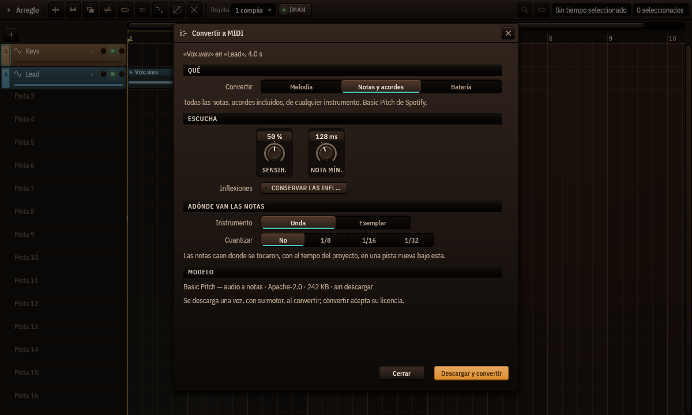

# Convertir audio a MIDI

*Cantus 0.1.0-beta.9 y posteriores · [Read in English](../en/audio-to-midi.md)*

Cantus convierte un clip de audio en notas que puedes editar, tocar con cualquier
instrumento, cuantizar o imprimir: una melodía cantada o tarareada, una parte de piano con
sus acordes, un loop de batería.

## Convertir un clip

1. Clic derecho en un clip de audio del arreglo ▸ **Convertir a MIDI…**
2. Elige **qué** convertir:
   - **Melodía** — una nota a la vez: una voz, un solo, una línea de bajo. El detector de
     tono propio de Cantus (el del editor de tono): nada que descargar.
   - **Notas y acordes** — todas las notas, acordes incluidos, de cualquier instrumento.
     El modelo *Basic Pitch* de Spotify.
   - **Batería** — bombo, caja, toms, charles y platos, escritos en el mapa de batería
     General MIDI para Pulsus.
3. Ajusta cómo escucha:
   - **Sensibilidad** (notas y acordes, batería) — más alta encuentra notas más débiles (y
     más equivocadas); 50 % es lo que cada modelo usa por defecto. Melodía no la tiene: su
     seguidor decide por sí mismo qué se canta.
   - **Nota más corta** — las más cortas se descartan (128 ms por defecto).
   - **Conservar las inflexiones** — cada nota guarda sus inflexiones y su vibrato como su
     propia curva de inflexión (la expresión por nota del piano roll), incluso notas que se
     solapan.
   - En batería, **Escribir** elige las clases. Bombo, caja y charles están encendidos;
     toms y platos solo cuando el modelo de batería está instalado, porque sin él fallan
     a menudo.
4. Elige adónde van las notas: **Unda**, o **Exemplar** con su primer sonido de fábrica
   (el kit de estudio de Pulsus para batería), y
   **Cuantizar** — apagado por defecto, para que las notas queden donde se tocaron.
5. **Convertir**. Las notas llegan a una pista nueva bajo la del clip, en un clip MIDI que
   empieza y acaba con el clip de audio. Es **un solo paso de Deshacer**.

Las notas siguen al clip tal como suena: con el tempo del proyecto y sus cambios, las
marcas de un clip con warp, un clip invertido al revés y un clip en bucle en cada vuelta
— cada vuelta donde de verdad suena, también tras un cambio de tempo, la última cortada
donde acaba el clip.

## Los modelos

*Notas y acordes* necesita **Basic Pitch** (230 KB, Apache-2.0, de Spotify) y el motor
ONNX Runtime (unos 15 MB, MIT, de Microsoft), descargados una vez la primera vez que
conviertes — el diálogo muestra el modelo, su licencia y su tamaño antes de descargarlo, y
convertir acepta su licencia. *Melodía* y *Batería* funcionan sin descargar nada.

Para mejor batería, **Descargar el modelo de batería** en el diálogo: *Onsets and Frames
Drums* de Magenta (6 MB, Apache-2.0), entrenado con 444 horas de batería real. Escribe
todas las clases; el detector propio de Cantus sigue diciendo qué charles iban abiertos.

Todo se ejecuta en tu ordenador, en un proceso auxiliar: si un modelo falla, Cantus sigue.

## Qué tan bien funciona

Medido con la regla habitual (una nota cuenta si empieza a menos de 50 ms de la real y en
el tono correcto):

- **Melodía**: unas 8 de cada 10 notas en melodías tocadas por los instrumentos de Cantus
  y en grabaciones solistas de violín, trompa, clarinete, trompeta, violonchelo y saxofón.
- **Notas y acordes**: unas 7 de cada 10 en grabaciones de música de cámara, 6 de cada 10
  en los acordes de nuestros instrumentos; exactamente las notas que escribe el propio
  Basic Pitch de Spotify.
- **Batería** en grabaciones de batería: bombo 96 %, caja 85–89 %, charles 65 %; con el
  modelo de batería, charles 74 %, platos 64 % y toms 44 % (los toms son lo más difícil:
  revísalos).

La batería funciona mejor en una pista de batería o una batería separada. En una mezcla
entera, enciende **Separar antes la batería**: Cantus saca la batería con HT-Demucs
(instalado con **Separar pistas…**) antes de escuchar, lo que deja una mezcla casi tan
bien como una pista de batería (alrededor de un minuto para una canción de 3 minutos).
El órgano de ruedas fónicas (Organum) no se transcribe bien.

## Para agentes

Los agentes conectados por el servidor MCP de Cantus tienen la misma conversión con la
herramienta `audio_to_midi`: pide permiso como cualquier edición, nombra el clip y la pista
que convierte y nunca descarga un modelo.
